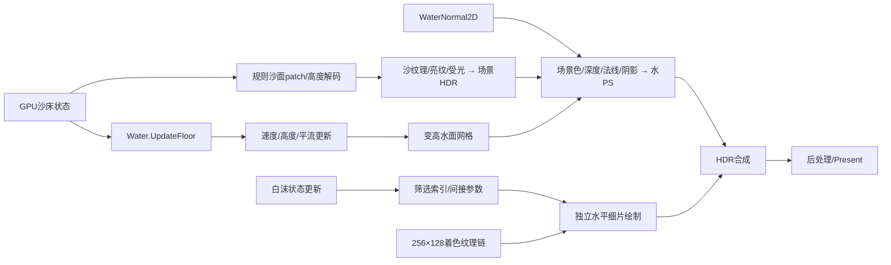

# 竞品已知实现方案

[水草与岸草功能分析](水草与岸草功能分析.md)：原包Plant系统共用分布、姿态更新和多视角图集渲染；已核对海草、海带及四种主要岸草配置，确认水流/光标倾斜、只向下调整根部、局部生成/删除与出现动画的编译指令。包内Paint为空操作，不能凭名称推断涂草功能。自主风摆、拔根漂流、生长繁殖与实际运行成本仍待验证；[来源索引](vegetation_sources_20261021.json)保存原字节、外部payload、字段及Shader证据。该专题按用户本次要求扩展植被分析范围，不修改历史任务状态。

2026-10-18完成[漂浮道具种类与实现分析](漂浮道具种类与实现分析.md)：直接核对29个Buoyancy根对象、49个采样点与685份相关原字节，补齐木板、软木塞、浮标、沙滩球、贝壳及小物等清单，区分实体/trigger、编号模型节点与类型数量。[来源索引](floating_props_sources_20261018.json)保留跨容器脚本引用修复前的失败与通过报告。浮沉、水阻、埋沙公式及双向水作用仍未知；接入方案按当前统一主流程提出，未修改运行实现或旧任务进度。

2026-10-18重新取证[test1场景尺寸、沙滩范围与沙深度](test1场景尺寸与沙深度.md)：确认30×15场景单位、2:1比例、1024×512完整沙高数据，峰值约6.643；所选E5006的4225个VSOut高度独立复算误差0。本帧湿干范围可恢复，真实米制与完整可挖厚度仍未知。附去独立装饰物的几何示意、[来源索引](test1_geometry_sources_20261018.json)及新原始缓冲；本次只评估静态几何复刻依据，未修改Godot场景或重启旧任务。

同日后续按用户要求完成[Godot原比例场景适配](../history/project_snapshots/test1原比例场景.md)，已接入main菜单第四项；62项功能检查及独立启动通过。可见域30×15，权威初态按0.125m格距重采样，底界/边缘/时序为项目适配，默认无独立草、鱼、石头。原作结论和历史母任务验收不因本次实现升级。

同日追加[低水位、回落与相机修复](../history/project_snapshots/test1场景回落与相机修复_20261018.md)：原比例场景改为0.95平静水位起步、20模拟秒的0.45上岸输入后回落，40模拟秒内观察到两轮真实向海流向反转；65项相机/回落与62项挖填/恢复回归分别通过。上述水位、周期及初态均为Godot适配，不属于新确认的原作时序。

2026-10-16核对[连续挖填的GPU并行结构](GPU编辑计算_项目对照.md#edit-perf-structure-20261016连续挖填的并行结构与未知成本)：test41 E863既有DXBC/asm与源捕帧hash一致，Ground.Paint为按单元并行结构；当前Godot仍有单工作组全域归约，合批未消除逐笔计算。原作较流畅的因果、实际GPU成本及读回/碰撞频率仍未知；缺失的旧Water.Paint导出路径已在[索引](continuous_edit_comparison_sources_20261016.json)登记。本次只读复核，不启动GPU重放或竞品，不涉及业务代码。

2026-10-16：只读核对既有test1 E1478侵蚀证据hash，原包、RDC、DXBC、常量与已选缓冲均与索引一致；没有新增原作动态结论。[Godot容量侵蚀v2适配](../knowledge/water_sand/ADR_竞品容量侵蚀_v2.md)已修改容量/交换路径，采用水平速度、饱和水深权重和渐进沉积；时间与米制映射仍为适配。下文10月14日项目比较保留其历史范围。

2026-10-15重新核对[漂浮道具配置与实现思路](碎石输运与道具浮力.md#prop-implementation-02漂浮道具专项复核与实现思路)：4类物体、27个对象原字节及浮力点引用、刚体质量/阻尼/重心字段，见[证据索引](floating_props_evidence_20261015.json)。受力、埋沙公式和原作实时接触仍未知；[漂浮道具实现计划](../../task/sandcastle_floating_props/总纲.md)明确采用Godot适配，运行实现尚未开始。

2026-10-15复取test41 E863，确认mode3按权重趋向目标高度，可升可降；城堡工具身份、底座选取与重复放置规则仍未知，见[目标高度印章与城堡落地基准](模拟与编辑方案.md#edit-stamp-placement-01目标高度印章与城堡落地基准的证据边界)。无生产或性能改动。

更新：2026-10-15。对象：本机 Sandcastle 原包及已调查的 RDC。角色：confirmed_knowledge_index。

2026-10-15补充[焦散历史数据路径可用性](证据与未知项.md#data-avail-caustic-20261015两条历史焦散派生数据路径当前缺失)：形状刷子候选索引时只读确认两条元数据引用路径当前缺失，机器记录见[可用性补充](availability_20261015.json)。未重放原包/RDC，不改变历史算法评级或重启竞品任务。

2026-10-14整理[碎石实现思路与移植边界](碎石输运与道具浮力.md#gravel-implementation-summary-01实现思路与本项目移植边界)：GPU贴床搬运、退水停留与再次起动规则，以及它与道具CPU刚体/沙地碰撞链的区别；当日仅核对源身份和关键证据可用性，未新增原作动态验证。2026-10-15已有[Godot GPU碎石实现与实际闭环证据](碎石输运与道具浮力.md#godot-gravel-implemented-01已验证的独立gpu碎石表现层)，明确区分原作事实与本项目适配；进度及最终交付见[水底碎石任务](../../task/sandcastle_gpu_gravel/执行状态.md)。

2026-10-14直接匹配并重放test1 E1478 Ground.HeightIntegration，确认有效水量/流速/悬沙容量控制侵蚀与沉积，海侧回设权重抑制交换及全局高度下限；核内未区分初始沙与玩家堆沙，见[水侵蚀沙的范围与限制](模拟与编辑方案.md#sand-erosion-01哪些沙会被水侵蚀限制在哪里)、[证据索引](erosion_evidence_inventory.json)。固定沙色网格和其他游戏阶段不在确认范围。

同日核对[侵蚀方案与当前main的比较](模拟与编辑方案.md#sand-erosion-compare-01当前项目侵蚀与竞品的差别)：当前入口已开启侵蚀，具有显式rock底层、材料强度、通量悬沙输运和时间步交换；此项是源码比较，未新增窗口运行验证。

2026-10-13复核[三个可编辑场景的材质与显示输入](水体运动与回落.md#playable-material-01三个可编辑场景的材质与显示输入复核2026-10-13)：固定材质/贴图相同，水深、形状、速度和视角不同；这解释当前观感差异，项目光学尺度与画面对齐仍待处理，未新增原作算法结论。

2026-10-13新增[可编辑场景切换适配](水体运动与回落.md#可编辑场景切换补充2026-10-13)：捕帧初态映射到main权威域并共享完整编辑/恢复链，可编辑回流场已观察到流向反转；这是项目适配，原固定床面逆向核及原作输入时序边界保留。

2026-10-12上滩/回落样片已接入当前main实际水沙材质与相关光学/白沫显示，见[Godot适配补充](水体运动与回落.md#main-材质接入的-godot-适配补充2026-10-12)。这是原运动公式的项目整合验证，未新增原作时序或完整复刻结论。

这里是竞品技术知识的统一入口，按“沙、水、浪、白沫、亮纹、GPU 编辑/读回、碎石输运与道具物理”组织。只收录报告中已由字段、指令、有效绑定或原始数据支持的具体事实；原作算法解释、未知时序与 Godot 适配分别标注。以后确认的新知识按[记录规范](记录规范.md)更新这里。

首次统一整理只核对文件身份与可用性，没有重放；历史报告的 C3 以其捕帧/包版本和验证范围为限。随后已直接重放 test1 E5006/E6083，复取沙/水材质、有效常量与焦散/法线纹理，并用三个实际水面像素验证配方，见[水体材质 RDC 详解](水体材质_RDC详解.md)。其余缺失快照不因本次局部复验自动恢复；数据状态见[证据与未知项](证据与未知项.md)、[文件核对清单](evidence_inventory.json)。

## 已知技术链

2026-10-12水运动专项：重新取得test1各水更新阶段的完整场、四个运动核与有效常量，并匹配包内Water对象的编译变量名。确认自由水面高差驱动边速度、上风水量搬运、速度自平流及海侧customWave回设；独立Godot场景已观察到上滩后流向反转和退水，见[水体运动与回落](水体运动与回落.md)。回落时长与周期仍是实验适配，原作墙钟规律未确认。

2026-10-12专项直接解码碎石/浮力物理字段与原包配置，在test1 E1566匹配Gravel.Update并复取完整已选缓冲，见[碎石输运与道具浮力](碎石输运与道具浮力.md)。确认贴沙面碎粒的水量阈值/水平移动指令，以及木棍、瓶子和船的多点Buoyancy、Rigidbody及实体碰撞形状；原作浮力/埋沙公式与道具运行时接触仍未知。[专项身份与产物索引](transport_evidence_inventory.json)保留原字节、快照与失败记录。

对应的[CPU/GPU碰撞与移动时序图](碎石输运与道具浮力.md#transport-sequence-01cpugpu碰撞与移动时序)分开展示沙地读回/碰撞发布、道具运动候选关系和Gravel的GPU移动；实线为已确认操作，虚线为待验证关系，不冒称完整单帧调度已恢复。

[碰撞读回与当时主场景对照](碰撞读回_项目对照.md)保留2026-10-12版本：GPU按块输出床高、CPU发布HeightMapShape，当时编辑等待碰撞revision和两次物理帧。2026-10-16当前普通挖填改为[合批流水线](../当前项目技术方案.md)，碰撞收尾可与下一批编辑重叠；竞品四样本Job与MeshCollider的确认不变，其读回/碰撞频率和端到端等待仍未知。

2026-10-12直接复取test41 E863/E878/E1210的Compute Shader、线程规模、有效mode及绑定，见[GPU编辑计算与项目对照](GPU编辑计算_项目对照.md)。本次原始编译字节码与常量可用；不新增原作毫秒性能或CPU调度结论。

同日命中专项已重新解码必要类型/字段，定向验证13个命中、碰撞与采样技术函数的机器码，见[代码补证](笔刷命中检测_代码补证.md)。它提供当前可复验的CPU拾取/碰撞/Readback证据，不抵充其他旧RDC快照缺失，也不改变实际输入时延与成本未知的边界。

上图概括 test1 已定位的输入和绘制链，不表示每个节点的完整原作公式、调度或动态因果已经恢复。test41 的专用编辑操作见下表与模拟文档。

| 主题 | 已确认的最小结论 | 统一记录 |
|---|---|---|
| 水草与岸草 | 分型配置、床高/分布场筛选、尺寸/朝向变化、水流/光标姿态响应、根部只下降、生成/删除、出现动画及多视角图集渲染；均限定包内静态证据 | [功能与证据边界](水草与岸草功能分析.md) |
| 沙体 | GPU 结构化沙床缓冲驱动规则高度patch，形成有高度变化的沙面 | [沙体、水材质与白沫](渲染方案.md#沙体与沙材质) |
| 水面 | 缓冲驱动变高网格；确认法线纹理、多坐标采样、场景色/深度读取及合成状态 | [水面与光学](渲染方案.md#水面形体法线与光学) |
| 水底亮纹 | 水面前底面已贡献亮纹；底面PS采样3D纹理 | [亮纹与受光](渲染方案.md#沙体与沙材质) |
| 水材质直接复验 | RGB吸收、低俯视反射权重、指数1500高光、flow与相位混合法线、3D焦散时变采样及岸边Alpha | [RDC公式、参数与Godot差异](水体材质_RDC详解.md) |
| 白沫 | GPU状态更新与筛选，间接绘制水平小片；另有像素着色纹理处理链 | [白沫与岸脚](渲染方案.md#白沫与岸脚) |
| 常规水更新 | 已匹配六个Water核；UpdateFloor保留本帧量字段；床高参与速度更新 | [常规水更新](模拟与编辑方案.md#常规水更新) |
| 上滩与回落 | 解析边速度/量搬运/自平流与customWave海侧回设；固定真实捕帧床面上适配实验已复现反向流及退水 | [运动公式、证据与独立测试](水体运动与回落.md) |
| 铲沙水波传播对照 | 复取四个运动CS及常量；明确边速度搬水与当前一阶Rusanov的数值差别。原作自由波寿命未知，旧完整运动导出缺失，新原字节仅覆盖所选四核 | [水波传播比较与证据边界](水体运动与回落.md#motion-compare-wave-01水波传播与当前求解器的比较)、[来源索引](wave_propagation_sources_20261020.json) |
| 沙笔刷 | test41确有Ground.Paint；少量参数与高度印章直接修改GPU沙床，本帧全域dispatch | [沙床编辑](模拟与编辑方案.md#test41沙床编辑) |
| 水笔刷 | test41的mode2改amount，mode6施加有符号模板速度修正 | [水编辑](模拟与编辑方案.md#test41专用水编辑) |
| 读回辅助 | Readback.Update是规则降采样，test1为1MiB输出；碰撞/命中CPU消费已确认，实际调度仍未知 | [Readback](模拟与编辑方案.md#辅助采样与cpu边界)、[项目对照](碰撞读回_项目对照.md) |
| 笔刷命中 | 中央输入以相机射线调用CPU Physics.Raycast；CPU Readback驱动MeshCollider并补充命中法线，实际时序未知 | [命中检测](笔刷命中检测.md)、[原生代码补证](笔刷命中检测_代码补证.md) |
| 运行时碰撞输入 | 真实sharedMesh完整输入与物理射线、辅助缓存及负例通过；同chunk正常桶挖沙配对完成（几何C3、编辑贡献C2），历史失败和输入状态未知保留 | [运行时碰撞网格取证](运行时碰撞网格取证.md) |
| 碎石搬运 | test1 E1566精确匹配Gravel.Update；双线性采样沙/水，水量>0.05打开水流位移，y取采样沙量；不是连续动作验收 | [Gravel更新规则](碎石输运与道具浮力.md#gravel-transport-02贴沙面随流移动退水后停留与再起动) |
| 道具浮力配置 | 木棍3点、瓶子/船2点Buoyancy，绑定Rigidbody；实体形状与trigger分开，完整受力/埋沙规则未知 | [原包配置与碰撞](碎石输运与道具浮力.md#prop-buoyancy-01木棍瓶子小船的实际浮力配置) |
| 待验证问题 | 波速、粒子寿命、米制/时间校准、贴图生成与跨帧观感、水量结算及实际性能 | [未知项](证据与未知项.md#未确认的实现与参数) |

## 使用顺序

1. 先查本目录的条目 ID、适用捕帧和限制。
2. 查来源报告及 evidence_inventory.json，确认原始数据可用性。
3. 需要复验时先核对源 hash，恢复缺失快照/工具并输出新英文目录，再执行同一 selector。
4. 对原作的新增重要结论确认后，当次任务交付前更新本目录、证据索引和未知项；不得只留在聊天或 task 草稿中。

Godot 的 local_front、波包参数、固定候选细沫、小型GPU回执、局部dispatch、库存预留和保守水位移都是本项目方案，不能从这些文档反向认定竞品使用相同算法。当前项目实现见[技术方案](../当前项目技术方案.md)，相关研究过程见[调查报告](../search/README.md)和[历史任务](../history/README.md)；原报告保持原位和原始判定。

2026-10-12：基于直接取证的[Godot水材质适配](../history/project_snapshots/水材质_RDC适配.md)已接到默认入口。R1105完整9级mip的新原始数据索引已补入[水体材质详解](水体材质_RDC详解.md)；项目的米/秒、天空色、光程保护与局部相位替代仍只属适配。

2026-10-13：[沙面物理构建与当前项目对比](沙面物理构建与当前项目对比.md)说明实际构建链路、当前main接线与版本等待，区分竞品事实、项目实现和适配判断；附本次源码hash索引。

- 2026-10-19：[Water.Paint 556模板复取](GPU编辑计算_项目对照.md#edit-water-556-20261019恢复实际mode6模板)：E1210实际128²全白R/alpha，参数和模板重复一致，完整水场重复不一致；不据此推定工具因果。
