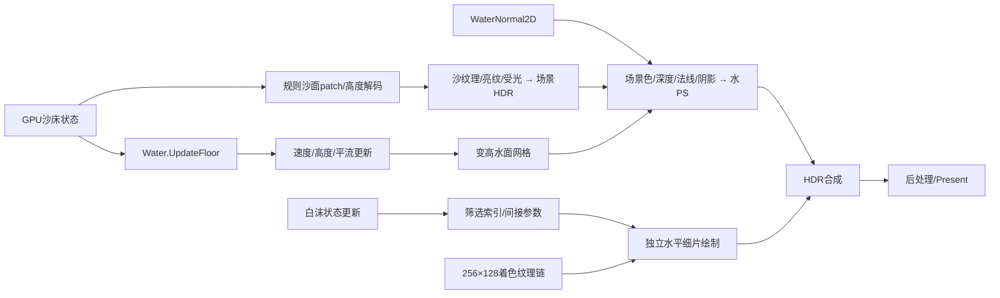

# 竞品已知实现方案

更新：2026-10-13。对象：本机 Sandcastle 原包及已调查的 RDC。角色：confirmed_knowledge_index。

2026-10-13复核[三个可编辑场景的材质与显示输入](水体运动与回落.md#playable-material-01三个可编辑场景的材质与显示输入复核2026-10-13)：固定材质/贴图相同，水深、形状、速度和视角不同；这解释当前观感差异，项目光学尺度与画面对齐仍待处理，未新增原作算法结论。

2026-10-13新增[可编辑场景切换适配](水体运动与回落.md#可编辑场景切换补充2026-10-13)：捕帧初态映射到main权威域并共享完整编辑/恢复链，可编辑回流场已观察到流向反转；这是项目适配，原固定床面逆向核及原作输入时序边界保留。

2026-10-12上滩/回落样片已接入当前main实际水沙材质与相关光学/白沫显示，见[Godot适配补充](水体运动与回落.md#main-材质接入的-godot-适配补充2026-10-12)。这是原运动公式的项目整合验证，未新增原作时序或完整复刻结论。

这里是竞品技术知识的统一入口，按“沙、水、浪、白沫、亮纹、GPU 编辑/读回、碎石输运与道具物理”组织。只收录报告中已由字段、指令、有效绑定或原始数据支持的具体事实；原作算法解释、未知时序与 Godot 适配分别标注。以后确认的新知识按[记录规范](记录规范.md)更新这里。

首次统一整理只核对文件身份与可用性，没有重放；历史报告的 C3 以其捕帧/包版本和验证范围为限。随后已直接重放 test1 E5006/E6083，复取沙/水材质、有效常量与焦散/法线纹理，并用三个实际水面像素验证配方，见[水体材质 RDC 详解](水体材质_RDC详解.md)。其余缺失快照不因本次局部复验自动恢复；数据状态见[证据与未知项](证据与未知项.md)、[文件核对清单](evidence_inventory.json)。

## 已知技术链

2026-10-12水运动专项：重新取得test1各水更新阶段的完整场、四个运动核与有效常量，并匹配包内Water对象的编译变量名。确认自由水面高差驱动边速度、上风水量搬运、速度自平流及海侧customWave回设；独立Godot场景已观察到上滩后流向反转和退水，见[水体运动与回落](水体运动与回落.md)。回落时长与周期仍是实验适配，原作墙钟规律未确认。

2026-10-12专项直接解码碎石/浮力物理字段与原包配置，在test1 E1566匹配Gravel.Update并复取完整已选缓冲，见[碎石输运与道具浮力](碎石输运与道具浮力.md)。确认贴沙面碎粒的水量阈值/水平移动指令，以及木棍、瓶子和船的多点Buoyancy、Rigidbody及实体碰撞形状；原作浮力/埋沙公式与道具运行时接触仍未知。[专项身份与产物索引](transport_evidence_inventory.json)保留原字节、快照与失败记录。

对应的[CPU/GPU碰撞与移动时序图](碎石输运与道具浮力.md#transport-sequence-01cpugpu碰撞与移动时序)分开展示沙地读回/碰撞发布、道具运动候选关系和Gravel的GPU移动；实线为已确认操作，虚线为待验证关系，不冒称完整单帧调度已恢复。

[碰撞读回与当前主场景对照](碰撞读回_项目对照.md)按实际main接线核对：本项目GPU按块输出床高、CPU发布HeightMapShape，编辑事务等待碰撞revision和两次物理帧；竞品四样本Job与MeshCollider已确认，其读回/碰撞频率和端到端等待仍未知。

2026-10-12直接复取test41 E863/E878/E1210的Compute Shader、线程规模、有效mode及绑定，见[GPU编辑计算与项目对照](GPU编辑计算_项目对照.md)。本次原始编译字节码与常量可用；不新增原作毫秒性能或CPU调度结论。

同日命中专项已重新解码必要类型/字段，定向验证13个命中、碰撞与采样技术函数的机器码，见[代码补证](笔刷命中检测_代码补证.md)。它提供当前可复验的CPU拾取/碰撞/Readback证据，不抵充其他旧RDC快照缺失，也不改变实际输入时延与成本未知的边界。

上图概括 test1 已定位的输入和绘制链，不表示每个节点的完整原作公式、调度或动态因果已经恢复。test41 的专用编辑操作见下表与模拟文档。

| 主题 | 已确认的最小结论 | 统一记录 |
|---|---|---|
| 沙体 | GPU 结构化沙床缓冲驱动规则高度patch，形成有高度变化的沙面 | [沙体、水材质与白沫](渲染方案.md#沙体与沙材质) |
| 水面 | 缓冲驱动变高网格；确认法线纹理、多坐标采样、场景色/深度读取及合成状态 | [水面与光学](渲染方案.md#水面形体法线与光学) |
| 水底亮纹 | 水面前底面已贡献亮纹；底面PS采样3D纹理 | [亮纹与受光](渲染方案.md#沙体与沙材质) |
| 水材质直接复验 | RGB吸收、低俯视反射权重、指数1500高光、flow与相位混合法线、3D焦散时变采样及岸边Alpha | [RDC公式、参数与Godot差异](水体材质_RDC详解.md) |
| 白沫 | GPU状态更新与筛选，间接绘制水平小片；另有像素着色纹理处理链 | [白沫与岸脚](渲染方案.md#白沫与岸脚) |
| 常规水更新 | 已匹配六个Water核；UpdateFloor保留本帧量字段；床高参与速度更新 | [常规水更新](模拟与编辑方案.md#常规水更新) |
| 上滩与回落 | 解析边速度/量搬运/自平流与customWave海侧回设；固定真实捕帧床面上适配实验已复现反向流及退水 | [运动公式、证据与独立测试](水体运动与回落.md) |
| 沙笔刷 | test41确有Ground.Paint；少量参数与高度印章直接修改GPU沙床，本帧全域dispatch | [沙床编辑](模拟与编辑方案.md#test41沙床编辑) |
| 水笔刷 | test41的mode2改amount，mode6施加有符号模板速度修正 | [水编辑](模拟与编辑方案.md#test41专用水编辑) |
| 读回辅助 | Readback.Update是规则降采样，test1为1MiB输出；碰撞/命中CPU消费已确认，实际调度仍未知 | [Readback](模拟与编辑方案.md#辅助采样与cpu边界)、[项目对照](碰撞读回_项目对照.md) |
| 笔刷命中 | 中央输入以相机射线调用CPU Physics.Raycast；CPU Readback驱动MeshCollider并补充命中法线，实际时序未知 | [命中检测](笔刷命中检测.md)、[原生代码补证](笔刷命中检测_代码补证.md) |
| 运行时碰撞输入 | 真实sharedMesh完整输入与物理射线、辅助缓存及负例通过；同chunk正常桶挖沙配对完成（几何C3、编辑贡献C2），历史失败和输入状态未知保留 | [运行时碰撞网格取证](运行时碰撞网格取证.md) |
| 碎石搬运 | test1 E1566精确匹配Gravel.Update；双线性采样沙/水，水量>0.05打开水流位移，y取采样沙量；不是连续动作验收 | [Gravel更新规则](碎石输运与道具浮力.md#gravel-transport-02贴沙面随流移动退水后停留与再起动) |
| 道具浮力配置 | 木棍3点、瓶子/船2点Buoyancy，绑定Rigidbody；实体形状与trigger分开，完整受力/埋沙规则未知 | [原包配置与碰撞](碎石输运与道具浮力.md#prop-buoyancy-01木棍瓶子小船的实际浮力配置) |
| 待验证问题 | 波速、粒子寿命、米制/时间校准、贴图生成与跨帧观感、水量结算及实际性能 | [未知项](证据与未知项.md#未确认的实现与参数) |

## 使用顺序

1. 先查本目录的条目 ID、适用捕帧和限制。
2. 查来源报告及 evidence_inventory.json，确认原始数据可用性。
3. 需要复验时先核对源 hash，恢复缺失快照/工具并输出新英文目录，再执行同一 selector。
4. 对原作的新增重要结论确认后，当次任务交付前更新本目录、证据索引和未知项；不得只留在聊天或 task 草稿中。

Godot 的 local_front、波包参数、固定候选细沫、小型GPU回执、局部dispatch、库存预留和保守水位移都是本项目方案，不能从这些文档反向认定竞品使用相同算法。当前项目实现见[技术方案](../当前项目技术方案.md)，相关研究过程见[调查报告](../search/README.md)和[历史任务](../history/README.md)；原报告保持原位和原始判定。

2026-10-12：基于直接取证的[Godot水材质适配](../水材质_RDC适配.md)已接到默认入口。R1105完整9级mip的新原始数据索引已补入[水体材质详解](水体材质_RDC详解.md)；项目的米/秒、天空色、光程保护与局部相位替代仍只属适配。

2026-10-13：[沙面物理构建与当前项目对比](沙面物理构建与当前项目对比.md)说明实际构建链路、当前main接线与版本等待，区分竞品事实、项目实现和适配判断；附本次源码hash索引。
