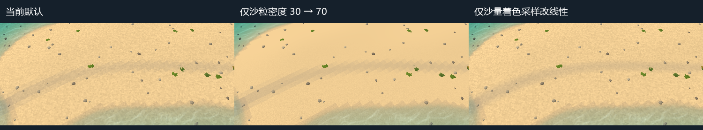

# 沙、水质感与可调项：当前场景对照 test1 RDC

范围：2026-10-23 工作区的 `main`、`test1_geometry`，以及 test1 的沙面 E5006、水面 E6083。本文是材质诊断与 Godot 适配建议，未修改正式 shader、场景、参数存档或水沙求解器。

后续Godot适配：两个正式入口已采用图3的沙厚度线性着色采样；当前语义见[沙面厚度着色规格](../当前技术规格.md#沙面厚度着色)，验证与成本范围见[实施结果](../../task/sand_material_filter/结果.md)。颗粒密度和水面参数保持原值。下文保留2026-10-23诊断时的输入、反例与原始图，不增加竞品原作算法结论。

主要优化空间是沙粒的视觉尺度、薄沙颜色的连续采样及岸边显示重建。当前水面已经使用 RGB 吸收、流向相位法线和指数 1500 的高光，不能继续套用旧 reference_v1 报告中“统一青色散射、指数 192”的诊断。现有窗口可以调整颗粒和水纹，但无法通过滑块消除薄沙着色的格状跳变。

## 来源与比较条件

- RDC：`D:/godot/project/sandcastle/rdc/test1.rdc`，225224034 字节，SHA256 `761aa980c2426f75a1fa7364bf6d2655ff4dd20ea76566e630ee5b53ea0ec5b2`；复取前后身份一致，与历史 test1 相同。
- 工具：RenderDoc 1.46，D3D12 replay；[导出脚本](tools/export_material_quality.py)与[原始字节/绑定/常量索引](evidence/material_quality_20261023/rdc/manifest.json)。E5006 PS SHA256 `b7f1ac50d5312f20e829e8788a7256d4cc84266880fca4fdedc7d39f98148aa2`；E6083 PS SHA256 `6b7870c1b83924ba8a7319d3bae374933ecff0873caa5109f3c2e7d8338e9961`。
- 已保存所选 VS/PS 编译字节、消费范围内的常量、反汇编，以及 Sand617、Normal681、Caustics1105、场景色3375、深度3386的 mip0 原始数据。3D 焦散 mip0 为完整该级 volume；不宣称导出了全部纹理 mip、全部状态缓冲或原始 HLSL。
- Godot：4.7.2，D3D12 Forward+，GTX 1050，1280×720 可见窗口；两入口均固定 generation=1001、tick=0、模拟时间=0，使用各自初态及默认相机，忽略用户启动参数文件。实际材质、相机、全部有效 uniform、配置及来源 hash 在各 `probe.json`。
- [main 对照](evidence/material_quality_20261023/main_v2/probe.json)、[test1_geometry 对照](evidence/material_quality_20261023/geometry/probe.json)、[材质分层定位](evidence/material_quality_20261023/layers_v3/probe.json)、[分析与产物索引](evidence/material_quality_20261023/analysis.json)、[被检查源码快照](evidence/material_quality_20261023/inspected_sources.zip)。各运行的配置来源在分析时均无 hash 漂移。
- [RDC 内嵌画面](evidence/material_quality_20261023/rdc/capture_thumbnail.png)为 1920×1080 的捕帧缩略图；E6083 场景色输入为 1280×720。项目场景与它的机位、水位、植被成熟态、光照及后处理没有对齐。跨游戏画面只用于定位质感差异，不计算整图相似度或“复刻百分比”；所有数值像素差只比较同一次 Godot 运行内的单变量图。

## MAT-QUALITY-SAND-01：竞品纹理调制与项目离散颗粒不同

分类：竞品观察事实 C3，本次直接复取；项目实现为源码及运行观察。证据定位：E5006 PS t3=Resource617，1024×1024 RGBA8、11 mip；s2 的 min/mag 为 Linear、mip 为 Point、Wrap。该帧 PS 指令 0–1 在 `world.xz × 0.3` 采样其 R/G，16、53–58 将 R 用于沙色调制；G 用于焦散相位。纹理坐标的 0.3 不是“每米 0.3 颗沙”，不能与项目的颗粒密度直接作倍率比较。

在该段着色中，设此前混合好的沙色为 C、输入法线为 N，则 R 的颜色贡献等价于：

```text
C_grain = C × (1 + 0.2 × max(N.y, 0) × (2 × Sand.R - 1))
```

E5006 PS 后段还逐像素读取阴影和256×128的光照颜色输入，计算方向光项。此 PS 没有以沙粒纹理恢复微法线的指令，也没有太阳镜面高光指数项；不能据此推断整个游戏的所有沙材质均无高光。

项目 `async_rdc_bed.gdshader` 没有采样 Sand617，而是对 `floor(world_position × sand_grain_scale)` 做三维 hash。默认密度 30，即每个 hash 单元边长约 3.33 cm，颜色增益 0.16；另用相邻 hash 模拟受光色差。这里的“沙粒法线”只调制颜色，未将扰动后的 `shaded_normal` 写入片元 NORMAL。远处依靠 `fwidth` 淡出。

本次单独将密度改为70，近处粗颗粒明显减轻，中远景更平滑。原因包含颗粒变细及屏幕导数淡出更早，不是细节资源增加。因此70可作试调起点，不能宣称已获得竞品颗粒；长期更接近的方案是基于已验证纹理输入建立有滤波的细节层，并保留近/远景可读性。

反证与边界：只调密度不能去除前景横跨沙面的格状暗带；竞品纹理原始生成方式、真实米制与跨帧闪烁仍未知。原作 t3 的完整11级 mip未在本次逐级导出，确认的是其绑定描述和 mip0 数据。

## MAT-QUALITY-SAND-02：薄沙颜色的最近邻采样形成格状色带

分类：Godot 实现及单变量绘制贡献 C3；这是项目问题，不是竞品算法结论。

当前片元使用 `texture(sand_state, UV).r`，其 sampler 为 `filter_nearest`。随后 `sand < 0.02` 切换裸岩分支，0.02–0.16 的厚度通过 `exposed_rock` 混合灰色。连续的厚度函数接收到逐格恒定的输入，显示结果仍逐格跳变，前景出现明显折线暗带。

将沙材质中的这一 sampler 单独改为 `filter_linear`，前景暗带明显连续化，见下图右栏。高度构建仍由 `bed_at()` 的 `texelFetch` 和原三角重建处理，运行中未提交编辑或 tick；该试验只改变读取沙量进行着色的方式。



三栏各自是独立变量，不是连续叠加；原图坐标 `(430,490)–(930,710)` 原像素裁剪，无缩放、调色。main_v2 与 layers_v3 的基线逐像素相同。

定位反例：单独关闭太阳阴影、水面、接触层、湿沙色或压实色，不能消除该条纹；仅将 wetness sampler 改线性也不能解决主体条纹。沙粒密度70会让条纹更显眼，说明细颗粒与薄沙颜色连续性是两个问题。以上不能证明所有岸边锯齿都由它造成。

建议：优先使薄沙/裸岩混色连续，复核裸岩阈值和边缘，再处理水面轮廓及其他显示字段；保持高度、碰撞和账本不变。此项当前没有 UI 控件，需要 shader 适配。

## MAT-QUALITY-WATER-01：当前水材质的已对齐项与剩余差异

分类：E6083 编译指令及常量 C3；Godot差异为当前源码/有效 uniform 对照。历史公式详解见[水体材质](水体材质_RDC详解.md)，本次新原始数据已补齐上述索引。

| 项目 | test1 E6083 | 当前 main / test1_geometry |
|---|---|---|
| 透射吸收 | RGB 系数约 `(6,0.856013,0.336771)`，无该 PS 额外青色散射加法 | 已使用同组系数及透射色，`rdc_optics_enabled=true` |
| 细法线 | Normal681，B通道相位、两路错半周期采样，流向驱动 | 已接入该结构，scale=0.2、gain=1，另有浅水衰减与幅度保护 |
| 太阳高光指数 | 1500 | 实际有效值也是1500；光源颜色、强度、深度门控为项目适配 |
| 掠射混色 | `0.75(1-c)^5 × min(S+0.25,1)` | 使用0.75基式，固定目标改为当前天空色；此混色未乘原作阴影权重 |
| 折射/吸收光程 | 在最终折射取色UV处取深度，重建光程 | `rdc_refracted_path=false`，取原屏幕UV处深度，另有越界/前景保护 |
| 焦散局部相位 | 沙面 Sand617.G | 复用 Normal681.B；保留3D焦散资源，但局部相位不是原作输入 |

本次将法线 gain 从1降到0.55，表面扰动和碎闪明显收敛，属于可用的美术控制。单独将 scale 从0.2升到0.3改变纹理形态/密度；没有连续运动验收，不推荐把这两个值作为已定稿组合。降低法线强度也可能损失原作大浪表面的碎闪，应分别检查平水和浪峰。

未知与下一步：原作秒制与本项目时钟仍未校准；本次固定tick0不能比较推进浪、回落速度、泡沫寿命或持续闪烁。岸线轮廓仍受低分辨率水沙场、显示网格和覆盖率重建约束，不能靠降低法线解决。相同图案更柔和不等于原作水面运动已经复刻。

## MAT-QUALITY-CONTROL-01：现有控件与优先级

入口：场景右侧“参数窗口”→“沙参数”或“水参数”。以下值均为隔离试验，不曾保存为启动默认值。

| 优先级 | 项目 | 当前值 → 本次试验值 | 结果与实施边界 |
|---|---|---|---|
| 高 | 薄沙颜色连续采样 | nearest → linear | 格状色带明显平滑；需要改shader，无现成滑块 |
| 高 | 沙参数：沙粒密度 /m | 30 → 70 | 可直接试调，粗颗粒减轻；同时会增加远处细节淡出 |
| 中 | 沙参数：沙粒颜色起伏 | 0.16 → 0.06 | 已确认改变画面，可收敛色差；仍需与密度分别调节 |
| 中 | 水参数：水面法线强度 | 1 → 0.55 | 已确认扰动/碎闪减弱；不是原作参数校准结果 |
| 中 | 水参数：水面法线尺度 | 0.2 → 0.3 | 已确认纹理形态变化，尚未选定最终值 |
| 后置 | 4×MSAA | 关闭 → 4× | 当前两入口MSAA/屏幕AA/TAA均关闭；该试验只改善部分轮廓，对沙面暗带无效；现窗口没有此控件，成本未测 |
| 需纠正认知 | 沙参数：干沙高光 | 0.16 → 1 | 两入口像素完全不变；当前 `specular_disabled`，不能靠这个滑块获得湿沙高光 |

单独移除沙 shader 的 `vertex_lighting`、保留其他条件，在main默认画面只产生很小差异，未解决粗颗粒和格状色带。它不应作为此次第一优化项。直接打开高光也不是已证明的竞品方案：E5006所选沙面PS本身并无镜面高光分支。

## 复验、失败记录与证据边界

RDC复验：核对源SHA256，用 qrenderdoc `--python` 执行导出脚本；改为新的完整英文输出目录，再 `SetFrameEvent(5006/6083, True)` 取对应shader、cb及PS纹理。对照上述shader hash、绑定和指令定位。21份导出文件的hash已逐一核对。

Godot复验命令形式：

```powershell
& 'D:/game/steam/steamapps/common/Godot Engine/godot.windows.opt.tools.64.exe' --path 'D:/godot/project/sandcastle' --rendering-driver d3d12 --script res://docs/competitor/tools/probe_material_quality.gd --log-file '<新英文目录>/godot.log' -- --output=<新英文目录> --scene=main --ignore-parameter-config
```

另以 `--scene=test1_geometry`覆盖第二入口，以 `--layers`执行分层定位。输出目录需预建。各轮当时的脚本保存在对应目录，不能用最终脚本冒充早期运行输入。`analyze_material_quality.py` 复算同运行内像素差并生成原像素裁剪；像素差仅用于核对控件贡献，不是美观评分。

main、main_v2、geometry及layers_v3恢复后与各自基线完全相同，tick及模拟时间不变。layers与layers_v2的严格恢复检查失败：有7个像素改变，包围框位于远景 `(525,197)–(534,198)`，前景沙面裁剪内为零；原因未查明，原始失败完整保留，不能改记通过。新增sand sampler变量在独立的layers_v3中验证并成功恢复，不依赖把前两次失败作废。

只进行视觉初始化和固定状态的因果隔离，未作权威场字节一致性、长稳、移动相机、跨帧动画或性能验收。此次运行还有其他GPU进程，耗时不用于成本判断。正式实现时仍需按受影响范围补充动态岸线、裸岩边缘、编辑后状态与真实窗口成本验证。

修订关系：补充[水体材质_RDC详解](水体材质_RDC详解.md)中保留的历史reference_v1对照，更新对当前正式入口的认识；不改变旧逆向任务、原失败及算法单位未知项。
