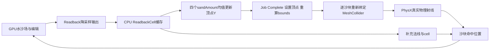

# 沙面物理构建与当前项目对比

2026-10-16当前项目补充：main已改为[普通挖填合批流水线](../当前项目技术方案.md)，GPU发布与碰撞/物理收尾分开，普通输入允许上一份完整碰撞面；保留逐笔兼容路径的物理等待数为1。本文下方2026-10-13源码对照按原版本保留，不能把其根脚本、两次物理帧和输入拒绝规则当作当前main。竞品性能因果仍未知，见[连续编辑结构补充](GPU编辑计算_项目对照.md#edit-perf-structure-20261016连续挖填的并行结构与未知成本)。

核对日期：2026-10-13。范围：水沙状态、沙面碰撞代理、物理拾取、编辑发布与恢复同步。当前项目以实际默认 `scenes/main.tscn` 为准，独立水体运动/近似编辑实验分开说明。本说明不扩展到竞品工具业务、存档业务或平台代码。

**两者都采用GPU水沙状态加CPU碰撞代理。竞品把读回沙高生成分块三角网格交给PhysX；当前项目把rock与sand之和打包成分块高度图交给Jolt。当前项目还将编辑收据、沙量结算、碰撞版本与物理帧纳入显式完成条件。** 架构方向一致，但采样基准、碰撞表示和发布等待不同，不能据此判定竞品更快或直接迁移其数值。

## 证据口径

竞品几何、绑定、物理查询和必要原生指令属于C3。正常桶编辑贡献由操作者确认、实际命中、固定相机与等长对照交叉支持，属于C2；InputSystem两段状态的转换原因和背景净贡献未知。当前项目部分是本次源码/场景配置事实，运行质量与成本只引用相应历史验收，不把源码存在等同运行通过。

竞品GameAssembly为47654400字节，SHA256 `147030ecf9527a25250238120364eb761390b99688b1812c4ea555b3b04e56a0`；metadata为8928184字节，SHA256 `aa4457307746c4552541b6cedd4809fdaccf33eef03964a9e2300de5a09e1606`。运行证据及来源见[碰撞网格取证](运行时碰撞网格取证.md)，指令定位见[命中代码补证](笔刷命中检测_代码补证.md)。当前项目及引用文件的大小、SHA256、行级选择器见[本次核对索引](沙面物理构建与当前项目对比_来源.json)。后续代码改变时，应重新核对对应判断。

## 竞品如何构建沙面物理

### 模拟状态与碰撞采样分开

历史捕帧已经确认GPU水更新包含床面更新、速度积分、高度/量积分和搬运；部分指令支持自由表面差驱动速度的解释，但完整浅水方程、单位和全局守恒结算尚未恢复。[模拟与编辑证据](模拟与编辑方案.md)

Readback采样ground/water并输出32字节记录；CPU缓存含水速度、地面切向、水量、sandAmount、groundHeight和crestSpawn。最终运行配置是256×128采样、16×8个chunk、32768条记录，共1MiB。另一个运行配置取到了256×256、2MiB，不能作为统一常量。该缓存有碰撞和命中补充等消费者，不能把整个缓存传输成本都归给碰撞。

缓存消费存在两条入口：AsyncGPUReadback回调复制，以及ComputeBuffer.GetData同步读取。已确认两条入口存在，尚未确认每次编辑使用哪条、请求频率或等待耗时。

### 用采样值构建分块三角碰撞面

每顶点保存四个CPU缓存索引，构建公式是：

`local_y[v] = (sandAmount[i0] + sandAmount[i1] + sandAmount[i2] + sandAmount[i3]) / 4`

这里读取的是sandAmount字段；没有在这条公式中再加groundHeight。名称不能直接解释为米制沙厚。最新运行样本中，按完整缓存复算的float32均值与实际sharedMesh顶点Y逐值相同，最大误差0。

目标更新使用IJobParallelFor并调用JobHandle.Complete，随后Mesh.SetVertices、RecalculateBounds，再先将sharedMesh设null、重新绑定meshC。Ground.UpdateColliders有遍历当前沙块数组的调用链；不能因此推断每帧全域更新。

最终样本有289顶点、1536索引、512三角形和一个submesh，源索引格式UInt16。导出API返回int32索引，二者分开记录。不同位置还取到过561顶点样本，不将289推广到所有块。

运行中多个chunk可以共享构建用Mesh对象。读数必须贴着目标chunk的成功发布边界，不能在全数组循环结束后读共享Mesh并当作任意沙块的输入。实际射线已经证实选定沙块参与碰撞，但PhysX内部如何保存烘焙形状或加速结构未导出。

### 物理命中和采样法线是两类数据

中央拾取为屏幕坐标→Camera.ScreenPointToRay→Game.Raycast→Physics.Raycast，代码中的最大查询距离为100场景单位。命中PlaneChunk后，以真实物理交点采样CPU缓存，补充法线和cell；此处不是用CPU高度场重新求射线交点。物理未命中时还有参考平面回退。

因此，游戏最终HitInfo的采样法线不一定是物理三角面法线。取证用的是Physics.Raycast原始输出，按实际face ID与导出几何逐面对应，避免把平滑法线或回退位置作为碰撞真值。

### 正常编辑后的碰撞确实变化

一次操作者确认的桶操作为按下、拖动、抬起。前后同chunk身份、完整变换、索引字节和XZ不变，相机端点一致，最大局部下降约0.382场景单位；中心、斜向、固定边缘三条物理射线分别对应各自网格。等长无按下采样对照的下降幅度约0.026场景单位，支持局部挖沙贡献，不能将全部顶点变化归因于桶。

内部按钮状态分两段，不是完整硬件事件日志；精确输入转换和净背景贡献仍未知。原始数据、错误目标样本、相机变化样本与子区间报告都保留。[最终验收](../../task/competitor_runtime_collider_probe/验收/Gate4-5_最终验收记录.md)

## 当前项目实际构建链路

### 默认入口和权威状态

[main.tscn](../../scenes/main.tscn)继承耦合沙滩，入口为[beach_recovery_entry.gd](../../scripts/beach/beach_recovery_entry.gd)，再经interaction、gpu、checkpoint等入口接入既有水沙框架。main明确换用edit_validation/collision_proxy.gd；目录名不代表该脚本仍只用于独立试验。

正式水沙核心是RenderingDevice compute、二维状态纹理和双缓冲。当前域为256×256、0.125m/格、32m×32m；SIM_DELTA为1/30秒，是模拟步长，不能当成已达到30次/秒。水状态包含水深与二维动量，另有rock、sand、沉积、湿度、压实等字段；CFL选择子步，超过64子步会拒绝该次推进。Jolt用于3D碰撞，并不承担这套GPU水沙数值积分。[求解器](../../scripts/simulation/gpu_shallow_solver.gd)

### GPU打包局部床高 然后更新高度图

[collision pack shader](../../shaders/simulation/shallow_collision_pack.glsl)直接读当前rock和sand，以 `bed = rock + sand` 输出R32F床高。一个chunk覆盖32×32格，读取33×33个共享边界样本；256²域对应8×8、64个chunk，每批最多16块。

[基础碰撞代理](../../scripts/collision/gpu_collision_proxy.gd)维护pending revisions，GPU打包后异步读回。在主线程检查generation、长度、有限值和过期revision，再给StaticBody3D下的CollisionShape3D配置HeightMapShape3D。每块只传高度数组，不在脚本中提交完整三角索引。

GPU打包高度的理论净数据量为每块33×33×4=4356字节，16块为69696字节。这是数据体积计算，不是实测总线带宽或耗时；全域请求、重复请求、API开销仍会增加成本。初始化、恢复和旧工具兼容路径也能由CPU shadow的rock+sand直接构建碰撞，不能把项目所有碰撞更新都描述成异步GPU读回。

main接入的[碰撞子类](../../scripts/simulation/edit_validation/collision_proxy.gd)在receipt_pending/publication_pending时延后打包，并记录实际捕获的solver.state_revision，避免给较新的内容贴旧请求版本。当前GPU入口明确关闭shape复用，每次替换会新建HeightMapShape3D；复用代码存在不代表默认启用。

### 编辑完成包含结算 碰撞与物理帧

[GPU入口](../../scripts/beach/beach_gpu_entry.gd)的正常命令等待顺序为：

`GPU编辑与水响应 → 收据返回 → CPU沙量结算 → 授权纹理发布 → 脏块碰撞请求 → applied_revision达到要求 → 两次physics_frame → 命令返回`

命令处理中gpu_busy限制继续推进，求解器的receipt_pending/publication_pending也锁住相关写入。编辑脏块默认扩展到周围3×3块；更窄的bounded选择函数存在，但release_config固定参数没有启用它。侵蚀则另有累计床高变化上界达到0.001m后请求相关共享边界块的机制，不能与编辑请求策略混为一谈。

### 拾取和恢复的版本检查

[interaction入口](../../scripts/beach/beach_interaction_entry.gd)用Godot物理intersect_ray，距离100m。命中必须是collision_proxy.body，位置在域内，且目标块applied_revision达到collision_needed；未达标拒绝输入。它比较的是当前要求的碰撞版本，不应描述为每次点击都强制等于最新solver revision。

generation用于隔离旧回调；恢复路径先构建候选GPU资源，再提交域与generation、发布纹理、重建碰撞。保存包含原生GPU状态和元数据，普通恢复已有历史验证，严格冷恢复和成本的未完成项继续按原报告保留。当前路径不包含竞品那种“物理未命中后回退到参考平面”的逻辑。

## 逐项对比

| 项目 | 竞品已知实现 | 当前main实际实现 | 对实现的意义 |
|---|---|---|---|
| 整体架构 | GPU水沙场加CPU采样、分块MeshCollider | GPU水沙场加局部床高读回、HeightMapShape3D | 技术方向相近，不需要因竞品采用GPU而取消CPU碰撞 |
| 物理后端 | Unity PhysX，运行日志SDK4.1.2 | Godot配置Jolt | 后端不同，形状更新成本不能直接类比 |
| GPU水更新 | 捕帧核含速度、高度/量、搬运；完整方程未知 | edge/drain/update及CFL子步，水深和动量字段 | 两者不是逐式等价的已知算法 |
| 地形基准 | 碰撞Y为四sandAmount均值 | 碰撞床高为rock+sand | 需要先统一采样空间和高度语义，不能直接照搬字段 |
| 碰撞采样 | 最终256×128缓存，16×8块 | 256×256域，8×8块 | 尺寸与域不同，不能仅凭数量判断精度高低 |
| 单块表示 | 实测289顶点、512三角形；其他样本数量不同 | 33×33高度图样本 | Mesh与HeightMap都是高度场碰撞代理，表示方式不同 |
| 读回用途 | 32字节复合cell，可供碰撞和命中补充 | 碰撞pack只读回R32F床高；另有收据/诊断/保存读回 | 必须分用途比较读回成本 |
| 更新选择 | UpdateColliders循环已知；触发频率、脏块策略未知 | 编辑默认3×3邻块扩展、最多16块一批；侵蚀有独立阈值 | 不能把竞品未知的调度当成已证实优势 |
| 形状发布 | Job完成后更新Mesh并重新绑定sharedMesh | 主线程替换高度图shape；默认不复用 | 都有CPU发布与物理后端处理成本 |
| 构建资源 | 实测可共享输入Mesh | 每块持有shape，默认替换时新建 | 可比较分配和发布成本，不应盲目复制共享引用 |
| 编辑终态 | 已取得正常编辑前后状态；完整事务时序未知 | 收据、结算、发布、碰撞revision、两物理帧显式等待 | 当前反馈链更容易逐阶段测量，但增加等待环节 |
| 输入命中 | Physics.Raycast，补充采样法线，失败可平面回退 | intersect_ray加碰撞体/域/revision检查，失败拒绝 | 原作回退不能证明碰撞始终新鲜；当前拒绝与等待是不同取舍 |
| 恢复同步 | 本专项未分析竞品存档业务 | generation、原生状态、候选提交与碰撞重建 | 保留现有契约，不将未知竞品机制当优化依据 |
| 性能结论 | 无同条件成本/延迟基准 | 有历史短窗与等待定位，完整成本门仍有未完成项 | 目前不能排出谁更快 |

当前默认编辑配置是release_config中的v1.60组合，main水响应policy=3，signed_speed=0.25m/s。独立近似GPU编辑实验和水体运动样片尚未替换main权威模拟；旧“CPU逐格编辑是默认”的叙述已经过时。[项目现状](../README.md)、[现有技术方案](../当前项目技术方案.md)

## 对当前项目的判断

**现有碰撞路线有竞品证据支持，主要应比较采样一致性和发布等待，而不是立即更换整个物理方案。** 竞品证明了GPU编辑、CPU读回和物理拾取能够共存，也证明输入网格更新后真实碰撞会变化；没有证明异步读回可以免等待或共享Mesh可以免烘焙。

优先核对可见沙面与碰撞面的高度基准、边界采样和三角插值。当前可见床面shader也取rock+sand，但“读取同一字段”不等于两个面在任意位置逐点一致，仍应以固定相机、固定generation和实际交点做边界、斜视与陡坡对照。竞品碰撞的四样本均值也不能直接证明它和渲染面完全重合。

若后续恢复性能工作，可沿现有时间戳分别量GPU编辑、水响应、收据等待、碰撞pack/readback、shape替换和两次物理帧。bounded脏块选择和shape复用是已有候选，应分别做单变量测量；只在本机同态成本和碰撞边界检查支持时启用。不能同时缩减采样、复用shape并改变等待语义后将收益归于其中一项。

现有水沙守恒、库存、generation/revision及恢复契约继续有效。改变两次物理帧等待或碰撞准入条件会改变完成语义，必须重验实际ray、连续拖动、边界、暂停和恢复；本说明不授权这些代码改动，也不恢复已暂停的母任务。

## 证据与复验入口

| 主题 | 定位与复验 |
|---|---|
| 竞品构建公式与发布 | [代码补证](笔刷命中检测_代码补证.md) HIT-PATH-03；同hash原生Job.Execute RVA0x46d5d0、UpdateMeshCollider RVA0x45f120 |
| 竞品缓存与拾取 | 同文HIT-PATH-01/02/04；Readback异步/同步入口、Game.Raycast的真实hit与采样补充 |
| 竞品运行时实证 | [RC-MESH-05至08](运行时碰撞网格取证.md)；最终raw、canonical、verify_mesh、verify_bucket_pair及OBJ |
| 当前入口与编辑 | main.tscn、beach_interaction_entry.gd、beach_gpu_entry.gd、release_config.gd；核对实际继承、函数与固定参数 |
| 当前碰撞 | gpu_collision_proxy.gd的request/dispatch/apply/replace，碰撞子类的实际revision，shallow_collision_pack.glsl |
| 当前数值与恢复 | gpu_shallow_solver.gd、beach_recovery_entry.gd、[冻结契约](../knowledge/README.md) |
| 成本判定边界 | [旧专项收尾](../history/sandcastle_gpu_edit_validation/收尾记录.md)、[主场景整合](../history/sandcastle_gpu_edit_validation/主场景整合与临时清理.md)；旧失败不改判 |

本次核对不启动竞品或Godot，不重跑性能。图表示依赖关系，不表示无延迟或同tick；派生预览不替代原始数据与射线证据。
