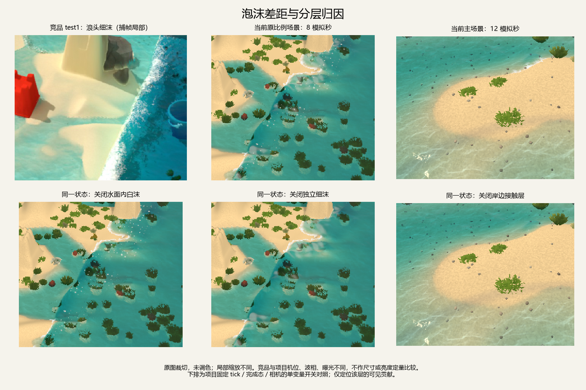

# 泡沫与当前项目对照

适用版本：下文图片、分层统计与源码快照保留2026-10-24关闭独立细沫前的状态。当前两个正式入口已隐藏`PrototypeFrontFoamDense`，独立小白点不再显示；共享泡沫历史、水面混白及岸脚继续生效，当前行为见[项目技术方案](../当前项目技术方案.md)。

当前差距集中在泡沫的空间组织与运动表示：竞品所选画面的浪头由密集、破碎的细沫构成；项目原比例场景表现为宽而柔的白色斑块配零散亮点，主场景则主要显出岸脚白边。单独提高亮度、大小或寿命不足以得到相同结构。



## FOAM-COMPARE-01：对象、比较条件与数据可用性

- 更新日期：2026-10-24。
- 竞品对象：`D:/godot/project/sandcastle/sandcastlegame/test1.rdc`，225224034 字节，SHA256 `761aa980c2426f75a1fa7364bf6d2655ff4dd20ea76566e630ee5b53ea0ec5b2`。打开前及结束后核对一致，原文件只读。仅分析泡沫视觉资源。
- 项目对象：当前工作区两个正式入口 `scenes/main.tscn`、`scenes/playable/test1_geometry.tscn`。实际启动配置、来源hash、材质有效uniform、相机、generation及完成态见各场景 `probe.json`；关键源码和表现资源另存快照。
- 采样条件：Godot 4.7.2，GTX 1050，1280×720；generation=1001，从各入口真实初态逐次请求1/30秒tick，固定tick 0/120/240/360，实际模拟时间约0/4/8/12秒。没有铲沙、手动造浪或替换参数。主场景边界幅度0.11，原比例场景幅度0.45、周期20秒，均是项目配置，不对应已确认的竞品波幅/周期。
- 分类/可信度：项目源码、有效配置和固定状态分层贡献为观察事实C3；竞品指令与原始几何为C3；跨游戏画面的感受描述仅限所示截图，不作为算法独立证据。改进优先级是Godot适配建议。
- 数据可用性：本次选定CS/VS/PS编译字节、常量、状态/索引/间接参数、VSOut与所选着色纹理原字节已保留；不是完整帧资源导出，也不是原始HLSL。阴影贴图未完整导出，纹理更早写入链未重新调查。
- [完整产物及源码快照索引](evidence/foam_comparison_20261024/inventory.json)、[RDC原始导出索引](evidence/foam_comparison_20261024/rdc/manifest.json)、[统计与图片裁切坐标](evidence/foam_comparison_20261024/analysis.json)。源hash、产物hash、selector、工具版本和命令均在索引中。
- 比较边界：竞品图为1920×1080捕帧缩略图，项目为1280×720实际viewport。机位、地形细节、波相、光照/曝光和图中局部缩放不同；不做跨游戏像素大小、亮度、覆盖率或相似度排名。没有竞品带时间戳连续观察，不能比较实际寿命、流速或成本。

## FOAM-RENDER-02：竞品小片的尺寸、透明度与着色

分类：本次直接复验的观察事实C3。范围限定test1 E1550、E1634、E3867、E3872、E6196；补充[VIS-FOAM-01..03](渲染方案.md#白沫与岸脚)，不覆盖历史数值。

E6196为6索引、29950实例的绘制。VS先按t1/R139575筛选索引读取t0/R139582的16字节状态。把状态首标量记为`s`，其指令给出：

```text
几何缩放 = 0.1 × (1 − 2^(−5.770780 × s)) ≈ 0.1 × (1 − exp(−4s))
强度输入 = 0.4 × saturate(10s)
位置 = 状态.yzw + 小片局部偏移 + (0, 0.02, 0)
alpha = max(0, 0.5 − length(UV − 0.5)) × 强度输入
```

因此单片中心alpha上限为0.2，向圆边逐渐降到零；尺寸随状态变化，不是仅用固定随机大小。PS的alpha没有把整片直接变成不透明白色。密集实例可叠加成明亮区域，但最终HDR还包含水面高光及其他贡献，不能把截图整条亮线都算成该draw。

定位：`rdc/e6196_vs.asm`指令0–9，`rdc/e6196_ps.asm`指令6–13。完整VSOut为4792000字节、每顶点40字节，四顶点一组；本次复算每组Y差为0，片宽P5/P50/P95约0.02162/0.04002/0.07700场景单位。历史报告的中位0.04168与本次分布不同，旧记录保留；跨重放一致性及其原因未确认，不把分布数值作为固定预算或稳定金标准。

PS以t2/R139723读取局部RGB，乘0.95，并与方向光、阴影比较及t1/R139590解码场产生的指数衰减项合成。E3867读取256×128 RGBA16F R139720写R139722；E3872对R139722作四邻平均写R139723。着色是单独链路，不等同泡沫发射图。定位：PS指令22–25、35–84和`e3872_cs.asm`0–10。

E1550更新R139582，E1634读该状态、按指数阈值和视锥筛选并写索引/间接参数；两核及绑定原字节已恢复。E1550存在基于采样场的水平位置写回，确认独立位置状态会被更新；没有把状态首标量命名为年龄，也没有由此确认原作秒级平流速度、生命周期或完整出生条件。

反证与未知：状态首标量的完整语义、创建初态、时间单位、原作实际消散曲线及岸脚专用发射公式继续未知。当前数据不能证明原作采用项目的rise/compression、local_front或岸边距离规则。

## FOAM-PROJECT-03：当前三层表现及差异来源

分类：Godot当前实现观察C3；视觉影响解释限定本次两个入口与有效配置。源码快照见索引 `source_snapshots`，运行配置见[main](evidence/foam_comparison_20261024/main/probe.json)和[原比例场景](evidence/foam_comparison_20261024/geometry/probe.json)。

| 部分 | 当前生效实现 | 与所选竞品证据的差别 |
|---|---|---|
| 泡沫历史场 | `visual_foam_step.glsl`维护256² RG场：半拉格朗日平流强度、指数消散，基于自由表面上升、通量压缩、速度及浅水/坡度生成；默认消散时间1.8秒、源增益25 | 项目已有平流和历史，不能说完全没有运动；但它保存的是网格强度，独立细片没有随流更新的位置状态 |
| 独立细沫 | `foam_distribution.gdshader`及稀疏mesh，32768顶点即8192个候选四边形；位置由固定UV和稳定hash抖动决定，再依照foam/local_front显隐 | 竞品该帧绘制29950个筛选实例，读取独立位置状态。8192是项目候选总数，不是实际可见数；两者不能直接当同成本预算比较 |
| 细沫覆盖 | 生效`front_local_dense=true`，候选中心X来自`64 + UV.x×128`，映到约−8至+8米，再乘距local_front的包络；湿深小于0.008时丢弃，约22%固定seed直接剔除 | 当前支持范围硬编码在域中段，浪头离开候选X范围时没有这些细片。不是按任意二维活动区域生成/搬运泡沫 |
| 单片形态 | 大小为固定hash分布，范围0.65–2.2；目标直径uniform 3.5px；圆/椭圆软边，强度为` smoothstep(0.025,0.28,foam)`，中心alpha理论可接近0.95再乘簇状门控 | 项目更容易看出一个个分离亮点；竞品用状态驱动大小、单片中心alpha≤0.2。后者并不意味着整片沫区更暗 |
| 水面内白沫 | `async_rdc_water.gdshader`把foam/front/crest条件转换为水材质混白；受`natural_main_foam_gain`控制 | 原比例场景中宽柔白色斑块的主要来源。只有细点数量增加，仍会保留底下这层较宽的混白结构 |
| 岸脚 | `contact_shape.gdshader`查5×5邻域干格距离、附近foam/front最大值，在深度0.001–0.075米内形成带状覆盖；噪声混合保留较实的核心 | 当前白带明确按湿干边界构建；竞品专用岸脚公式仍未确认，不能把它当作原作复原 |
| 受光 | 岸脚shader为unshaded；细沫约一半使用EMISSION、另一半方向光受光 | 与竞品局部RGB纹理、场衰减、阴影及两路光照合成不同。岸脚与散点在亮暗过渡中容易不一致；实际改善幅度需光照单变量验证 |

另一个明确的尺度问题：本次窗口高720，细沫实际有效`viewport_height_px`仍为1080。当前正式入口没有随窗口更新该uniform；其宽度计算的分母与实际输出尺寸不符，未触及0.04米半宽上限时基础尺寸有2/3比例偏差，再受随机尺度、透视及平面倾角影响。它值得修正，但不足以单独解释密度与形态差距。

## FOAM-CONTRIBUTION-04：固定完成态的层贡献

分类：项目固定状态消融观察C3。在tick240和360暂停模拟，分别隐藏接触层、隐藏细沫，或将水面内白沫增益置零；每次只变一个因素。恢复全部参数后的PNG与基准逐字节一致。相机和完成态保持不变。

下表统计任一RGB通道差超过2/255的屏幕像素数，口径只用于判断该开关在本场景该时刻是否产生可见贡献。不是泡沫实际面积、亮度积分、可见粒子数，各层也不能相加。

| 入口/模拟时刻 | 关闭独立细沫 | 关闭岸脚接触层 | 关闭水面内白沫 |
|---|---:|---:|---:|
| main / 8秒 | 17 | 180 | 0 |
| main / 12秒 | 112 | 2576 | 206 |
| test1_geometry / 8秒 | 985 | 1012 | 5731 |
| test1_geometry / 12秒 | 2015 | 2573 | 10034 |

由此可以分开定位：主场景这几个样本主要看到岸脚白边，独立细沫贡献很弱；原比例场景有较强浪头，宽柔混白的贡献范围明显大于散点层。两入口不能套用同一组“泡沫太少”结论。竞品图上还同时有突起浪面、亮边和背景明暗对比，当前平滑浪面形体也影响泡沫观感，但尚未做几何单变量归因，列为候选因素。

## FOAM-ADAPT-05：建议顺序与待验证问题

以下是Godot适配建议，不宣称是竞品原算法，也不表示已实施：

1. 优先调整空间组织：减少原比例场景浪头的宽柔混白，让主沫集中成破碎窄带，并保留带后的稀薄残沫；主场景先核对真实浪前源强度及覆盖，避免只增强岸边描线。
2. 调整细沫表示：候选范围覆盖实际活动水域；引入能保持身份的随流位置/尺度变化，或验证等价的连续输运表现；提高局部细片密度，同时降低单片不透明度。仅把8192改成29950不能保证相同观感。
3. 调整接触层：减少实心核心，让岸边白带以碎片和空隙过渡，与浪前源及完成态一致；检查退水后是否及时消失。
4. 统一尺寸与受光：先修正viewport尺寸消费，再对比阴影区、阳光区及不同距离；岸脚、细沫和水面混白应使用一致的光照基准。

这些纯视觉改动不应修改权威水沙、动量、源汇或沙量账本。若需要调整实际造浪输入，应单独列为场景/模拟变化验证，不能归入泡沫材质调参。

待验证：竞品带时间戳的出生→随流→退浪→消散连续过程；相同相机/输出大小下的细沫视觉尺度；当前浪面抬升几何对白色团块观感的独立贡献；本次与历史VSOut尺寸分布不同的重放一致性原因。以上不因本次截图或导出成功而关闭。

## 复验方法

RDC用RenderDoc脚本[export_foam_comparison.py](tools/export_foam_comparison.py)，先核对源hash，并将OUT改为新的完整英文目录，避免覆盖原产物；运行`qrenderdoc.exe --python D:/godot/project/sandcastle/docs/competitor/tools/export_foam_comparison.py`。索引中的工具版本为实际版本，导出成功只表示所选证据取得。

项目用[probe_foam_comparison.gd](tools/probe_foam_comparison.gd)，选择`--scene=main`或`--scene=test1_geometry`和新的`--output=res://…`目录，执行真实渲染窗口。探针按现行正式入口初始化与绑定，逐tick推进；检查固定时刻、实际来源、恢复图片一致性和资源释放。它不是连续录像或性能探针。

[analyze_foam_comparison.py](tools/analyze_foam_comparison.py)按40字节VSOut和四顶点一组复算几何，比较项目PNG，生成原RGB未调色的裁切图。代码、精确命令、图源裁切坐标和派生文件hash见索引。原始日志、首次未产生输出的RenderDoc启动记录与最终取证结果分别保留。
