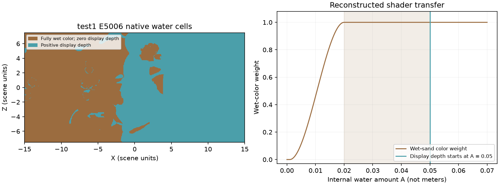

# 湿沙颜色与退水残留

对象：Sandcastle 原包 `sharedassets0.assets` 的 Sand 材质与 Lit/Sand、Water、Ground 编译资源，以及 test1 沙面 E5006、水面 E6083、水量更新 E1537。仅分析沙水视觉状态与着色，不涉及业务方法。

## 来源身份与可用性

- 捕帧：`D:/godot/project/sandcastle/rdc/test1.rdc`，225224034 字节，SHA256 `761aa980c2426f75a1fa7364bf6d2655ff4dd20ea76566e630ee5b53ea0ec5b2`。
- 原包：`D:/godot/project/sandcastle/sandcastlegame/Sandcastle_Data/sharedassets0.assets`，76135784 字节，SHA256 `6dd7bb6bc7d926fd43c08d22c9c767b7edf531cf11a4a555fcd41830f2f9c721`。
- 2026-10-24 直接复验，工具为 UnityPy 1.25.4、RenderDoc 1.46 和 D3DDisassemble。源文件复取前后 hash 一致。所选原对象、Shader 压缩与解压 payload、DXBC、有效常量、完整所选运行时缓冲及派生反汇编当前均可用。
- [包内索引](evidence/wet_sand_20261024/package/manifest.json)、[RDC 索引](evidence/wet_sand_20261024/rdc/manifest.json)、[匹配、解码与派生索引](evidence/wet_sand_20261024/analysis.json)。各索引包含完整路径、对象/事件/阶段、字节范围、命令、工具和 hash。选中 shader 无外部 payload 缺口；引用贴图未在本专题重导，不把材质引用当完整贴图数据。

## WET-SAND-01：水量直接控制湿沙颜色

**分类/可信度：指令、资源绑定、常量映射为观察事实 C3，本次直接复验。**

E5006 VS t1 绑定 `ResourceId::139573`，512×256、uint4/stride16 水场。指令 54–102 对水量 A 做四邻双线性读取；103–105 分别输出 `v4.z=A` 和 `v4.w=max(A−0.05,0)`。A 解码自第三个 uint 的低24位，精确 shader 尺度字面量为 `0x3521999b`，约等于 `10.1/(2²⁴−1)`。

E5006 PS 40–49 等价于：

```text
t = clamp((clamp(A, 0, 1) - 0.001) / 0.019, 0, 1)
wet_weight = t² × (3 - 2t)
base_color = lerp(sandColor, wetSandColor, wet_weight)
```

分母是对字节码乘数 `52.63158` 的可读表达，实际 float 舍入以 DXBC 为准。A 达到约 0.02 时，干湿混合已完全使用湿色；不像项目现有 `wetness×0.65` 只混合到部分湿色。

包内 Shader605 的选中 PS 与 RDC 完全同 hash：`b7f1ac50d5312f20e829e8788a7256d4cc84266880fca4fdedc7d39f98148aa2`。编译元数据将 cb0[127]/[129]/[130] 分别映射到 sandColor/wetSandColor/sedimentColor，帧内有效值为：

| 输入 | 常量字节偏移 | 帧内 RGB |
|---|---:|---|
| sandColor | 2032 | (0.838799, 0.760525, 0.485150) |
| wetSandColor | 2064 | (0.585351, 0.537010, 0.376927) |
| sedimentColor | 2080 | (0.603827, 0.274677, 0.138432) |

湿色通道约为干色的 0.698、0.706、0.777；这是着色输入比值，不等于最终屏幕亮度比例。后续还叠加泥沙色、纹理颗粒、焦散、环境光和方向受光。

PS 50–52 的第二路颜色混合目标是 `sedimentColor`，权重为 `clamp(v5.w×20,0,1)`；它不能当作独立湿度贴图的证据。所选沙 VS/PS 没有读取独立 wetness 纹理。该结论只覆盖所选材质链，不证明整个游戏不存在其他湿润状态。

**反证与边界：** 原包材质默认色不等于本帧有效色；贴图/颜色名称单独不足以证明用法，本条依靠 bytecode 全匹配、偏移映射和寄存器链。未做原作湿色开关的绘制消融，不据本条宣称完整屏幕观感贡献比例。原始 HLSL 未恢复。

## WET-SAND-02：不可见水面与湿沙使用不同阈值

**分类/可信度：公式和本帧样本为观察事实 C3；“残余内部水量承载湿色”的机制解释为 C2。**

水面 E6083 VS 输出有效深度 `h=max(A−0.05,0)`；PS 指令 0–2 在插值有效深度低于 0.00001 时丢弃像素。沙面在 A≈0.02 时已经达到完全湿色。因此内部 A 在约 0.02–0.05 区间时，可同时满足“沙色完全湿润”和“有效水深为零”。这里的 0.05 是内部偏置，不能称为现实 5 cm，也不能直接替代本项目以米计的真实水深。

本次 E5006 的131072个原始水格中，59248格有效水深为零，但湿色权重仍为1；全场 A 最小值约0.033432，全部原始水格已越过完全湿色阈值。因此该捕帧并不包含一片可用来标定干→湿过渡速度的干沙输入。统计是原始格点分类，不是精确光栅岸线面积；沙VS双线性采样、水网格插值和地形遮挡仍需区分。



图为原始状态解码及公式示意，不是原作截图。棕色表示有效水深为零但湿色权重为1，蓝色表示有效水深大于零。

**反证与边界：** 单帧不能证明这些格子此前被哪一波水覆盖、何时退水或经历了多久干燥。E1537/E5006/E6083分别独立重放，完整缓冲及部分水量字存在差异，不能将跨导出相减当作确定的单步变化；相同阈值分类不消除重放差异，原始差异已进入分析索引。

## WET-SAND-03：内部水量有蒸发项，真实干燥时长未知

**分类/可信度：水量更新指令与有效字段为观察事实 C3；实时时长为 C0。**

包内 Water636.UpdateAmount 与 E1537 CS 完全同 hash：`a61d34e411e8eee5c795bf233908a9b2a5b85ee272f5d0fbcb1481da27a62b80`。编译字段和指令52–60支持以下蒸发部分：

```text
evaporation = exp2(-0.721348 × air_term)
              × sunColor.r × evaporationFactor × 0.001
A_after_evaporation = A - deltaTime × evaporation
```

air_term 来自空气场的非负打包分量；该计算之后还有障碍近表面扰动、边界造浪、格内源项、限幅和量化。不能把蒸发部分冒充整个 amount 更新公式。帧内 sunColor.r=1、evaporationFactor≈0.1、deltaTime≈0.025；未受空气衰减时，蒸发部分每次调用的减量约0.0000025，实际写回还受后续项及量化影响。

这一结构允许内部水量逐渐降低，经过湿色混合阈值后颜色恢复。**不能据捕帧推断现实20秒、30秒或任何固定干燥时长**；原作传入 deltaTime 与墙钟、暂停及更新频率的关系尚未取证，也没有带时间戳的连续干湿观察。

## Godot 适配边界

本项目的 `water` 是真实水深，`wetness` 还参与压实与塌落；它们与竞品含0.05偏置的 A 语义不同。可复用的是“薄水即可进入湿色、可见水消失后仍保留湿色、随残余状态逐渐干燥”的关系。

此前提出的独立256²表面湿痕、0.3–0.5秒湿润及20–30秒淡出，属于尚未实施的 Godot 候选，不是原作已确认实现。新证据支持用独立表现状态去适配原作阈值关系，但不能据此称原作也增加了独立湿痕纹理，或直接给项目求解器增加0.05水深。是否采用该适配及其参数、恢复格式与成本仍需项目验证。

## 复验与修订关系

先核对上述源 hash，为导出脚本配置新的完整英文输出目录，再执行：

```text
python docs/competitor/tools/export_wet_sand_package.py
D:/other_software/RenderDoc/qrenderdoc.exe --python D:/godot/project/sandcastle/docs/competitor/tools/export_wet_sand_capture.py
python docs/competitor/tools/analyze_wet_sand.py
```

当前脚本默认拒绝覆盖已有导出目录。分析应得到所选包内/RDC shader 完全匹配、常量映射一致及上述格点分类；独立重放的完整缓冲 hash 不保证重复一致，不能硬编码成成功条件。

本条补充[渲染方案](渲染方案.md)的沙材质主题及[水体运动](水体运动与回落.md)的内部水量偏置/蒸发；部分关闭历史 `Q-SAND-03` 的干湿颜色公式未知项，原报告保持原样。原作干燥墙钟时间、跨帧完整生命周期和所有材质覆盖继续未知。项目诊断见[湿沙不明显的实测](../../task/wet_sand_diagnosis/诊断结果.md)，本次未修改正式项目 shader 或模拟。
