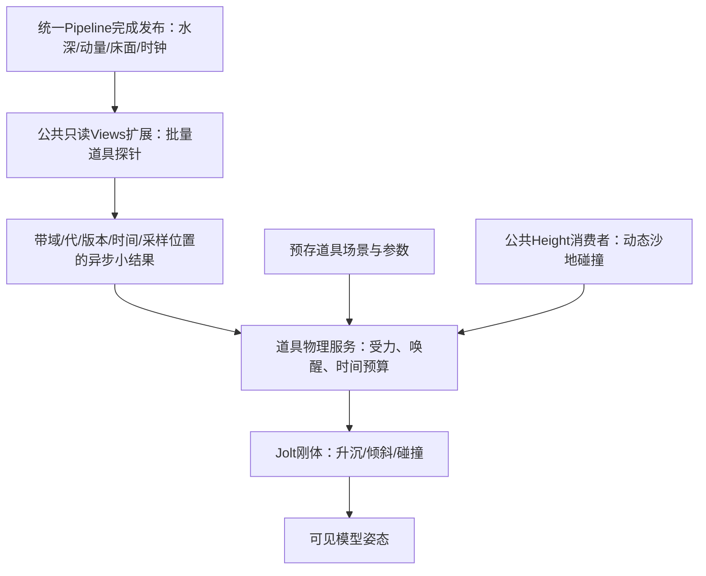

# 漂浮道具种类与实现分析

更新：2026-10-18。角色：competitor_technical_analysis。范围：用户要求新增的水中道具种类、物理资源结构及当前Godot接入方式；不分析物品业务、解锁、库存、UI、存档业务或生物行为方法。本次完成资源调查和方案分析，未实现运行功能，未恢复旧任务。

**原包在本次核对的sharedassets0.assets中有29个不同命名的根对象持有Buoyancy，共49个采样点。它们覆盖漂流物、船、玩具、贝壳、金属小物和寄居蟹。带Buoyancy只能证明参与这套组件配置，不能证明每一种都会稳定浮在水面。**

当前能够直接确认的是对象种类、采样点、质量/阻尼/重心、实体碰撞形状和模型节点结构。原作排水体积、浮力、水阻、埋沙固定及释放公式仍未知。本文候选受力与Godot接线独立标为适配，不冒称原作实现。

## PROP-CATALOG-20261018：完整资源清单

分类/可信度：包内配置事实C3，本次直接复验。中文名称为资源名的便于阅读的释义，不是原游戏本地化名称。下表“种”按不同根资源对象计，包含普通/金色硬币两份资源；不等于游戏菜单条目数或现实生物分类数。所有GO、Buoyancy、Rigidbody的PathID都只在上述源身份下有效。

表中质量是`m_Mass`包内数值，不赋予真实世界千克尺度；B/RB分别为Buoyancy和Rigidbody。碰撞形状列指根层级内非trigger配置，不证明运行时全部模型同时激活。

| 分类 | 资源名与释义 | GO | B / RB | 点数 | 质量 | 实体形状 |
|---|---|---:|---|---:|---:|---|
| 木质漂流物 | WoodStick 木棍 | 1714 | 11919 / 4982 | 3 | 0.5 | Box |
| 木质漂流物 | WoodPlank 木板 | 1352 | 9805 / 5000 | 2 | 2 | Box |
| 木质漂流物 | WineCork 软木塞 | 1563 | 9719 / 4963 | 1 | 1 | Capsule |
| 容器 | Bottle 瓶子 | 2384 | 12405 / 4998 | 2 | 2 | Capsule；含瓶塞子节点 |
| 船与浮标 | WoodenBoat 木船 | 1516 | 10356 / 4967 | 2 | 1 | Capsule |
| 船与浮标 | Boat 另一船资源 | 2437 | 11930 / 4987 | 2 | 1.5 | Capsule |
| 船与浮标 | Buoy 浮标 | 1989 | 11462 / 4978 | 2 | 2 | Capsule |
| 玩具 | Beachball 沙滩球 | 2671 | 9870 / 5001 | 1 | 3 | Sphere |
| 玩具 | ToyCar 玩具车 | 2577 | 9334 / 4975 | 2 | 2 | Box |
| 玩具 | RocketToy 火箭玩具 | 1483 | 12062 / 4999 | 2 | 1.5 | Capsule |
| 杂物 | Shoe 鞋 | 3507 | 11246 / 4965 | 2 | 2 | Box |
| 杂物 | TreasureChest 宝箱 | 1313 | 11049 / 4983 | 1 | 6 | 多个Box配置 |
| 金属小物 | Anchor 锚 | 2389 | 8919 / 4986 | 2 | 4 | Box |
| 金属小物 | Bolt 螺栓 | 1886 | 8889 / 4977 | 1 | 0.5 | Box |
| 金属小物 | BottleCap 瓶盖 | 2860 | 12290 / 4979 | 1 | 0.25 | Box |
| 金属小物 | Coin 硬币 | 3515 | 8960 / 4969 | 1 | 0.5 | Box |
| 金属小物 | CoinGolden 金色硬币 | 2714 | 11335 / 4985 | 1 | 0.5 | Box |
| 石/玻璃 | Pebble 独立石块 | 1288 | 10893 / 4984 | 1 | 2 | Box；根Sphere为trigger |
| 石/玻璃 | Seaglass 海玻璃 | 2136 | 11208 / 4968 | 1 | 0.5 | Box；根Sphere为trigger |
| 石/玻璃 | Gemstone 宝石 | 2869 | 11234 / 4997 | 1 | 1 | Box |
| 贝壳 | CommonMusselShell 贻贝壳 | 2376 | 11688 / 4989 | 2 | 0.5 | 凸MeshCollider |
| 贝壳 | IncongruousArkShell 蚶类贝壳 | 2377 | 11689 / 4990 | 2 | 0.5 | 凸MeshCollider |
| 贝壳 | MoonSnailShell 玉螺类壳 | 2378 | 11690 / 4991 | 1 | 0.5 | 凸MeshCollider |
| 贝壳 | MiterShell 笔螺类壳 | 2379 | 11691 / 4992 | 2 | 0.5 | 凸MeshCollider |
| 贝壳 | CalicoScallopShell 扇贝壳 | 2380 | 11692 / 4993 | 2 | 0.5 | 凸MeshCollider |
| 贝壳 | SundialShell 日规螺类壳 | 2381 | 11693 / 4994 | 3 | 约0.6 | 凸MeshCollider |
| 贝壳 | ClamShell 蛤类贝壳 | 2382 | 11694 / 4995 | 2 | 0.5 | 凸MeshCollider |
| 生物外形对象 | Starfish 海星 | 3588 | 11150 / 4980 | 1 | 1 | Box |
| 生物外形对象 | HermitCrab 寄居蟹 | 2996 | 9957 / 4974 | 3 | 8 | 子节点Capsule；根Sphere为trigger |

共12个单点、14个两点、3个三点对象。29个Rigidbody包内均为`UseGravity=true`、`IsKinematic=false`、`Constraints=0`。这不排除运行时改参数、休眠、冻结或其他组件施力；也不能用没有轴约束证明它们动态上不会翻转。

按视觉种类组织以上分组是本文的阅读分类；“哪些浮、哪些沉、哪些贴底滑动”还没有逐类动态证据。尤其不能把Anchor、Pebble、金属件默认列为漂浮成功对象，也不能把HermitCrab带Buoyancy解释成其移动AI已经恢复。

### 模型节点与种类的区别

- WoodStick和WoodPlank：各10个`Model_01…10`节点，每个带BoxCollider。
- Pebble和Seaglass：各6个编号Model节点，实体碰撞是Box；根Sphere是trigger。
- 贻贝、蚶类、扇贝、蛤类壳各3个编号Model节点；SundialShell为2个；MiterShell和MoonSnailShell各1个。合计16个凸MeshCollider配置。
- WoodenBoat与Boat是两个独立根资源；不能仅凭Boat名称断言它是动力船、有推进器或可驾驶。

这证明层级内预存了多个模型槽位，不证明唯一mesh数量、运行时随机概率、同时激活数量或玩家可选皮肤数量。本次没有导出Mesh/Material/Texture及外部`.resS`完整payload；不能把配置清单交付为可直接导入的美术资产包。

## PROP-PHYSICS-20261018：原作已证实的物理组成

分类/可信度：下述组件和字段为本次C3；沙地读回链复用历史已确认技术，见[碰撞专项](运行时碰撞网格取证.md)；整条Buoyancy运行调用链仍未恢复。

每个对象由可见模型、Rigidbody、实体Collider，以及引用刚体和若干Transform采样点的Buoyancy配置组成。模型用于外观，碰撞体用于支撑与接触，采样点描述水作用的空间分布；最后一句是这些配置的架构解释，不能替代实际施力方法证据。

Buoyancy序列化配置只有三项已核对字段：`rb`、`samplingPoints[]`、`buriedThreshold`。其类型元数据还保留`samplingPointsVolumes`、`submergedVolumeTotal`、`buriedVolumeTotal`、`volumeTotal`、`initialLinearDrag`、`initialAngularDrag`等运行缓存字段。字段名称支持体积/浸水/埋沙的研究方向，**字段本身不能证明体积公式或运行分支**。

| 对象 | 点布局（资源本地坐标） | 线性/角阻尼默认 | buriedThreshold | 实现时需要关注 |
|---|---|---|---:|---|
| WoodStick | y约0.411、0.005、−0.378，近长度轴 | 0.1 / 0.05 | 0.4 | 长物体两端受水差与岸边架空 |
| WoodPlank | y约−0.352、0.349 | 0 / 0.05 | 0.4 | 宽度方向稳定性；两点没有覆盖完整板面 |
| WineCork | 单点y约0.1594 | 0 / 0.05 | 0.3 | 排水量/重心与滚动 |
| Bottle | y约0.152、0.712；重心y=0.2 | 0 / 0.05 | 0.2 | 横躺/竖立姿态与瓶身、瓶塞组合接触 |
| WoodenBoat | z约0.125、−0.138；重心y=0.01 | 0.1 / 0.5 | 0.3 | 纵摇与横摇须分别验证 |
| Boat | z约0.132、−0.134；重心y=0.01 | 0.1 / 0.5 | 0.3 | 与木船质量不同，不能只换模型 |
| Buoy | y约−0.044、0.564 | 0.1 / 0.5 | 0.3 | 重心/浮心决定能否保持竖立；原作锚定行为未知 |
| Beachball | 单点y约0.014 | 0.5 / 0.05 | 0.3 | 球体滚动与水中阻力 |

每个点有位置、旋转和局部缩放，父Transform也已核对。局部y方向不能直接当作世界竖直轴。缩放是原始Transform缩放，**尚不能当作球半径、直径或有效排水体积**。buriedThreshold也不能解读为米或埋入百分比。

原包既有简单Box、Capsule、Sphere，也有凸MeshCollider。WoodStick根Capsule、Pebble根Sphere等trigger与实体形状分开使用；复制trigger形状作为唯一碰撞体会丢失实际支撑。材质、碰撞层的实时消费及运行中的变体启停尚未采集。

Gravel是另一条GPU贴床粒子路径，它以床高决定y，并借水流搬运水平位置。Pebble则是这里的独立刚体对象；不能因它们都像石头就复用一套运动规则。具体原作Gravel指令见[历史主题](碎石输运与道具浮力.md#gravel-transport-02贴沙面随流移动退水后停留与再起动)。

## PROP-UNKNOWN-20261018：原作实现仍未确认的部分

以下均为待验证C0/C1，不与上文C3配置混合：

| 问题 | 当前证据缺口 | 能区分候选解释的观测 |
|---|---|---|
| 哪些对象浮在水面 | 没有逐类投水、最终姿态与水床配对轨迹 | 同一初态分别投水；记录时间戳、姿态、速度、局部水/床面 |
| 排水体积与浮力 | 有体积缓存字段，没有计算式 | 固定姿态改变浸入深度，比较力/加速度曲线；另对点缩放作独立对照 |
| 流速怎样驱动物体 | 没有施力位置、系数、线性/平方阻力证据 | 平水正反流与不同相对速度、不同方向的单变量观测 |
| 船的横摇稳定来源 | 两点在前后，包内无轴锁；运行覆盖未知 | 沿纵/横轴分别扰动，记录重心、惯量、约束和恢复力矩 |
| buriedThreshold语义 | 比较对象、单位、冻结/摩擦机制未知 | 固定同一物体逐渐埋入再挖出，记录物理状态与采样量 |
| 是否反馈阻水/排水/造浪 | 层级存在名为Obstacle的节点，未核对有效写场/绑定因果 | 同初态有物/无物水场差分及绑定；节点名本身不作算法证据 |
| 道具是否产尾迹/白沫 | 没有对象到白沫源的动态证据 | 独立控制物体移动与背景浪，对白沫源和绘制贡献作对照 |
| 水样源、更新频率及延迟 | Readback存在但没有与Buoyancy每步闭合 | 带时间戳的读回版本、物理步和采样记录 |

可先用验证过的Godot近似实现功能，不以完整反编译为前提。这些未知不会因Godot实现通过而升级为原作C3。

## GODOT-PROP-DESIGN-20261018：当前项目的接入建议

分类：Godot适配候选，未运行验证。当前正式四入口已使用统一主流程；源码依据见[来源索引](floating_props_sources_20261018.json)。[10月15日旧计划](../../task/sandcastle_floating_props/总纲.md)保留未开始状态；其中baseline适配/旧入口链不能直接当作今天的实现接点。

### 共用服务、按类型配置

采用一个道具物理服务，给每种对象预存模型、实体shape、质量/重心、有效排水体积、采样点及阻力参数。固定节点保存为`.tscn`，参数保存为资源；不在`_ready()`重建固定三件物体的层级。形状/外观不同主要由配置表达，不为瓶子、木棍、小船各造一套水场采样与调度。



图为项目候选设计，不是原作调用图。建议第一阶段只读水沙场，由水推动道具；道具互碰和地形接触由刚体处理。阻水、排水、推动沙体、尾迹与白沫若后续纳入，须进入公共数值阶段和账本/守恒契约，不能在道具脚本直接改权威纹理。

### 浮力与随流的可实施近似

物体能否浮起来取决于重量与有效排水量的比例，复制原质量并不能保证水线一致。给每个采样点定义独立、明确单位的有效体积`V_i`和半高`r_i`，使用实际世界点位`p_i`采样一致床面`b_i`与水面`eta_i`。

一个便于校准的线性浸入近似为：

```text
S_i(y) = clamp((y - (p_i.y - r_i)) / (2*r_i), 0, 1)
alpha_i = max(S_i(eta_i) - S_i(b_i), 0)   // 只取床面与水面之间的占比
V_water_i = V_i * alpha_i               // 干格明确为0
F_buoy_i = rho * g * V_water_i * up
v_point_i = v_center + omega × (p_i - center_of_mass)
u_i = (momentum_x / h, 0, momentum_z / h) // h有干格门槛；竖直流暂取0
F_drag_i = -k_i * alpha_i * (v_point_i - u_i)
tau_i = (p_i - center_of_mass) × (F_buoy_i + F_drag_i)
```

这不是原作公式，也不声称是精确船体水动力；它是沿垂直方向线性分配体积、按局部水区间裁切的候选。多点体积权重应避免重复计入同一船体体积；浅水/埋沙时不能把沙内体积也当成自由水排水量。对大坡度、复杂凹形和很薄的水层要验证近似误差。

静水中应满足总浮力与重力平衡；两个端点浸深不同产生转矩；相对流速阻力让物体逐渐追随实际流向。不要直接每帧把y设为水面，也不要把刚体速度硬设为水流，否则岸边接触、惯性和物体互碰会被覆盖。浮力/阻力系数按真实物理步限制过冲，尤其避免小质量物体受过大阻力而反向振荡。

Godot用`RigidBody3D._integrate_forces`组织物理状态与持续受力，`apply_force`的位置参数是相对刚体原点、以世界轴表示的偏移，不是绝对世界位置；持续浮力使用force而非每帧固定impulse。采用引擎重力时不再重复手加重力。API语义依据[Godot RigidBody3D文档](https://docs.godotengine.org/en/stable/classes/class_rigidbody3d.html)及[PhysicsDirectBodyState3D](https://docs.godotengine.org/en/stable/classes/class_physicsdirectbodystate3d.html)，核对日期2026-10-18；本机版本与具体时钟整合仍需实现时验证。

### 各类对象的实现差异

| 适配对象 | 推荐起点 | 专门验证内容 |
|---|---|---|
| 木棍 | 3点、Box或少量凸形、沿长度布点 | 斜浪、两端跨岸、挖空后跌落、被水重新托起 |
| 瓶子 | 2点、Capsule组合、独立重心和体积 | 横躺/竖立、部分入水、上岸滚动；不凭名称假设空瓶或灌水 |
| 小船 | 推荐4点覆盖前后左右、低重心、凸形或简单组合 | 纵摇/横摇、船头搁浅、侧向流；4点是Godot适配，原包两种船均2点 |
| 木板 | 推荐4点覆盖板面、Box | 一边着地一边浮起；原包2点作为对照 |
| 软木塞、沙滩球 | 1点可作起点，匹配shape/体积 | 水线、滚动、干湿切换；单点不意味着完全不转动 |
| 浮标 | 2点竖向分布、重心与浮心配置 | 受扰后竖立恢复；锚链/系泊须单独立项，原作未证实 |
| 贝壳、独立石块、金属小物 | 同一刚体服务，以有效密度决定浮/沉，简化凸形 | 沉底、随流滑动、碰撞滚动和埋沙；与GPU Gravel分开 |
| 寄居蟹 | 这里只考虑其被水作用的物理层 | 行走、抓取、腿部动画等另属需求，不随本次浮力扩展 |

### 搁浅、再起浮与编辑沙床

水退后浮力逐渐消失，重力和沙地实体接触承托物体。再次来水时，持续采样水深/流速并唤醒静止刚体；水足够深才重新浮起。可加有迟滞的湿润/干燥状态避免岸线抖动，但状态本身不应无条件传送物体。

休眠物体仍需低成本监测水覆盖和支撑版本，否则来浪不能唤醒。挖沙后地面降低应允许下落；填沙穿进物体时，在同代碰撞就绪后作有界解穿透或明确埋沙约束。不能同时用“每帧拉到床面”与Jolt接触互相争夺位置，也不能把未知的原作buriedThreshold直接做冻结门槛。

浮力采样与显示必须共享相同床/水面基准和表现时钟。若视觉shader有额外几何位移，要区分真实位移与仅法线细节；真实水线位移需要共享可采样表达，不能用另一份噪声让物体浮在看不见的水面上。

### 当前源码接点与时钟风险

- [pipeline.gd](../../scripts/simulation/unified_edit/pipeline.gd)集中录制编辑/水步并发布完整状态，保留`completed_state_seq`、`completed_revision`、`completed_tick`和`advanced_time_s`。新增道具不能再建一条权威GPU调度链。
- [views.gd](../../scripts/simulation/unified_edit/views.gd)已有公共只读发布与异步预览回读，发布动量等字段；现有`request_preview`返回笔刷范围统计，**不是任意多个点的浮力采样API**。应扩展公共批量探针能力，结果带请求点位、domain、generation、state_seq、时间戳与有效标记。
- [height_surface.gd](../../scripts/simulation/unified_edit/height_surface.gd)在物理回调中消费分块高度，64个固定CollisionShape使用33×33数据。接触需核对物体足迹相关块及generation；未变块允许保留较早revision，不要求无关全域每块追到同一最新版本。
- [domain_runtime.gd](../../scripts/simulation/unified_edit/domain_runtime.gd)负责候选/当前/退休域与消费者换代；探针持有读者期间不能释放对应资源。恢复/切场景后拒绝旧generation回包，位置请求也要有身份，避免把旧位置水样当成新位置样本。

GPU异步推进的`advanced_time_s`与Jolt固定物理步不是天然同一时钟。重复在多个Jolt步使用一个滞后水样，会让道具在水停住时继续走；只把浮力乘时间比例也无法同步重力和接触。应先用单刚体验证共同时间预算、有限延迟、插值/保持和暂停策略，再做三件主场景接入。若采用等待完成态时保持物体的方案，必须一起处理速度保存、重力、接触及恢复，不能把“暂停施加浮力”当作物理暂停。此项是实施前的核心不确定性，尚无现成通过方案。

不要每帧CPU整张回读256²水沙图。GPU批量查询少量点，只回传必要值；为结果陈旧度设置有界策略，不能为了强求永远最新样本而持续丢弃有效回包。正常水/编辑队列不等待每个道具的CPU回执；等待和插值属于公共消费者与道具时间协调。

## 建议的加入顺序与验证

第一批仍建议木棍、瓶子、木船各1件：它们分别覆盖长物体三点、非对称两点和宽船体稳定问题，种类少而验证面完整。先验证公共采样/时钟，再验证静水与正反流，再进入真实浪和可编辑岸边。第二批增加木板、软木塞、沙滩球和浮标，主要扩展配置；第三批做贝壳、石块、金属件的沉底与埋沙行为。这里是实施建议，不是已经修改的执行计划或新Gate。

| 验证 | 通过依据 |
|---|---|
| 静水不同浸深/姿态 | 水线收敛、速度衰减、没有持续弹跳；总力和转矩可解释 |
| 正流/反流 | 水流反转后物体通过受力逐渐反向，没有预设向岸/向海脚本 |
| 实际完整浪周期 | 同一物体漂浮→接岸→搁浅→再浸水，保留时间戳和姿态 |
| 挖填与跨碰撞块 | 支撑更新正确、无持续穿透、无无界抛飞；包含足迹跨块 |
| 暂停、慢帧、恢复、切场景 | 水和物体时间行为一致，旧回包被拒绝，引用与资源释放完整 |
| 真实可见成本 | 按3/16/64件分别测采样回读、物理CPU和整帧P95/P99；数量仅为测量档位，不是性能承诺 |

旧第一阶段约定为重新进入/成功恢复后重置道具，不持久化其运行姿态。当前四入口有各自进度缓存，若继续此约定需要明确把道具重置放在成功换代后；失败恢复不得提前重置。若改为保存道具状态，需另补位置、线/角速度、睡眠、参数版本及恢复事务，不能当成本次水场存档自动涵盖。

## 证据身份、复验与边界

本次工具：Python 3.13.12、UnityPy 1.25.4，源Unity版本6000.4.10f1。主要源：

| 文件 | 字节 | SHA256 |
|---|---:|---|
| Sandcastle_Data/sharedassets0.assets | 76135784 | `6dd7bb6bc7d926fd43c08d22c9c767b7edf531cf11a4a555fcd41830f2f9c721` |
| Sandcastle_Data/globalgamemanagers.assets | 282924 | `8c8f9cbc1b1bc03ff278154f93698295e5de5f4b078b46c3a9ccae70e70815a2` |
| GameAssembly.dll | 47654400 | `147030ecf9527a25250238120364eb761390b99688b1812c4ea555b3b04e56a0` |
| il2cpp_data/Metadata/global-metadata.dat | 8928184 | `aa4457307746c4552541b6cedd4809fdaccf33eef03964a9e2300de5a09e1606` |

- [机器报告](../../test_output/floating_props_catalog_20261018/v2/catalog.json)保存29对象全部字段、采样点、节点变换、碰撞树及685个对象的原字节路径、源偏移、长度和hash。[交付索引](floating_props_sources_20261018.json)保存报告/工具/当前源码身份及可用性。
- 本次先核对源hash，再在sharedassets0.assets中直接扫描MonoBehaviour引擎头的script引用。Buoyancy指向`fileID=1, pathID=448`，实际解引用到globalgamemanagers.assets的MonoScript，类型名Buoyancy。不能把它误作本容器PathID448。
- 三项Buoyancy字段：rb在`[32,44)`，点数`[44,48)`，点引用`[48,48+12N)`，threshold在末尾4字节；对象总长`52+12N`。Rigidbody质量/线性阻尼/角阻尼/重心连续六float在`[12,36)`。每个对象的绝对容器偏移见报告。
- 对GO/Transform/Rigidbody/Collider/MonoScript重新用UnityPy读取树，与历史树比较，并把raw与原容器范围逐字节比较。GameAssembly/metadata只重新核对身份，类型字段依据既有严格解码器；未分析CPU方法。外部mesh/texture payload没有因此变成已导出。
- 初版v1因错误假设MonoScript与Buoyancy处于同容器而StopIteration失败，未获得对象清单。v2改用真实外部PPtr解析后完成；[v1报告](../../test_output/floating_props_catalog_20261018/v1/catalog.json)和两版工具原件均保留，失败不回写。
- 源文件前后hash一致。本次没有启动竞品、没有RDC道具动态重放，也没有Godot运行或性能PASS。C3只适用于这里列明的静态配置事实。

复验命令（使用新的英文输出目录，工具拒绝覆盖已有输出）：

```text
C:/Python313/python.exe D:/godot/project/sandcastle/docs/competitor/tools/analyze_floating_props.py --root D:/godot/project/sandcastle --out D:/godot/project/sandcastle/test_output/floating_props_catalog_recheck/new_run
```

预期：29对象、49采样点、685份相关对象raw一致，结果PASS；此PASS不表示29对象都能浮起。反证边界是组件存在但动态浮沉未知，编号模型节点不等于独立游戏种类，原质量/缩放不等于校准后的Godot物理尺寸。本文扩展[旧四类配置调查](碎石输运与道具浮力.md#prop-implementation-02漂浮道具专项复核与实现思路)，保留旧结果与未完成状态。
