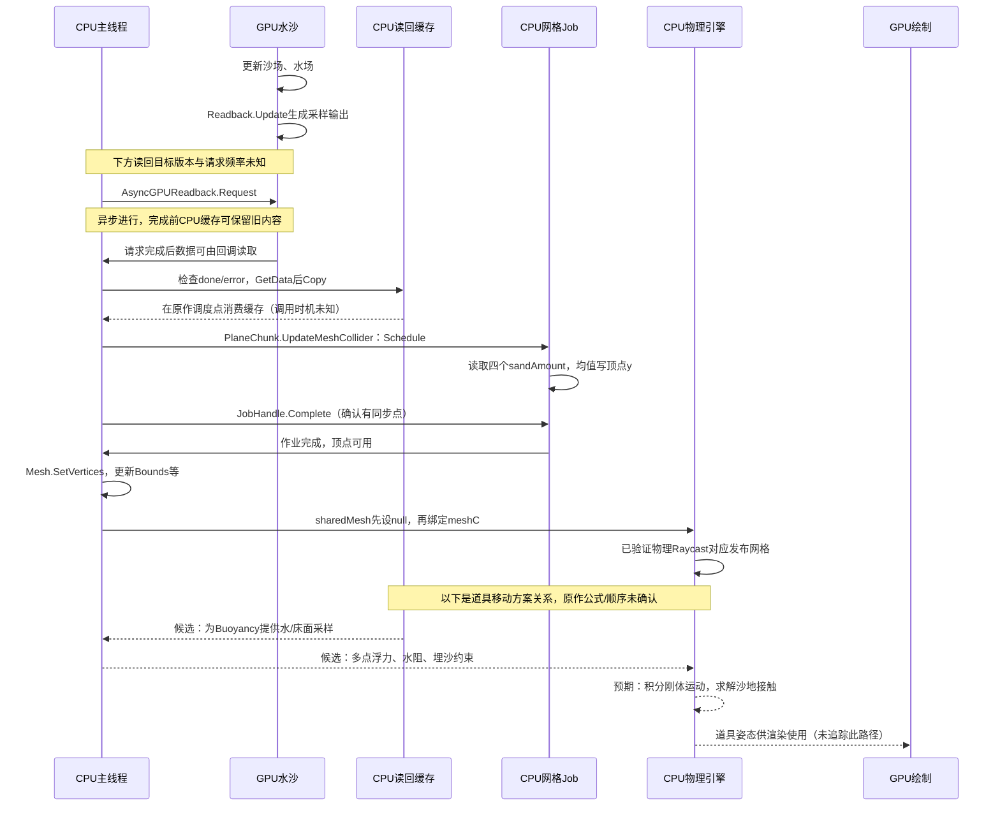
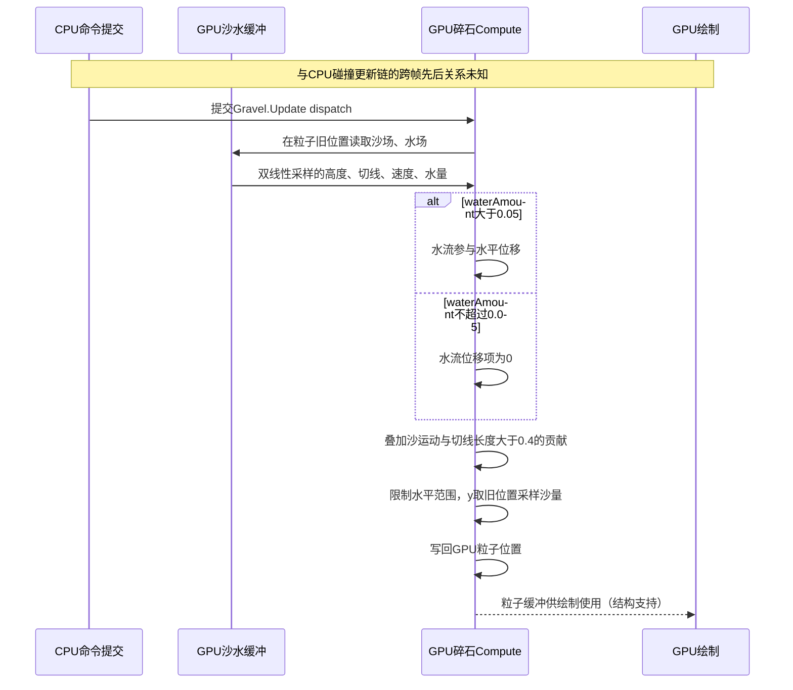

# 碎石输运、道具浮力与沙地碰撞

更新：2026-10-15。范围：原包的物理/视觉资源、必要类型字段，以及test1的Gravel.Update。2026-10-12完成专项取证，10-14整理碎石计划，10-15记录Godot碎石交付并重新核对漂浮道具配置；当前新增计划聚焦木棍、瓶子、小船。竞品物品业务、任务、库存、解锁、UI、存档或平台方法不在调查范围；本次道具研究仅更新证据和计划，未改运行实现。

**原包区分两种系统：Gravel 是贴沙面的 GPU 碎粒；木棍、瓶子和船持有 Rigidbody、Buoyancy 与碰撞形状。**前者的移动规则已由包内指令和 test1 实际调用确认，后者确认到了配置和物理组件，完整浮力/埋沙公式仍未知。原包另有名为 Pebble 的独立刚体物件，不能仅凭“石头”外观把它归入 Gravel。

## GRAVEL-IMPLEMENTATION-SUMMARY-01：实现思路与本项目移植边界

日期：2026-10-14。这是下文已确认条目的归纳，未新增原作重放、连续动作或性能验证。原包/RDC身份及关键派生产物本次重新核对，见[复用核对索引](gravel_plan_sources_20261014.json)；详细来源、selector、复验方法仍以下文及[专项索引](transport_evidence_inventory.json)为准。

| 环节 | 竞品思路 | 证据与可信度 | 当前项目的对应方案 |
|---|---|---|---|
| 颗粒状态 | GPU保存位置和一个响应除数，aliveList保持粒子ID | GRAVEL-TRANSPORT-01/02，字段与Update指令C3 | 固定数量、稳定ID；GPU浮点纹理保存位置和湿润状态，响应系数按ID/seed生成，属于Godot适配 |
| 水中移动 | 双线性采样局部水场，水量超过阈值时叠加水流位移；同时有沙运动和陡坡切线项 | sharedassets0.assets :638 Update与test1 E1566精确匹配，C3 | 从同一完成态的水深h和动量q求u=q/h，做水平输运；项目没有已映射的sandVelocity，MVP不伪造这一项 |
| 垂直贴床 | y取采样沙量，采样位置是本步旧位置 | Update末尾写回xyz，C3 | y取rock+sand的可见床高，在移动后的xz重采样；这是消除贴床滞后的适配 |
| 上岸停留 | 退水使水流项关闭；平缓、静止沙床上其余项也为0 | 水量门槛与位移指令C3；完整搁浅动作解释C2 | 不创建静态刚体；干燥时保留同一ID与xz，用水深滞回和流速门槛减少岸线抖动 |
| 再次搬运 | 水重新覆盖且有流速时，原ID可继续被水流项搬运 | 更新规则C3；跨浪周期再起动解释C2 | 持续采样局部水场，回流水流决定向海移动；没有反向流时不强制“自动回海” |
| 绘制 | Particle配置具有mesh/material/args，帧内args实例数344 | 结构/数量C3；完整Gravel绘制绑定本专项未追踪 | MultiMesh +顶点着色器采样GPU位置纹理；CPU不逐颗回读/设置变换，属于待实现适配 |
| 道具碰撞 | Rigidbody、实体Collider与Buoyancy；动态沙地另由GPU读回后发布MeshCollider | PROP-BUOYANCY/COLLISION配置C3，架构解释C2 | 木棍/瓶子/船是另一个实现任务，复用当前CPU沙地碰撞代理；不混入本次细碎石MVP |

可以把碎石规则理解为：**局部水流推动水平位置，床高承托垂直位置，退水关闭水流贡献，重新浸水重新打开贡献。**这不是本核内的逐粒刚体接触求解；颗粒相互堆叠、真实滚动、阻水和排水没有从该核得到证实。

CPU/GPU边界见[已确认与待验证的时序图](#transport-sequence-01cpugpu碰撞与移动时序)：细碎石Update直接读GPU沙水，沙地读回/CPU碰撞是道具的支撑链。单帧dispatch不能证明完整帧调度、每帧同步频率或零延迟；也不能把配置中的Buoyancy字段当成已恢复的受力公式。

**待验证/未知：**原作粒子完整出生/删除路径、跨帧seed变化、age在其他路径的含义、真实单位与更新频率、细碎石完整绘制资源/阴影行为、道具浮力和埋沙公式。本项目不能直接复制0.05、0.4或0.025作为米/秒参数。没有原作连续轨迹证据，不能把“搁浅再回海”标为已完成动态复刻。

实施入口：[水底碎石执行总纲](../../task/sandcastle_gpu_gravel/总纲.md)。该计划只借鉴上述结构，数值、纹理布局、湿润滞回、保存恢复和Godot绘制均明确为项目适配；所有实现任务当前[未开始]。

## 来源、身份与数据可用性

| 原始文件 | 字节数 | SHA256 |
|---|---:|---|
| sandcastlegame/Sandcastle_Data/sharedassets0.assets | 76135784 | `6dd7bb6bc7d926fd43c08d22c9c767b7edf531cf11a4a555fcd41830f2f9c721` |
| sandcastlegame/Sandcastle_Data/level0 | 96756 | `7e4fa0a38904d42243cec1f600f353c8adce0182fa5d9304f1023f2867243b6d` |
| sandcastlegame/GameAssembly.dll | 47654400 | `147030ecf9527a25250238120364eb761390b99688b1812c4ea555b3b04e56a0` |
| Sandcastle_Data/il2cpp_data/Metadata/global-metadata.dat | 8928184 | `aa4457307746c4552541b6cedd4809fdaccf33eef03964a9e2300de5a09e1606` |
| sandcastlegame/test1.rdc | 225224034 | `761aa980c2426f75a1fa7364bf6d2655ff4dd20ea76566e630ee5b53ea0ec5b2` |

工具：Python 3.13.12、UnityPy 1.25.4、Windows D3DDisassemble、RenderDoc 1.46，以及既有严格 v39 类型/字段解码器。Unity 资源版本为 6000.4.10f1；没有强改版本、填空方法或全量方法反编译。GameAssembly 只用于字段类型描述与偏移，未分析其方法。

当前机器数据根目录：`test_output/competitor_transport_20261012/`。

- [源身份](../../test_output/competitor_transport_20261012/package_v4/source_manifest.json)、[源文件前后核对](../../test_output/competitor_transport_20261012/package_v4/source_after.json)：包含四个资源容器和对应外部 payload 文件的身份，源文件 hash 未变。
- [原字节索引](../../test_output/competitor_transport_20261012/package_v4/raw_index.json)、[字段](../../test_output/competitor_transport_20261012/package_v4/technical_fields.json)、[物理对象与可读配置](../../test_output/competitor_transport_20261012/package_v4/physical_objects.json)：字段记录、类型、descriptor、对象 raw 分开保存，原容器偏移可复核。
- [包内 shader 索引](../../test_output/competitor_transport_20261012/analysis_v4/shader_index.json)：Dirt/Gravel 各八个 DXBC 变体，带 tree selector、raw/hash 和反汇编。部分 bytecode 在同对象内有多处相同字节，保留全部偏移候选，不伪造唯一偏移。
- [浮力配置解码](../../test_output/competitor_transport_20261012/analysis_v4/buoyancy_config.json)：29 个原包 Buoyancy 对象，逐个验证 rb、采样点 Transform 和 GameObject 引用。
- [test1 实际调用](../../test_output/competitor_transport_20261012/replay_v2/manifest.json)、[快照字段摘要](../../test_output/competitor_transport_20261012/replay_v2/decoded_snapshot.json)：完整已选沙、水、args、aliveList、gravel buffer 与 cbuffer 原字节。
- [Readback 字段映射](../../test_output/competitor_transport_20261012/readback_mapping_v2/index.json)：原包 Readback :646 的 Update 字节码，辅助核对压缩沙/水字段到 stride32 ReadbackCell 的对应。
- [完整性核对](../../test_output/competitor_transport_20261012/verification.json)、[产物 hash 索引](../../test_output/competitor_transport_20261012/artifact_index.json)：4,306 条 raw 与原文件范围逐字节一致、16 个包内编译变体核对、test1 字节码匹配。PASS 仅指这些完整性/身份检查。

原对象字节完整不等于全部模型/贴图 payload 已导出；本次没有导出它们，也未取得 PhysX cooked 数据。MonoBehaviour 的通用 type tree 只解析32字节引擎头，明确记录 header_only；Buoyancy 的三项序列化字段另行按原字节解码并验证完整长度，其余业务类型尾部不解释。

## GRAVEL-TRANSPORT-01：实际运行的 GPU 碎粒结构

- 分类/可信度：字段、包内绑定、帧内实际调用事实，C3；本次直接复验。
- 元数据：GravelParticle TypeDefinition7399，字段为 `position:Vector3` 和 `age:float`；Gravel7400 持有 `ComputeBuffer` 及更新/清理 kernel 索引；Particle7431 持有 alive/dead/compacted 列表和绘制参数缓冲。
- 原包 ComputeShader：sharedassets0.assets :638，`variants[targetRenderer=2].kernels[name=Update].uniqueVariants[0]`。编译字节码 SHA256：`2456ab782422af78135a2dd2c7e4d0cfaa23610d0057e48ee24db25bc774b874`。
- test1 E1566 的 CS 原字节与上述变体完全相同。组数 `32×1×1`，每组 `1024×1×1`；这帧容量为32768个16字节记录，绘制 args 的实例数344，aliveList 的344个 ID 唯一且有效，所选数据均有限。
- 绑定：t0 groundCells=`ResourceId::139571`（8 MiB），t1 waterCells=`139573`（2 MiB）；u0 args=`139606`（20字节），u1 aliveList=`139602`（128 KiB），u2 gravel=`139608`（512 KiB）。ResourceId 只属上述 capture。
- 有效常量：beachSize=`(30,10,15)`，groundResolution=`1024×512`，waterResolution=`512×256`，deltaTime≈`0.025`，seed=`57849`。仅为该调用消费值，不将它们当成米制、真实40Hz或长期固定配置。
- 反证/边界：此前 Dirt/Gravel 的 Kill、Compact 等共用字节码无法唯一归属；本次 Update 的字节码和实际绑定消除了这个特定调用的归属歧义，不能反过来替其他共享核归属。
- 未知：实际更新频率、完整粒子发射/删除时序、米制与真实时间倍率。

## GRAVEL-TRANSPORT-02：贴沙面、随流移动、退水后停留与再起动

分类/可信度：完整包内 Update 指令及 test1 实际使用事实 C3；对岸上停留/再次搬运的行为解释 C2，不是本次连续动作验收。

该核先在粒子的旧水平位置对沙场和水场做双线性采样。以解码后的字段表示，寄存器数据流等价于：

```text
p_new.xz = clamp_domain(p_old.xz + deltaTime × (
    sandVelocity
    + (length(groundTangent) > 0.4 ? groundTangent : 0)
    + (waterAmount > 0.05 ? beta × waterVelocity / a : 0)
))
p_new.y = sampledSandAmount(p_old.xz)
beta = 0.5 + 0.4 × hash01(particleID + seed)
a = particle.age
```

上式中的 `waterAmount`、`sampledSandAmount` 是原作编码字段，不把它们直接替换成项目的有效水深或 `rock+sand`。sandVelocity 的语义由 GroundCell 字段及压缩布局支持；采样量与切线的对应另有 Readback :646 的解码→stride32字段写入交叉核对。

证据定位：[Gravel_Update_0.txt](../../test_output/competitor_transport_20261012/analysis_v4/Gravel_Update_0.txt) 的双线性读取，以及末尾 `dp2/sqrt → lt(0.05,0.4) → hash → div → mad → store_structured u2.xyz` 数据流；cb0[155].z 对应包内 `deltaTime` offset2488。沙高落到写出的 y；水量来自 t1.z 的低24位解码。相关压缩字段映射见 Readback :646 末尾写入 u0 offset16，其中 y 对应 ReadbackCell unboxed offset20 的 sandAmount。

这解释了用户描述的三种表现：

1. **水中搬运**：水量阈值打开后，局部水流贡献水平位移；显示高度仍来自沙面。波浪能通过改变水量和流速带动颗粒。
2. **冲上岸后停留**：退水使水流项关闭；当沙场速度也接近0、切线长度不过0.4时，水平位置不再改变，仍贴着沙面。陡坡或沙面自身运动时仍可移动，不能宣传“上岸一律永久固定”。
3. **重新冲回水中**：粒子仍在 aliveList；水重新覆盖并超过0.05且有流速，就再次产生水流位移。这个 Update 中没有“到岸就改成静态刚体”的切换；重新动起来不需要在该核中另造一个唤醒对象。

`age` 在这个 Update 中仅被读取为除数，没有递增或寿命判定；Spawn 的末尾将对应分量初始化为 `0.5 + R³`，E1566 有效记录范围约 `[0.50000006,1.49756622]`。因此不能把字段名字 age 当成已证明的秒级年龄，或据此计算寿命。它如何被其他路径改变仍未知。

反证/边界：这里只见单粒子采样和更新，没有该核内的粒子邻居碰撞求解；Cleanup 变体对域边界做检查，而本 Update 还执行水平范围 clamp。不能宣称它是逐颗石头的完整刚体模拟、真实颗粒接触或水面浮力。新水平位置的 y 来自旧位置采样，不宣称移动后绝对零贴面误差。单帧不证明全部帧均使用同阈值、跨浪周期固定时长或表现质量。

## PROP-BUOYANCY-01：木棍、瓶子、小船的实际浮力配置

分类/可信度：包内类型/字段与序列化指针事实，C3；多点体积近似的算法解释仅C1待验证。

Buoyancy TypeDefinition7528 具有以下物理字段：`rb:Rigidbody`、`samplingPoints:Transform[]`、`buriedThreshold:float`，以及运行时缓存 `samplingPointsVolumes`、`submergedVolumeTotal`、`buriedVolumeTotal`、`volumeTotal`、`initialLinearDrag`、`initialAngularDrag` 等。字段存在不证明其公式、计算先后或启停条件。

| 原包物体 | GO PathID | Buoyancy PathID | Rigidbody PathID | 采样点数 | buriedThreshold默认值 | m_Mass默认值 |
|---|---:|---:|---:|---:|---:|---:|
| WoodStick | 1714 | 11919 | 4982 | 3 | 0.4 | 0.5 |
| Bottle | 2384 | 12405 | 4998 | 2 | 0.2 | 2.0 |
| WoodenBoat | 1516 | 10356 | 4967 | 2 | 0.3 | 1.0 |
| Boat | 2437 | 11930 | 4987 | 2 | 0.3 | 1.5 |
| Pebble，独立石块物件 | 1288 | 10893 | 4984 | 1 | 0.15 | 2.0 |

上表所有 PathID 均限于本节源 hash 的 sharedassets0.assets。上述刚体包内 `UseGravity=true`、`IsKinematic=false`；具体运行时修改尚未采集。buriedThreshold 的单位和比较对象未知，不能说0.4米或40%埋沙。

采样点布局也有直接数据：木棍三点位于其本地长度方向约 y=`0.411/0.005/−0.378`；木船两点位于本地 z=`0.125/−0.138`；Bottle 两点本地 y≈`0.152/0.712`，并各有局部缩放。它们都指向真实 Transform，不是根据画面推测的虚构采样点。局部缩放参与体积的具体方式未知。

定位/复验：每个 Buoyancy 对象32字节引擎头后，rb PPtr `[32,44)`、数组数量 `[44,48)`、点指针 `[48,48+12N)`、threshold最后4字节；对象完整长度为 `52+12N`。三字段 public属性、类型和顺序已按元数据核对；每个指针验证目标为对应 Rigidbody/Transform，rb与组件同属目标GO。默认值与快照消费值分开记录。

未知/C0–C1：是否以球冠体积/线性浸水率计算采样点排水、是否直接在采样点 AddForce、水平水流如何传到刚体、浮力常量/密度、阻尼公式、埋沙后提高阻尼还是冻结/切换 kinematic、重新离沙时的解锁规则。本次不把可行公式冒称原作代码已恢复。

## PROP-IMPLEMENTATION-02：漂浮道具专项复核与实现思路

更新：2026-10-15。本次用户在碎石交付后明确要求实现漂浮道具；本条聚焦木棍、瓶子和小船的物理技术，不调查物品业务。Godot实现计划见[漂浮道具总纲](../../task/sandcastle_floating_props/总纲.md)。

**已确认事实C3：**本次重新核对sharedassets0.assets、GameAssembly.dll、global-metadata.dat三个源的大小/SHA256，与本页历史身份一致；27个选定对象raw与原容器字节范围一致。对四个Buoyancy对象重读rb、point_count、采样点PPtr、buriedThreshold；对四个Rigidbody重读质量、线性/角阻尼和重心。点Transform与实体/trigger Collider复用原有已解码树并核对raw身份，未重新推导它们的全部序列化布局。完整记录及工具身份见[本次证据索引](floating_props_evidence_20261015.json)、[字段核对报告](../../test_output/floating_props_research_20261015/config_v1/configuration_check.json)。

| 对象 | Buoyancy / Rigidbody PathID | 采样点 | 质量 | 线性/角阻尼 | 本地重心 | 已确认实体形状 |
|---|---|---:|---:|---|---|---|
| WoodStick | 11919 / 4982 | 3，沿长度分布 | 0.5 | 0.1 / 0.05 | (0,0,0) | 子模型BoxCollider :5091；根Capsule :5467为trigger |
| Bottle | 12405 / 4998 | 2，位于瓶身不同高度 | 2.0 | 0 / 0.05 | (0,0.2,0) | 子模型CapsuleCollider :5449 |
| WoodenBoat | 10356 / 4967 | 2，前后分布 | 1.0 | 0.1 / 0.5 | (0,0.01,0) | 子模型CapsuleCollider :5471，Z轴；:5457为trigger |
| Boat | 11930 / 4987 | 2，前后分布 | 1.5 | 0.1 / 0.5 | (0,0.01,0) | 子模型CapsuleCollider :5448，Z轴 |

所有PathID限于本页同hash的sharedassets0.assets，参数均为包内默认值，坐标为资源本地坐标；没有转换为Godot米制质量/尺寸。原始Rigidbody连续六个float位于对象字节[12,36)，Buoyancy布局见PROP-BUOYANCY-01及报告selectors。物体尺寸、缩放及有效排水体积需一起校准，不能只复制质量与采样点缩放就保证漂浮。

**架构解释C2：**原包使用“动态刚体 + 实体碰撞形状 + 独立Buoyancy配置”；沙地另有GPU沙床→CPU读回→MeshCollider发布的已确认链。由此支持把水作用、物体积分和沙地接触分开实现。Readback确为Buoyancy每步采样源、实际施力顺序和调用频率仍未闭合，不能把架构解释升级为原作调用链已恢复。

**仍未知C0/C1：**采样点缩放是否表示球半径或排水体积、浸水比例/浮力公式、水平拖曳/角阻力公式、buriedThreshold比较量及埋沙冻结/释放方法、运行时参数覆盖、碰撞层和真实接触/穿透情况。两点前后配置不等于完整船体稳定算法；不能据此断言原作锁死横摇或使用四点浮力。

**Godot适配（待实现）：**用RigidBody3D及预存Box/Capsule/凸形碰撞体承载道具，GPU批量采样同完成态床高/水深/水流，CPU物理步按多点有效排水量施浮力和相对流速阻力。退水后由实体接触承托；持续监测湿润/支撑变化来唤醒，挖填造成的重叠单独作有界位置修正。首选木棍3点、瓶子2点、船4点以采到左右水高差；船4点和具体受力公式均为本项目方案。碎石GPU贴床坐标更新不直接移植为刚体移动。

复验命令（输出目录须为新的英文目录，脚本拒绝覆盖）：

```text
C:/Python313/python.exe D:/godot/project/sandcastle/tests/investigation/competitor_transport/verify_prop_configuration.py --root D:/godot/project/sandcastle --out D:/godot/project/sandcastle/test_output/floating_props_recheck/config_v1
```

本次PASS仅表示列出的身份、原字节和字段检查；没有运行竞品、重放道具动态或恢复原生受力方法。它补充PROP-BUOYANCY-01/PROP-COLLISION-01，不替代原报告、不消除上述未知。既有CPU/GPU时序图中的道具虚线仍保留。

## PROP-COLLISION-01：实体形状和动态沙地碰撞是两部分

分类/可信度：包内实体碰撞组件 C3；沙面 MeshCollider 更新和真实射线是既有直接证据；本次道具接触动力学为C0未验证。

原包实际保留了用于实体接触的简单形状：

- 木棍 Model_01 子节点 GO2540 有 BoxCollider :5091；其余模型变体也有BoxCollider。木棍根节点另有 CapsuleCollider :5467，但它是 trigger，不能用它证明实体接触。
- Bottle 子节点 GO1912 的 CapsuleCollider :5449 为非trigger；Cork 子节点另有 :5453。运行时变体激活情况未采集。
- WoodenBoat_01 子节点 GO2324 的 CapsuleCollider :5471 为非trigger，轴方向Z，radius≈0.11、height=0.5；另有较大的trigger :5457。
- Boat_01 子节点 GO1917 的 CapsuleCollider :5448 为非trigger；另有trigger :5446。

这些组件包内 enabled=true；是否在实际实例中保持激活及实时层过滤仍未知。Pebble 根 SphereCollider :5437 是trigger，本次不能据它证明独立石块与沙面的实体接触路径。

沙地一侧已有[原生字段/代码补证](笔刷命中检测_代码补证.md#hit-path-03cpu样本确实用于碰撞网格发布)和[运行时输入网格取证](运行时碰撞网格取证.md)：GPU状态读回CPU缓存，更新分块顶点，再重绑MeshCollider.sharedMesh；中心样本真实getter有289顶点/512三角形，实际Physics.Raycast对应几何。这些证据证实了动态地形碰撞的基础设施。

**实现解释：道具的刚体与实体形状可以交给引擎接触求解，浮力组件另行施加水作用；动态沙地由更新后的碰撞网格提供支撑。**这是配置及已有碰撞通路支持的架构解释C2。它没有证明本次木棍/船/瓶子在每个运行时碰撞层都与沙面有效接触，更不能保证快速堆沙时无穿透、碰撞代理零延迟或所有形变无重叠。

## TRANSPORT-SEQUENCE-01：CPU/GPU碰撞与移动时序

更新：2026-10-12。本图整理已有逆向证据，未新增重放或运行验证。实线表示已确认的操作/数据通路；虚线表示待核实的算法或调度关系。异步读回也使用实线，其异步属性由消息和注释说明。**纵向顺序表达局部依赖，不是已测得的全游戏单帧调用时间轴。**跨分支顺序、读回目标版本、缓存/碰撞发布频率，以及与物理步的相位尚未闭合。

第一条链是动态沙地碰撞和道具运动。Readback.Update的输出及异步请求/回调存在已有C3证据；缓存到碰撞顶点、作业完成和sharedMesh重绑也已确认。道具Buoyancy对Readback缓存的消费、施力、埋沙约束和物理接触细节仍是待验证关系。



同步入口另行存在：`Readback.UpdateCellsImmediate → ComputeBuffer.GetData`是C3代码事实。它是另一入口，没有证据说明以上异步路径每次都先调用它，故不画成必经步骤。图中的GPU完成通知由Unity读回机制在CPU侧触发回调，不表示GPU执行C#回调。

道具在物理步之前只能消费已经发布的碰撞输入；本图没有证明原作每次物理步都等待新的碰撞网格，也没有证明物理步与最新GPU沙场同版本。CPU缓存、已发布碰撞网格和GPU可见沙面可能存在版本差；实际差值和延迟未知。

第二条链是细碎Gravel的GPU移动。它在Update中直接读沙/水缓冲，不依赖上述CPU网格Job或刚体接触求解。CPU命令提交存在捕帧dispatch证据；具体脚本入口未知。末端绘制关系由Particle的mesh/material/args配置支持，未在本次追踪完整绘制绑定。



该碎石核内没有逐粒子刚体碰撞求解。岸上停留来自各位移贡献关闭，重新覆盖后水流项可以再次打开；不在图中虚构一次“GPU碎石→CPU静态刚体→GPU碎石”的交接。

证据与复验：Gravel见本页GRAVEL-TRANSPORT-01/02及test1 E1566索引；异步/同步读回和网格Job见[HIT-PATH-03/04](笔刷命中检测_代码补证.md)，真实网格及缓存四样本对应见[RC-MESH-01/03/05](运行时碰撞网格取证.md)。道具虚线路径仅以本页PROP-BUOYANCY-01、PROP-COLLISION-01作为配置线索，不升级为CPU方法已恢复。原始source hash、selector与产物索引沿用对应来源记录。

## GODOT-TRANSPORT-ADAPT-01：项目移植方案（2026-10-15已有下述验证实现）

此节全属Godot适配建议，不是原作已验证实现。

1. **大量细碎石**：用GPU粒子缓冲批量读取同完成态的可见床高、水深和水流；借鉴“贴床 + 条件水流搬运 + 沙面运动”结构。可为美术稳定性增加水深/流速滞回阈值，但这是新增适配。每颗碎粒保留ID、位置和独立响应系数；以实例化绘制承载。应先明确它们是表现碎粒还是权威沙量：若只是表现，不增减sand/sediment；若代表物质，需要另定义与账本的转换。
2. **木棍、瓶子、船及独立大石块**：预存RigidBody3D、Box/Capsule/凸形接触体和Marker3D采样点。木棍可先采用3点、船采用前后2点；用小批量探针取得床面、水面、水流，采样必须携带generation/tick和完成时间，拒绝跨generation旧回调。
3. **浮力和摇摆**：一个可行适配是按各采样点的浸水体积分配 `F_up = rho × g × V_submerged`，在对应位置施力产生力矩，并依据水流与刚体采样点速度之差加阻力。多点可以产生倾斜与俯仰。此公式及体积近似尚未在本项目验证，也未恢复为原作公式。[Godot RigidBody3D](https://docs.godotengine.org/en/stable/classes/class_rigidbody3d.html)支持按位置施力和刚体接触；position参数使用相对刚体原点、以世界坐标轴表示的偏移。
4. **上岸、卡沙与再入水**：浅水时浮力减小，由接触与摩擦承托；埋沙约束可以用阻尼/支撑判定实现，并在床面下降或水作用超过释放门槛时重新激活。释放要持续观测，不能只依赖一次body_entered事件。原作埋沙缓存提供方向线索，具体原作规则仍未知。
5. **编辑后的不穿透**：复用项目的[分块GPU碰撞代理](../../scripts/collision/gpu_collision_proxy.gd)，确保碰撞更新与对象采样消费同一完成态或有明确延迟补偿；修改碰撞形状后检查受影响刚体的埋入深度与支撑。仅有浮力、只设置中心y或只改渲染沙面，都不足以满足用户要求的碰撞。项目使用HeightMapShape3D的技术边界见[官方文档](https://docs.godotengine.org/en/stable/classes/class_heightmapshape3d.html)。

先验证单向“水沙状态→物体运动/碰撞”即可覆盖本次提出的功能。物体排水、阻水、尾流和对权威水动量的反作用是进一步扩展，需单独定义守恒语义，不能因有碰撞形状就当作已经接入。

建议的区分验证：固定机位和相同输入，记录一颗Gravel的ID/位置、水量和流速经过入水→退水→再覆盖；记录一个道具的采样点、姿态、接触和埋入量经过漂浮→岸上支撑→堆沙→挖沙→再次入水。加入无流、陡坡、浅水、暂停恢复和旧generation回调负例。它们是后续验证内容，不是本次完成项。

## GODOT-GRAVEL-IMPLEMENTED-01：已验证的独立GPU碎石表现层

更新：2026-10-15。分类：Godot适配；以下C3只针对本项目可重复运行事实，**不升级原作完整动作、生命周期或浮力算法的可信度**。原作事实仍以GRAVEL-TRANSPORT-01/02的原包与RDC定位为准，本次未读取原包或新增逆向结论。

- 来源身份：本项目运行代码/资源hash及驱动条件见[实际回流manifest](../../test_output/gpu_gravel/backwash_movie_20261015/manifest.json)，项目4.7.1/D3D12/GTX 1050。GpuGravelField使用主RD的64×16 RGBA32F双状态，固定ID/seed，MultiMesh顶点按INSTANCE_ID取数，默认512、容量1024。水沙只读，采用本项目q/h米制速度、0.012/0.006m深度滞回、速度平滑、独立microsteps；床高匹配项目沙面三角重建。这些数值与公式不是原作有效常量。
- 直接证据/复验：[G1真实RD人工流场](../../task/sandcastle_gpu_gravel/验收/G1_GPU输运.md)验证随流/零流/干燥/再湿/边界/限速/固定数量；[G2显示](../../task/sandcastle_gpu_gravel/验收/G2_绘制.md)验证受光、浅水、深度与AABB；[G3生命周期](../../task/sandcastle_gpu_gravel/验收/G3_生命周期.md)验证暂停编辑、双状态原字节恢复、相同输入续跑、候选失败、旧回调和三场景往返。命令、失败run和修复关系在各报告，不能只看探针打印PASS。
- 实际动作证据：test1_backwash原有水沙/回流输入，seed57849、固定ID325，tick30向岸移动；tick330/360/390水深约2.4–2.6e-5m、wet=0，xz逐值相同；tick810水深0.05749m、u_x=-0.42525m/s，x比tick780减少0.046653m。见[逐粒原始轨迹](../../test_output/gpu_gravel/backwash_movie_20261015/trace.jsonl)、[ID325摘录](../../test_output/gpu_gravel/backwash_movie_20261015/particle_325.csv)及[带tick录像](../../test_output/gpu_gravel/backwash_movie_20261015/backwash.avi)。时间来自完成tick/30，render_frame只用于对应录像帧；局部h/u是完成态目的地采样，不伪称步前输入。
- 反证/范围：不使用原作压缩waterAmount或age字段直接驱动Godot；不包含原作sandVelocity、陡坡切线、颗粒碰撞、刚体浮力、排水或反作用。启用/关闭的13项隔离检查中，全部native当前/备用字段、白沫/材料和源汇账本字节/值相同，见[隔离结果](../../test_output/gpu_gravel/isolation_1792038286_199/main_smoke.json)。这只支持当前固定输入下的表现隔离，不证明任意未来改动仍隔离。
- 未知/后续：原作完整发射/删除/CPU调度、道具浮力/埋沙依旧未知。当前Godot颗粒没有真实滚动/堆叠/埋入释放；正式性能预算未定义，短成本与180秒结果以本任务最终[G5报告](../../task/sandcastle_gpu_gravel/验收/G5_交付.md)为准，不能用原作单帧粒数推断本机性能。
- 数据可用性：上述本机新run、CSV、AVI及源码当前可用；未要求旧逆向原始数据重新上线。原始竞品数据的可用性仍按本页既有索引，不因本项目实现而改写历史失败。

## 复验命令、失败与修订关系

```text
python tests/investigation/competitor_transport/probe_transport.py --out D:/godot/project/sandcastle/test_output/competitor_transport_recheck/package
python tests/investigation/competitor_transport/analyze_transport.py --package D:/godot/project/sandcastle/test_output/competitor_transport_recheck/package --out D:/godot/project/sandcastle/test_output/competitor_transport_recheck/analysis
python tests/investigation/competitor_transport/extract_readback_mapping.py --out D:/godot/project/sandcastle/test_output/competitor_transport_recheck/readback
D:/other_software/RenderDoc/qrenderdoc.exe --python D:/godot/project/sandcastle/tests/investigation/competitor_transport/replay_gravel.py
python tests/investigation/competitor_transport/verify_transport.py
```

最后两个脚本本次OUT/目录为固定英文路径；再运行前复制封存脚本并改到新的英文run，不覆盖本次证据。新复验需核对同hash，shader应在test1 E1566精确匹配，包内采样指针应仍指向相同容器对象。此选择器用于原始源版本，不跨版本复用。

初次MonoBehaviour完整读取因引擎头不含自定义字段而失败；后续显式头部读取保留custom tail。原生快速reader的cursor走过整块buffer，曾导致header大小判定失败，最终按序列化PPtr/name长度校验边界。bytecode重号也曾使唯一偏移断言失败，最终保留重复位置与精确tree selector。首个隐藏重放助手未出manifest，已记录setup_failure并只终止本任务自建PID；第二次成功。相关失败和partial目录保持原样，不改成PASS；详见verification known_partial_attempts。工具脚本已封存到run根目录。

本次补充[模拟与编辑方案](模拟与编辑方案.md)的粒子未知范围：关闭特定Gravel.Update的结构/阈值/输入归属未知，不关闭全部粒子生命周期或CPU调度未知。新增道具物理配置知识，不改变母任务暂停、旧Gate、成本失败或历史碰撞阶段未完成判定。
