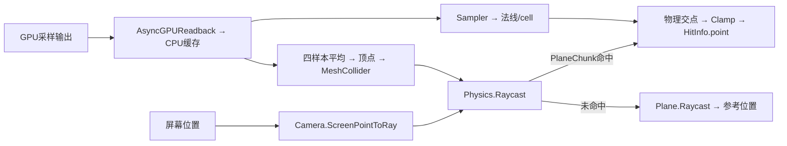

# 笔刷命中检测：限时原生代码补证

日期：2026-10-11。开始于北京时间23:26:44，用户授权最多30分钟继续定向调查。只检查输入拾取、碰撞发布和CPU采样技术方法，不展开工具业务、库存、任务、UI、存档或平台接入。

**已确认中央拾取代码采用“屏幕位置 → 相机射线 → CPU物理Raycast”，沙面分块命中后用CPU Readback缓存补充法线/单元信息。**原作确有Readback缓存驱动的MeshCollider更新；物理未命中时还有参考平面求交回退。这些是本次原始机器码/字段直接证据，不再仅为名称线索。没有运行竞品或新重放RDC，test41单笔中心与输入尚未逐值闭合，实际频率/时延仍未知。

## 来源、工具与复验方式

| 原始来源 | 字节数 | SHA256 |
|---|---:|---|
| sandcastlegame/GameAssembly.dll | 47654400 | `147030ecf9527a25250238120364eb761390b99688b1812c4ea555b3b04e56a0` |
| Sandcastle_Data/il2cpp_data/Metadata/global-metadata.dat | 8928184 | `aa4457307746c4552541b6cedd4809fdaccf33eef03964a9e2300de5a09e1606` |

两文件只读。实际metadata版本39；没有强改版本或用空数组代替失败。按[Cpp2IL官方头部布局](https://github.com/SamboyCoding/Cpp2IL/blob/development/LibCpp2IL/Metadata/Il2CppGlobalMetadataHeader.cs)、[动态索引布局](https://github.com/SamboyCoding/Cpp2IL/blob/development/LibCpp2IL/Metadata/Il2CppVariableWidthIndex.cs)、[元数据引用解码](https://github.com/SamboyCoding/Cpp2IL/blob/development/LibCpp2IL/MetadataUsage.cs)实现局部解析器；下载源码及hash索引保留。v39的section header12字节、TypeDefinition76、FieldDefinition10、MethodDefinition30、ParameterDefinition10字节，以count、范围、token和类型归属检查验证实际兼容性。

唯一MetadataRegistration候选及Assembly-CSharp codegen module建立token→函数指针映射，再依据Windows `.pdata` 的CHAININFO补齐函数范围。Capstone5.0.9只反汇编13个命中/碰撞/采样白名单函数。RVA仅属于上述GameAssembly，imagebase=`0x180000000`。这是实际机器码及派生反汇编，**不是原始C#源码或完整业务层恢复**。

工具：`tests/investigation/brush_hit_competitor/metadata_fields.py`、`hit_native_probe.py`、`disassemble_hit.py`、`resolve_hit_usages.py`。命令为 `python <对应脚本>`；再执行时先选新的英文OUT目录，保留本次输出。旧工具版本随对应run保留。

核心产物：[functions.json](../../test_output/brush_hit_competitor/hit_disassembly_20261011_v3/functions.json)、[原始字段及布局](../../test_output/brush_hit_competitor/hit_disassembly_20261011_v3/fields/selected_types_fields.json)、[泛型与引用实证](../../test_output/brush_hit_competitor/hit_usage_resolution_20261011/resolved_usages.json)、[专项文件hash索引](brush_hit_evidence_inventory.json)。每个函数包含token、原始文件偏移/长度、raw/hash、unwind片段、参数及call选择器；方法表/参数/引用原记录另存到原始证据目录，外部资源不包含在本代码完整性声明中。

## HIT-PATH-01：屏幕位置生成CPU物理射线

北京时间23:54完成完整性校验：13个白名单函数raw均与原文件范围一致，指令字节覆盖完整且hash相符；338条所选类型/字段/方法/参数/MethodSpec/引用cell/类型descriptor原记录及索引保留；GameAssembly和metadata前后hash未变。[verification.json](../../test_output/brush_hit_competitor/hit_verification_20261011/verification.json)的PASS仅指原字节与解码覆盖完整性，不是运行时命中、时序或成本验收。调查约28分钟，未超过30分钟。

分类：观察事实，静态代码C3；本次直接复验。

- `PlayerControls.GetHitInfo`，RVA `0x4943f0`，参数 `pointerPosition:Vector2, layerMask:LayerMask, includeTriggers:bool`，返回游戏自身HitInfo。
- VA `0x1804944bd`调用 `Camera.ScreenPointToRay`，输入为pointerPosition的x/y，z置0；VA `0x1804944f3`将所得Ray、HitInfo输出、调用者mask及由includeTriggers生成的查询枚举传入 `Game.Raycast`。
- `Game.Raycast`，RVA `0x48c3e0`，参数 `Ray, out HitInfo, LayerMask, QueryTriggerInteraction`，VA `0x18048c4e9`直接调用 `Physics.Raycast`，最大距离常量100.0。
- 证据：[PlayerControls_GetHitInfo.txt](../../test_output/brush_hit_competitor/hit_disassembly_20261011_v3/PlayerControls_GetHitInfo.txt)、[Game_Raycast.txt](../../test_output/brush_hit_competitor/hit_disassembly_20261011_v3/Game_Raycast.txt)。复验时同时核对调用指令、engine module的token/方法指针和输入寄存器，不用API字符串代替调用证据。

反证与边界：中央函数没有GPU深度读取/求交dispatch，这排除了该函数以GPU深度替代物理射线的解释；不能排除其他场景/版本或独立功能使用其他拾取技术。尚未记录pointerPosition的具体事件、当次mask、相机状态和test41单笔中心，不能宣称所有工具动作均使用它，或GPU中心未经额外变换。

## HIT-PATH-02：命中分块后消费CPU样本；未命中平面回退

分类：观察事实，静态代码C3。

- 物理成功分支在VA `0x18048c731`读取collider，在`0x18048c750`调用 `Component.TryGetComponent<PlaneChunk>`。泛型由原二进制cell `0x182973f80`、编码`0xc0040491`、MethodSpec131656及PlaneChunk类型参数直接解码，非靠邻接名称猜测。
- PlaneChunk成功分支（`0x18048c90f`起）在原物理命中位置调用 `Readback.Sampler`（`0x18048c963`）；经 `Beach.Clamp` 写HitInfo.point，调用 `ReadbackCell.get_GroundNormal`（`0x18048c9ec`）写normal，并保存采样cell。distance仍来自物理RaycastHit。
- 这条分支**没有以CPU高度场重新求射线交点，也没有把采样groundHeight覆盖point.y**。CPU采样用于附加数据，不能将Sampler描述成高度场射线求交。
- `PlayerControls.GetHitInfo`在Game.Raycast返回false时调用 `Plane.Raycast`（`0x180494537`），按 `origin + direction × distance` 得参考位置，经Beach.Clamp写point并填参考法线。Plane实际配置尚未运行复验，回退位置不等于真实沙面命中。

HitInfo必须以具体descriptor/type index区分同名类型。代码还处理其他collider分类，本次只记录分类边界，不分析其业务方法。CPU样本与碰撞网格的版本可能不同，不据静态代码宣称同tick或零延迟。

## HIT-PATH-03：CPU样本确实用于碰撞网格发布

分类：字段、调用、指令事实C3；实际频率和成本C0。

- Ground TypeDefinition7403：`colliderResolution:Vector2Int`、`chunks:Vector2Int`、`planeChunks:PlaneChunk[]`。PlaneChunk7439持有 `meshCollider:MeshCollider`、`verticesOS:NativeArray<Vector3>`、`readbackIndices:NativeArray<int4>`、`meshC:Mesh`。上一轮C1字符串线索已升级为结构证据。
- `Ground.Setup`生成网格，并在VA `0x180450fff`调用PlaneChunk.SetMeshCollider。包内Ground无子节点与运行时构建并不冲突。
- `Ground.UpdateColliders`（RVA `0x451580`）遍历planeChunks数组，逐元素调用 `PlaneChunk.UpdateMeshCollider`（`0x1804515b9`）。这是该方法的全数组循环，**未证明每帧或每笔编辑调用此方法**。
- `PlaneChunk.UpdateMeshCollider`（RVA `0x45f120`）从Readback缓存构造 `UpdateVertexPositionJob`，以IJobParallelFor调度，随后 `JobHandle.Complete`；调用Mesh.SetVertices、RecalculateBounds等；最后先把MeshCollider.sharedMesh设null（`0x18045f310`），再绑定meshC（`0x18045f325`）。Schedule/SetVertices的泛型已通过MethodSpec核对。
- Job.Execute（RVA `0x46d5d0`）按每顶点int4索引读取四条stride32 ReadbackCell，取每条`+0x14`字段，即 **sandAmount**，平均乘0.25写顶点y，x/z保持。常量原地址 `0x182035b20`。它不是读取`groundHeight`字段；不将名称擅自解释成米制或总床高。

证据：[PlaneChunk_UpdateMeshCollider.txt](../../test_output/brush_hit_competitor/hit_disassembly_20261011_v3/PlaneChunk_UpdateMeshCollider.txt)、[UpdateVertexPositionJob_Execute.txt](../../test_output/brush_hit_competitor/hit_disassembly_20261011_v3/UpdateVertexPositionJob_Execute.txt)。复验：字段偏移、job结构传参、四条样本地址、0.25原常量及sharedMesh调用按指令串联。碰撞分辨率实际值、局部/世界基准、与可见沙面的精度一致性尚未运行验证。

## HIT-PATH-04：CPU Readback消费与同步入口

分类：静态代码事实C3；运行时频率/等待C0。

- Readback7453持有 `readbackCells:NativeArray<ReadbackCell>`、`readbackCellsPtr:ReadbackCell*`和ComputeBuffer。
- Readback.Draw（RVA `0x4649e0`）在条件/步进路径调用 `AsyncGPUReadback.Request`（`0x180464af9`）。不能由该条件代码直接换算请求频率。
- 回调 `Readback.<Draw>b__11_0`（RVA `0x4653e0`）检查done、hasError、缓存存在及数量，然后 `GetData<ReadbackCell>`、`NativeArray<ReadbackCell>.Copy` 到CPU缓存；类型参数有原始MethodSpec证据。
- `Readback.UpdateCellsImmediate`（RVA `0x4654b0`）直接调用 `ComputeBuffer.GetData`（`0x180465545`），因此原作存在同步消费入口。**未证明每笔输入调用它，也未测其毫秒耗时。**

已找到两个CPU缓存消费者：碰撞更新、Game.Raycast的分块命中补充数据。历史“CPU是否消费/碰撞用途未知”的范围因此缩小；调度、频率、缓存版本、等待与实际命中延迟仍未知。证据与历史GPU Readback.Update的hash身份可关联，但没有在同一带时间戳运行中对齐。

图不表示无延迟、同tick或GPU Paint中心已追踪闭合。

## 线索修订、失败与剩余边界

`kernelRaycast`/`raycastResults`对应Gi类型；`groundRaycast`字段属于其他对象，不属于Ground/笔刷命中入口。只登记归属、排除错误联系，不调查那些对象的行为。此前两条字符串不能作为GPU笔刷拾取证据。

工具失败保留：native probe初次只验证.text而遗漏il2cpp代码段；二次要求第一条module指针非零，但本模块前六条合法为null；第三次修正选择器成功，没有填造空指针。初版反汇编只取到首个unwind片段（Game.Raycast29字节），保留为partial；最终用链式unwind取得1622字节完整范围，GetHitInfo538字节。未从截断方法作算法确认。

尚未闭合：某次鼠标事件→该函数调用→HitInfo.point→test41 E863中心的逐值关系；调用者mask、参考Plane实际配置；Readback与碰撞发布频率/完成态；暂停/恢复一致性、端到端延迟与成本。此次未启动GPU负载，未停止用户或其他任务进程，未修改主场景、shader/profile、模拟或碰撞语义。

## 对当前Godot方案的启示（适配判断）

我们当前“相机射线→已发布高度场碰撞面→笔刷位置”与原作中央拾取在技术方向上相近；原作碰撞代理为MeshCollider，本项目为HeightMapShape3D分块。GPU编辑与CPU碰撞拾取能够共存，有直接竞品代码支持，不能据GPU Paint推断原作绕过碰撞。

原作仍有CPU Readback、job Complete与碰撞网格重新绑定，不能宣传为零同步/零成本。当前项目已有generation/revision命中检查，应继续保持；此次代码不能替代我们的可见床面一致性、恢复和碰撞验收。若继续优化，先分别测物理查询与碰撞发布等待/构建成本，再决定是否改求交方案。
