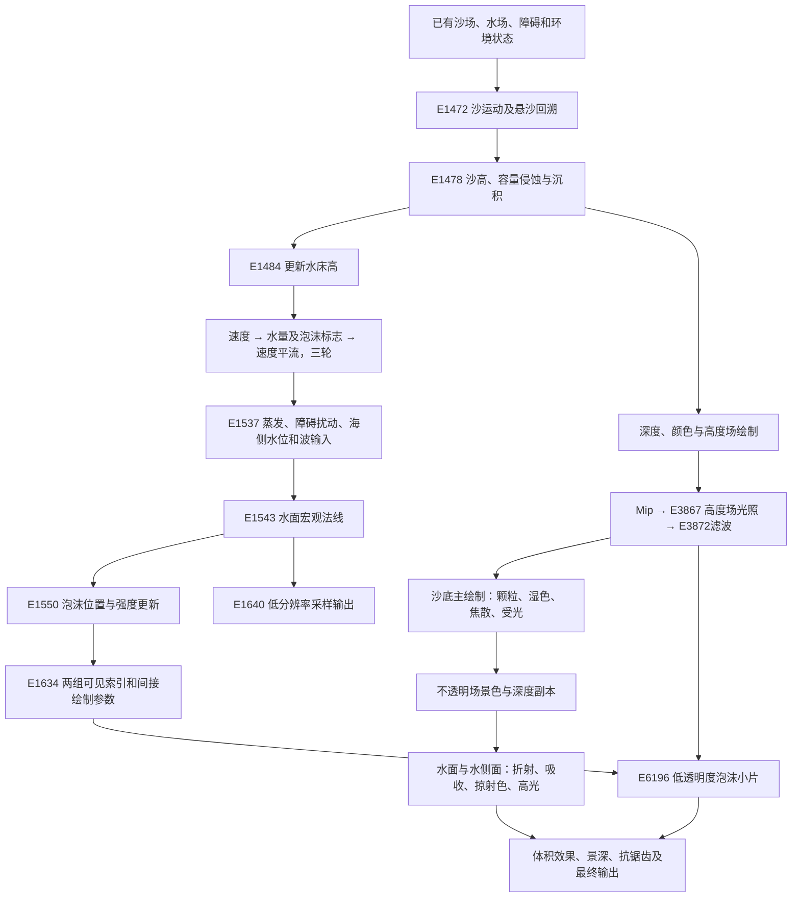
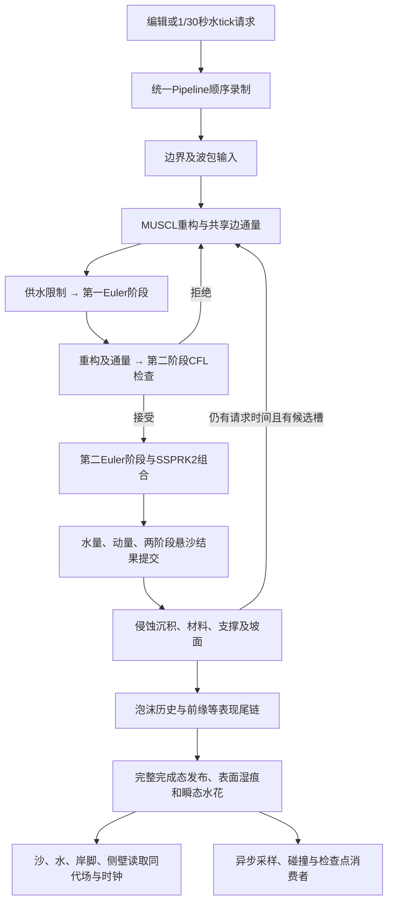

# Sandcastle 水处理全流程与当前项目对比

竞品的水由相互连接的四套系统组成：**二维水量与速度模拟、沙床与悬沙交换、水面与底面光学、独立泡沫粒子及公共光照**。宏观浪形来自水场；细波来自随流法线；水底亮纹来自沙材质中的三维纹理动画；白沫由模拟产生的响应标志驱动，再以大量低透明度小片绘制。把这些效果都归结为一张水材质，无法解释本帧的数据流。

当前项目已经采用 RGB 吸收、流向双相位细法线、三维焦散纹理和指数1500高光。仍然明显不同的是：**竞品以打包边速度和上风水量搬运推进，项目以守恒动量和 MUSCL／SSPRK2 推进；竞品泡沫有独立位置状态，项目正式入口以二维历史场和水面纹样表现；几何重建、光程、阴影及共享光照也未完全对齐。** 这比“项目尚无折射、焦散或随流泡沫”的旧比较更符合当前源码。

本文以2026-10-25工作区默认正式入口为项目比较对象。它是技术分析，不改变运行实现，也不恢复已暂停的完整视觉复刻任务。

只看原作水求解时，先读[竞品水求解实现方案](水求解实现方案.md)及其来源索引；该入口独立于本页的项目对照。阅读导航：[总体数据流](#2-一帧的总体处理顺序) · [状态布局](#3-水场究竟保存什么) · [水流与浪](#5-宏观水流与浪的传播) · [水面几何](#7-宏观法线与真正绘制的水面) · [底面焦散](#8-沙底怎样形成水下细节) · [水面光学](#9-水面光学怎样合成) · [泡沫完整链](#10-泡沫从哪里来怎样移动和消失) · [当前项目](#13-当前项目的水处理流程) · [逐项对照](#14-逐项对照) · [成本](#15-成本应该怎样比较) · [优先方向](#16-对当前项目的判断与优先方向) · [未知项](#17-未知项与复验方法)。

## 1 范围、证据与可信度

### PIPE-SOURCE-01 来源身份

| 来源 | 大小 | SHA256 |
|---|---:|---|
| `sandcastlegame/test1.rdc` | 225224034 B | `761aa980c2426f75a1fa7364bf6d2655ff4dd20ea76566e630ee5b53ea0ec5b2` |
| `rdc/test1.rdc` | 225224034 B | 与上项相同 |
| `sandcastlegame/Sandcastle_Data/sharedassets0.assets` | 76135784 B | `6dd7bb6bc7d926fd43c08d22c9c767b7edf531cf11a4a555fcd41830f2f9c721` |

本轮直接读取上述源文件确认身份，复核已保存的 DXBC、有效常量、资源绑定与选中状态原字节，并重新解码关键字段；没有重新启动竞品或做新的 GPU 重放计时。现有导出来自 RenderDoc 1.46。编译指令是实际 GPU 程序的证据，不是原始 HLSL。

[本轮来源审计与源码快照](evidence/water_pipeline_20261025/audit_v2/audit.json)记录全部来源、选择器、长度、hash、常量、字段统计、正反例和项目源码身份。下列证据简称用于后文定位：

| 简称 | 内容与入口 |
|---|---|
| E1 | [水更新12次 dispatch](evidence/water_schedule_20261024_v2/manifest.json)：全部所选 CS、常量、线程规模 |
| E2 | [全帧核心程序](evidence/shader_execution_20261025/selected_v1/manifest.json)及[精确十六进制反汇编](evidence/shader_execution_20261025/analysis_v1/analysis.json)：沙、水、泡沫、光照 |
| E3 | [材质复取](evidence/material_quality_20261023/rdc/manifest.json)：E5006／6083、有效材质常量、纹理和混合管线 |
| E4 | [泡沫原始数据](evidence/foam_comparison_20261024/rdc/manifest.json)：更新、筛选、实例状态／索引／间接参数、VSOut与光照纹理 |
| E5 | [湿沙包内原字节](evidence/wet_sand_20261024/package/manifest.json)和[RDC原字节](evidence/wet_sand_20261024/rdc/manifest.json)：完整选中水／沙缓冲及字段匹配 |
| E6 | [资源使用与子资源视图](evidence/shader_execution_20261025/views_v2/manifest.json)、[三次重放时间戳](evidence/shader_execution_20261025/timing_v1/manifest.json)、[逐程序汇总](evidence/shader_execution_20261025/summary_v1/shader_index.md) |
| P1 | [项目源码快照](evidence/water_pipeline_20261025/audit_v2/project_snapshot/)：两个正式场景、表现清单、水求解、耦合、材质、泡沫、湿痕、水花与边界配置 |

评级按具体陈述使用：C3为直接指令／字段／绑定事实，C2为有交叉支持的算法解释，C1为待验证假设，C0为未知。文中公式区分“编译指令的可读等价式”和“为讲解省略分支的主项”；后者不能当作可直接替换生产核的源码。

早期逐阶段水场验证、三个水像素调试轨迹和旧焦散mip导出路径当前缺失。原报告保留历史结论，本轮不声称这些实验重新通过。当前保留的正式证据足以复核本文所用核心指令与绑定，但不是整帧所有资源的完整恢复。全部事件与 ResourceId 仅适用于表中 test1 hash；原作长度与时间单位尚未校准为米和墙钟秒。

## 2 一帧的总体处理顺序

### PIPE-FRAME-01 从沙水状态到画面



以上三轮是匹配test1的这一帧条件；其他已核验捕帧包含四轮，或同一水缓冲在一个捕帧内经历三轮、四轮两条完整更新链，见[多捕帧直接证据](水求解参考与同步.md#water-capture-01不同捕帧的轮数与同帧周期不能固定为三轮一次)。限定自然及公开引擎变速条件已有[连续时钟证据](水求解参考与同步.md#water-runtime-clock-01配置步长与累计积分轮数分别有实测依据)，但完整调度方法和无探针频率仍未知。

这是数据依赖示意，不表示所有箭头对应本帧首次生成的输入。例如水更新E1537读取障碍纹理R139724时，本帧后续障碍绘制尚未执行；E3867也会读取旧光照做历史混合。它是一套保留状态的系统，不能画成每帧从空白重建的单向流水线。上述顺序和资源使用为C3；跨帧实际延迟、CPU更新策略仍未知。[E2、E6]

本帧共37次compute、1509条draw action。沙面主绘制117次，水面主绘制64次；水处理还涉及之前的模拟、底面、光照与之后的泡沫／合成，不能以水面材质那64次绘制概括全部成本。

## 3 水场究竟保存什么

### PIPE-STATE-01 两个分辨率与一份打包水记录

| 状态 | 本帧规格 | 主要消费者 |
|---|---|---|
| 沙场R139571 | 1024×512，16 B／格，8 MiB | 沙运动、侵蚀、水床高、沙绘制、辅助粒子 |
| 水场R139573 | 512×256，16 B／格，2 MiB | 水传播、泡沫、沙湿色／焦散、水绘制、采样输出 |
| 泡沫R139582 | 524288槽，16 B／槽，8 MiB | 更新、筛选、泡沫顶点shader |
| 两份泡沫可见索引 | 各524288×4 B，即各2 MiB容量 | 两组间接绘制消费者 |
| 公共光照 | 256×128 RGBA16F，单张256 KiB | 沙、泡沫等材质 |
| Readback输出 | 256×128，32 B／记录，1 MiB | CPU侧高度／状态消费者的输入来源 |

这些是单份资源的有效载荷，不是整套系统总显存。水和沙覆盖同一个30×15场景单位的域，水格距为0.05859375，沙格距相应更细。沙不是水网格上的一张同分辨率贴图。[E1、E2]

水记录为`uint4`。从读写双方可确认以下布局：

| 位段 | 字段 | 解码 |
|---|---|---|
| u0 bits0–7／8–15 | 宏观法线X／Z编码 | `2×code/255−1` |
| u0 bits16–31＋u1 bits0–7 | X方向边速度 | 24位，`8×code/(2²⁴−1)−4` |
| u1 bits8–31 | Z方向边速度 | 同上 |
| u2 bits0–23 | 内部水量A | `10.1×code/(2²⁴−1)` |
| u2 bits24–31＋u3 bits0–15 | 水所见床高b | 同上 |
| u3 bits16–23 | 水量上升／陡面响应B | 8位；当前水量核写0或255，采样时除255 |
| u3 bits24–27 | 格内源项编码 | 4位；源项核按阈值及比例消费 |
| u3 bits28–31 | 海侧回设权重编码 | `alpha=code/15` |

速度编码间隔约4.77×10⁻⁷，水量／床高编码间隔约6.02×10⁻⁷，都是对应编码单位。完整核还有限幅，不能把“24位”解释为24位浮点，也不能从编码精度推断全链守恒。

最容易误读的是A：

```text
可见水深 h = max(A − 0.05, 0)
自由表面 eta = b + h
```

A既参与搬运，又能在没有可见水面时影响湿沙颜色。项目的`water`则直接保存米制水深。因此不能把原作A原样导入项目water，也不能给项目凭空增加0.05 m水层。当前正式适配已经采用自己的初态与坐标映射。[E2、E5]

## 4 水与沙床怎样互相影响

### PIPE-COUPLING-01 先沙后水的帧内反馈

E1472／1478先更新沙，随后E1484重新计算水的床高。Ground.HeightIntegration既有沙自身输运／平滑，也读取水深和速度计算悬沙容量。已恢复的容量主式是：

```text
C = min(30h, 1) × sedimentCapacity × |v|^gamma
本帧 sedimentCapacity≈0.003，gamma=1
```

悬沙S低于容量时从沙床取沙，超过容量时沉积；海侧回设权重alpha通过`1−alpha`抑制交换。本帧交换系数约0.015／0.005，交换段未另乘dt。沙高随后还有全局范围限制和量化，悬沙也有输运／平滑；这个局部成对交换不等于整条沙量链已证严格守恒。细节见[容量侵蚀证据](模拟与编辑方案.md#sand-erosion-01哪些沙会被水侵蚀限制在哪里)。本轮可复核E1478程序和有效常量；历史原作连续侵蚀速度仍未知。[E2]

E1484把水格中心映射到沙网格，用四点双线性采样。它解码两种沙格高度通道，分别插值后取较大值作为水床高；24位沙高与12位障碍高度的来源在相关核中可追踪。该阶段不积分水量，主要改变床面输入；但会重新打包已有字段，极值码下不能承诺水量位逐位保留，见[受控打包反例](水求解参考与同步.md#water-pack-02非主更新字段在极值输入下也会变化)。[E2：E1484指令16–64、74–95；E3861障碍高度写入]

因此，**“床高变化影响下一次水面梯度”**有直接数据流依据；**“所有编辑都只改床高、不改水量”**没有。历史test41还出现专用Water.Paint写水量或速度的不同模式，不能用常规UpdateFloor代替编辑语义。

这里还有时间层次：沙更新读取的是进入这段流水线时的水场；当前三轮水传播发生在沙更新之后。它不是每个水子步都紧接一次完整沙床交换。项目当前恰好相反：每个接受的MUSCL子步都推进其约定的水沙耦合，这会影响反馈频率和成本。

## 5 宏观水流与浪的传播

### PIPE-SOLVE-01 本帧12次水dispatch

| 顺序 | 事件 | 作用 |
|---|---|---|
| 床高 | 1484 | 沙／障碍高度重采样到水场 |
| 第1轮 | 1490 → 1495 → 1500 | 边速度积分 → 水量搬运／响应标志 → 速度平流 |
| 第2轮 | 1505 → 1510 → 1515 | 同上 |
| 第3轮 | 1520 → 1525 → 1530 | 同上 |
| 源汇 | 1537 | 蒸发、障碍微扰、海侧输入、格内源项 |
| 宏观法线 | 1543 | 自由表面差分与8位编码 |

每次为16×8工作组，每组32×32线程，覆盖131072水格。三轮传播对应的同名shader具有相同DXBC hash；但这只能确认该帧调用，不能推断游戏所有帧固定三轮。[E1、E2]

### PIPE-SOLVE-02 速度由自由表面高差加速

以X边为例，省略边缘、限速等项的主关系是：

```text
vx* = vx − dt × g × (eta_right − eta_center) / dx
```

本帧`dt=0.00732421875、g=16、dx=0.05859375、maxVelocity=2、damping=0、kappa=1000`。然后执行主体阻尼、四边窗口构成的边缘衰减、邻速度混合、湿干阻挡与向量限速。邻速混合可概括为：

```text
v_mix = (v_left + v_right + v_bottom + v_top + kappa×v*) / (4+kappa)
```

这是边速度／自由表面驱动的局部更新，不是先求全域压力泊松方程的三维不可压流求解。所查核没有迭代压力收敛循环；不能据此扩展为游戏其他系统绝无别的流体算法。

当岸侧自由表面高于海侧，梯度项可使水向海侧加速。因此回流并不需要一套与上岸完全独立的“倒放动画”。但具体何时回流、速度多大还受初态、边界输入、床形和时间尺度影响，单帧不能给出这些动态结果。

### PIPE-SOLVE-03 水量搬运与速度平流是两件事

HeightIntegration根据边速度正负选择供水侧深度，做上风通量差。忽略修正和限幅的主式为：

```text
F_edge = velocity_edge × h_donor
A_next = A − dt × divergence(F)
```

完整核对每个本格计算：

```text
C_i = max((hL+hR+hB+hT)/4 − 2dx/(dt×g), 0)
F_edge_as_seen_by_i = velocity_edge × (h_donor − C_i)
```

本帧修正阈值`2dx/(dt×g)=1`。**C_i从各边用于通量的深度中扣除，不是最后再从A直接减掉一次。** 随后A限制到本帧0..10，并重新编码。因为公共边两侧可能得到不同C_i，加上局部限幅、量化和原位邻格读写，不能把简化通量式的理想守恒直接推广到完整链。[E2：E1495指令53–100；详见[守恒边界](水体运动与回落.md#motion-mass-01水量搬运的守恒结构与完整更新边界)]

水量核也会重新打包已有速度码：原指令对部分24位整数码作float加0.5再转整数，大码值可发生一档变化，不能要求u0/u1逐位保留。原DXBC固定输入已验证该重编码关系，见[字段打包事实](水求解参考与同步.md#water-pack-01e1495也会重新舍入已有速度码)。

Advection主要搬运速度。它由当前速度反向查找源位置，用四个源格手工双线性插值速度，再写回速度编码；本帧`advectionFactor≈0.2`。水量已由前一核处理，不能把这一核称为水量的唯一平流器。[E2：E1500]

这套传播有若干耗散来源：上风选择、邻速混合、回溯插值、边缘处理、量化和限速。`damping=0`仅表示一个显式系数为零，不证明弱波永不衰减。反过来，波幅下降也不证明水量丢失：水量、动量、能量和波形误差是不同问题。

### PIPE-SOLVE-04 原位更新的执行边界

水核在同一UAV读取邻格并写本格，所查核没有组共享邻格缓存或组同步指令。32×32只说明线程组织，不能自动获得“所有格同时读旧态”的保证；组内同步即使存在也不等于跨组同步。

完整API记录已确认水核间的UAV屏障；受控执行原E1495 DXBC、每次恢复并复制实际前态后，在限定设备上仍观察到输出差异，见[同步与参考边界](水求解参考与同步.md)。核内调度、观察扰动及跨设备范围尚未闭合；这种原位结构和项目MUSCL所需的阶段隔离不同，不能作为保持当前数值语义的透明优化直接照搬。

## 6 海侧造浪、回落与水量源汇

### PIPE-SOURCE-02 水位回设控制大尺度输入

E1537的本帧有效量为：`playTime≈284.717834、dt≈0.025、level=1、waveAmplitude≈0.0497019、customWave≈1.6163164、evaporationFactor≈0.1`。这里的dt与传播核dt不同。[E1、E2]

水记录高4位的alpha在海侧最后16列构成从0到1的回设过渡，表示回设强度；过渡起点仍可为0。主要关系为：

```text
普通目标 A_target = max(level + max(sin(playTime)×waveAmplitude, −0.5) − floor, 0.05)
A = lerp(A, A_target, alpha)
若 customWave > 0，再向 level + customWave − floor 混合
```

由于可见水深另减0.05，满权重、有水的海侧可见水面目标约为2.566316，而不是2.616316。customWave为0时，普通可见水位约为`0.95+sin(playTime)×waveAmplitude`。这说明造浪输入改变的是水场边界目标，不只是表面UV。

但`customWave`在后续帧如何产生、维持、下降和重复，RDC单帧没有答案。不能把项目geometry的20模拟秒周期或早期独立实验的16秒周期写成原作规则。

### PIPE-SOURCE-03 蒸发、障碍和局部源

蒸发部分可读为：

```text
evap = exp2(−0.721348×air_term) × sunColor.r × evaporationFactor × 0.001
A -= dt × evap
```

`air_term`来自R139590的解码与插值。原作还按障碍高度与当前表面的相对位置加入正弦微扰，并消费格内源项编码；最终有范围限制和量化。无空气衰减时，单次蒸发减量约2.5×10⁻⁶编码单位，后续源汇还可能改变写回值。[E2：E1537；E5]

完整水量判断应使用“总量变化＝边界净交换＋内部源汇＋数值残差”。原作的连续完整账本与长期残差尚未知，不能从开放海侧总水量变化直接判定漏水，也不能从局部通量结构宣称完整严格守恒。

## 7 宏观法线与真正绘制的水面

### PIPE-GEOMETRY-01 法线先算，网格另做四邻平均

E1543从左右／上下的`eta=b+max(A−0.05,0)`差分构造宏观方向，归一化后把X／Z压成两个8位分量。水面VS再解码它，恢复向上的Y分量；PS把它与细法线合成。[E2：E1543指令18–61，E6083 VS66–81]

水VS的几何高度不是简单取中心eta：它读左、右、下、上四个自由表面，求平均作为顶点Y，水平X／Z来自规则网格。中心水量、速度与编码宏观法线则作为插值属性继续送往PS。[E2：E6083 VS17–60、66–105]

因此必须区分三个量：模拟格的自由水面、平滑后的顶点几何、片元插值水深／法线。它们相互关联但不完全相等。所查VS没有额外的Gerstner水平位移或翻卷浪唇公式；既有选中VSOut分析显示65×33规则水patch，不能把未筛选的最高顶点当可见浪高。

水侧面另有专用绘制，以水量／床高裁剪可见部分并读取场景色／深度做吸收。它解决沙盘边缘的水体截面，不是海面内部独立的体积流体网格。[E6逐程序索引，E6184]

### PIPE-GEOMETRY-02 对项目的直接影响

项目先从256²完成态重建水面，再叠加`local_front`控制的视觉抬升。两个正式表现清单均保留`prototype_crest_height_m=0.25`，实际抬升受前缘强度、前后包络、浅水门控及`depth×1.5`限制；不是每处固定加高0.25 m。`curl_forward`与`local_overturn`当前为0。

该抬升来自项目表现公式，竞品所查VS没有对应项。项目法线还使用重建表面的邻点差分，而竞品消费预计算的量化法线。因而即使细法线贴图和RGB吸收常量相同，浪脊宽度、明暗轮廓和泡沫承载面仍可能不同。是否是当前视觉差距的主因需固定水场做单变量对照，不能由结构差异直接宣布改善幅度。[P1：`async_rdc_water.gdshader`的`prototype_crest`、`vertex`和两个表现清单]

## 8 沙底怎样形成水下细节

### PIPE-BED-01 底色、颗粒、湿润和悬沙色

水面之前，沙PS已经绘制床形、颗粒、干湿色、悬沙色、底部亮纹及受光。水面取到的是这张已着色的场景图，不是在水PS里重新计算所有沙粒。

E5006的二维Sand纹理R617为1024² RGBA8。R通道参与颗粒色调制，G通道参与焦散局部相位。沙VS对水场进行四点插值，把A、`max(A−0.05,0)`和速度等传给PS。[E3、E5]

湿色权重是：

```text
x = clamp((clamp(A,0,1) − 0.001) / 0.019, 0, 1)
wet = x²×(3−2x)
base = mix(dryColor, wetColor, wet)
```

A约0.02就完全进入湿色，低于可见水面的0.05偏置。随后还存在向sedimentColor的混色，不能把这一路误认为独立湿度图。有效干色约`(0.838799,0.760525,0.485150)`，湿色约`(0.585351,0.537010,0.376927)`；它们是进入光照前的参数，不能直接作为最终截图颜色。

### PIPE-CAUSTIC-01 焦散是三维纹理动画

运行时R1105为256×256×64、R8、9级mip的三维纹理。其Z轴在沙材质里作为变化维度参与采样。现有证据确认消费方式，不确认最初是离线光线追踪、程序生成还是手绘制作；也未完成包内Caustics932与运行时1105的全部内容同一性证明。

令P为床面世界XZ，g为Sand绿色通道，f为水速度，q为插值水法线水平分量，t为材质时间。在本帧正相位范围内，公式可读为：

```text
phase = g + 0.5t
a = frac(phase)；b = frac(phase+0.5)
uv0 = P×0.25 + q×0.1
C1 = volume(uv0 − f×(2b−1)×0.1 − 0.5, (g+t−0.5)×0.2)
C2 = volume(uv0 − f×(2a−1)×0.1 + 0.5, (g+t+0.5)×0.2)
pattern = mix(C2,C1,2×abs(a−0.5))
```

采样强度还乘深度衰减`exp(−1.2h)`、水深门控、床面朝向门控和太阳颜色相关量，再加到沙色、钳制并进入底面受光。两个XY位置受水流偏移，两个Z位置随时间改变；局部g又把不同位置的相位错开。它因而具有“形状变化＋局部流动”的结构，而非一张二维亮纹平移。[E3：E5006 PS0–39、54–64；详见[水材质公式](水体材质_RDC详解.md)]

当前项目已绑定同一运行时来源的带mip三维资源，并采用双相位采样。还存在三处适配：局部相位取法线纹理B而非Sand.G；偏移q用床面法线而非原作传入的水法线；速度由项目动量除有效水深取得，时钟用完成模拟时间。纹理资源复用不等于整个焦散场逐点相同。[P1：`async_rdc_bed.gdshader`183–220行附近]

## 9 水面光学怎样合成

### PIPE-OPTICS-01 四类纹理输入

E6083水PS固定读取四个纹理槽：

| 槽 | 资源 | 用途 |
|---|---|---|
| t0 | R3344，2048²阴影深度 | 太阳可见度 |
| t1 | R3375，1280×720 RGBA16F | 水面绘制前的场景颜色 |
| t2 | R3386，1280×720深度 | 前景保护及光程重建 |
| t3 | R681，1024² RGBA8，11mip | 细法线与局部相位 |

实际有7个纹理采样位置：3次法线、2次深度、1次场景色、1次阴影。没有独立环境cubemap／平面反射纹理，也没有反射射线步进循环。这个结论限所查水PS，不排除整帧其他效果。[E2、E3]

### PIPE-OPTICS-02 细法线随流变化

以Ntex表示法线纹理、P为世界XZ、`flow=clamp(v,−0.5,0.5)`：

```text
phase = Ntex(P×0.05).b + 0.8t
a = frac(phase)；b = frac(phase+0.5)
n1 = Ntex((P−flow×(2b−1))×0.2+0.25).rg
n2 = Ntex((P−flow×(2a−1))×0.2−0.25).rg
r = 2×mix(n2,n1,2×abs(a−0.5))−1
Ndetail = (r.x, sqrt(1−dot(r,r)), r.y)
N = normalize(Nmacro + Ndetail)
```

B通道错开局部相位，两路采样错开半周期，交叉权重压低UV回跳时的贡献。宏观水流并未因这层动画改变；细法线主要改变折射偏移、反射权重和高光破碎程度。原指令含有符号小数处理，上式限定本帧的正相位，不把0.8直接解释为Hz。[E2：E6083 PS3–41]

项目目前已经采用这套主要结构，额外加入浅水衰减、法线长度保护、双面朝向处理和项目流速／时钟转换。因此“只有一张原作贴图、仍在固定方向滚动”的描述不再适用于当前正式入口。

### PIPE-OPTICS-03 折射查询和光程

1. 用最终世界法线XZ乘0.0121形成屏幕UV偏移，第二分量按实际宽高关系缩放。
2. 查偏移UV的深度；如果采到了水面前面的物体，则退回原UV。
3. 在选定的同一UV读取颜色和深度。
4. 用逆变换重建不透明表面的世界位置，取它与当前水面位置的欧氏距离L。

这是一种屏幕空间的折射式扰动。它不是完整Snell折射追踪，也不是仅用垂直水深除视角余弦。画面外的底面、没有写入该深度的透明物体，不会凭空出现在这份输入里。[E2：E6083 PS42–69]

当前项目`rdc_refracted_path=false`：颜色使用受保护的扰动UV，但光程默认由原SCREEN_UV重建；无有效深度时再回退到深度／视角估计。项目偏移使用视空间法线XY，并有屏幕边界和0.005 m前景间隔保护。这些选择并不与原作逐式相同，尤其在陡岸、前景遮挡和大视角变化处，需要单独核对。

### PIPE-OPTICS-04 分通道吸收保持底部图案

实际有效式为：

```text
T = (0.758970,0.883854,0.968461)
    × exp(−L×(6.000000,0.856013,0.336771))
transmitted = scene_color(selected_uv) × T
```

这是一组三通道的底色乘数，包含固定着色，不是归一化物理透射率。红色减得快，绿蓝保留得多；水色由过滤底色形成。这个水PS没有再加`scatter_color×(1−T)`式的水体补色。[E2：PS71–75]

| 同一数值光程L | 红乘数 | 绿乘数 | 蓝乘数 |
|---:|---:|---:|---:|
| 0.1 | 0.417 | 0.811 | 0.936 |
| 0.2 | 0.229 | 0.745 | 0.905 |
| 0.5 | 0.038 | 0.576 | 0.818 |

表只解释公式，不把原作单位当项目米制。当前项目已采用这些RGB系数，不能再把旧统一指数衰减＋青色补色当作当前主水面的公式。最终清晰度仍受光程、底面颜色、泡沫、曝光和几何影响。

### PIPE-OPTICS-05 掠射色、阴影与窄高光

令c为`clamp(dot(V,N),0,1)`，S为太阳阴影可见度：

```text
base = transmitted × (0.9+0.2c^6)
F = 0.75×(1−c)^5×min(S+0.25,1)
H = normalize(V−light_direction_constant)
spec = sun_color×S×max(dot(N,H),0)^1500
water_rgb = mix(base,(0.801526,0.649696,0.506065),F)+spec
```

正视表面时F趋近0，掠射时变强；阴影还会压低这个混色权重。高光指数1500使太阳高光只在很窄的角度出现，其碎度高度依赖法线。固定混色RGB的物理来源没有完全映射，不能直接称为实时天空或真实物体倒影。[E2：PS76–116]

项目当前也用`0.75×(1−c)^5`和指数1500，但固定目标改为天空偏蓝色`(0.491905,0.710566,0.848088)`；该反射权重没有原作的`min(S+0.25,1)`调制。高光进入Godot的`light()`，使用引擎光色、阴影和项目深度／泡沫门控。材质中虽然保留平面反射代码和绑定，RDC光学启用时优先进入固定颜色分支，不能仅凭资源存在就说主水面正在使用平面倒影。[P1：水shader1005–1076、1106、1204、`light()`]

### PIPE-OPTICS-06 岸线Alpha和深度写入

原作PS先在插值有效水深低于1e-5时丢弃，然后使用：

```text
alpha = clamp(100×h,0,1)
```

管线为SrcAlpha／InvSrcAlpha混合，GreaterEqual深度测试并写深度。它既通过scene_color透底，也在极薄岸边通过Alpha混合；“主体Alpha接近1”不等于看不到底。[E3]

项目为`smoothstep(0.001,0.015,depth)`，再乘重建的湿区覆盖；泡沫会进一步影响透明度。岸线基准、插值和深度写入的共同作用需要整体比较，单纯调低Alpha既不能复现原作光程，也可能改变遮挡关系。

## 10 泡沫从哪里来，怎样移动和消失

### PIPE-FOAM-01 上游响应标志已经能够追到水量核

**新增直接指令结论，C3；语义名称“上升陡面响应”是便于解释的命名，不是恢复的源码变量名。** 对象为同hash的test1，证据为E2及本轮审计的`foam_instruction_checks`与`dataflow_bindings`。

HeightIntegration在完成本格A更新、范围限制之后，量化写回之前，计算水量变化率；又解码输入记录中的宏观法线水平分量。可读关系为：

```text
rise = (A_after_clamp − A_before) / dt
steep = sqrt(Nx²+Nz²)
B = 1，当 rise > 0.10000000149 且 steep > 0.5
B = 0，其他情况
把 B×255 写入 u3 bits16..23
```

定位：E1495普通asm指令97、100、106、112–123；精确反汇编`0xEC0`保留0.1／0.5的位模式，`0xF04`的掩码为`0x00ff0000`。E1510／1525使用同一字节码。E1530、E1537和E1543保留这个位段，E1550明确读取并插值它。[E1、E2]

这里测的是**这一水量子步的A上升**，不是所有因素合成后的跨帧自由面上升。这里的法线来自输入记录；三轮水量更新都在E1543新法线计算之前。不能擅自把它替换成当步新水面的精确坡度，也不能说它直接使用项目的`compression`或岸边距离。

若把编码方向视为单位法线，水平长度0.5约对应倾角30°；这只是几何解释，实际门槛受8位编码影响，未证明等于物理破碎判据。E1550水场快照的131072格里，该位段129005格为0、2067格为255，符合二值标志结构；这不是屏幕泡沫面积，也不是生成率。

这条链路把“水量上升且较陡 → 标志 → 泡沫增强”连接起来，部分缩小了旧文档的出生公式未知范围。它没有恢复游戏首次分配／初始化粒子池的规则，也没有确认真实破碎流体动力学。

### PIPE-FOAM-02 粒子保存强度和独立位置

R139582每槽16 B，可按`(s,x,y,z)`理解其消费方式。E1550启动512组×1024线程，共524288槽；超过有效容量会返回。本帧容量字段就是524288。

从E1550指令6–40、51–132、133–147可还原局部更新：

```text
若旧s < 0.01：
    s0 = 0.01
    在域内由整数hash重新选择XZ
否则：
    s0 = 旧s，保留XZ

在这个XZ四点插值 A、floor、velocity、B
XZ_next = clamp(XZ + 0.5×dt×velocity×[A>0.05], 域边界)
Y_next = floor + max(A−0.05,0)
s_next = clamp(s0 + dt×(2B−0.2),0,1)
```

本帧dt约0.025。因此B=1时单次强度增量约0.045，B=0时减量约0.005；在标志边缘，四点插值得到0..1的连续B。Y取自本次查询位置，XZ随后位移，不能把这段简写成“在新XZ再次精确求水高”。

这说明s是可增长、衰减并控制显示的状态，不能直接叫“年龄秒数”。低强度槽会重新选位置，候选池可在活动区逐渐形成可见密度；不是先在CPU为每一片沫创建对象。指令支持独立位置随流变化，但实际墙钟速度、连续寿命和跨帧稳定性仍需时间序列。[E2；E4同核原字节]

### PIPE-FOAM-03 筛选、几何和着色各自负责什么

E1634先检查：

```text
1−exp(−4s) >= 0.2
```

近似对应`s>=0.055786`；随后对两组六平面分别筛选，用原子计数追加索引并写间接参数。两套列表不是“所有槽都画两次”的证据，完整消费者需按对应资源使用判断。

E6196记录为每实例6索引、29950实例。VS读可见索引，再读独立状态生成水平小片：

```text
尺度系数 = 0.1×(1−exp(−4s))
强度输入 = 0.4×clamp(10s,0,1)
位置 = 状态位置 + 小片偏移 + (0,0.02,0)
alpha = max(0,0.5−length(UV−0.5)) × 强度输入
```

单片中心alpha上限0.2，边缘平滑降到0；片越强通常越大。多个低透明度片可以叠成清楚的沫带，单片并非不透明白点。它们是贴水水平片，不是面向相机的统一billboard，也不是三维泡沫体积求解。[E4：VS／PS、40 B stride VSOut]

泡沫PS另读R139723公共光照、阴影和R139590环境字段。**决定哪里增强的B，与决定画出来是什么颜色的光照纹理，是两条不同链。** 把R139723称为泡沫发射图会混淆物理响应与着色。

### PIPE-FOAM-04 必须保留的重放反例

本轮重新解码E4原字节时，同E1634导出的间接参数给出31115个索引，全部唯一，最小s约0.055788，符合上述筛选阈值。

但按记录的E6196 action数量29950读取其导出的索引／状态，只有29760个唯一索引，17项s低于该阈值，最小约0.050973。该导出脚本在同一个controller中多次`SetFrameEvent`；现有数据不能将这些阶段拼成严格一致的一次执行。根因可能涉及重放状态等，但本轮没有区分性实验，保持C0，不能直接判为原作粒子bug。

所以：**筛选公式由指令直接证实，同事件快照给出正例；跨事件粒子数量、生命周期及稳定分布尚未闭合。** 29950是捕帧记录的绘制数量，31115是该次重放导出的筛选数量，二者不能互相覆盖。该反例记录在本轮audit_v2，早期audit_v1也保留。

## 11 退水以后为什么还能看到湿沙

### PIPE-WET-01 内部水量与可见水深的阈值错开

A达到约0.02时沙已全湿，但可见水深要A超过0.05才出现。因此`0.02≤A≤0.05`可以同时表现为“没有可见水面”和“沙色仍然湿”。水量源项的蒸发又允许A逐渐降低，经过湿色阈值后褪色。[E5；[湿沙专题](湿沙颜色与退水残留.md)]

E5006的完整原始水格中，有59248格属于有效水深为0、湿色权重仍为1；全场A最小约0.033432，意味着该捕帧不能用来标定一片真正干沙如何被润湿。格点分类不是光栅湿沙面积。

项目已采用独立表面湿痕M，避免把外观记忆塞进真实水量。默认充分接触0.75模拟秒使M饱和，约0.3秒达到全湿颜色；饱和退水后默认保持18模拟秒，再褪色12秒。它与物理wetness、权威水量、沙量账本分开，暂停冻结并通过扩展保存。所有这些秒数都是项目适配，不是原作实测。[P1；[当前湿痕规格](../沙面湿痕.md)]

## 12 公共光照与后处理怎样影响水的观感

### PIPE-LIGHT-01 低分辨率光照供多种表面共享

R139720为256×128颜色／高度场，先生成mip，再由E3867沿高度场计算48方向的遮挡／颜色贡献。每个方向可动态步进、逐级升mip、出界提前停止，结果与旧R139722按0.2混合；E3872做四邻平均得到R139723。[E2、E6]

这是高度场上的环境／方向光照计算，不是已证硬件光追。水PS本身不直接采R139723，但它透过场景色看到已经使用这份光照的底面；泡沫则直接采它。因此水底、沙岸和泡沫可以共享局部明暗结构。只复制Water PS而忽略底面的受光输入，很难得到相同的整体空间感。

### PIPE-LIGHT-02 水PS没有散射加法不等于整帧没有体积效果

E6275为半分辨率640×360体积散射型处理：由深度重建视线，与场景盒相交，沿视线查询水面／空气场和3D噪声；本帧视线最多52步，必要时沿光照方向最多12步，并有低密度跳过与提前停止。

后续还有滤波、景深、曝光／暗角、边缘抗锯齿及颜色转换／抖动。E6354景深核虽只有两个静态sample位置，其中一个在71次循环中，实际像素采样量不能按“两个sample”理解。场景主颜色1280×720，最终Present1920×1080，不能拿最终输出尺寸当全部效果的内部尺寸。[E6]

由此可分清两句话：所选水PS没有附加水色散射项，是C3；整帧画面没有散射或后处理，则是错误扩大。当前项目依赖Godot环境与光照链，没有证据表明已等价实现原作这套48方向历史光照及体积后处理。

## 13 当前项目的水处理流程

### PIPE-PROJECT-01 正式入口与权威数值

比较对象是`scenes/main.tscn`与`scenes/playable/test1_geometry.tscn`，共同使用统一Pipeline；不是旧`test1_water_motion_trial`实验，也不是早期一阶求解版本。以下为仓库默认配置和源码，不代表读取了用户当前已保存的启动覆盖参数。



项目权威域为256×256、32×32 m、0.125 m／格。geometry仅显示其中30×15 m，对应240×120权威格；显示细分并不增加流体求解分辨率。状态为水深h（R32F双槽）与二维动量（RG32F双槽，R=qx、G=qz），床面为`rock+sand`，另有悬沙与材料场。CPU与磁盘仍使用momentum_x／momentum_z逻辑字段。[P1；[数值规格](../当前技术规格.md)]

当前默认`muscl_mc_ssprk2_v1`具有以下结构：

1. 重构水深、水位和速度；默认MC限幅，保波参数可在MC与Superbee坡度间混合。
2. 公共边采用静水重构和Rusanov通量，信号速度含`|u|+sqrt(gh)`，g=9.81。
3. 按供水深度限制出流，避免供体变负；含湿干、障碍、床面压力修正及速度帽。
4. SSPRK2两阶段在私有U1／U2中试算。悬沙分别使用各阶段水通量、供体浓度和出流限制搬运。
5. CFL按两个方向的速度上界和0.2系数判断；第二阶段超限则拒绝并缩步，最多64个候选槽。
6. 只有接受的子步进入公共状态并推进耦合与实际时间；拒绝不会公开中间态。

用标准符号写，Rusanov公共边主式为：

```text
F = (F(U_L)+F(U_R))/2 − a×(U_R−U_L)/2
U1 = U0 + dt×L(U0)
U2 = 0.5×U0 + 0.5×(U1 + dt×L(U1))
```

实际实现还包含静水修正、供水限制和上述检查，不能用这三行替代完整算法。与竞品`边速度×供体深度`的质量输运不同，项目同时构造守恒水量／动量通量；不能通过删掉Rusanov波速项或阶段隔离来“无损换成竞品”。

当前已经有命令描述缓存、线程内面状态复用、无效候选的归约提前退出，以及同一未接受初态连续重试时的第一阶段派生量复用。当前正式源码已使用RG32F动量双槽，Views发布单张RG32F完成态；初始化／恢复按uint32位型打包，捕获时无损拆分。该说明依据当前[state.gd](../../scripts/simulation/unified_edit/state.gd)、[views.gd](../../scripts/simulation/unified_edit/views.gd)和[momentum_bytes.gd](../../scripts/simulation/unified_edit/momentum_bytes.gd)；P1审计内保存的旧源码快照保持原样，不代表当前文件身份。格式合并不证明显存载荷或帧成本减半。

### PIPE-PROJECT-02 输入与水沙反馈

main默认海侧均值0.10 m、幅度0.11 m、角频率0.35；geometry默认静水面0.95 m、上岸抬升0.45 m、20模拟秒周期。geometry另有0.5模拟秒抽样的溢水控制：水位超过1.04 m启动窄带退水，低于0.98 m停止；水汇进入账本。它们是项目输入策略，与原作未来customWave时序不能等同。[P1：`boundary.gd`、`water_cycle.json`]

当前侵蚀已采用容量v2：水平速度乘饱和水深权重决定容量，沙与悬沙成对交换，受现有沙库存／悬沙库存限制；交换率按接受dt换算。rock保持不可侵蚀，海侧保护采用项目实际水库列规则。MUSCL的两阶段悬沙搬运与接受后的床面交换分开，不能沿用旧“一阶输运与交换全部合在同一核”的成本说明。

编辑也必须独立看待：main默认动量B，按接受床高差施加水平动量而不在编辑瞬间修改水深；geometry默认连通排水策略。两者都进入统一原子提交／账本流程。原作专用Water.Paint只支持历史所选模式，尚不能做完整同操作、同体积的编辑水响应排名。

### PIPE-PROJECT-03 当前泡沫并非静止白贴图

项目的256² RG32F历史场保存泡沫强度和上一水深，另存上一床高。每个完成水tick尾部按实际接受dt推进：

```text
v = q / max(h,0.02)
carried = bilinear(old_foam, position−v×dt) × exp(−dt/lifetime)
rise = max(((h+bed)−(old_h+old_bed))/dt,0)
compression = max(−div(q),0)
source = rise门控 × (超阈值rise与compression)
         × 流速门控 × 浅水／床坡权重 × source_gain × dt
new_foam = clamp(carried+source,0,1)
```

默认lifetime=1.8模拟秒、source_gain=25，水深小于0.0015 m直接清除该格泡沫。采用自由面变化而非只比较水深，避免床面降低造成虚假上升源。它有真实的历史输运和有限消散，不能描述为“项目泡沫完全没有运动”。[当前源码：`visual_foam_step_momentum.glsl`、`visuals.gd`；P1保留旧标量版本快照]

目前正式显示进一步使用`foam_detail_mode=1`：历史强度控制存在范围，512²细胞纹样形成孔洞与破边；速度限长默认2 m/s，4秒双相位位移交叉混合，两次`textureGrad`沿未位移坐标导数选mip。强度衰减时阈值由0.22向0.96变化，孔洞扩大；零流速保持纹样，暂停冻结时钟。

两入口的`PrototypeFrontFoamDense`已经隐藏，旧8192个固定候选小片并不参与当前正式绘制。岸脚仍是独立接触层，查邻域湿干关系形成窄带，默认覆盖增益0.55；其shader为unshaded。冲岸水花是另外的1024槽只读弹道表现，按朝向干岸的浅水流发射，恢复清空瞬态轨迹。它不是竞品水平泡沫片的等价实现。

这与竞品的差别是表示方法：项目在固定网格上平流密度，再在水面着色；竞品的每个槽保有独立XZ，按水场更新位置、强度和片尺度。两者都能表现随流泡沫，但不会自动拥有同样的聚集、拉伸、遮挡和局部密度变化。

### PIPE-PROJECT-04 完成态与表现时钟

项目把权威写入、完成回执、显示发布和碰撞消费分开。沙、水、亮纹、泡沫、岸脚读取同generation和完整state_seq；表现时钟由GPU累计actual_dt。tick请求为1/30秒，不代表每个tick都实际推进完整1/30秒。

湿痕进入独立保存扩展，泡沫历史随既有状态保存；瞬态水花重进或恢复时清空。项目的这些生命周期保证是自身契约，不能因为RDC看不到相同结构，就断言竞品没有保存、账本或CPU同步管理。原作相应语义不在单帧证据覆盖范围。

## 14 逐项对照

### PIPE-COMPARE-01 已对齐的结构与仍不同的行为

| 环节 | 竞品test1 | 当前正式项目 | 对结果的含义 |
|---|---|---|---|
| 水模拟域 | 512×256，30×15场景单位 | 256²，32² m；geometry可见240×120格 | 单位未对齐，不能直接宣称物理分辨率倍率；显示细分补不了状态细节 |
| 沙模拟域 | 1024×512 | 与水同为256² | 原作沙床比水细；项目细地形也受权威网格约束 |
| 状态语义 | 含偏置A、边速度、床高、法线、标志打包 | 真实h、守恒动量、rock／sand、独立历史 | 不是只改字段格式就能互换 |
| 数值更新 | 自由面梯度→上风量输运→速度回溯 | MUSCL、静水重构、Rusanov、SSPRK2 | 应按同初态／波长／时间分别验证波形和守恒 |
| 时间步 | 本帧3轮dt≈0.007324，源汇dt≈0.025 | GPU CFL及接受／拒绝，累计actual_dt | 不能按相同tick数或帧数比较波速 |
| 旧／新态 | 同UAV邻格读写 | RK私有阶段及公开双槽 | 原作短链不能直接用来删项目同步边界 |
| 沙反馈 | 先沙更新，再三轮水 | 每接受水子步推进耦合 | 反馈频率与完整负载不同 |
| 海侧波输入 | alpha渐变回设，customWave本帧值已知 | main周期及波包；geometry20秒周期＋溢水控制 | 当前上岸与退水形状不能只归因求解器 |
| 水面高度 | 规则XZ，四邻eta平均 | 连续湿区重建＋local_front视觉抬升 | 同水场仍可能形成不同浪脊 |
| 宏观法线 | 提前差分，8位水平分量 | 表现几何差分，浮点状态 | 法线与几何的平滑尺度不同 |
| 细法线 | B局部相位、双相位随流 | 已采用主要结构，另有浅水／数值保护 | 此项已基本接线，不是从零补功能 |
| 折射偏移 | 世界法线XZ到UV | 视空间法线XY到UV及额外保护 | 相机变化下可能出现方向与幅度差别 |
| 光程 | 选定折射UV的深度 | 默认原SCREEN_UV的深度 | 陡岸／前景是优先区分场景 |
| RGB吸收 | 三通道乘性过滤，无该PS补色 | 已使用相同主要系数 | 保底纹的核心配方已接入 |
| 掠射色 | 暖色常量，受阴影调制 | 蓝天空常量，权重无该阴影调制 | 阴影区和斜视水色仍可能不同 |
| 太阳高光 | 指数1500＋原作太阳／阴影 | 指数1500＋Godot灯光、深度／泡沫门控 | 指数相同不等于最终宽度亮度逐像素相同 |
| 岸线Alpha | `clamp(100h)`及小阈值discard | smoothstep水深＋湿区coverage | 接触宽度、遮挡与光程需联合核对 |
| 焦散 | 底面3D纹理、Sand.G相位、水法线偏移 | 已有3D资源和双相位；相位／偏移输入不同 | 不应再建议换掉当前不存在的旧二维平移主路径 |
| 泡沫源 | 水量子步上升＋输入宏观法线陡度二值B | 完成水面rise＋通量压缩、流速、浅水／床坡 | 生成位置／时间不同；照抄阈值前要统一单位和采样时机 |
| 泡沫历史 | 独立槽强度与位置，线性增减／低值重置 | 网格强度半拉格朗日平流＋指数衰减 | 拉伸、聚集和残沫形态不同 |
| 泡沫绘制 | 大量可见索引水平片，单片alpha≤0.2 | 水面孔洞纹样；独立细片隐藏 | 不应把旧散点图片当当前表现 |
| 泡沫受光 | 公共局部RGB、阴影、环境衰减 | 水面直射分量＋unshaded岸脚 | 不同白层可能缺乏一致的阴影关系 |
| 湿痕 | A阈值低于水可见阈值，蒸发可影响褪色 | 独立M，默认18秒保持＋12秒褪色 | 外观目标相似、状态语义不同 |
| 公共光照 | 高度场48方向＋历史滤波 | Godot环境／灯光与现有材质 | 底面和泡沫整体空间感仍有系统差别 |
| 水花 | 所选水平泡沫片不是弹道水滴证据 | 已有1024槽冲岸弹道层 | 这是项目扩展，不能当已复原原作 |
| 完成态／恢复 | 单帧不足以恢复完整契约 | 统一完成态、账本、发布与保存恢复 | 保留项目保证，原作未知不等于缺失 |

## 15 成本应该怎样比较

### PIPE-COST-01 原作重放成本的实际分布

现有三次RenderDoc EventGPUDuration结果，条件为GTX1050、D3D12本地重放、场景主颜色1280×720。下表先按各次事件范围求和，再取三次中位数；图形项是整条draw成本，不是单独PS耗时。[E6]

| 工作 | 本帧重放累计中位数 |
|---|---:|
| E1484–1543完整12次水更新 | 0.813 ms |
| E1550泡沫524288槽更新 | 0.855 ms |
| E1634泡沫筛选 | 0.130 ms |
| E6196泡沫主绘制 | 0.186 ms |
| 64次水面主绘制 | 1.244 ms |
| 117次沙面主绘制 | 2.715 ms |
| E3867公共高度场光照 | 5.372 ms |
| E6275体积散射 | 2.726 ms |

泡沫更新本身与完整水更新处于相近量级；公共光照明显更重。竞品的视觉预算分布并不支持“水模拟一定是画面主要GPU成本”的直觉。与此同时，高度场光照和底面又间接影响水的观感，不能因为它们不在Water命名下就从水视觉成本里完全忽略。

这些是工具插桩重放数据，非原作可见运行的CPU／GPU时间线；不能相加后倒数当实际FPS，也不能与项目tick完成耗时直接算加速倍数。原作输入时间、线程工作和VSync未在此实验校准。

### PIPE-COST-02 项目阶段较多的原因与优化边界

当前MUSCL录制器有64个候选槽；自身每tick静态录制901次dispatch调用，另有水沙耦合、边界、完成标记和表现尾链。无效间接dispatch可能为零工作组，静态调用数不等于执行了901次全域计算。重试缓存已能避免部分重复计算，但不自动消除所有CPU录制／命令处理成本。

竞品的12次水dispatch不含项目这些同等功能，也不使用同一时间／数值口径。合理的比较量是：相同输入任务、相同推进模拟时间、满足指定波形与守恒误差后的GPU成本和完成吞吐。必要时再拆CPU录制、提交空隙、有效／无效候选与各耦合阶段。

可借鉴的是减少重复解码／重构、复用公共派生场、让纯表现按自身需要更新、减少无效命令工作。不能仅为减少pass而取消RK阶段隔离、接受／拒绝、供水约束或完成态发布。大线程组和高GPU占用率也都不是优化结果本身。

## 16 对当前项目的判断与优先方向

### PIPE-ASSESS-01 当前差距应按层定位

**水的清透配方已有较多对应，后续重点应放在输入与各层之间的关系。** 该判断来自源码结构比较；“哪个因素对当前画面贡献最大”仍需同态消融，以下不是已测得的视觉改善或性能收益。

| 优先检查 | 为什么有区分力 | 固定其他条件后的单变量 |
|---|---|---|
| 可见水面几何 | 项目有0.25 m上限的前缘视觉抬升，原作所查VS是四邻eta平均 | 保持权威水场，仅关闭抬升或替换为对应重建；看侧视浪脊与法线 |
| 折射与光程 | 当前颜色和L默认来自不同UV，法线坐标也不同 | 分开比较光程UV、偏移坐标；重点观察岸边和前景穿插 |
| 泡沫源与表示 | 已能追到原作B，当前源公式和表示均不同 | 先只可视化两种源，不同时改颜色／密度；随后单独比较粒子位置与场纹样 |
| 掠射色与阴影 | 当前固定目标色及阴影权重不同 | 只改目标色或阴影权重，比较受光／阴影和俯视／掠射 |
| 焦散输入 | 3D资源已在，仍有相位和法线来源差别 | 分开替换相位图与水法线偏移，观察底纹结构与运动 |
| 白沫共同受光 | 水面、岸脚与原作公共光照响应不同 | 固定泡沫强度，比较统一阴影／受光下的层间连续性 |
| 公共环境光照 | 原作确有独立且成本较高的高度场光照 | 先隔离底面受光贡献，再决定是否需要额外环境光场 |

不能把这些观察简化成“先把水求解器换掉”。项目已经为守恒、编辑、悬沙、碰撞及恢复建立明确接口；竞品完整长期误差尚未知。对于真实短波传播，应继续按目标波长测量当前MUSCL的振幅、相位、湿干前缘与成本；显示细分、法线或泡沫无法替代这项验证。

同样不能把当前泡沫简单退回旧固定散点：当前孔洞纹样是明确的成本与表现取舍，独立位置粒子的收益需要验证。若采用类似原作的粒子表示，优先保持只读完成态、与水面一致的表面基准、统一表现时钟和现有恢复语义，再确定容量与筛选频率；不必先照抄524288槽。

## 17 未知项与复验方法

### PIPE-UNKNOWN-01 已确认到哪里

| 问题 | 当前判断 | 有区分力的证据 |
|---|---|---|
| 原作水量、速度、法线、响应B与泡沫位置的连接 | 所选编译链C3；本轮补齐B生产与消费 | 同事件原字节及寄存器追踪可重复 |
| 原作泡沫首次初始化、长期寿命与墙钟速度 | C0；局部增减／重置公式不等于完整生命周期 | 固定镜头、有时间戳的输入／输出状态序列 |
| E1634与E6196索引／数量不一致的原因 | C0冲突；保留正例与反例 | 独立打开、同事件负例，原状态／参数／索引配对导出 |
| 原作真实波周期、退水时序与单位 | C0 | 有时间依据的连续原作记录；帧号差不足以换算秒 |
| 原作自由波衰减与严格水量／动量误差 | C0；通量结构及局部修正已知 | 无源、固定边界、成对快照与源汇残差统计 |
| 原位邻格更新的实际数值影响 | C0 | 保持相同输入，比较确定旧态复算及受控重放 |
| 原作是否存在完整三维翻卷／其他波层 | 所查主水VS没有对应水平翻卷；更广范围未知 | 相关draw与连续状态贡献，不能凭外观或名称判断 |
| 原始焦散制作方法、包内与运行时全内容映射 | C0／C1 | 包内全mip texel匹配与制作或写入证据 |
| 项目差异中谁主导最终视觉 | C1候选 | 同seed、完成态、相机、光照／曝光的单变量消融 |
| 原作实际实时CPU／GPU瓶颈 | C0；本机重放分项已测 | 可见窗口同钟CPU／GPU时间线，记录尺寸、后端及VSync |

### PIPE-REPRO-01 复验入口

只读审计已保存证据和当前源码：

```powershell
python -X utf8 D:/godot/project/sandcastle/docs/competitor/tools/audit_water_pipeline.py --output D:/godot/project/sandcastle/docs/competitor/evidence/water_pipeline_recheck_01
```

输出目录必须新建且使用英文绝对路径。该脚本核对原RDC／原包身份、正式manifest列出的原字节及派生产物，解码有效常量与B标志，保留E1634正例和E6196不一致样本，并保存当前项目源码副本。`mechanical_pass`只说明身份与机械检查成功，不是原作动态、全链守恒或项目视觉验收。

若需要新的RDC取数，使用[核心程序导出器](tools/export_shader_execution_audit.py)及[泡沫导出器](tools/export_foam_comparison.py)，按其环境变量或OUT配置选择新的英文目录；先检查源hash，再分别复取E1495／1510／1525、1530／1537／1543、1550／1634／6196。核对u3 bits16..23的写入、保留、插值与消费；同一controller跨事件结果不能未经负例就当作一条严格状态轨迹。

修订关系：本综合分析取代“用旧reference_v1光学或旧一阶求解器代表当前项目”的比较口径，补充[泡沫专题](泡沫与当前项目对照.md)的上游来源及局部状态公式；原报告的历史截图、旧实验及失败结果保持原样。它不确认原作墙钟生命周期，不把Godot适配升级成原作算法，也不将旧任务进度计为新完成。
