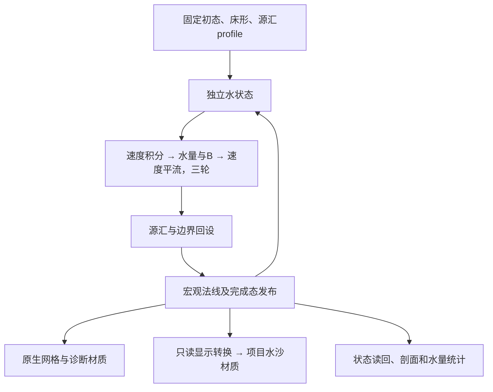

# 竞品水求解独立测试场景可行性

**可以实现，现有公式和资源足以建立固定沙床的独立GPU试验场。** 适合检验竞品公式在Godot中的水量传播、浪形、回流和成本，再与项目MUSCL在明确条件下比较。原作未来造浪时序、原位读写的实际执行结果和长期误差仍有未知，不能将可运行样片等同于完整原作逐帧复现。

本文是Godot适配方案与可行性分析，尚未创建新场景、修改求解器或执行运行验证。竞品公式及选择器沿用[全流程分析](水处理全流程与项目对比.md)，资源可用性按本次独立核对记录。

## TRIAL-FEASIBILITY-01：已有基础及当前缺口

- 核对日期：2026-10-25；capture为`D:/godot/project/sandcastle/sandcastlegame/test1.rdc`，225224034 B，SHA256 `761aa980c2426f75a1fa7364bf6d2655ff4dd20ea76566e630ee5b53ea0ec5b2`。
- 分类：下表是工作区静态事实C3；后文设计为待验证Godot适配，不是新增原作算法结论。
- [来源、可用性与源码副本](evidence/water_trial_feasibility_20261025_v1/inventory.json)记录实际文件和hash；没有启动原作、Godot或新的RenderDoc重放。

| 现有内容 | 当前情况 | 复用边界 |
|---|---|---|
| [试验计算核](../../shaders/simulation/test1_water_motion.glsl) | 存在；速度、水量、速度平流、源汇四阶段 | 主要公式、量化、限幅和边缘处理已有；需要与原指令逐段复核 |
| [试验驱动](../../scripts/visual/test1_water_motion_trial.gd) | 存在；三轮传播后调用源汇，有保持／回落／周期输入 | 依赖旧节点和显示桥，不能单独视为可运行场景 |
| `scenes/test1_water_motion_trial.tscn` | 当前路径不存在 | 不能按历史文档直接F6运行；缺失原因未知 |
| [初态说明](../../assets/test1_water_motion/capture_profile.json)、state／aux | 两份各2097152 B，hash与说明一致 | state来自E6083；aux组合E1537的标志、空气场和障碍采样 |
| 网格、旧材质及环境资源 | 仍在`assets/test1_water_motion/` | 可以参考，未重新运行验证兼容性 |
| [旧显示桥](../../scripts/visual/test1_main_presentation.gd) | 将512×256场采样到256²／32单位显示域，接旧泡沫和前缘 | 不利于原分辨率短波观察；旧材质不代表当前正式材质 |
| 旧逐阶段复算与窗口记录 | 指定test_output路径中的原始索引和所查结果缺失 | 保留历史成功／失败叙述，不计作本轮复验 |

现有核以两个RGBA32F场保存`(vx,vz,A,b)`，8×8线程组、阶段只读输入／独立输出。每tick执行9次传播和1次源汇；床高固定，未单独执行UpdateFloor与UpdateTangent，也没有写出新确认的B标志。原作为打包uint4、32×32线程组、同UAV邻格读取／本格写回，两者并非相同执行实现。

现有CPU模型与GPU核有相同公式来源，互相一致可检查移植错误，但不是两类独立原作证据。外部参照仍应使用原DXBC、常量和配对状态。

## TRIAL-SCOPE-01：推荐第一版范围

第一版使用固定沙床、独立状态和原生矩形网格，保留原作A偏置、边速度语义及源汇。先回答波峰怎样传播、铺开和回流，关闭源汇后的水量残差与波幅衰减是多少，以及深水修正、速度平流和量化分别造成什么影响。

建议独立入口为`scenes/experiments/competitor_water_solver.tscn`，脚本与shader放入对应experiments命名空间。这些是建议路径，目前未创建。固定相机、灯光、水／床网格、诊断界面和信号固化到场景及资源；脚本只负责GPU资源、调度、动态字段和读回。

最小操作包括暂停、单步、复位、输入模式切换、显示模式切换和状态导出。固定seed、profile及初态hash，普通启动与捕图共用入口。正式资源与必要证据保存在正式目录，临时帧图和探针日志可写test_output。

首版不需要动态侵蚀、堆挖、道具或完整粒子系统。先导出B响应图，就能检查泡沫源的数值输入；不必先接524288槽粒子池。固定床面是明确范围，不能声称覆盖了原作动态沙水反馈。

## TRIAL-ARCH-01：数值、显示与诊断分层



底层保留`A`和`h=max(A−0.05,0)`两个概念。项目water保存真实水深，不能直接绑定A；边速度也不能无说明地视为格中心动量。显示转换须明确速度重建、`q=h×v`、坐标翻转、法线、时钟和场尺寸，并只读独立完成态。

首次显示直接消费512×256状态，不先降到旧256²显示域。提供灰模、水深、流速／方向、自由面剖面和B标志视图；水面按已确认的四邻eta平均重建，额外视觉抬升关闭。这有利于把数值波形与材质影响分开。

项目材质作为第二种显示模式，回答“相同水场换成现有着色是什么样”。切换材质不改水状态。当前正式项目已使用RG32F动量，旧显示桥仍是分开的R32F qx／qz，适配时需核对实际uniform和纹理格式；不能把旧桥直接视为当前接口。

## TRIAL-FIDELITY-01：怎样定义“按竞品求解”

| 层次 | 目标 | 结论范围 |
|---|---|---|
| 指令与字段对照 | 打包字段、常量、量化、分支及阶段结果 | 某字段／公式／阶段与capture相符 |
| 固定阶段输入的公式试验 | 每阶段读旧态、写新态，保留公式和量化 | 竞品已知公式在该Godot执行方式下的行为 |
| 项目单位和边界适配 | 统一域、g、时间及输入，与MUSCL比较 | 两种数值方案在共同条件下的差异 |

推荐以第二层建立可重复基线，同时保留第一层取证对照。双缓冲是有意改变阶段读写方式的Godot适配，应写入profile和结果，重复性仍需实测。若专门研究原位更新，再加入独立同UAV变体观察重复执行差异；跨线程组可见次序未完全确定，不能承诺跨驱动逐位复现。

基线保留原24位速度／水量编码舍入。关闭量化只能作为单变量实验；冻结床面、障碍和空气场也要明确记录。旧核重点补核对以下内容：

- 边速度方向、供水侧选择、越界与干格分支，不能只实现简化水面梯度式。
- 深水修正从各边供水深度扣除，不能改成对最终A再减一次，也不自行加原指令没有的正值钳制。
- 在水量限幅后、量化前计算rise，结合输入宏观法线写B。新法线在三轮传播后计算，不能提前改变B的输入时机。
- 旧浮点初态不含宏观法线和B，初始化时需从相应打包水快照恢复；若选择从初始水面重新生成法线，应明确记录为适配，不能用零占位冒充捕帧原值。
- 固定床可以预先得到水床高；若不逐tick执行UpdateFloor，应注明这部分工作不在成本中。
- 源汇与宏观法线有独立阶段和参数；显示材质不承担权威字段更新。

## TRIAL-TIME-01：时钟和初态的边界

本帧三轮传播各dt=0.00732421875，合计0.02197265625；源汇dt=0.025，playTime又是独立输入。旧驱动以tick×0.025命名实验时间，它们没有被证明等于原作墙钟。

建议两套明确profile：捕帧参数profile保留各阶段原常量，分别记录tick、累计传播时间、源汇时间和playTime；共同时间profile明确实验单位，让两个求解器推进到相同目标时间并施加共同边界，重新选择稳定dt。后一项是Godot对照适配。

海侧输入至少有保持、单次释放和周期脉冲。释放曲线、周期和持续时间保存为显式实验输入，不称为原作周期。

保留的state来自**E6083绘制时刻**，适合从已知状态继续试验，不能当作E1490更新前的精确输入。它与E1537辅助量按旧说明组合为实验fixture；派生hash一致不证明各字段属于同一严格执行状态。

要验证单步误差，需要取得同一核的输入、输出、常量与依赖，记录导出发生在事件前还是后。加入独立打开capture及同事件重复读取的对照，避免把跨事件重放差异当作核误差。逐字段报告平均、分位数、局部最大误差和空间分布，再区分原位次序、浮点舍入与实现缺项。

## TRIAL-COMPARE-01：怎样与MUSCL公平比较

竞品原域512×256、30×15场景单位；项目正式域256²、32²米。直接并排播放时，分辨率、重力、时钟和边界同时不同，不能将画面差异全部归因于求解器。因此分开原场景样片和共同数值基准。

| 用例 | 固定条件 | 主要观察 |
|---|---|---|
| 平床／地形静水 | 无源汇、明确封闭边界、相同自由面 | 虚假流速、湿干界面、静水保持 |
| 小振幅单波／波包 | 同水深、波长、振幅、域及时间 | 波幅、相位、速度、色散和衰减 |
| 坡岸上冲／回落 | 同解析坡面和边界脉冲 | 上冲位置、回流、岸上量、薄水残留 |
| 深水及深浅过渡 | 修正阈值上下、关闭外源 | 修正触发、公共边残差及速度变化 |
| 暂停、单步与复位 | 相同初态及请求序列 | 非有限值、负量、重复性和时钟一致性 |

共同基准可先使用项目支持的256²域，为竞品核设置相同cell size、g及边界；原capture参数独立保留。边速度与中心动量需明确初态映射，优先使用双方都无歧义的静止初态或解析场。MUSCL以隔离实例运行，关闭本次固定床实验之外的侵蚀、编辑及额外输入。

至少分别记录`sum(A)`和`sum(max(A−0.05,0))×cell_area`。每阶段记录边界／源汇、限幅和量化影响，检查总量变化与可说明交换的残差；波幅衰减、动量变化和质量残差分别衡量。

成本分为纯水核、显示转换、表现／绘制和完整窗口。使用同输出尺寸、硬件、后端及VSync，记录GPU完成时间和有效推进量。旧驱动的tick_completed来自渲染线程录制后的延迟回调，本身不是GPU耗时测量。也不能用12与901的dispatch调用数之比推导加速。

## TRIAL-DECISION-01：价值、风险与复验

技术可行性高：核心公式、常量、编译程序、派生初态和旧GPU核均可用。工作重点是重建静态场景、校正旧核范围、补法线／B、建立原生显示和可重复诊断。

值得先交付的是可独立F6运行的固定床实验：可切输入、暂停单步、复位，能输出水场、剖面、源汇残差和成本，清楚区分capture参数与Godot适配。核正确性、动态稳定性和视觉表现分别判断，窗口打开不能抵充这些验证。

主要风险是原位读写差异、阶段配对状态缺失、原作时间未知，以及旧显示桥的分辨率和接口。它们限制“与原作精确相同”的结论，但不阻止建立独立试验。

复验本页资源可用性：

```powershell
python -X utf8 D:/godot/project/sandcastle/docs/competitor/tools/audit_water_trial_feasibility.py --output D:/godot/project/sandcastle/docs/competitor/evidence/water_trial_feasibility_recheck_01
```

输出需为新英文绝对目录；命令仅核对静态身份与可用性，不运行场景。旧试验结果不作为该方案的已实现或性能依据。

## TRIAL-RECOVERY-01：缺失信息能怎样取得

大部分缺口有可实施的补证方法。应区分“尚未导出的数据”“需要运行观察的时序”和“原程序没有规定唯一顺序的执行行为”，不能一律归为反编译不足。

本轮仅设计方法并核对工具。当前目录有14份RDC、RenderDoc 1.46、原作可执行文件，以及已有阶段导出器和引擎边界观察脚本；路径、大小、hash和脚本副本见[补证条件索引](evidence/water_gap_recovery_20261025_v1/inventory.json)。文件存在及源码能力为C3，下面方法的实际成功率、兼容性和原作行为均待实验；本轮未新增重放、运行注入或连续观测。

| 缺口 | 首选取证方法 | 可以收敛到什么程度 |
|---|---|---|
| 单核输入、输出与精确边界值 | 小范围重取水核常量、打包状态、依赖；对边缘／干湿／深水阈值格作指令追踪 | 可建立逐核数值基准；完整GPU调度不能由单线程调试证明 |
| 更新顺序与同步 | 从完整API事件和结构化命令检查UAV／资源屏障、队列提交、Signal／Wait及实际资源别名 | 可确认dispatch之间的依赖，不能自动规定dispatch内部线程次序 |
| 同输入重放是否稳定 | 同一输入和依赖hash，比较独立打开及同事件重复执行，记录逐字段差异位置和幅度 | 可测重复性范围；差异根因需要进一步区分 |
| 造浪曲线、子步频率与时间尺度 | 原作运行期间记录水核实际参数和Dispatch、单调时钟，并用少量RDC核对GPU消费值 | 可恢复所观察情形的输入时序；有限样本不证明全部运行模式 |
| 床高、障碍和环境的跨帧变化 | 同时间轴保存相关字段版本与少量完整快照 | 可分辨水核自身、外部输入及床面反馈 |
| 长期误差与波形行为 | 固定输入执行原字节码与重建核，对照源汇和水量／动量／波幅 | 可验证具体配置；改变边界的试验属于受控实验，不冒称原游戏自然过程 |

### RDC配对要避免“假前后状态”

RenderDoc 1.46公开接口明确：`SetFrameEvent(eventId, force)`选择事件执行后的状态；`force`表示强制刷新，不是前／后开关。实现内部先进行WithoutDraw重放，再执行OnlyDraw。见[接口说明](https://github.com/baldurk/renderdoc/blob/v1.46/renderdoc/api/replay/renderdoc_replay.h)与[对应实现](https://github.com/baldurk/renderdoc/blob/v1.46/renderdoc/replay/replay_controller.cpp)。

旧导出器为每个选择器重新打开capture。这能隔离部分控制器历史，却不能保证不同打开得到的输入／输出属于同一次执行。RDC重放结果也不能直接等同于原捕获时的每个线程历史。

应先做最小样本：明确前后事件、完整依赖和写入者，再比较两种重放路径。如果无法可靠配对，可以定向扩展重放器，在目标dispatch前后复制状态到独立GPU缓冲，结束后统一读回；该方案需要实现和验证，不能当成现成Python接口能力。额外copy与屏障可能改变调度，要与无插桩结果对照，不能忽略观测扰动。

更有价值的备选是建立最小D3D12执行器，**直接运行提取的原DXBC**：固定输入、常量、资源视图和线程组，每次恢复相同输入，只执行一个核，再读输出。成功后可把原字节码当作数值参考，与GLSL移植逐阶段比较。需要先验证后端兼容、root signature／绑定及完整依赖，原位核自身的重复性仍需测量；这不等同于恢复整个Unity运行环境。

### 同步问题要分成核间与核内

核间可以查实际屏障和队列。D3D12相邻dispatch不能仅凭事件号推断存在完整UAV数据依赖；UAV屏障用于建立相应访问顺序，见[微软同步说明](https://learn.microsoft.com/en-us/windows/win32/direct3d12/dml-barriers)。核内的组同步只覆盖相应线程组，见[组同步范围](https://learn.microsoft.com/en-us/windows/win32/direct3dhlsl/groupmemorybarrierwithgroupsync)。

因此，前文“同UAV读写”只能确认结构。对现有差异，需依次排查前态不同、缺失依赖、核间同步、重放路径、浮点和量化，最后再研究核内原位访问。若行为确实依赖未规定的线程次序，可能没有一个可从原文件提取、跨硬件复现的唯一答案；可交付的是已确认公式、执行结构、重复性测量和明确的适配选择。

### 跨帧时序已有可复用的观测基础

[运行观察脚本](../../tests/investigation/water_edit_runtime/capture.py)与[agent](../../tests/investigation/water_edit_runtime/agent.js)已有QPC计时、ComputeShader参数缓存、Dispatch观察和捕帧触发。但当前只有Paint核附带参数快照，不能原样宣称已覆盖常规水传播；应定向改为已验证身份的水核，并检查CommandBuffer、全局参数或constant buffer路径是否遗漏。

推荐观测无操作、自然浪输入和一次释放等可重复条件，记录playTime、各阶段dt、customWave、level、waveAmplitude、调用次数和对应时间。CPU设参日志须与少量RDC有效常量配对；CPU Dispatch返回时间不是GPU完成时间。还需比较轻量记录和抓帧运行的扰动，不能用受抓帧影响的频率直接代表正常运行。

只观察必要的水模拟引擎／图形API边界，资源及视觉参数按实际消费核对，不扩展业务调用链调查。运行前核对副本版本与水shader hash；本轮只检查脚本，没有运行原作。

### 已有多帧数据先用于缩小候选

目录中的test35系列可以先比较水shader hash、阶段数量、有效dt、playTime、customWave及床形，查出哪些参数变化、哪些情况值得连续观察。每份capture单独建立资源映射；不能复用test1的ResourceId或事件号。文件名和帧号差不能转换成秒数，内部playTime的差也需先确认其语义和是否发生重置。

建议补证顺序：完整API同步与小样本状态复取 → 同输入重复性 → 必要时原DXBC单核执行器 → 轻量跨帧参数日志 → 单步和短序列移植对照。停止条件是输入依赖、调用时序和误差来源已能解释；不存在唯一调度的部分应明确边界，不靠无限增加捕帧或扩大反编译范围追求确定性。
