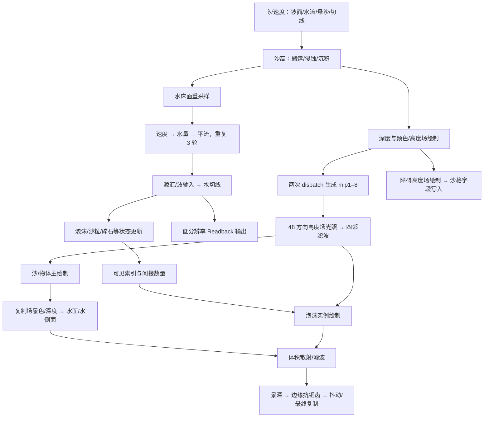

# test1 Shader 执行结构与 MUSCL 对照

本专题分析编译指令、实际绑定和本机 RenderDoc 重放成本，解释沙、水、泡沫及相关视觉链如何组织 GPU 工作。**这帧的主要大块负载包括高度场光照、体积散射和多次几何绘制；水传播链本身很短。** 高利用率的来源不能只从水求解器判断。

[全帧逐 shader 索引](evidence/shader_execution_20261025/summary_v1/shader_index.md)覆盖 **19 个 CS、39 个 VS、52 个 PS，共 110 个不同 DXBC 程序**，并列出每个程序的指令、读取、采样、循环、调用事件和对应成本。主文展开沙水核心及重负载；植被、其他物体和覆盖层仅作绘制结构分类，不分析业务逻辑。

## EXEC-SOURCE-01：证据身份、范围与口径

- 更新日期：2026-10-25。
- 源捕帧：`D:/godot/project/sandcastle/sandcastlegame/test1.rdc`，225224034 字节，SHA256 `761aa980c2426f75a1fa7364bf6d2655ff4dd20ea76566e630ee5b53ea0ec5b2`。`rdc/test1.rdc` 副本大小/hash 相同。
- 工具：RenderDoc **1.46**，`D:/other_software/RenderDoc/qrenderdoc.exe`；工具、脚本、字节码、常量与派生文件的完整 hash 在各 manifest。
- 范围：37 条 dispatch、1509 条 draw action，所有已绑定 CS/VS/PS 已按完整 DXBC hash 去重。没有发现已绑定 GS/HS/DS。draw action 数不等于物体数、材质数或 CPU 函数调用数。
- 本机完整证据：[compute/核心材质](evidence/shader_execution_20261025/selected_v1/manifest.json)、[全帧图形程序](evidence/shader_execution_20261025/graphics_v1/manifest.json)、[后处理复取](evidence/shader_execution_20261025/post_v1/manifest.json)、[资源使用及 mip 视图](evidence/shader_execution_20261025/views_v2/manifest.json)、[三次计时](evidence/shader_execution_20261025/timing_v1/manifest.json)、[汇总数据](evidence/shader_execution_20261025/summary_v1/summary.json)。原始 DXBC、实际消费范围的 cbuffer 字节与派生 asm 分开保存；本次没有导出所有状态缓冲/纹理的完整像素，不能宣称完整模拟快照已恢复。
- [完整文件身份索引](evidence/shader_execution_20261025/evidence_index.json)保存原始/派生产物及生产脚本快照的 hash；[机械校验](evidence/shader_execution_20261025/validation.json)只确认 hash、文件链接及程序覆盖，不替代算法/视觉/运行时性能验收。
- 可信度：编译指令、绑定、分辨率和帧内调度为 **C3 观察事实**；从数据流命名的光照/景深/抗锯齿语义为指令解释，未据此声称恢复原始 HLSL 或包内所有函数名。利用率因果、原作实时 CPU/GPU 耗时仍未知。
- 原始 HLSL 边界：多数程序只有编译字节码；Unity 内部 mip 核附带局部调试源码，不代表其他 shader 源码已取得。默认 asm 会把部分整数位模式显示成 `0.000000`，位域复算应使用原始字节码及 [hex 常量反汇编](evidence/shader_execution_20261025/analysis_v1/analysis.json)，不能照抄该显示值。

**计时条件。** 本机 NVIDIA GeForce GTX 1050，驱动 `32.0.15.8183`；RenderDoc 返回 NVIDIA、D3D12、本地重放、非 degraded。使用内建 `EventGPUDuration`，单位秒，含义为事件前后 GPU 时间戳之差；连续复取三次，每次 1559 条计数结果。Windows 还枚举到 UHD 630，但重放 API 报告的 vendor 为 NVIDIA。捕帧主颜色/深度为 **1280×720**，交换链 **1920×1080**；体积效果/景深工作纹理为 **640×360**，高度场光照为 **256×128**。

这些是**带工具插桩的离屏重放成本**。没有启动原作可见窗口做同钟 CPU/GPU 时间线，未固定 GPU 频率或隔离全部桌面负载，VSync 和实时等待不属于此测量。三次一致支持本机重放的量级与排序，不证明原作原帧耗时，更不能和项目可见窗口 tick 时间直接计算加速倍数。表内 CS 是 dispatch 时间；图形项是整条 draw 的时间，**不是单独 VS/PS 的时间**。

## EXEC-COST-02：实测负载分布

下表对每次重放先累加所列事件，再取三次中位数；不同项目的中位数不要求严格相加。

| 事件/范围 | 本帧次数 | 重放累计中位数 ms | 三次范围 ms | 说明 |
|---|---:|---:|---:|---|
| E3867 高度场方向光照 | 1 | **5.372** | 5.364–5.380 | 48 方向 × 动态步进，全部 CS 的约 62.4% |
| 共享常量 PS 的深度绘制族 | 602 | **6.518** | 6.508–6.518 | 包含不同 VS/几何，不能说“两条 PS 指令花了 6.5 ms” |
| E6275 体积散射 | 1 | **2.726** | 2.726–2.727 | 视线/光照方向双层循环 |
| 沙面主绘制 E4906–5144 | 117 | **2.715** | 2.710–2.717 | E5006 是其中一块，不能用单块代替全沙面 |
| 沙场颜色/高度生产绘制族 | 128 | **2.618** | 2.616–2.622 | 写低分辨率光照的输入纹理 |
| 水面主绘制 E6027–6173 | 64 | **1.244** | 1.243–1.244 | 包含几何、像素和固定管线 |
| E1550 泡沫状态更新 | 1 | **0.855** | 0.848–0.858 | 524288 个状态槽 |
| 全部水更新 E1484–1543 | 12 | **0.813** | 0.806–0.826 | 包含床高、三轮传播、源汇和切线 |
| 沙体更新 E1472/E1478 | 2 | **0.662** | 0.661–0.667 | 1024×512 域 |
| E6354 圆盘景深模糊 | 1 | **0.602** | 0.600–0.603 | 循环 71 次取样 |
| E6411 抗锯齿权重 | 1 | **0.405** | 0.403–0.410 | 多方向边缘搜索和查找表 |
| E6196 泡沫主绘制 | 1 | **0.186** | 0.181–0.188 | 本帧 29950 实例、每实例 6 索引 |

全部 37 次 compute 合计约 **8.608 ms**。高度场光照一次约为整条水更新的 **6.6 倍**，体积散射约为 **3.4 倍**。这支持“视觉链承担大量工作”的观察；它不证明竞品占用率高就代表求解效率高，也不证明目前项目的瓶颈和竞品相同。

## EXEC-COMPUTE-03：19 个 compute 核逐项分析

I 是静态 DXBC 指令行数，包含控制流；L/W 是全局读取/写入**指令位置**，不计硬件事务，不等于采样到的总 texel 数。位域读取可只读记录的一部分；动态循环会重复执行同一位置。除 mip 核为 8×8 外，二维核均为 32×32，粒子核为 1024×1。

| 核 / 首次事件 | 次数 | I；L/W | 本帧累计 ms | 实际写法与代价 |
|---|---:|---|---:|---|
| Ground.VelocityIntegration / 1472 | 1 | 254；13/1 | 0.353 | 中心及邻沙格、水场插值、回溯悬沙取数；同核合入坡面驱动、水流影响、阻尼、限速、切线编码，最后打包写回 |
| Ground.HeightIntegration / 1478 | 1 | 232；9/1 | 0.311 | 上风搬运、平滑、容量侵蚀/沉积、悬沙混合、边界/高度限制同核完成；它不是单独的“高度拷贝” |
| Water.UpdateFloor / 1484 | 1 | 97；5/1 | 0.137 | 读自身水记录和 4 个沙记录，重采样床面、保留水量字段，打包写回；带来跨分辨率和解码成本 |
| Water.VelocityIntegration / 1490 | 3 | 163；5/1 | 0.169 | 中心+四邻，水面梯度驱动、阻尼/邻速混合、干湿阻断和限速；主要用 `movc` 选择，没有迭代收敛循环 |
| Water.HeightIntegration / 1495 | 3 | 125；5/1 | 0.209 | 按速度方向选上风水量，做通量差、深水修正、限幅和量化；部分邻格只读取单字段 |
| Water.Advection / 1500 | 3 | 100；5/1 | 0.184 | 自身速度反推位置，4 个源格手工双线性，写回速度；不是硬件纹理线性采样 |
| Water.UpdateAmount / 1537 | 1 | 131；6/1 | 0.059 | 空气场插值、蒸发、障碍、海侧/波输入及标志更新集中在逐格源汇核；含 `exp`、`sincos` |
| Water.UpdateTangent / 1543 | 1 | 93；5/1 | 0.058 | 邻水面差分、归一化、两路 8 bit 编码；三轮传播后只算一次 |
| Foam.Update / 1550 | 1 | 149；6/1 | 0.855 | 状态读取、低强度槽重置位置、4 水格插值、随流位移/贴水、强度变化；固定容量 524288 槽，重置分支并不跳过后续采样 |
| 第二套表面粒子 / 1555 | 1 | 166；6/1 | 0.278 | 262144 槽；同类随流/贴水更新，强度项消费坡度、速度和水深阈值。包内核名本次未匹配；139589 本帧 usage 只列 barrier 和此更新，没有发现绘制消费者，不能据此宣称永久无用 |
| 沙/水驱动粒子 / 1561 | 1 | 169；12/1 | 0.076 | 先读活跃数量与索引，超界/无效索引立即返回；4 沙格+4 水格手工插值，写粒子 xyz。完整启动容量不等于完整有效计算 |
| Gravel.Update / 1566 | 1 | 207；12/1 | 0.011 | 同类活跃索引过滤、贴床和水平输运，附坡度阈值/个体尺度影响；与 E1561 的写法相似但状态/系数不同 |
| Plant.Update / 1571–1626 | 12 | 251；17/3 | 0.109 | 12 次同字节码、不同实例缓冲；48 B 状态、活跃索引、沙/水插值、姿态更新。此处仅记录 GPU 工作组织 |
| 泡沫可见筛选 / 1634 | 1 | 52；1/2 | 0.130 | 强度裁剪、两组各最多 6 个平面判定；两个全局原子追加点，输出可见索引与间接数量；不是 wave/prefix-scan 压缩 |
| Readback.Update / 1640 | 1 | 192；12/2 | 0.083 | 沙水重采样到 256×128、stride32 输出；一个格写两段 float4/打包字段。核耗时不包含 CPU 读回等待，不能证明运行时每帧同步 |
| Unity MipGen2DCS / 3503、3510 | 2 | 212；0/4，另有共享读取 | 0.028 | 每组 8×8；RGBA 四块共享数组共 1024 B，3 处组同步，一次生成最多 4 级 mip；静态有 9 个 sample 分支位置，本帧偶数尺寸路径首级只执行其中一路 |
| 沙格障碍高度写入 / 3861 | 1 | 40；1/1，另 1 sample | 0.175 | 读自身沙记录和障碍高度纹理，将高度压进 12 bit 字段并保留其他位；域大，短指令不保证比小域复杂核便宜 |
| 高度场方向光照 / 3867 | 1 | 211；7/1，含循环 | 5.372 | 48 个方向、多 mip 步进、颜色/遮挡累计、历史混合；静态 211 行掩盖了大量动态执行 |
| 光照四邻滤波 / 3872 | 1 | 12；4/1 | 0.015 | 四邻平均，139722 读、139723 写；无复杂着色和循环 |

### 水核的共同写法及边界

水格是 **stride16 的打包 uint4**，整张 512×256 缓冲共 2 MiB；沙格也是 stride16，1024×512 共 8 MiB。这不是四个全精度 float 简单拼接：水量/床高/速度、法线及标志占不同位段，程序反复用位移、掩码、浮整转换解码并重新编码。典型速度字段为 24 bit，法线分量为 8 bit。完整数值及守恒边界见[模拟与编辑方案](模拟与编辑方案.md)和[水量守恒](水体运动与回落.md#motion-mass-01水量搬运的守恒结构与完整更新边界)。

E1490/1495/1500 等在同一 UAV 读邻格、写自身记录。检查所有这类核，没有组共享缓存声明或 `sync` 指令；共享缓存只出现在 mip 核。**不能把它解释成“32×32 线程组自动共享邻格”**，实际缓存命中未知。

同一次 dispatch 的跨组执行顺序不能提供严格的“所有线程读旧态、最后一起写新态”。这些核的原位邻格读写没有给 MUSCL 所需的旧/新阶段隔离提供证明；即使增加组内 barrier，也只同步本组。[Microsoft 的组同步说明](https://learn.microsoft.com/en-us/windows/win32/direct3dhlsl/groupmemorybarrierwithgroupsync)限定同步范围为线程组。是否造成此捕帧可观测漂移、量级多大，仍需专门的状态复算；已有不同 fresh replay 分布的观测不能单独归因为这个竞争。

### 低分辨率光照的实际循环

E3867 的 `cb0[138].xy=(256,128)`；`cb0[139]` 在字节偏移 **2224** 处，按实际指令类型解释为 `(int 48, int 5, float 0.2, unused)`。不能把 int 字节按 float 读出的微小数值当参数。

```text
每个像素：读中心/四邻高度，形成局部法线
重复 48 个方向：
    用像素、方向序号、时间字段构造方向
    沿高度场网格步进，单方向上限 256 次
    从当前 mip 读取 RGB + 高度
    更新沿方向的最大遮挡角贡献与颜色
    每级步进计数超过 5 后升 mip；出界可提前结束
    累加环境/方向光和遮挡贡献
新光照 = 48 方向平均
输出 = lerp(旧光照, 新光照, 0.2)
```

`256×128×48×256≈4.03 亿` 是循环访问的理论上限，不是本帧实际访问数。多 mip 与出界终止大幅影响执行长度；warp 分歧、缓存与物理寄存器占用没有在本次计数器中测量。该 shader 是高度场步进，没有调用硬件光追管线的证据。

E3503 的 SRV 是 139720 mip0，UAV 为 mip1–4；E3510 的 SRV 是 mip4，UAV 为 mip5–8。它们是同纹理的**不同子资源**，与水核在同一记录原位更新的风险不同。还观察到首个 dispatch 声明的 256×128 线程覆盖大于 mip1 的 128×64 有效尺寸，第二次也为对应尺寸的 4 倍；因此不能把竞品每处启动规模都当成最优写法。

## EXEC-GRAPHICS-04：顶点、像素与后处理的写法

### 沙、水、泡沫的核心材质

| 程序 | 静态指令 | 读取/采样组织 | 计算安排 |
|---|---:|---|---|
| 沙 VS / E5006 | 141 | 5 个结构化 load 位置 | 沙高/法线/状态解码，4 点水状态插值，把量、速度等送给 PS |
| 沙 PS / E5006 | 145 | 4 空气格 load + 5 sample | 1 颗粒图、2 路 3D 焦散、1 公共光照、1 阴影；湿色/深度权重与光照合成 |
| 水 VS / E6083 | 107 | 6 个结构化 load 位置 | 4 邻水面高度平均，中心已编码法线和速度解码；另读沙状态。PS 无需重新访问整套权威场 |
| 水 PS / E6083 | 119 | 固定 7 个 sample | 3 细法线、2 深度、1 场景色、1 阴影；RGB 吸收、Fresnel、窄高光，无 raymarch 循环 |
| 泡沫 VS / E6196 | 21 | 索引 1 次+状态 1 次 | 强度控制水平小片尺度，随后变换；它不是每粒子 CPU 节点 |
| 泡沫 PS / E6196 | 86 | 4 空气格 load + 2 sample | 圆片裁剪、公共光照/阴影；单片中心 alpha 上限 0.2，重叠片的像素覆盖仍会累积成本 |

这套结构复用模拟状态中已经计算的派生量，并把域级光照结果给多种材质共享。不过它也存在多次几何遍历：深度、低分辨率颜色/高度场、主颜色，以及水侧面等用途分别绘制。**PS 短不代表整次 draw 便宜**；几何量、覆盖范围、深度、混合与次数都参与成本。

侧面也有独立实现：E5286 用 4 点沙高裁剪并叠加空气衰减和条纹；E6184 用 4 点水量/床高裁剪可见侧面，再读取场景色/深度做吸收。二者已进入全帧逐程序索引。

### 两个容易遗漏的长循环像素核

**E6275 体积散射。** 467 条静态 DXBC，12 个结构化 load、5 个纹理 sample 位置，其中相当部分在循环内。先由深度重建视线，与场景盒相交，再沿视线取水面/空气场和 3D 噪声；低密度可跳过、进入水面或透射很低时提前停止。必要时沿光照方向再次积分遮挡，最后把累积散射与原场景色合成。

有效常量 `cb0[145].y/z≈0.2/52`、`cb0[145].w≈0.614`、`cb0[146].x=12`：视线最多 **52 步**，每次的光照方向最多 **12 步**。52×12 是嵌套步数上限，不是每像素都执行的次数。本帧该事件实际输出为 **ResourceId::3462，640×360**；ResourceId 不跨捕帧通用。其 2.726 ms 成本不能记到 Water.VelocityIntegration 头上。

**E6354 景深型圆盘模糊。** 看起来只有 46 条指令、两个 sample 位置，实际其中一个位于固定 **71 次循环**中；连同循环外中心采样，一个未提前退出的像素执行 **72 次取样指令**。指令把有符号模糊半径用于前/后景权重，再分别归一化。该写法直接说明：仅统计 shader 文件数或静态 sample 数，会严重低估工作量。

### 后处理 19 个 PS 的逐项职责

| 事件 | 写法 | 成本判断依据 |
|---|---|---|
| 6229 | 常量输出辅助 pass | 无取样 |
| 6241 / 6251 | 横/纵五点加权滤波 | 每个 5 个 sample，无循环 |
| 6261 | 两输入阈值/掩码合成 | 2 个 sample |
| 6275 | 双层步进体积散射 | 上述 52/12 有效上限，约 2.726 ms |
| 6286 / 6297 | 横/纵五点滤波 | 复用低分辨率工作纹理 |
| 6309 | 单次取样复制/合成 | 2 条指令 |
| 6318 | 检查颜色有效性、异常归零 | 1 个 sample |
| 6329 | 深度线性化、离焦半径编码 | 1 个 sample，无循环 |
| 6343 | 颜色与离焦半径预滤波 | 4 色+4 半径，共 8 个 sample |
| 6354 | 71 点圆盘模糊 | 动态取样量高，约 0.602 ms |
| 6365 | 四点模糊 | 4 个 sample |
| 6378 | 按离焦半径混合原色/模糊色 | 3 个 sample |
| 6388 | 曝光乘数/暗角，含模式分支 | 分支内成本，不能把所有分支同时计入 |
| 6400 | 颜色边缘检测，无边缘 discard | 7 个静态 sample 位置 |
| 6411 | 方向搜索+两张查找表，形成边缘混合权重 | 8 个静态 loop 位置，不是 8 层嵌套；约 0.405 ms |
| 6423 | 依据邻边权重混合颜色 | 条件路径，6 个静态 sample 位置 |
| 6434 | 颜色空间转换间加入噪声抖动 | 2 个 sample，含幂函数 |

完整 39 VS/52 PS 的每个程序、重复绘制次数和对应成本见[逐 shader 索引](evidence/shader_execution_20261025/summary_v1/shader_index.md)。上述描述以指令为依据；景深/形态抗锯齿为算法类别识别，没有声称已匹配所有原包 shader 名称或版本。

## EXEC-DEPENDENCY-05：整条处理链



图为本帧主要数据依赖，不代表所有支路并行执行或所有资源都由本帧首次生产。例如 E1537 在 E3518 之后的障碍场绘制前已经读取 139724，说明不能把本帧后写入的障碍内容冒充该次水更新的输入。低分辨率颜色/高度生产绘制也读取尚未被 E3872 更新的 139723；E3867 读取旧 139722 做历史混合。两者均须保留跨帧资源语义。

## EXEC-ADAPT-06：对 MUSCL 的实际启示

以下是 **Godot 优化候选/算法推断**，不是原作已证实加速比例，也不是本次实施变更。

| 方向 | 从竞品得到的依据 | 适用性与负面影响 | 建议顺序 |
|---|---|---|---|
| 双分量动量打包 RG32F | 共同消费字段放在同一记录 | 同时读两分量时可少一次图像访问指令/绑定；总数据仍是 8 B，不保证带宽下降；单分量消费者、恢复/发布链需同步适配 | 当前正式链路已合并为 RG32F，CPU/磁盘保留分量；实际成本仍须按完整负载量测，见[动量资源](../当前项目技术方案.md#动量资源与完成态读取) |
| 降低无效候选的命令成本 | 原作传播链只有三轮、12 个水 dispatch，未见 MUSCL 式全局接受/拒绝链 | 项目固定 64 个候选、每阶段录制 compute list；间接零工作不等于 CPU 录制/命令处理免费。需证明瓶颈在提交空隙，不能先牺牲重试能力 | 优先与动量打包分开测量 |
| 按核选择线程组 | 原作二维 32×32、线性 1024×1；mip 却用 8×8 | 线程组更大不会增加总格数；寄存器、共享内存、驻留组数、尾部浪费都可能变差。项目复杂 MUSCL 核不能照搬 1024 线程 | 对普通逐格核单独比较 16×8、16×16、32×8，最后再考虑 32×32；64 线程归约核单独处理 |
| 按更新频率拆分模拟与表现 | 水切线在三轮传播后一次计算；光照/粒子独立更新 | 仅能外移不参与下一子步物理反馈的派生量；影响侵蚀、源汇或材料的量不能随意降频。保持同 generation 的完成态 | 收益潜力值得审计，先明确消费者 |
| 融合共享同一输入的逐格计算 | 沙高核同时做搬运/交换/限制；源汇核组合多个局部项 | 可以省中转/读写；跨格新结果依赖仍须分阶段，融合还会提高存活变量/寄存器压力 | 仅对合法局部依赖做单变量候选 |
| 邻格共享缓存 | 此帧沙水核并未采用；mip 核只共享局部归约 | 打包前后缓存收益可能不同；之前项目共享邻格候选的低收益结果仍有效，不能因竞品大线程组就推翻 | 放在具体热点与缓存证据之后 |
| 单缓冲原位邻格更新、位级压缩 | 原作通过不同数值/时序取舍减少状态占用 | 改变 MUSCL 阶段隔离、精度与守恒风险；并非透明内存优化 | 不纳入保持现有契约的性能改造 |
| 增大网格或加重单核以提高利用率 | 原作水域 131072 格、沙域 524288 格；项目当前域 65536 格 | 增加工作量可让 GPU 更忙，但不能说明单位有效工作更快 | 仅用于扩展性实验，不作为优化验收 |

当前项目对照依据为 `scripts/simulation/unified_edit/water_muscl.gd` 的 64 槽循环、逐阶段 `compute_list_begin/end`，以及 `shaders/simulation/muscl/muscl_spatial.glslinc` 的 8×8、`rk_decide.glsl` 的 64 线程声明。CPU 录制描述缓存已经存在，不能把“继续缓存”写成尚未实现的建议；是否应合并 list 要满足 Godot 实际 barrier 与 push constant 契约，不能只删除边界。

大工作组、高 occupancy 与高吞吐没有单调关系；[NVIDIA 官方优化指南](https://docs.nvidia.com/cuda/cuda-c-best-practices-guide/index.html#occupancy)明确指出更多 occupancy 不一定提升性能，需要结合每线程寄存器等资源限制。该原则用于提出对照实验，不能由 DXBC 的 `dcl_temps` 直接算 GTX 1050 的真实 occupancy。

**验收量应是同完成模拟时长、同精度/守恒条件下的 GPU 时间与有效 tick 吞吐，并同时记录 CPU 录制及 GPU 队列空隙。** 原作 CPU 利用率较高可能包含大量几何提交和其他 CPU 工作；RDC 的 shader 字节码不包含 CPU 线程时间线，因此本次没有确认其原因。

## EXEC-REPRO-07：复验、反证及未知项

复验先确认上述捕帧大小/hash；使用以下脚本和各 manifest 中的环境变量，以**新建绝对英文目录**输出，禁止覆盖旧数据：

1. [export_shader_execution_audit.py](tools/export_shader_execution_audit.py)：`qrenderdoc.exe --python`，`SHADER_AUDIT_OUT`、`SHADER_AUDIT_SELECTION`；所选 CS/VS/PS 的原字节、常量、绑定。
2. [export_shader_graphics_inventory.py](tools/export_shader_graphics_inventory.py)：`SHADER_GRAPHICS_OUT`；全 1509 条 draw 的 stage hash 和所有首次出现程序。
3. [export_shader_execution_views.py](tools/export_shader_execution_views.py)：`SHADER_VIEWS_OUT`；关键资源 usage、mip/slice 视图。
4. [measure_shader_execution_replay.py](tools/measure_shader_execution_replay.py)：`SHADER_TIMING_OUT`；同一打开的捕帧连续三次 `FetchCounters(EventGPUDuration)`。这是重放复验，不替代可见窗口成本测试。
5. [analyze_shader_execution_audit.py](tools/analyze_shader_execution_audit.py)：输入 manifest 和新输出目录；核对 raw hash，生成带精确常量的 asm 和静态统计。[summarize_shader_execution_audit.py](tools/summarize_shader_execution_audit.py)将事件与三次计时连接，输出固定的 `summary_v1`，重跑前需将脚本输入/输出改为新的版本目录。

预期观测：19/39/52 个不同程序，水速度/水量/平流各出现 3 次，E3867 的 48/5/0.2 常量，E6275 的 52/12 步数上限，E6354 的 71 次循环。新重放的 GPU 时间不要求与本次逐位相同。

保留的反证与限制：短 PS 对应的 602 次深度绘制累计并不小；仅 mip 核使用共享内存；部分 dispatch 覆盖大于有效 mip 尺寸；第二套表面粒子本帧未发现消费；32×32 不是“免费高利用率”；原位邻格写入也不是严格旧态隔离。这些事实阻止把竞品整体当作所有局部写法都更优的证据。

尚未知：原作可见窗口 CPU/GPU 时间线、频率和 VSync；GPU 空闲间隔、物理寄存器、occupancy、缓存命中与带宽占比；动态循环实际步数；所有帧的粒子活跃率/生命周期；跨帧输入时延；原位更新对数值漂移的实际影响；完整图形程序与包内名称逐一对应。要回答“CPU/GPU 为什么持续高利用率”，下一份有区分力的证据是同场景可见运行的 CPU 线程/提交/GPU 队列时间线。

修订关系：补充[水更新调度](水体运动与回落.md#motion-perf-structure-02水更新调度与-muscl-优化边界)、[水材质](水体材质_RDC详解.md)与[泡沫专题](泡沫与当前项目对照.md)。新增的是全帧程序覆盖和本机重放成本；不回写旧失败、不把历史缺失快照改为完整、不将重放成本升级为原作实时性能。
