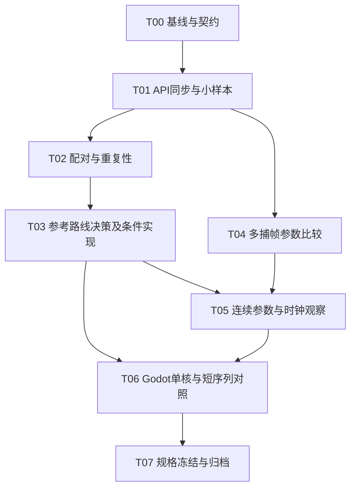

# [进行中] 竞品水求解补证与最小移植验证计划

角色：execution_plan。编制日期：2026-10-25。执行方式：单主执行者串行；T00–T05已完成，G0–G4按所选条件通过；当前进入T06隔离核，T07仍待执行。

## 1. 目标与交付

把竞品水求解的已知公式补成可实施、可验证的技术规格：恢复阶段输入和输出及同步关系，辨明原位更新的重复性，观测实际参数和时间序列，再用隔离的Godot计算核作单步与短序列对照。交付逐核参考数据、时间／输入记录、误差与未知项说明，以及独立固定床测试场景的实施输入规格。

来源：[补证路线](../../docs/competitor/独立水求解测试场景可行性.md#trial-recovery-01缺失信息能怎样取得)、[全流程分析](../../docs/competitor/水处理全流程与项目对比.md)、[补证条件索引](../../docs/competitor/evidence/water_gap_recovery_20261025_v1/inventory.json)、[项目约束](../../AGENTS.md)、[已有技术契约入口](../../docs/knowledge/README.md)。旧场景、旧核和旧结果仅为复用来源，不计新完成。

最终交付必须回答：每个核读取什么、怎样计算和写回、依赖什么同步、何时调用、时间如何解释、误差如何衡量，以及哪些项尚不能承诺与原作一致。

## 2. 文档角色与进度

| 文档 | 角色 | 用途 |
|---|---|---|
| 本总纲、[需求映射](需求映射.md)、[任务细则](细则/README.md) | execution_plan | 计划范围、依赖、完成条件 |
| [契约](契约/README.md) | draft_contract | 文件接口、原始证据、时间和误差边界；T00及后续指定门冻结 |
| [执行状态](执行状态.md) | execution_state | 进度、写锁、分支决定和证据索引的唯一主表 |
| [决策记录](决策记录.md) | planning_decisions | 路线变化、条件分支与停止理由 |
| [验收](验收/README.md) | verification_evidence | 实际命令、运行结果和Gate报告；计划审阅不算运行验证 |
| 上述竞品文档和历史任务 | source / archive | 已知证据与旧边界；不覆盖原报告 |

| 层级 | 状态 | 初始进度 | 说明 |
|---|---|---:|---|
| 补证与最小验证整体 | [进行中] | 6/8任务，25/32小目标 | T00–T05已完成，T06为1/4 |
| T00–T07 | [进行中] | T00–T05为4/4；T06为1/4；T07为0/4 | 见执行状态与各细则 |
| G0–G6 | [进行中] | 5/7门 | G0–G4通过（限定已登记条件） |

状态使用`[未开始] [进行中] [已完成] [阻塞] [需返工] [暂停] [已跳过]`。已完成须有对应验证证据；依赖等待仍为未开始，不预设阻塞。T03始终要完成路线决策；只有不需要的实现子目标可有证据地跳过，并单独列出，不计作实测通过。

## 3. 范围口径

| 内容 | 分类 | 完成边界 |
|---|---|---|
| test1水核身份、输入依赖、完整API同步图 | MVP | 覆盖UpdateFloor、三轮速度／水量／平流、源汇、法线；事件号仅在匹配hash内有效 |
| 配对快照、重放重复性、字段解码与误差预算 | MVP | 实际原始数据和正反例可复验，不以导出成功代替算法判定 |
| 原DXBC最小执行器／定向重放插桩 | MVP（条件分支） | T02决定；已有可靠参考可复用时不强制两套都建 |
| 多RDC参数比较及原作轻量连续观察 | MVP | 同程序身份、参数实际消费、QPC与模拟时钟对应；观测范围明确 |
| Godot隔离计算核、单步和短序列对照 | MVP | 核级验证器，固定床／固定依赖；不更换正式求解器 |
| 独立场景实施规格与可信度归档 | MVP | 参数、接口、初态、时钟、限制和后续验收输入齐全 |
| 完整可交互试验场景、精美材质与MUSCL效果排名 | vNext | 使用本次结果另行实施，不以本计划完成宣称场景已建 |
| 512k泡沫粒子、动态侵蚀、挖填／碰撞／恢复整合 | vNext | 本次只保留水量核B与宏观法线相关字段 |
| 跨硬件逐位一致、全游戏阶段时序 | out_of_scope | 可量测限定配置，不承诺未规定的GPU调度 |
| 业务代码、任务／经济／存档逻辑及全量反编译 | out_of_scope | 观察限必要的水模拟引擎／图形API与资源 |
| Web服务、数据库、前端路由、空壳工具 | out_of_scope | 本项目采用本地CLI／JSON和GPU探针；不生成无关API模板或伪实现 |

## 4. 运行模式矩阵

| 模式 | 依赖 | 输入／工具入口 | 验收口径 |
|---|---|---|---|
| static_audit | Python、已保存原字节 | 现有审计脚本＋新manifest校验器 | 文件身份、范围、可用性；不是新算法复验 |
| rdc_replay | RenderDoc 1.46、匹配后端与GPU | 独立导出器；先小样本 | 重放状态、有效常量、完整事件依赖和误差分布 |
| native_reference | D3D12 SDK、编译器、原DXBC | T03条件建设的单核执行器 | 同输入恢复、绑定和原程序执行；不是完整Unity复刻 |
| replay_instrumented | 可构建的对应RenderDoc源码 | T03选择时才改重放器 | 实际前后配对与插桩扰动；不能假设现有Python API已支持 |
| runtime_trace | 经过身份验证的程序副本、隔离运行数据、引擎／图形API探针 | T05定向观察器 | 参数、调用和QPC轨迹；CPU返回不当GPU完成 |
| godot_probe | 当前Godot、真实RenderingDevice | 新的隔离计算探针 | 原生512×256状态、阶段对照、短序列和释放；不绑定正式场景 |

GPU实验串行占用。性能数据仅作方法诊断，不设“快于MUSCL”目标；测量需记录窗口、输出尺寸、后端、GPU／驱动、VSync及计时口径。长稳与完整画面成本属于后续场景验收。

## 5. 执行DAG与任务



默认执行顺序T00→T01→T02→T03→T04→T05→T06→T07。T04逻辑上不依赖T02／T03，可在工具外部等待期间做只读分析；仍由同一主执行者串行安排，不自动创建subagent。T06可在时间资料待取时准备单核代码，但整体验收依赖T05，不能把未知时间填成固定40Hz。

| 任务 | 内容 | 依赖 | 状态／进度 | 出口 |
|---|---|---|---|---|
| T00 | 执行基线与契约冻结 | 无 | [已完成] 4/4 | G0 |
| T01 | API同步与阶段小样本 | T00 | [已完成] 4/4 | G1 |
| T02 | 状态配对和重放重复性 | T01 | [已完成] 4/4 | G2 |
| T03 | 参考执行路线及必要实现 | T02 | [已完成] 4/4 | G3 |
| T04 | 多捕帧参数及候选时序 | T01 | [已完成] 4/4 | T05输入 |
| T05 | 运行参数、时钟与观察扰动 | T03、T04 | [已完成] 4/4 | G4 |
| T06 | Godot核与短序列对照 | T03、T05 | [进行中] 1/4 | G5 |
| T07 | 实施规格、结论与归档 | T00–T06 | [未开始] 0/4 | G6 |

各任务负责人均为主执行者。禁止并发修改契约、导出器、共享shader或同一输出目录；原作、重放器、原DXBC执行器、Godot GPU实验不能同时运行后拼接性能结果。

## 6. Gate清单与失败处理

| Gate | 必须满足的条件 | 失败出口 |
|---|---|---|
| G0 基线 | 源身份、作用域、工具版本、目录、契约和写锁明确 | 错版本／路径缺失有记录，先修基线 |
| G1 小样本 | 至少一个核有完整字节、绑定、常量、前后边界定义；核间屏障／队列证据可定位 | 缺依赖不能进入公式误差判定 |
| G2 配对与重复性 | 小样本矩阵有效；区分同输入重复与不同重放前态；提出参考路线和初步误差来源 | 根因未明保留C0，触发T03替代方法 |
| G3 参考可用 | 每类水核有可追溯参考输入／输出，含原位模式和重复性范围；容差规则在看候选结果前冻结 | 无参考不得以CPU自洽代替原作核验 |
| G4 时序 | 所选条件的参数／调用／单调时间有配对、GPU常量抽查及观测扰动说明；无静默丢样 | 只得到部分轨迹就标部分，不能宣称原作完整周期 |
| G5 移植 | 解码／保留位、边界分支、单步与短序列符合冻结判据；原位／双缓冲结果分列 | 失败定位到字段／阶段／坐标，不调容差掩盖 |
| G6 交付 | 来源、规格、结论、反证、未知和复验入口齐全；必要原始资料正式归档 | 关键输入／参考不完整则不能宣称具备忠实复刻依据 |

Gate报告只在实际执行后创建。G3允许通过“可靠原重放参考”路线，不要求必须有原DXBC执行器。若工程兼容性小样本失败，先记录一次原因明确的修复或替代路径；同一原因、相同配置不机械反复重跑。每个后续实验必须写出能区分的候选解释。

G6结论分为：`ready`（约定范围规格与验证闭合）、`bounded`（核验证闭合，非唯一调度或限定条件外时序有明确边界）、`insufficient`（关键依赖／参考／时间配对不足）。`bounded`必须列出可实现范围及禁止外推；`insufficient`不能将关键Gate或总体任务改为已完成。未知项不得通过改名成适配来消失。

## 7. 契约与验证入口

字段级接口见[取证接口与来源契约](契约/取证接口与来源.md)，数值／时间／停止条件见[参考执行与比较契约](契约/参考执行与比较.md)。核心接口为本地JSON请求、manifest响应和原始文件，不采用HTTP／OpenAPI。

验证按：源身份与索引负例 → 单核小样本 → 同输入重复性 → 参数／时钟轨迹 → 移植单步 → 短序列推进。不要先做完整长稳或批量导出14帧全部资源。每个测试记录代码、资源和profile hash，固定输入；多RDC必须重新匹配shader及资源，不复用裸事件号。

## 8. 文件布局与正式证据

```text
task/competitor_water_solver_evidence/
  总纲.md / 需求映射.md / 执行状态.md / 决策记录.md
  契约/                  # 约定，不存实际测试结果
  细则/                  # T00–T07与小目标
  验收/                  # Gate报告和轻量验证记录
  verification/          # 计划结构审阅的机器记录，不是技术Gate
  tools/                 # 执行时创建，ASCII名称
  requests/              # 执行时创建，JSON请求
  work/                  # 执行时临时构建，非唯一证据
docs/competitor/evidence/water_solver_reconstruction/<run_id>/
  manifest.json / raw/ / derived/ / sources/ / logs/
docs/competitor/          # 已确认技术结论与未知项的统一归档
```

本任务根有`.gdignore`，隔离构建及脚本副本避免Godot自动导入。需运行的Godot核在T06创建独立正式探针路径，不放在被忽略目录里。所有机器产物、原作副本与RenderDoc脚本使用完整英文绝对路径。test_output只保存可重建临时内容；Gate验收前将必要证据迁入正式目录并重新校验引用。

## 9. 立即执行入口

T00已完成，见[G0](验收/G0_20261025.md)。T01已完成，见[G1](验收/G1_20261025.md)。T02已完成，见[G2](验收/G2_20261025.md)。T03参考与已登记单核判据已冻结，见[G3](验收/G3_20261025.md)。T04已完成，见[T04报告](验收/T04_20261025.md)。T05已完成，见[G4](验收/G4_20261025.md)。当前进入T06独立Godot计算探针；T06、T07仍须完成。不编写完整交互场景，不改变main或test1_geometry。

当前可运行的取证工具、实际命令、失败和来源见[隔离及观察报告](验收/T05_isolation_preparation.md)，自然及受控配置以G4关联的两份D07为准，时间映射见[clock_mapping](../../docs/competitor/evidence/water_solver_reconstruction/t05_clock_mapping_20261025_v1/clock_mapping.json)。后续工具仍需真实入口及最小调用，不能把计划当成执行结果。

当前T06-G02：快照72身份／216次逐位相同；六核小样本双向原位读流配对与独立审计通过。完整72身份矩阵中断于第48个身份，前47个三阶段完成，第48个只完成原生阶段；不接受全矩阵。GPU启动器的临时目录、用户数据和缓存须先满足项目内写入边界，再补剩余覆盖。详见[执行状态](执行状态.md)及六核诊断报告；进度仍25/32，完整原位、短序列、生命周期与T07范围不变。
