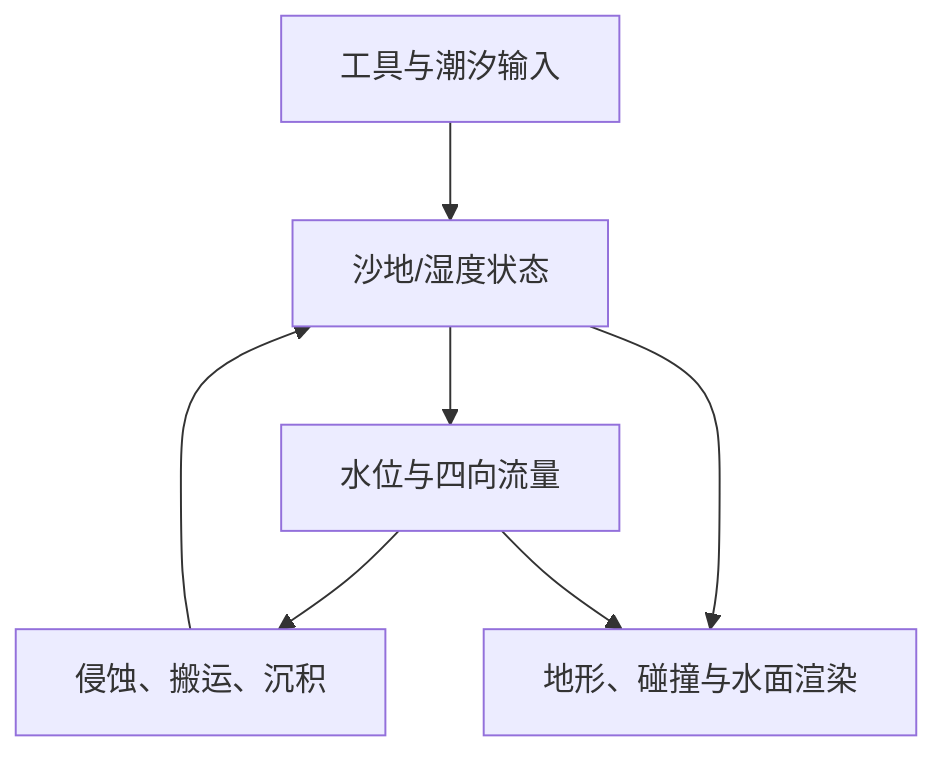

# Godot 4.7.2 水沙耦合系统分阶段执行计划

> 本文是 2026-09-27 的历史规划，阶段名称、预估工期和待办描述不代表当前进度。当前交付、暂停状态、未完成项及目录迁移见[项目现状](../../README.md)；各阶段原判定见[历史任务记录](../README.md)。

版本：v1.1（自审补全）｜日期：2026-09-27｜目标：复刻《Sandcastle》中可塑沙地、水流改道、冲刷、沉积和局部坍塌的**可观察行为**。

> **证据边界**：已检查 `testnew.rdc`。它是 RenderDoc 1.46 的 Unity/D3D12 捕获，内嵌画面为 1920×1080，捕获信息出现 NVIDIA GeForce GTX 1050。截图可观察到浅水、水下沙地和物件、沙堡接触水线；捕获中有计算着色器字节码，但当前分析环境不能结构化回放该 D3D12 帧。**下述水流求解、GPU 网格及侵蚀模型是面向 Godot 的复刻设计，不是对原作内部实现的断言。**

> **本次自审结论**：v1.0 覆盖了主路径，但没有充分展开求解器选择、湿干界面和潮汐边界、编辑水下沙地时的水体重分配、动态障碍占水、GPU→CPU 小区域读取、分块碰撞成本、保存快照时序、失败转向规则。v1.1 已在 S0/S2/S3/S6 阶段门与第 7–11 节补齐。这里的“完整”以本文件明确的 2.5D 加局部构件范围为准；任意体素雕刻是另一个项目量级。

## 1. 项目边界与最终验收

### 1.1 首个完整版本必须具备的闭环

1. 玩家从一个位置挖走沙并堆到另一位置，沙量可追踪。
2. 潮水进入沟渠，绕过沙墙，填满洼地，退潮后留下湿沙。
3. 水冲刷松散墙脚，携沙移动，在下游或低流速区沉积。
4. 拍实或适当润湿的沙结构比松散干沙更稳定；过陡或失去支撑时局部塌落。
5. 沙地几何、水面几何、水线、物理交互读取同一套状态，不出现明显的“画面已变、碰撞未变”。

### 1.2 明确暂缓

- 完整 3D Navier–Stokes、SPH/FLIP 水体、真实破碎浪和飞溅粒子物理。
- 任意形状、任意位置的体素雕刻及从中间挖空的塔楼：基础版只支持 2.5D 地形和预定义的局部沙堡构件。第 6 阶段单独评估是否升级。
- 沙粒级全局模拟。近景少量粒子可以作为画面反馈，不承担全局质量守恒。

### 1.3 建议的统一坐标和状态

首个测试场为 **32 m × 32 m、256 × 256 格**，每格约 0.125 m。固定模拟步长从 30 Hz 开始，渲染独立运行。数值是起点，阶段 0 在目标硬件上测量后可调整。

| 状态 | 含义 | 初始方案 |
|---|---|---|
| `rock` | 不可侵蚀基底高度 | 静态 R32F |
| `sand` | 可移动沙的**参考密度等效厚度**，代表质量存量；S1–S4 暂取几何厚度相等，S5 决定是否加入密度/压实引起的高度变化 | 双缓冲 R32F |
| `water` | 有效水域内水深；`surface = bed + water` | 双缓冲 R32F |
| `flux` | 向四邻格的**体积流率**，统一 m³/s | 双缓冲 RGBA32F 起步；量测后再试 RGBA16F |
| `sediment` | 水中悬浮沙量，采用与 `sand` 相同的参考密度等效厚度 | 双缓冲 R32F |
| `wetness` | 湿度 | R16F |
| `compaction` | 压实度 | R16F |
| `obstacle` | 不可移动物件及局部沙堡的占用/阻水信息 | R8 或 R16F；必要时拆成高度与材质两图 |

**守恒口径**：封闭边界、无玩家输入时，`Σ water × 单格有效水域面积`基本不变；`Σ (sand + sediment) × 单格面积`基本不变。后者是**参考密度下的沙量账户**，不是压实后实际几何体积；S5 可由压实度对应的体积密度换算可见沙层高度。`sediment` 是单位面积悬浮沙的等效厚度，不是水中浓度；开放整格的浓度比例为 `sediment/max(water,ε)`，部分格应再按 `A/A_eff` 修正。潮汐、雨、蒸发、玩家取走或加入沙均记录为显式输入/输出。第 8 节给出单位与误差公式。

## 2. 技术路线与模块

**模拟**：先用 64² CPU 参考实现验证算法，再迁移到 Forward+ 的主 `RenderingDevice` 计算着色器。主设备产生的纹理经 `Texture2DRD` 给地形和水材质采样；不要把本地计算设备产生的 RID 当作可直接显示的主设备纹理。读写状态使用 ping-pong，避免同一 pass 对同一纹理同时读写。计算调度在渲染线程进行，GDScript 负责输入、资源生命周期和调试控制。

**水流**：S2 同时评估四邻格虚拟管道模型与保守型二维浅水方程的最小参考实现。前者实现快、适合沟渠和蓄水；后者更适合有动量的涌水、反射和沿岸波。**在 S2 的破坝、斜坡静水、潮汐湿干、墙体开口算例通过前，不锁定生产求解器**。两者都必须有显式的水量预算、时间步约束、正水深处理；单靠 `max(water, 0)` 不能修复质量损失。

**沙地**：固定拓扑网格在顶点着色器采样 `bed = rock + sand_height` 位移。S1–S4 可令 `sand_height=sand`；S5 若要压实后地形降低，则按实际体积密度把守恒的沙量换算为 `sand_height`。材质用湿度改变颜色和粗糙度。水网格顶点采样 `bed + water`；近零水深处裁切或柔化岸线。大尺度水流来自模拟，小尺度波纹与白沫属于表现层，不反过来虚构水量。

**碰撞**：CPU 保存分块、较低分辨率的地形代理。**注意 Godot 的 `texture_get_data_async()` 按纹理/层读取，并没有直接的任意矩形小块参数**；要只取脏块，需先在 GPU 把所需区域打包到小纹理/缓冲，再异步读取，或一开始就将模拟纹理按块管理。S0/S3 必须测这条实际路径。玩家工具落点先由可用碰撞/代理定位，再转换到模拟格。不要每帧读取完整 GPU 状态或重建整片碰撞。

## 3. 阶段总览与里程碑

工期按**一名熟悉 Godot 和 shader 的开发者全职**估算；美术资源、陌生 GPU 调试和任意体素雕刻会增加时间。阶段不能仅凭“看起来能动”放行，必须附测试记录。

| 阶段 | 预计 | 本阶段完成时玩家可看到什么 | 放行门槛 |
|---|---:|---|---|
| S0 目标、基线与风险验证 | 4–7 天 | 固定测试场，四个高风险原型结果 | 算法、GPU共享、碰撞、3D形状范围决定 |
| S1 沙地编辑与守恒 | 1–2 周 | 挖、堆、拍实；可显示高度/湿度调试图 | 工具量守恒、网格无裂缝 |
| S2 CPU 水流参考与求解器选择 | 2–3 周 | 挖沟导水、筑坝蓄水、退潮、破坝 | 两类求解器对照后锁定生产方案 |
| S3 GPU 迁移与同源显示 | 2–3 周 | 256² 场景流动，水与沙显示同源 | 与参考算例一致且无每帧全图回读 |
| S4 冲刷、搬运、沉积 | 2–3 周 | 墙脚被冲、下游堆沙 | 沙总量守恒、侵蚀位置合理 |
| S5 湿度、压实和塌坡 | 1–2 周 | 干湿沙强度差异、支撑失效 | 可重复的强度对照与塌坡测试 |
| S6 沙堡构件与局部坍塌 | 3–6 周 | 高塔/墙体被水逐步破坏 | 结构受支撑条件驱动，不靠计时脚本 |
| S7 水沙画面与工具手感 | 2–3 周 | 接近参考的浅水、白沫、湿沙 | 参考镜头和交互录像验收 |
| S8 整合、性能与可靠性 | 2–4 周 | 连续可玩的沙滩 | 长时稳定、存档与目标性能通过 |

**核心可玩原型：S0–S4，约 8–14 周。完整沙堡系统：约 4–8 个月。**增加的时间来自求解器比较、GPU↔碰撞链路和早期失败验证；它是计划工期，不是保证工期。此估算不包括升级为全局 3D 体素沙雕；是否升级应在 S0、S6 两次作明确决定。

## 4. 各阶段执行与验收

### S0：锁定目标、证据和四个高风险验证（4–7 天）

**执行**

- 在项目中建三种标准场景：斜坡海岸、弯曲沟渠加洼地、沙墙加两座塔；固定相机和光照。
- 保存参考截图及至少三段连续视频：挖沟导流、墙脚侵蚀、塔/墙坍塌。RDC 静态帧只能说明画面，不能证明时序及算法。
- 确定目标平台和最低显卡；优先使用 GTX 1050 级别机器作为保守参考，但该抓帧本身**不能**提供水沙 pass 耗时。
- 明确版本范围：基础版是否允许拱洞、悬挑及横向掏空。若必须任意掏空，提前为局部体积网格单列技术预研和预算。
- 建立视频对照和数值日志模板：总水量、总沙量、每帧 CPU/GPU 时间、负水深格数、脏块数。
- 做四个独立技术验证：①主 RD 计算纹理同帧进入沙地/水面材质；②最小湿干/破坝 CPU 算例可暂停逐步查看；③计算状态中一块 32² 高度能异步送到一个碰撞块并量测延迟；④一堵高墙带拱洞或悬挑时，高度图与局部构件两种表达的功能差距。每项记录代码快照、屏幕录像、资源格式、耗时、失败日志。
- 列出参考视频中**必须复制的行为**与仅由静帧猜测的效果。若拿不到时序视频，只能以本文件的测试行为为替代验收，不能声称还原原作细节。

**交付物**：目标镜头、3 个测试场、硬件档位、测试记录模板、4 份技术验证报告、2.5D/局部体积的范围决定。

**验收**：任意开发者按同一输入种子可重现测试场；明确 256²/30 Hz 只是初值，记录首次性能基线。主 RD 纹理可见；小块回读/碰撞链路给出实测延迟与耗时；求解器比较指标和 3D 形状范围落在决策记录中。**四项验证有任意一项没有结果，不把对应风险留到 S6/S8。**

### S1：可塑沙地与工具操作（1–2 周）

**执行**

- 实现 `bed = rock + sand_height`，初期 `sand_height = sand`；不允许工具或侵蚀把守恒状态 `sand` 减到负数。
- 做画笔命令：取沙、放沙、抹平、拍实；每条命令带位置、半径、强度、种子和源/目标沙量。
- 取放沙使用体积账户：挖得的量进桶，堆沙从桶扣除；可以另外提供带明确外部来源的“无限沙”调试工具。
- 网格切块；生成高度、坡度、沙层厚度、压实度的伪彩调试视图。先在 CPU 64² 实现参考规则，不做性能优化。

**验收场景与阈值**

- 同一位置连续挖 100 次不会穿透 `rock`，无负沙层、NaN、网格裂缝。
- 在封闭场地“挖出 1 m³、原量搬运并堆放”后，沙总量相对误差 **≤0.5%**；工具输入量另外记录。
- 每次画笔释放后可撤销/重放同一命令并得到同一网格状态；3 个固定种子重复结果一致。

**不过关先查**：工具核函数的体积归一化、边界裁切、浮点累计、网格块接缝。

### S2：CPU 水流参考与求解器选择（2–3 周）

**执行**

- 实现虚拟管道基线：四方向流量、水深更新、封闭和潮汐边界、固定步长、干湿阈值；再实现保守浅水方程最小 CPU 对照（至少保存水深及二维动量，使用带床面高度的静水保持/正性处理）。对照只需 64²，不要求两套 GPU 产品化。
- 提供手动单步、暂停、1×/10×速度和水位/流量箭头可视化。
- 添加 7 个算例：平盆静水、**不平床静水**、单侧注水、弯沟导流、沙墙挡水后开口、破坝冲击、往复潮汐湿干边界。暂不做侵蚀。
- 统一比较水量误差、到达时间、墙前积水高度、岸线反射/抖动、干格再湿润、每步 CPU 耗时；依据目标效果决定生产算法。若虚拟管道缺乏可接受的冲击/回退行为，改用保守浅水求解器，S3 工期重新估算。

**验收场景与阈值**

- 封闭平盆运行 5 分钟模拟时间：`water ≥ 0`，无 NaN，扣除明确源汇后总水量相对误差 **≤0.5%**；静水不自发产生持续单向漂移。
- 弯沟打通后水进入下游洼地；封口后不再有水穿过墙体。验收必须看流量箭头和水量计数，不能只看蓝色画面。
- 相同输入、相同固定步长与种子重复两次，关键测点的水深曲线一致（允许浮点误差）。
- 不平床初始静水保持静止；破坝不会产生负水深；往复潮汐至少 10 个周期后，水位与边界总进出量能解释内部水量变化。**只通过平地静水，不能证明坡滩可用。**
- 求解器决策表写明虚拟管道与浅水方案的七项测试结果、性能差、哪项视觉行为值得额外复杂度；未决策不进入 GPU 迁移。

**不过关先查**：四向出流超过本格可用水量、边界的隐式水源、一步跨越过大的水位差。保留这份 CPU 实现作为后续 GPU 结果的参考样本。

### S3：迁移 GPU，打通模拟到渲染（2–3 周）

**执行**

- 在主 `RenderingDevice` 上创建对应求解器的双缓冲状态纹理；计算分多 pass 完成输入、边界、通量、状态更新。明确每个 pass 的读写资源、纹理 usage flags、内存屏障和纹理有效版本。
- 通过 `Texture2DRD` 供沙地网格、水面网格采样；水面只在 `water > epsilon` 的区域显示。
- 使用渲染线程调度，工具命令批量上传；不在正常帧循环同步回读全图。
- 增加数值调试叠层和 GPU 时间测量；做纹理 ping-pong 与资源生命周期检查。
- 落实碰撞读回方案：单一大纹理时先将脏块打包到小的 staging 纹理/缓冲，再异步读回；或者直接切为块纹理。记录单块与多块读回、碰撞替换的延迟及主线程尖峰。读回调用不能写成“每帧直接读取大纹理并希望只返回脏区”。
- 用可录制的工具命令队列在固定模拟时间戳应用编辑；同一格被多个笔刷同时修改时采用确定性顺序或按格收集，避免无序浮点原子加法产生偶发差异。

**验收场景与阈值**

- S2 四个标准算例在 256² 网格上通过；同样初始条件下 GPU 与 CPU 64² 参考的水域范围和关键测点水深曲线趋势一致，差异原因可解释。
- 工具挖开沙墙后，水面和沙地在同一或下一渲染帧响应；无长期残留的旧水线。
- 运行 10 分钟，显存/资源 RID 数量不持续增长；正常交互路径**没有每帧全图 GPU→CPU 读回**。
- 一分钟连续挖掘后，GPU 沙地与 CPU 碰撞代理在工具附近的最大高度差和最高延迟均有记录；初定目标为高度差不超过一格的编辑高度、延迟不超过 100 ms，超过则优先改同步策略而非扩大容差。

**不过关先查**：本地与主设备混用、读写同纹理、计算/材质时序、纹理格式不匹配、顶点位移后的包围盒裁剪。

### S4：侵蚀、搬运、沉积（2–3 周）

**执行**

- 用流速、水深、坡度和局部沙强度算可携沙能力。水流快且未饱和时从 `sand` 转到 `sediment`；水慢、变浅或饱和时反向沉积。
- 悬浮沙随水的**同一通量**搬运，使用上游浓度，避免只用采样平移导致物质量失控。
- 不可侵蚀 `rock`；高潮冲刷和退潮沉积共享沙总量统计。
- 参数先追求行为可读：明显的墙脚冲刷、下游沙洲、改道后的新侵蚀位置。
- 增加“**水下堆沙**”“**水下挖沙**”回归：提高或降低床面后不凭空增减水量，液面会重新平衡；若障碍占用面积改变，先把被挤占的水保守转移至邻近开放格，并记入账本。

**验收场景与阈值**

- 封闭边界、无玩家取放时，`sand + sediment` 总量在 5 分钟模拟后相对误差 **≤1%**，沙层非负。
- 两条路径只有一条通水：主要侵蚀必须出现在通水路径；改挖通第二条后，侵蚀热点随水路转移。
- 放置一堵松沙墙，水连续冲刷墙脚后出现可量化的高度降低；下游至少一个低流速区出现可量化的沉积增长。
- 同一水量、同一坡度的回归场景能连续重复，未出现“水越冲沙总量越多”的趋势。
- 持续向已积水处倒沙时不生成困在障碍内部的不可见水；挖开湿沙坝时冲出的水量等于此前蓄积量减去明确源汇误差。

**不过关先查**：侵蚀与搬运的单位换算、沉积超出悬浮量、通量方向、干湿边界的重复扣量。

### S5：湿度、压实与沙坡失稳（1–2 周）

**执行**

- 水覆盖提升湿度；退潮后湿度缓慢扩散/干燥。画面湿沙变深，模拟层使用同一湿度值。
- 画笔拍实提高局部压实；湿度与压实共同影响抗侵蚀阈值及允许坡度。S5 决定是否实现真正的几何压低：守恒 `sand` 仍代表质量账户，`sand_height = sand × ρ_ref / ρ_bulk(compaction)`；新腾出的空间由水重新进入。若不实现体积密度变化，应在交付中写明“拍实只改强度，不会压低轮廓”。
- 坡度超阈值时做局部质量守恒转移；底部被掏空的 2.5D 土坡逐渐滑落。先做离散失稳，不做逐沙粒动力学。

**验收场景与阈值**

- 三堵几何相同的墙：松散干沙、适度湿沙、拍实湿沙。在同一水流下，破坏先后顺序稳定且可重复；参数设计目标为后两者至少有肉眼可辨的生存时间差。
- 陡坡超过设定阈值会滑落，滑落后停止，不会在静水中永远抖动；滑坡前后沙总量误差 **≤1%**。
- 退潮后留下湿润区域，干燥变化连续，碰撞/画面不出现一帧突变。
- 若启用压实几何变化：同一份沙拍实前后的沙量账本不变，可见高度按所选密度曲线下降，邻近水流填补新空间；不启用时，明确记录为玩法化简。

**不过关先查**：湿度直接反复增加沙质量、坡度松弛过冲、压实度无限叠加、干燥时间单位错误。

### S6：高墙、塔与局部结构破坏（3–6 周）

**执行**

- 先用可编辑的参数化墙段、塔身和基座网格。构件向二维水网格投影障碍信息，其基座读取地形支撑量。
- 构件可局部损伤：迎水面受流速/冲击和湿度作用；破损把沙返还到附近地形或悬浮沙账户。
- 支撑面积或连续支撑路径不足时触发倾斜、分段崩落、整体坍塌。崩落体积回填地形或形成可搬运碎块。
- 为预定义结构建立“基座接触—构件连接—破坏阈值”的支持图，分别更新**结构几何、障碍占用、可用水体积和碰撞**；动态障碍移动时需要保守重映射水量，不能只把 mask 改成 0/1。
- **结构选择门**：若必须让玩家在塔身任意打洞或掏空拱门，另立局部体素/SDF 试验；不要强迫高度图承担多层几何。

**验收场景与阈值**

- 相同墙体：冲刷墙脚会在支撑丢失后坍塌；加厚基座或拍实会推迟坍塌。塌落时机由状态阈值决定，不能由固定倒计时决定。
- 一堵墙的倒塌改变流道，水在随后模拟步进入新路径；障碍 mask、可见网格、碰撞无持续不一致。
- 已塌落沙体进入可追踪的沙量账户；重复同一输入可重现主要破坏过程。
- 决策记录：基础版是否已覆盖目标；如没有，局部体积试验单独估算时间和性能再扩大范围。
- 结构生成/破坏 100 次后，水总量与沙账户在事件前后可解释；不存在在旧墙体占用区永久储存不可见水的状态。

### S7：画面、音效反馈与工具手感（2–3 周）

**执行**

- 水色用实际水深调制；水下地形保持可读。叠加两尺度波纹和由模拟速度引导的流纹。
- 白沫来自浅水边界、迎水面冲击、局部收敛/高流速，再用噪声打散，不在每个冲击点持续叠一串标准圆圈。
- 湿沙、干沙、压实沙在颜色、粗糙度、轮廓上可辨。工具取放量、力度、水流对画笔的反馈可见可听。
- 固定镜头逐项对比参考帧的青绿水色、明亮沙体、水线宽度和密度；同时检查移动镜头下的表现。

**验收**

- 只看画面能辨认深浅水、当前流向、刚湿的沙、被冲刷的墙脚；关闭颜色调试层也能读懂因果。
- 主线验收：潮汐绕墙、沿沟流动和退潮留下连续流纹，不表现为等距的一串独立圆圈。**只有 S0 把可移动物体推水列入范围时**，再追加拖动物体的连续扫掠尾迹测试。
- 水面无明显穿帮：沙地露出处不残留蓝片，遮挡物交界无持续错误白环，较低视角不暴露水底与水面的长距离分离。
- 提供固定相机对比图和 30 秒交互录像；若画面漂亮却不能从水路变化解释破坏位置，退回 S4/S6。

### S8：整合、性能、存档和长时稳定（2–4 周）

**执行**

- 分块模拟与渲染：活动区高分辨率，远区降低更新频率；**跨块通量必须在每条共享边上计算一次并复用同一数值**，而非两边各自估算。先让全局 256² 版本达标，再启用复杂分块，避免早期同时调试两套数值边界。
- 局部碰撞代理按脏块更新；存档保存必要状态及版本，不把 GPU RID 当存档内容。
- 固定步长下处理帧率波动；限制一帧最大追赶子步，防止慢帧引发模拟雪崩。
- 建自动回归场景，记录质量守恒、非负值、NaN、峰值计算耗时、内存和碰撞滞后。

**最终验收**

- 三个标准场景分别持续模拟 **30 分钟**，无 NaN、负水深、不可解释的质量漂移或资源泄漏。
- 在事先选定的最低目标硬件上以 **1080p** 运行完整测试场。初定目标：**p99 帧时间 ≤33.3 ms**，与第 11.3 节使用同一测量区间；S0 要固定实际硬件、是否开垂直同步、画面选项和测量工具。若未达标，先看水沙计算、全图透明 overdraw、碰撞重建及读回，不直接牺牲模拟正确性。
- 存档/读档后，地形、水量、湿度、已破坏结构恢复一致；同一存档继续 60 秒无突发涌水或沙体爆炸。
- 交付一段从“挖沟 → 筑墙 → 涨潮 → 墙脚侵蚀 → 改道 → 下游沉积 → 塌落”的无剪辑演示。

## 5. 贯穿项目的测试与诊断约定

| 仪表/回归项 | 为什么必须从早期就有 |
|---|---|
| 水总量、沙总量、源汇账户 | 找出数值系统悄悄生成/丢失物质的问题 |
| `water < 0`、`sand < 0`、NaN 计数 | 干湿边界与高落差是最容易出错的地方 |
| 高度、水深、流量箭头、悬沙、湿度、压实度伪彩 | 把“渲染不对”与“模拟不对”分开 |
| 固定种子、固定步长、命令录制与重放 | 每次优化 GPU pass 后能复现差异 |
| CPU 64² 参考结果与 GPU 结果对照 | 让并行化错误有可检查的标准 |
| 每 pass 时间、整帧时间、碰撞更新量 | 判断真正瓶颈；截图上的 52 FPS 不能代表原游戏水体开销 |

**阶段门规则**：守恒与稳定性阈值未过，不以调颜色、加粒子、减模拟帧率掩盖；先保留失败种子与录像、定位出错 pass，再进入下一阶段。

## 6. 两个需要尽早作出的取舍

1. **是否要任意三维沙雕？**只需墙、塔和沟渠，2.5D 地形加局部构件能较快做到可玩；要任意掏空、拱洞、悬挑，需局部体素/SDF、表面提取和独立碰撞，工作量与性能风险显著上升。
2. **是否要求水的力学高度真实？**本计划优先保证水量、改道、冲刷和沉积的因果关系；浪花、泡沫与细波纹由表现层增强。以沙堡建造游戏的镜头而言，这是更直接的视觉和玩法收益。

## 7. 自审矩阵：上一版缺什么、现在如何处理

本矩阵是技术覆盖审查，不表示这些机制已实现。状态“已纳入”仅说明有任务和验收；实际通过需按各阶段记录测试证据。

| 技术点 | v1.0 状态/缺口 | v1.1 落点 | 必须提前验证的原因 |
|---|---|---|---|
| 原作证据与功能目标 | 有静帧，缺连续行为基线 | S0 录像/范围；第 11 节证据分级 | 防止把推测当原作源码 |
| 求解器选择 | 过早确定虚拟管道 | S2 双算法灰模比较 | 简单排水与有动量浪涌难以兼得 |
| 坡面静水、干湿界面 | 只有平盆守恒 | S2 不平床与往复潮汐 | 平地稳定不代表海滩稳定 |
| 潮汐开放边界 | 只写“设置潮位” | §8.4 边界账本与反射测试 | 边界会隐式造水、反射浪 |
| 编辑水下地形 | 未单列 | S4、§8.5 | 地形变动与水体积耦合 |
| 悬浮沙输运单位 | 仅概念描述 | §8.1/§8.6 | 沙量负值和假沉积 |
| 湿度与压实 | 有阶段，缺极端行为 | §8.7 浸没/干燥/饱和 | 一味“越湿越强”会使浸水墙永远不塌 |
| 动态障碍占水 | 只写 mask 更新 | S6、§8.5 | 移动墙体会吞水/凭空放水 |
| 沙堡几何表达 | 提到高度图限制 | S0 原型、S6 支持图、§10 | 悬挑是拓扑问题，不是网格加密问题 |
| GPU 计算纹理到材质 | 已写主 RD | §9.1 初始化/同步/资源契约 | 本地 RD 与主 RD 不能直接混用 |
| GPU 回读碰撞 | 错把脏块回读当现成能力 | S0/S3、§9.3 打包或块纹理 | 整张纹理回读和碰撞重建易卡帧 |
| 编辑命令重放 | 有概念，缺顺序 | §9.2 时间戳/确定性队列 | GPU 并发笔刷可能偶发不同结果 |
| 渲染与数值水位一致 | 有概念，缺误差规范 | §10.2 三层水面 | 视觉波浪可掩盖物理水位错误 |
| 分块边界 | 仅一句“处理通量” | §8.8 单份边通量 | 双重计算造成水量损失 |
| 存档、重启与异步任务 | 只写“保存状态” | §9.4 原子快照 | 回调延迟会把旧数据覆盖新存档 |
| 目标性能与调档 | 有 30 FPS 目标，缺分项 | §11.3 预算和降级次序 | 不能等场景完工才发现回读/透明水开销 |

**审查结论**：对于“二维海滩 + 可塑沙层 + 预定义高墙/塔”的完整闭环，经过本次补齐后已经有对应的实现任务、主要数值契约和验收门；**没有覆盖任意三维沙粒/水粒物理，也没有原作专有 shader/模拟源码**。这些是明确的范围外项，而不是遗漏后默认能做。

## 8. 数值模型与不能跳过的边界情况

### 8.1 坐标、单位、守恒账本

- 网格坐标 `(i,j)` 对应世界 `(X,Z)`；Y 为高度。单格边长 `Δx` 米，平面面积 `A=Δx²` 平方米。部分格障碍使可用面积为 `A_eff=A×(1−coverage)`，完全阻水格为零；边界通量也要按有效开口宽度处理。
- `rock`、`water` 是米；`sand` 和 `sediment` 是在固定参考体积密度 `ρ_ref` 下折算的**米等效厚度**，便于合并沙量账户。S1–S4 令 `sand_height=sand`，`bed=rock+sand_height`；S5 若启用压实几何，`sand_height=sand×ρ_ref/ρ_bulk(compaction)`，`η=bed+water`。不要把压实后体积变小误算成沙质量丢失。
- `flux` 用 m³/s 表示一条面上的水体积流率。面向东的正出流，在相邻格的西面必须是**同一笔流入**，不能用两个近似值。
- 一步水深更新（有效面积非零）：`water_new = water_old + Δt/A_eff × (Σ入流 − Σ出流) + 显式源汇厚度`。修改水深前按可用水量 `water×A_eff` 缩放所有出流；事后把负值夹到零，只能当最后的异常保护，不能算守恒策略。S2 的二值障碍先用 `A_eff∈{0,A}`；部分格覆盖率需另测面积和面通量的一致性。
- 水账本记 `V_water = Σ(A_eff×water)`；沙账本记 `V_sand_ref = A×Σ(sand + sediment) + 桶中/结构中/碎块中的参考等效沙量`。如需要千克数，再整体乘同一个 `ρ_ref`。开放边界、蒸发、道具外部沙都要作为增减项单列。
- GPU 并行求和可因规约顺序产生微小差异；比较容差与分布趋势，不要求不同显卡逐位相同。接近零的初始水量时单独使用绝对误差门槛，不能拿相对百分比除零。

### 8.2 求解器选择：先看要求的行为

| 候选 | 强项 | 主要短板 | 进入生产的条件 |
|---|---|---|---|
| 四向虚拟管道 | 快速实现沟渠、蓄水、缓慢流动和水量约束 | 强冲击、斜坡静水、墙前反弹及开放边界可能不自然 | 通过 S2 全部行为测试，墙脚冲刷节奏达到目标 |
| 保守有限体积浅水方程（如 Rusanov/HLL 通量） | 保存水平动量，适合涌水、反射、绕流；有成熟湿干数值方法 | 实现、稳定性与调试工作更多，数据和 pass 也更多 | 虚拟管道达不到冲击/潮汐行为，且性能实测可接受 |
| 单纯波动方程/圆圈扰动 | 便宜，适合水面小波纹 | 不保存可流动水量，不能挖沟蓄水、侵蚀改道 | 只能作为视觉细波层，**不能替代水流核心** |
| 3D SPH/FLIP | 可表示翻卷、飞溅和立体液体 | 沙滩面积、编辑和 GPU/碰撞复杂度显著增加 | 当前范围不选 |

若用浅水方程，S2 的 CPU 参考至少包含 `h, hu, hv` 守恒状态、床面源项、干湿正性、静水平衡和由局部波速约束的 CFL 子步。推荐从一阶数值通量开始验证；视觉精度不足再升级高阶重建。**不能直接把现有涟漪 shader 的高度当作可流动水深**。先前的 Godot 4.7.2 交互水文档已有浅水、移动物体与浮力的详细设计，但目标是溪流/钓鱼尾流，本计划只复用它的数值与工程约束，不套用它的玩法范围。

### 8.3 正水深、时间步与静水测试

- 对虚拟管道，限制本格四向出水总量不超过 `water × A / Δt`；对有限体积浅水方程，使用保正性通量/重建与兼容的源项处理。
- “静水平面横跨不平床”是关键试验：所有湿格 `η` 相同但 `bed` 各异时，应保持静止，不能自己沿台阶爬升/漏水。遇到明显台阶和浅水，需对照静水重建等成熟处理。
- 动态选择子步时依据当前真实 `h`、速度和 `Δx` 计算，记录最大 Courant 数。峰值水流或瞬时挖开坝体时若子步数超上限，暂缓模拟时间/限制输入强度并报告超载，不能放大 `Δt` 让系统爆炸。
- 先分别测试“开口壁”“封闭壁”“不平床静水”“破坝冲击”“潮汐重新浸润”，再把潮汐、沙更新和障碍混合。每项保存录制命令、起始状态、总量曲线和错误位置。

### 8.4 潮汐与开放海边

- 第一版采用一侧开放海边作为**外部水库边界**：海侧设定参考潮位，内部通过边界面通量与之交换水；不要每帧把一大片水域直接设成指定蓝色水深而不记账。
- 测试恒定潮位、缓慢上涨、缓慢退去、快速反向和高潮覆盖高沙丘五种情况。记录每步进水、出水以及域内水量；记录边界回波是否明显改变墙前流速。
- 若简单 ghost cell 导致明显假反射，先加入阻尼/松弛过渡并保留质量记录；若仍破坏目标浪涌，再改进开放边界条件。**开放边界不要求域内水量不变，只要求差值等于边界净通量与显式源汇。**

### 8.5 水下编辑、移动墙体与体积占用

- 在有水格挖沙会降低床面、形成容水空间；在有水格加沙会升高床面、抬高局部自由液面。水体积以 `h×A` 计，随后由边界通量重新平衡。编辑时不能顺手把 `h` 重置为海平面减新床高，否则会凭空造水/删水。
- 若加入的是**不可透水实体**（塔身、石块、移动闸板），改变了可用流体面积或体积；实体覆盖的旧水须在邻格保守重映射，或者由明确的位移源项推走。实体撤走要处理留下的空间如何进水。单改 `obstacle` mask 不等于完成实体与水耦合。
- 固定墙初始无水占用简单；动态墙体、被拖动物体、旋转板材是独立风险。第一版 S6 可限制高墙形状变化发生在模拟步边界并保守更新相邻格；真正移动固体的浸入边界需另做测试。物体拖动造成的尾流要求连续扫掠轨迹与相对水速，不能仅每帧在物体中心写一个圆点。
- 验收用两类剖面：①积水洼地中堆沙再挖走；②在满水沟渠中创建/移除障碍。记录事件前后水量，半秒内没有永久不可见的“被困水”。

### 8.6 侵蚀、沙搬运、沉积与坡面松弛

- 先计算流速/切应力的游戏代理量及可携沙能力 `C`。侵蚀 `E` 不超过该格可用 `sand/Δt`；沉积 `D` 不超过可用 `sediment/Δt`。`sand -= (E-D)Δt`，`sediment += (E-D)Δt`。
- 沿水通量搬沙：开放整格的上游体积浓度比例是 `sediment / max(water, ε)`；部分格要用 `sediment×A / max(water×A_eff, ε)`，再约束一格输出的沙不能超过已有悬沙。这在水面翻转、干格邻接时尤其重要。
- 坡面松弛必须把从高格拿走的沙加到低格；不能只滤波高度，否则每次平滑都在暗中造沙/删沙。`rock` 从不改变。
- **别用图像“看起来差不多”替代单位检查**：记录每个 pass 的最小/最大高度、搬运量、侵蚀量、沉积量、边界沙流出量；独立计算全域沙账本。

### 8.7 湿度、压实与“太湿”

- 湿度受浸没、表面水、渗入/扩散及蒸发影响；压实来自工具操作并有上限。两者控制屈服、允许坡角和冲刷阈值；压实**不修改守恒的沙量**，但如果启用密度曲线，可减少可见几何体积和高度。相应水域空间变化需要重新由水流填补。
- 初版可用**随湿度先升后降**的黏结曲线：少量水让沙可塑，完全浸没并受强流时结构更易被冲刷；压实提高阈值但不能产生永久免疫。参数是风格化玩法参数，不应作为真实沙土力学常数宣传。
- 设计正交测试：湿度相同、压实不同；压实相同、湿度不同；完全浸没与周期潮汐；干燥后重复冲刷。这样能判断是哪条曲线决定破坏结果。

### 8.8 分块与多分辨率

- 先完成**单一 256² 全域**。分块前保存相同输入的参考水深/沙量录像，之后各块结果必须与单域在容差内接近。
- 相邻块共享一条面的通量只计算一次，并同时用于两侧格子的出入账本；块同步有 halo/ghost 数据和相同模拟时间戳。绝不能把两块各自独立水模拟叠上“视觉无缝贴图”当数值连续。
- 远区降频时必须处理跨区边界的时间积分：累计高频边通量，低频区在自己更新时消费累计量。若这个复杂度超出预算，先只降低远区**显示分辨率**，模拟仍用统一时间步。

## 9. Godot 4.7.2 工程契约与早期卡点

### 9.1 主渲染设备、资源格式和时序

建议模块职责：`SandWaterDomain` 管坐标、边界、时钟；`SimulationBackend` 管计算 pipeline/RID 和 pass；`ToolCommandQueue` 管输入；`TerrainVisual` 与 `WaterVisual` 只采样已完成状态；`CollisionProxy` 管低分辨率可查询地形；`AuditRecorder` 负责统计与重放。文件名可变，职责边界不可省。

1. 在主线程创建场景节点与空 `Texture2DRD` 引用，使用 `RenderingServer.call_on_render_thread()` 在渲染线程取得 `RenderingServer.get_rendering_device()` 并创建计算资源。使用 **Forward+**，别混用本地 RD 的纹理 RID。
2. 状态纹理按需包含 `STORAGE_BIT` 和 `SAMPLING_BIT` 等正确 usage flags；格式在目标后端逐一调用支持性检查。首先用 R32F/RGBA32F 保证可解释，再考虑半精度。记录网格尺寸、每纹理字节数、ping-pong 数量和总显存。
3. 每个 pass 有明确输入与唯一输出；上一 pass 写出的数据只能在正确的调度/屏障后被下一 pass 读到。`Texture2DRD` 指向**当前完成态**，不能指向仍在写入的纹理。
4. 资源释放、场景切换、暂停和热重载必须等未完成的 GPU 任务/回调按既定时序结束或失效；不能释放后仍把旧 RID 留在材质上。做资源代次 `generation`，异步回调携带代次，旧代次结果直接丢弃。
5. 调试指标区分 CPU 提交时间、GPU pass 时间和整个场景帧时间。Godot 本地 RD 示例可学习绑定语法，但其本地设备不能直接作为正常画面的共享纹理；官方 Compute Texture Demo 展示主 RD 到材质的正确路径。

**S0 必做的最小闭环**：计算着色器写 32² 色块/高度 → `Texture2DRD` → 沙地顶点位移与水面材质 → 同一渲染帧变化；再销毁/重建场景 50 次检查 RID 与内存。失败则先解决 Godot 管线，而不是继续写水沙算法。

### 9.2 输入、模拟、显示与 GPU 冲突

- 工具的世界坐标先转换到格坐标，事件记录 `(domain_id, sim_tick, command_id, shape, transform, radius, strength, amount)`。跨过格子的拖动需记录扫掠线段并按距离补采样；否则快移时会出现断点。
- 游戏帧可积累多个工具事件；在**模拟步开始**按 `(sim_tick, command_id)` 排序后打包上传。每格聚合或使用独立 pass 避免不可控的浮点原子写入顺序。撤销要保存反向体积账户或阶段快照，而不是简单重放一个“负强度画笔”。
- 动态沙网格和水网格视觉使用最新**完成态**，物理碰撞可以有限滞后，但 UI 要显示地形修改已提交与碰撞代理仍旧的状态。任何需要精确拾取的工具，优先使用同一低分辨率 CPU 代理加局部编辑预测，不使用陈旧的全图深度缓存。
- 固定模拟 30 Hz 并不意味着画面 30 FPS；渲染可插值显示水面小波，但沙的交互结果不应在模拟完成前假装侵蚀已发生。每帧最大模拟追赶子步及超载处理要可记录、可调。

### 9.3 GPU 到物理碰撞：必须原型验证的链路

**常见误判**：把“有异步 API”当作“能直接异步只读脏矩形”。`RenderingDevice.texture_get_data_async(texture, layer, callback)` 公开参数是纹理与层，没有矩形区域参数。对于全域大纹理，有三个设计选项：

| 方案 | 实施 | 代价/风险 | 适合 |
|---|---|---|---|
| GPU 打包脏区 | 计算 shader 将若干块高度采样到小 buffer/纹理，再异步读取 | 要写打包与块编号映射；回调有数帧延迟 | 首选原型 |
| 状态天然按块纹理 | 每块独立纹理，只回读脏块 | 通量跨块、纹理数量与调度复杂 | S8 有较多同时脏块时评估 |
| CPU 保留权威低精代理 | 工具在 CPU 同步修改代理，GPU 反映；侵蚀定期抽样修正 | CPU/GPU 误差和事务时序复杂 | 工具拾取要求即时、侵蚀变化较慢时 |

用 `HeightMapShape3D` 的每块碰撞网格作为第一候选，明确它不支持悬挑；有洞或塔体另配独立碰撞。该形状设置 `map_data` 时复制数组，因此**一块为更新单位**，不是单格免费修改。块大小从 16²/32² 两档实测；变动阈值、小面积聚合和更新频率由测试确定，不能承诺固定“每帧 5 Hz”之类的无依据上限。

**S0/S3 量测记录**：单块改变后从 GPU 完成到 CPU 有效数据、到碰撞替换、到射线命中新表面的三个时间戳；同时记录最坏帧时、同时 1/4/16 块脏的成本、释放后旧回调是否仍来。若时间超工具可接受窗口，改 CPU 代理或调整地形/物理权威划分，不在 S7 靠补间掩盖。

### 9.4 存档、重放与场景重建

- 快照在一个固定 `sim_tick` 边界创建：冻结新工具命令入队、等待该 tick 的 GPU 状态完成，记录待执行命令列表及源汇账户，再异步读出持久状态。不要把“点击保存时已提交一半的 GPU pass”写成存档。
- 保存 `rock` 或场景 seed、`sand`、`water`、水流状态、`sediment`、`wetness`、`compaction`、结构拓扑/损伤、潮位相位、工具桶沙量、随机种子、网格尺寸/单位、存档格式版本及校验。画面泡沫可重建，不必当物理权威。
- 恢复时先重建所有 GPU 纹理及结构，初始化边界和物理代理，再开放输入。异步任务使用 `generation` 防止旧场景数据覆盖新场景。数值格式或网格尺度变更必须版本迁移，不能把 256² 原始字节直接按 512² 解释。
- 在“波正冲过墙脚”的时刻保存，重启进程后读档，比较 30/60 秒测点曲线、沙量、水量、倒塌状态；允许不同硬件浮点容差，不能允许突发积水或结构重置。

## 10. 沙堡、画面与物理可见性的三层表达

### 10.1 沙堡拓扑升级条件

| 目标 | 表达 | 能做什么 | 无法自然做什么 | 判断时点 |
|---|---|---|---|---|
| 基础沙滩 | 高度图 `rock+sand_height` | 沟、坡、堤、平台、局部冲刷 | 同一 XZ 有两层实体、真正悬挑 | S0 确认 |
| 预定义墙/塔 | 参数化网格或可破坏段 + 支持图 | 陡壁、塔、可控坍塌、装饰 | 任意从结构中心挖洞 | S6 基础版 |
| 局部自由雕刻 | 局部体素/SDF + 表面提取 + 独立碰撞 | 拱洞、横向掏空、自由塔身 | 成本大、与高度图接口复杂 | S0 需求硬门；S6 原型验证 |

局部体积结构接入全域水模拟时，至少需向水网格投影**底部占用、边界高度、材料强度和破坏后释放沙量**。悬空拱洞若允许水穿过，单个二维 `obstacle` 标量不足以表达“某高度可过、某高度不可过”；要按水位判定通道，或者在局部结构域里使用更细的分层占用。**如果拱洞通水本身是主卖点，S0 就要上局部技术试验，不能等 S6。**

### 10.2 物理水面、显示水面、白沫分开验收

- **物理自由面** `η=rock+sand_height+water` 决定水量、障碍越顶和侵蚀；任何细波视觉偏移都不应改变它。
- **显示水面**可在 `η` 上叠加受流向影响的小波纹和局部细法线；视觉波峰幅度应受水深控制，不能在 2 cm 薄水中画出 30 cm 浪。
- **白沫/湿边**从岸线湿干、障碍迎水侧、较高流速或流量收敛产生，噪声打散；可在渲染中加强，但不能反过来凭白色粒子决定侵蚀速度。
- 当水面 shader 读取 `hint_screen_texture` / `hint_depth_texture` 时，Godot 的 3D 屏幕颜色在透明阶段前复制，透明物体不会进入该采样；透明沙粒或玻璃桶与水的交界要单独处理。检查水在沙堡后面、近摄像机、穿过画面边缘、多个透明效果重叠时的排序。顶点位移网格要设置覆盖最大高度的包围盒，避免被错误裁掉。

### 10.3 结构稳定性的可检验模型

- 对每段高墙/塔保存体积、材料强度、损伤、基座接触面积以及连接到相邻段的边。沙地降低使某些基座失去支撑，流动/湿度产生损伤；由支持图传播后再按阈值拆段。
- 崩落可以是预制碎块或即时几何修改，但每份释放的沙都有落点账户：落入地形、形成暂存碎块、被水携走三者之一。碎块若之后消失，必须沉积或记录显式移出。
- **同样墙形与同样潮汐**下，将基座加宽/压实应稳定推迟破坏。需要记录每段的损伤曲线、支撑面积和最终体积；单凭“倒得漂亮”不构成结构正确性证明。

### 10.4 水与工具/物体互动的范围

- 第一版实现水流与**固定沙构件、地形变化**的双向作用。动态船、铲子、桶在水中的连续位移尾流可以沿用先前交互水设计文档的扫掠轮廓、相对速度和异步浮力探针，但这是独立的子系统，不应让 S4 的侵蚀依赖它完成。
- 若工具本身需要推水，把连续路径分段输入，记录移动固体排开的水量；水不会因为玩家快速拖过而漏采样。若只是手指/鼠标在画面上画沙，不应给水额外力，地形变化已足以使水改道。
- 沙堡主玩法若没有可漂浮刚体，可以先不做浮力。后续加入鱼漂/船时，异步 GPU 探针有延迟，需要时间戳、预测、阻尼，不能把过期水位当瞬时真值。

## 11. 提前暴露的卡点、转向条件与评审包

### 11.1 风险清单：在对应阶段结束前给出答案

| 优先级/卡点 | 最晚验证 | 失败信号 | 预定转向，不等到后期临时补救 |
|---|---|---|---|
| P0 任意掏洞/拱门属于拓扑升级 | S0 | 高度图必须在同一 XZ 产生两层表面 | 限制为预定义构件，或立项局部体素/SDF 并重估工期 |
| P0 主 RD 状态能否同帧给材质 | S0 | 纹理不可见、错一帧或热重建丢 RID | 按官方 Compute Texture Demo 路径排查；暂不移植数值内核 |
| P0 GPU 状态到碰撞的局部链路 | S0 样例、S3 实测 | 只能全图回读，或多块脏时严重卡帧 | GPU 打包小块；若仍慢，改 CPU 权威代理/局部模拟区 |
| P0 虚拟管道能否表达目标潮汐冲击 | S2 | 破坝、墙前反弹或退潮呈明显错误行为 | 使用带动量、湿干保正性的有限体积浅水求解器，并重估 S3 |
| P0 不平床静水和湿干边界 | S2 | 静水在沙坡自己流动、干格反复震荡 | 修正源项/静水重建/子步；不进入 GPU 迁移 |
| P1 水下堆沙/障碍变化的排水 | S4 与 S6 | 创建墙体直接吞掉水或拆墙喷出旧水 | 保守体积重映射；动态障碍先限制为步边界事件 |
| P1 悬沙与坡面质量守恒 | S4/S5 | 沙总量随雨/潮无解释地增长 | 回到通量、浓度、源项单位；禁用仅靠高度滤波的“平滑” |
| P1 结构局部破坏与碰撞同步 | S6 | 画面塔倒了但水/物理仍撞旧塔 | 把几何、障碍和碰撞作为同一结构事件提交 |
| P1 分块跨边界守恒 | S8 开始优化前 | 区域边出现水位台阶/沙量偏移 | 暂留单域 256²，先只降低远区画面成本 |
| P1 GPU 性能与透明水 overdraw | S3 首测、S7 重测 | 新增画面层后水沙模拟预算被吃光 | 降细波/泡沫/折射成本，其次减模拟活动范围和频率；守恒不能删除 |
| P2 存档异步回调跨场景 | S8 前半 | 旧回调覆写新局、加载后水量跳变 | 暂停模拟做一致快照、generation 校验；必要时只在暂停菜单保存 |
| P2 与先前钓鱼交互水系统融合 | S0 需求、后续独立计划 | 试图一套沙滩求解器同时覆盖杯中水/深湖 | 共享工具和材质接口，多个水域采用不同物理后端 |

**范围保护**：若 P0 卡点未过，不能通过“减少验收样例”“写一个看起来类似的粒子特效”宣布阶段完成。可以明确改变目标范围，但要记下删掉的用户可见行为、可交付的替代行为及工期变化。

### 11.2 失败后的技术停止线

1. **连续两次修补后仍不守恒**：保存最小失败格局和每步状态；回 CPU 参考比较单条边通量，暂停增加新特效。
2. **同一机器 256² 基础水流都达不到目标**：先测 pass 带宽、回读、是否误同步，判断属于算法开销还是 Godot 资源调度；只有测过再改分辨率。
3. **沙堡任意掏空是用户体验核心**：2.5D 加预定义墙的结果不能拿来当完整验收；必须开局部体积原型、独立工期和性能门。
4. **缺少原游戏连续行为证据**：成品只能称为“复刻同类水沙效果”；不能宣称精确匹配原作侵蚀算法或 shader。

### 11.3 性能预算与画质降级顺序

- 单域 256² 约 **6.6 万格**；512² 约 **26.2 万格**，各状态纹理、通量和工作量大致增长 4 倍。按第 1.3 节的高精度起步格式，256² 的主要物理纹理约为数 MiB；ping-pong、暂存、渲染和调试资源另计。**显存小不等于运行快，多 pass 的读写带宽和透明全屏像素更可能主导。**
- S3 先在目标机器采“只有模拟”“模拟加沙地”“加透明水”“加白沫”“加结构”的增量帧时间。每项记录 CPU/GPU、p50/p95/p99 与显存，不用单张截图 FPS 推导水体开销。
- 初定最低档验收仍是 1080p、完整场景 **p99 帧时间 ≤33.3 ms** 的目标；正式门槛由 S0 的目标硬件及画质选项固定。记录启动预热后连续 5 分钟的稳定区间，首次 shader 编译尖峰另报耗时，不能通过只截取轻负载画面达标。
- 降级优先级：①减噪声采样/高光/泡沫粒子与折射；②控制模拟活动域，远景只显示；③验证后降低模拟分辨率或更新频率；④保留水沙通量与质量账本。不要用全图异步回读碰撞去换取画面效果。

### 11.4 每个阶段的交付与评审模板

每阶段完成时归档下列材料，缺一项则标记“技术演示”而不是“验收通过”：

1. **代码与配置**：提交号、Godot 精确版本、渲染器、物理引擎、显卡及驱动、网格大小、固定步长、纹理格式。
2. **可重现输入**：场景文件、随机种子、工具命令日志和运行秒数；CPU/GPU 同一算例的配置。
3. **行为证据**：固定镜头截图、最少 30 秒无遮挡录像、数值调试层录屏。
4. **数值证据**：水/沙总量曲线、边界源汇和工具收支、负值/NaN 计数、关键测点高度及速度曲线。
5. **性能证据**：CPU/GPU 耗时分项、p50/p95/p99 帧时间、显存、碰撞更新数和延迟；没有目标机器时写“待测”，不填写估计值冒充实测。
6. **阶段结论**：通过/未通过、未通过场景、复现步骤、下一阶段依赖、范围取舍与新的风险。

## 12. 与现有交互水设计文档的关系

此前的 `godot-4.7.2-interactive-water-design.md` 面向低多边形溪流及钓鱼交互，细化了连续物体尾流、二维浅水动量、固定/移动障碍、浮力异步探针和流域边界。本计划的主角是**可编辑沙地与水量/沙量双重守恒**。两者可以共用渲染设备管理、坐标与时间协议、调试仪表和水面表现；不要默认复用同一套求解器参数或把沙堡状态塞进原本仅表示水波的纹理。合并两套系统必须新增跨域边界、不同网格尺度和对象所有权测试，另排工期。

## 参考实现与资料

- [Godot Compute Texture Demo](https://godotengine.org/asset-library/asset/2764)：主 RenderingDevice、计算写纹理、`Texture2DRD` 给材质采样的官方示例。**这是波纹演示，不包括水沙流动与侵蚀。**
- [Godot 4.7 RenderingDevice](https://docs.godotengine.org/en/4.7/classes/class_renderingdevice.html)、[RenderingServer](https://docs.godotengine.org/en/4.7/classes/class_renderingserver.html)、[Texture2DRD](https://docs.godotengine.org/en/4.7/classes/class_texture2drd.html)。
- [Godot 4.7 HeightMapShape3D](https://docs.godotengine.org/en/4.7/classes/class_heightmapshape3d.html)：碰撞网格与悬挑限制。
- [Godot 4.7 3D 屏幕读取与深度](https://docs.godotengine.org/en/4.7/tutorials/shaders/screen-reading_shaders.html)、[Spatial shaders](https://docs.godotengine.org/en/4.7/tutorials/shaders/shader_reference/spatial_shader.html)：透明水、屏幕底色与深度阶段的限制。
- [Real-Time Erosion Using Shallow Water Simulation](https://www.cs.purdue.edu/cgvlab/www/resources/papers/Benes-2007-Real-Time_Erosion_Using_Shallow_Water_Simulation.pdf)：浅水、沙搬运和实时侵蚀的研究依据，**并非《Sandcastle》实现资料**。
- [A Fast and Stable Well-Balanced Scheme with Hydrostatic Reconstruction for Shallow Water Flows](https://epubs.siam.org/doi/10.1137/S1064827503431090)：有底床高度变化时，浅水静水保持和湿干正性的参考研究；不是可直接粘贴的 Godot 实现。
- [Sandcastle 官方页面](https://store.steampowered.com/app/3216520/Sandcastle/)：游戏目标行为的公开描述。
