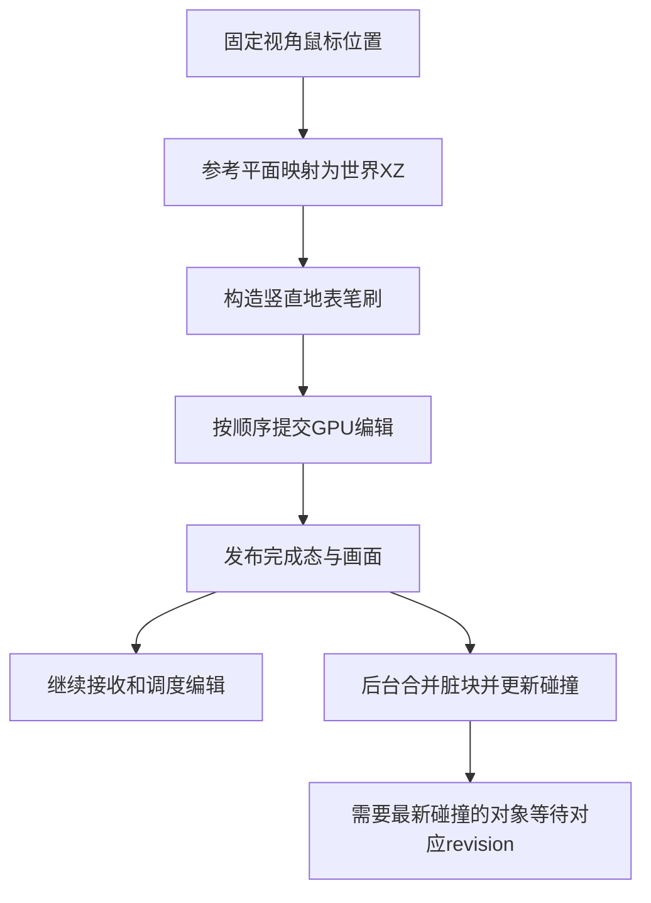

# sandcastle性能取舍分析

日期：2026-10-11。状态：方案分析，尚未实施或验证收益。

## 游戏前提与取舍目标

用户确认：游戏面向固定方向的操作体验。性能方案可以围绕固定视角、地表操作和可感知反馈设计，不必为任意相机方向下的精确三维命中承担全部成本。

这里的“固定方向”是产品前提。当前主场景仍提供自由相机功能；本文不代表已经限制相机、切换拾取方式或修改生产算法。后续应明确正式玩法允许的相机移动、缩放和倾角范围，调试自由相机可以采用另一条拾取路径。

优先目标是让堆挖与连续拖动跟手，减少画面长帧和编辑积压。可以讨论以近似计算换取性能，但要分别决定命中精度、沙量精度、水响应精度和碰撞更新时效，不能把这些统称为“挖沙不用精确”。

## 当前耗时依据

数据来自[当前主场景堆挖卡顿诊断](../../search/edit_stutter_diagnosis.md)，原始记录在[test_output/edit_stutter_diagnosis](../../../test_output/edit_stutter_diagnosis)。测试为GTX1050、D3D12、1280×720、VSync开启，固定v1.60/E3、速度0.25m/s、80自动浪与侵蚀开启。每个用例从同一原生检查点恢复；短窗结果不代替正式长窗验收。

| 环节 | 当前挖沙实测量级 | 含义 |
|---|---:|---|
| CPU射线拾取 | 约0.03ms，基线最大0.052ms | 单独取消真实碰撞查询，直接节省很小 |
| CPU输入处理，含拾取与准入 | 约0.1ms | 不应与上一行重复相加 |
| GPU沙候选与提交 | 约0.4ms/笔 | 精简沙量计算本身不是最大的收益来源 |
| GPU水位移index7 | 约12ms/笔 | E3中的主要计算成本之一 |
| GPU速度归约index6 | 约12ms/笔 | 另一个主要计算成本 |
| GPU候选与提交总和 | 约24–29ms/笔 | 包含沙和水，不与上述GPU分项重复相加 |
| 派发至回执就绪 | 运行时中位数51.788ms | 包含render排队、GPU执行、异步读回与CPU调度，不是GPU独占耗时 |
| 回执就绪至发布就绪 | 运行时中位数4.123ms | 包含渲染线程调度与帧轮询 |
| 发布就绪至碰撞就绪 | 运行时中位数35.573ms | 包含异步高度读回、主线程更新与等待 |
| 两次physics_frame等待 | 两段中位数14.013ms、16.575ms | 是调度等待，不是物理计算独占耗时 |
| 输入至发布后的post_draw | 运行时中位数55.828ms | 画面提交观测，不等于屏幕实际显示时刻 |
| 输入至整笔终态 | 运行时中位数121.282ms | 事务此后才释放，下一笔才能执行 |

GPU分项来自开启GPU时间戳的独立详细窗；CPU阶段来自未开启GPU时间戳的基线窗。不能跨窗逐项相减当作精确纯等待，也不能将各列中位数相加视为某一笔完整耗时。

密集拖动还出现排队中位数198.529ms、最大299.708ms，输入至终态最大399.762ms。32次采样中18笔准入成功，14次因`collision_pending`拦截；队列未达到64笔上限。可见，连续操作的卡顿感同时包含GPU成本、逐笔串行完成和碰撞时效限制。

## 方案一：固定高度映射，沿世界竖直方向编辑

将屏幕鼠标位置映射到固定参考高度的水平面，取该点的世界XZ作为笔刷中心，再沿世界竖直方向改变沙面。编辑目标由平面映射确定，不依赖真实沙面碰撞命中，也不要求从相机方向寻找沙丘侧面的交点。

屏幕坐标到世界坐标仍需要固定相机的投影关系。可以使用屏幕射线与参考平面的解析交点；如果相机和输出尺寸固定，也可以预计算映射参数。这里省去的是物理地形碰撞查询，不是所有相机坐标转换。

### 收益与代价

- 只替换拾取，直接收益约为当前0.03ms查询量级，无法消除几十毫秒的编辑长帧。
- 更重要的结构收益是解除“新输入必须命中最新碰撞”的依赖，为笔刷与碰撞更新解耦创造条件。
- 高沙丘、深坑和斜视画面中，真实表面投影与固定平面映射可能不同，笔刷会偏离鼠标看到的位置。固定方向不自动消除这种偏差；固定俯视通常更容易接受。
- 方案适合主要操作水平地表、没有侧壁与洞穴命中要求的玩法。需要指向沙丘顶部或侧面的操作时，应单独评估。

笔刷指示器应显示真正消费的世界XZ和作用范围；可以在该XZ采样可见高度来贴地显示，不能用另一套真实碰撞命中显示光标、却把编辑应用到固定平面位置。

如果固定高度偏差影响操作，可以采用“固定平面XZ定位＋缓存高度显示”，或进一步研究低成本可见高度定位。后者仍是候选，不应直接宣称无等待或零读回成本。

## 方案二：编辑与碰撞更新解耦

在方案一成立时，笔刷准入不再依赖碰撞代理已更新到该笔revision。GPU编辑按确定顺序执行并发布画面；碰撞代理按批次或限定频率消费完成态，不阻塞下一笔地表编辑。

当前运行挖沙“发布至碰撞就绪＋两次物理帧等待”的分段中位数合计约66ms。这说明其占据较大的串行准入周期，但不意味着可以直接从画面反馈中减掉66ms：画面已在此前发布，异步工作也有重叠。

预期主要改善下一笔调度与密集拖动积压。保留准确E3水响应时，约24ms的单笔GPU成本仍在，不能凭碰撞解耦承诺稳定60FPS。

若角色、刚体或其他工具需要碰撞，碰撞更新必须继续保留。需要明确最大允许滞后、合并规则及依赖最新碰撞的操作；所有更新读取同generation的完整完成态。笔刷可继续，不代表需要最新碰撞的对象也可以无条件继续。

## 方案三：取消每笔CPU回执，库存采用估算

GPU编辑不再每笔等待128字节回执再由CPU结算和授权发布。CPU库存可先按请求量估算，画面依据GPU完成顺序发布；必要时通过较低频率的汇总校正或在保存边界同步。

这改变的是事务确认与账本语义。取消读回字节本身不是主要收益，主要收益来自减少CPU/GPU往返和逐笔门控。若仍执行准确E3全域水响应，GPU约24ms成本不会消失。

必须定义估算遇到沙量不足、笔刷越界、重叠编辑或GPU拒绝时的行为。例如按请求量增加库存而实际沙量不足，会产生库存偏差；需要明确允许误差以及如何校正，或者把工具库存设计为独立的玩法量，而不再声称它等于物理沙量。

“不用CPU回执”也不代表不用完成顺序。GPU编辑、模拟tick、可见发布和保存必须仍有明确依赖；需要区分已提交、GPU已完成、画面已发布、碰撞已更新等状态，不能把提交命令当作执行成功。

## 方案四：局部近似水响应

当前GPU大头是水位移与速度归约，而不是沙笔刷。若游戏允许近似，可研究只对笔刷邻域进行水面调整、局部速度扰动或缓慢松弛，减少每笔全域湿分量处理与速度账本归约。

这通常比单独近似挖取沙量更有潜力。代价是水体体积、动量或瞬时水面响应可能偏离现有精确模型，需要为游戏可接受的误差建立新的规格。视觉反馈可以优先保证稳定、无明显跳变和无非数值，但不能冒称继续满足旧精确守恒证明。

| 组合 | 可讨论的性能预期 | 证据状态 |
|---|---|---|
| 仅固定平面拾取 | 只省约0.03ms量级查询 | 基于当前拾取成本；未实施 |
| 固定平面＋碰撞解耦 | 减少逐笔准入周期和拖动排队，GPU计算仍约24ms | 有现有等待阶段证据；收益尚未测量 |
| 再取消每笔CPU回执，保留准确水响应 | 画面提交反馈可把30–45ms作为候选目标 | 设计估算，不是预测保证或验收结果 |
| 再采用局部近似水响应 | 若GPU编辑做到1–3ms，可把1–2帧反馈作为目标；60Hz下约17–33ms | 条件性目标，完整渲染负载和碰撞仍可能限制帧率 |

这些目标不能直接换算为整体游戏提速倍数。编辑吞吐、画面帧时间、输入至发布及输入至碰撞就绪应分别测量；吞吐提高也可能让更多GPU工作进入队列，必须限制积压。

## 建议的取舍顺序与验证边界

1. 先确定正式固定相机的范围与固定高度映射容许偏差。保留准确水沙计算，单独验证新定位能否满足操作手感。
2. 再验证笔刷与碰撞解耦，观察拖动准入、队列长度、画面反馈和碰撞滞后。此步不同时切换近似水响应。
3. 若单笔GPU成本仍导致卡顿，再单独研究水响应近似；若往返仍限制调度，再评估取消每笔回执及库存估算。按证据选择，不把所有近似一次性合入。
4. 每个候选使用相同原生完成态、相机、笔刷位置/量和profile。除帧p99/max外，记录逐笔GPU执行、排队、画面提交与碰撞完成；检查越界、沙量不足、密集拖动、暂停、保存和恢复。

现有库存、沙量守恒、generation、碰撞和检查点契约仍约束当前生产实现。本文记录允许讨论的性能取舍；只有明确采用某候选时才修订受影响的规格并验证迁移，不能静默放宽旧契约或覆盖旧失败结果。

当前主场景、shader和profile未因本文改变。历史约600ms长帧本轮未复现，底层原因仍未知；这些方案不构成历史长尾已解决的结论。
