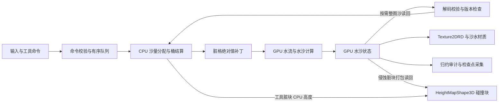

# Sandcastle 当前项目技术方案

2026-10-13场景复用更新：main使用`beach_playable_entry.gd`继承原恢复/交互控制器，新增`BeachScenes`autoload协调检查点保存、GPU关闭、目标加载与失败回退。两个test1可编辑场景继承main，复用全部工具/碰撞/材质/恢复；它们的捕帧初态映射和周期水位是项目适配，原独立逆向核保持单独入口。配置、验证和扩展方式见[场景切换与功能复用](场景切换与功能复用.md)。下方2026-10-11架构索引保留原范围。

2026-10-12水材质更新：默认main与正式fixed/coupled已采用rdc_v1视觉链，包含RGB吸收透底、完整mip体纹理焦散、流向/相位细法线与指数1500高光。GPU堆挖v1.60/E3、相机/UI与权威计算保持原样；最新资源身份和回归见[水材质RDC适配](水材质_RDC适配.md)。下文与technical_scheme_sources.json保留此前架构核对范围，不能把旧材质参数当作最新默认配置。

2026-10-11收尾整合更新：项目默认`scenes/main.tscn`现直接继承完整耦合沙滩，使用`scripts/beach/beach_recovery_entry.gd`，GPU堆挖与v1.60优化组合、水位移+速度E3及原生保存恢复已接入。旧通用主入口保留在`scenes/legacy/main_preview.tscn`。本文下方描述的是此前正式路径；当前入口和候选验证边界以[主场景整合记录](history/sandcastle_gpu_edit_validation/主场景整合与临时清理.md)为准，G5成本与长稳仍未完成。

核对日期：2026-10-11。本文描述当前仓库中已经接线的水沙模拟、工具、显示、碰撞与恢复方案。**核心架构是二维高度场上的 GPU 浅水与水沙计算，加上 CPU 工具体积结算和按需状态同步。**当前 test1 沙滩是这一架构上的视觉适配，尚未实现 GPU 原生守恒笔刷，也未解决大块水中加沙的排水响应问题。

test1 定向逆向母任务的最后判定为 **14/15，暂停，RG4 未通过**。新的 [GPU 堆挖沙与水响应验证专项](history/sandcastle_gpu_edit_validation/执行状态.md)已启动，本次核对期间已完成 T00 基线与观测冻结，开始后续契约工作；其 GPU 笔刷、水位移和速度响应仍属于待验证方案。本文不将这些草案计入当前实现。源码、配置和引用证据的字节数与 SHA256 见[核对索引](technical_scheme_sources.json)，后续修改后应重新核对对应章节。

## 1. 技术栈与实际启动入口

工程使用 Godot 4、GDScript、RenderingDevice compute shader（GLSL）和空间材质 shader。`project.godot` 声明 `4.7` / `Forward Plus`，Windows rendering driver 为 `d3d12`，3D 物理引擎为 Jolt；默认 viewport 为 1280×720。当前autoload为开发辅助 `GodotIQRuntime` 和场景切换协调 `BeachScenes`；水沙域、求解器和工具队列仍由场景入口持有。[工程配置](../project.godot)

本机两个引擎路径的 `--version` 已分别核对：

| 二进制位置 | 实际版本 | 证据使用范围 |
|---|---|---|
| `D:/godot/Godot_v4.6.2/godot.exe` | `4.7.beta.custom_build.dff2b9bb6` | 旧 test1 RG3/RG4 测量所用版本；目录名不是引擎版本 |
| `D:/game/steam/steamapps/common/Godot Engine/godot.windows.opt.tools.64.exe` | `4.7.2.stable.steam.ed1daf0bf` | 当前测试脚本的默认路径；2026-10-11 T00 首轮诊断使用该版本 |

这些版本的运行数据需要分别标注，不能只凭相同场景名直接比较成本。

| 入口 | 当前接线 | 运行配置 |
|---|---|---|
| [main.tscn](../scenes/main.tscn) | 项目默认入口，挂载 `sandcastle_main.gd`，运行时实例化 GPU 或 CPU 子场景 | 默认 GPU；`enable_gpu_erosion=false`、`enable_structures=false`；F9 切换 CPU，1/2/3 切换标准场景 |
| [gpu_water_preview.tscn](../scenes/gpu_water_preview.tscn) | 通用 GPU 水沙预览，使用 `gpu_water_preview.gd` | 256²、0.125 m/格、目标 30 Hz；侵蚀和构件按开关启用 |
| [cpu_reference.tscn](../scenes/cpu_reference.tscn) | `sandcastle_demo.gd` + `ShallowWaterReference` | 64²、8×8 m、目标 30 Hz；CPU 比较与交互参考 |
| [sandcastle_test1_beach_fixed.tscn](../scenes/sandcastle_test1_beach_fixed.tscn) | 固定沙床视觉入口，使用 `test1_beach_fixed_entry.gd` | `fixture_id=water_render_demo_v2`，侵蚀关闭、构件关闭 |
| [sandcastle_test1_beach_coupled.tscn](../scenes/sandcastle_test1_beach_coupled.tscn) | 实时沙滩入口，使用 `test1_beach_edit_worker_entry.gd` | `fixture_id=water_render_coupled_v2`，侵蚀/材料耦合开启、构件关闭 |

两份 test1 场景共用 [test1_beach_release.json](../assets/test1_beach/test1_beach_release.json)，经继承场景选择 `continuous_packets_v1` 波包负载。**它们没有替换项目默认 `main.tscn`。**“固定沙床”指关闭侵蚀、控制工具输入的验证模式；该入口仍继承通用手动笔刷代码，没有额外设置禁止编辑的锁。入口依据：[主入口脚本](../scripts/demo/sandcastle_main.gd)、[固定夹具配置](../tests/visual_water_alignment/prototypes/reference_fixed.tscn)、[耦合夹具配置](../tests/visual_water_alignment/prototypes/reference_coupled.tscn)。

## 2. 模块划分与运行数据流

| 模块 | 当前实现职责 |
|---|---|
| [SandWaterDomain](../scripts/simulation/sand_water_domain.gd) | 网格/单位、CPU 状态数组、工具分配、桶库存与源汇、快照；GPU 模式下承担需要同步版本的 CPU 影子 |
| [SandcastleGpuShallowSolver](../scripts/simulation/gpu_shallow_solver.gd) | 主 RenderingDevice 资源、双缓冲、水通量/动量更新、潮位边界、CFL 和水审计 |
| [ToolCommandQueue](../scripts/sand/tool_command_queue.gd) | 命令校验与排序、CPU 工具应用、脏格补丁、有界同 tick 撤销快照、命令历史 |
| [GpuSedimentCoupler](../scripts/simulation/erosion/gpu_sediment_coupler.gd) | 按水通量搬运悬沙，侵蚀/沉积，输出沙床变化摘要 |
| [GpuMaterialCoupler](../scripts/simulation/material/gpu_material_coupler.gd) | 湿度、压实度、共享边坡面松弛及状态提交 |
| [GpuCollisionProxy](../scripts/collision/gpu_collision_proxy.gd) | 分块高度碰撞；工具操作可直接使用 CPU 影子，GPU 侵蚀使用异步分块读回 |
| [StructureField](../scripts/structures/structure_field.gd) / [GpuObstacleRemap](../scripts/structures/gpu_obstacle_remap.gd) | 可选构件、损伤/支撑和阻水掩码重映射；test1 正式配置未开启构件层 |
| [GpuFoamField](../scripts/visual/gpu_foam_field.gd) | 只供显示使用的白沫及上一 tick 水深/床高历史 |
| [CheckpointStore](../scripts/simulation/checkpoint_store.gd) | 带版本、大小限制和校验和的本地二进制检查点 |
| 场景入口脚本 | 组织固定步、输入、异步回调、材质纹理发布、碰撞与检查点时序 |

通用 GPU 入口和 test1 入口共享求解器等底层模块，但存在两份调度脚本：`scripts/demo/gpu_water_preview.gd` 与 `tests/visual_water_alignment/prototypes/reference_preview.gd`。test1 的脚本继承链为：

`test1_beach_edit_worker_entry → test1_beach_fixed_entry → rock_reflection_candidate_entry → water_render_staging_entry → reference_preview`。

下面是实时耦合场景的数据流。工具 CPU 影子不是 GPU 沙床每一步都会同步的副本。



主线程处理场景、输入、CPU 工具结算和物理碰撞形状；触碰 RenderingDevice 的创建、dispatch、读回请求和释放由 `RenderingServer.call_on_render_thread` 进入渲染线程。test1 耦合子类将显式沙同步的解码/逐值校验交给 WorkerThreadPool，再回主线程更新影子和续接命令；它没有把整个工具系统移入工作线程。

共享 `reference_preview.gd` 现通过 `_create_solver()` 工厂选择原来的 default/sync/batched/fixed 求解器。新专项的隔离追踪子类覆盖该工厂，记录原始读回和补丁调用；正式场景仍选择原默认路径，没有切换为候选 GPU 笔刷。[T00 冻结与代码影响范围](history/sandcastle_gpu_edit_validation/验收/T00_基线与观测冻结.md)

## 3. 网格、权威状态与单位

正式 GPU 域为 **256×256 格、32×32 m、0.125 m/格**。坐标使用世界 XZ 平面、Y 高度，索引为 `z×N+x`，单元中心映射为 `((x+0.5−N/2)Δx, (z+0.5−N/2)Δx)`。纹理行方向由物理索引定义。[冻结数据契约](knowledge/water_sand/状态与数据契约.md)

| 状态 | GPU 格式 | 单位及用途 |
|---|---|---|
| `rock` | R32F | 不可侵蚀基底高度，m |
| `sand` | 双缓冲 R32F | 参考密度等效沙厚，m；当前也直接作为几何厚度 |
| `water` | 双缓冲 R32F | 有效水深 `h`，m |
| `momentum_x/z` | 双缓冲 R32F，各一张 | `hu/hv`，m²/s；不是直接存储的 m/s 速度 |
| `sediment` | 双缓冲 R32F | 悬浮沙等效厚度，m；浓度由悬沙厚度/水深派生 |
| `wetness/compaction` | 双缓冲 R16F | [0,1] 的湿度/压实度 |
| `obstacle` | R8_UNORM | 首版二值阻水掩码 |
| `flux` | 双缓冲 RGBA32F | −X/+X/−Z/+Z 四向非负出流，m³/s |
| `edge_x/z`、`drain` 等 | RGBA32F、R32F 等 | 有符号共享边通量、出流缩放和归约工作数据 |

实际创建格式见[求解器初始化](../scripts/simulation/gpu_shallow_solver.gd)。双缓冲是计算时的读写隔离，不是所有状态每个 pass 都同时翻转；材料模块另有 commit 将两份相关状态对齐。

当前几何关系固定为 `bed=rock+sand`、`eta=bed+water`。**压实度改变侵蚀强度和坡面支撑，不通过密度曲线直接压低几何高度。**该域是单值高度场，不能表达任意洞穴、悬挑和多层水体。CPU 参考入口实际调用独立浅水比较器；`SandWaterDomain.step_water()` 中保留的虚拟管道算法不是当前 GPU 生产水通量的定义依据。

## 4. 固定步与浅水求解

模拟步长为 `1/30 s`。帧累加器最多保留 4 个固定步的时间，每次 `_process` 至多发起一个 tick，且不在已有 tick 飞行中重复启动。长卡顿后超过上限的时间会被丢弃；目标 30 Hz 不等于任意负载都能完成 30 tick/s。[实时调度实现](../tests/visual_water_alignment/prototypes/reference_preview.gd)

正常 CFL 路径的顺序为：

1. 有待执行工具命令且 CPU 沙影子过期时，先等待有效预取或显式沙同步，再应用命令、上传补丁。
2. 更新 `x=0` 海侧的潮位/波包边界，记录水源汇；开启侵蚀时处理边界后的悬沙状态。
3. 提交潮位账本与 CFL 归约读回，两者完成后决定子步数。256² 的 CFL 输出为 32×32 个最大波速值，约 4 KiB。
4. 每个水子步执行共享边通量 → 出流缩放 → 水深/二维动量更新；开启耦合时紧接悬沙搬运、侵蚀/沉积、材料和坡面更新。
5. 更新显示白沫和局部浪前，发起需要的审计/脏块摘要，发布当前纹理引用，再由主线程完成回调推进 `completed_ticks`。

水通量代码采用静水重构与 **Rusanov 型数值通量**：共享边使用较高床面 `zmax`，重构 `h*=max(0,bed+h−zmax)`；通量为两侧物理通量平均减去由最大波速控制的耗散项。每格只负责其 +X/+Z 边，邻格复用同一边结果。`drain_scale` 按供体可用水量限制总出流，更新核附加床面压力修正、干格归零与速度上限保护。依据：[边通量](../shaders/simulation/shallow_edge_flux.glsl)、[出流缩放](../shaders/simulation/shallow_drain_scale.glsl)、[状态更新](../shaders/simulation/shallow_update_state.glsl)。

CFL 系数为 0.35，子步数按 `ceil(Δt×最大波速/(0.35×Δx))` 计算，至少 1，超过 64 时记录过载并拒绝本 tick。正式路径没有启用固定子步、批量潮位账本或同步读回候选，不能将这些试验开关写成默认性能方案。

`generation` 标识场景代际，`state_revision` 标识 GPU 状态修订，`completed_ticks` 标识已完成固定步；工具补丁也能推进 revision，三者不能互换。异步回调按 generation/revision 丢弃旧结果。test1 表现时钟在完成 tick 后设为 `completed_ticks/30`，暂停时不会继续按墙钟播放 shader 动画。[时钟与有效配置发布](../scripts/visual/water_render_staging_entry.gd)

## 5. 堆沙和挖沙的当前实现

命令支持 `remove_sand/place_sand/smooth/compact/debug_add_sand` 与圆形、扫掠线段。队列按 `(sim_tick,command_id)` 排序，校验域、代际、单调 ID、半径和强度；入队成功返回空 StringName，仅表示接受，实际应用结果与 GPU 绘制仍是后续阶段。[命令接口契约](knowledge/water_sand/模块与命令接口契约.md)

当前工具链是：**最新 GPU 沙场 → 按需 CPU 影子 → CPU 分配实际沙量 → 桶/源汇记账 → GPU 脏格绝对值补丁**。

- 笔刷候选格按包围盒枚举，以格中心到圆心/线段的距离计算权重；扫掠线段的总量只结算一次。
- 挖沙按可挖格的权重最多进行 4 轮重分配，实际挖出的沙进入工具桶；放沙库存不足则拒绝整笔。`sand_delta_m3` 沿桶账户符号：挖为正、放为负。
- `debug_add_sand` 是显式沙源，单独进入源账本；平滑和压实不等价于调试加沙。
- 同一批次脏格去重、按索引排序，上传每格 16 字节：索引、沙厚、压实度、保留字段。compute patch 将绝对值写入两份 sand/compaction 状态，避免下一次翻转恢复旧值。

依据：[CPU 工具计算](../scripts/simulation/sand_water_domain.gd)、[批量补丁构造](../scripts/sand/tool_command_queue.gd)、[GPU 补丁核](../shaders/simulation/shallow_tool_patch.glsl)。

256² 沙图一次读回为 256 KiB；完整材料影子同步还包括悬沙、湿度和压实度，共 768 KiB 原始字段数据。当前工作线程优化只覆盖 `_on_shadow_field` 的显式 sand 同步；共享预取回调 `_record_sand_prefetch` 仍在主线程转换并逐值检查整张沙图。提交后 500 ms 内的预取窗口已存在，悬停预取开关默认关闭；“预取命中”本身不证明点击前已有缓存。[工作线程子类](../scripts/visual/test1_beach_edit_worker_entry.gd)、[共享同步与预取](../tests/visual_water_alignment/prototypes/reference_preview.gd)

工具补丁**不修改 water 或 momentum**，因此加沙瞬间保留水深，物理自由水面 `eta` 随床面升高，后续依赖水通量排开。浅水中的大床高突变会使重构响应饱和：隔离对照中 20/80 cm 平顶堆的水深演化最大差约 `3.73e−8 m`。这是已记录的数值局限，不能用“水量守恒”推导排水速度已正确；当前尚无正式保守水位移/专用冲量处理。[水中加沙调查](search/underwater_deposit_report.md)

## 6. 悬沙、材料和构件

[悬沙核](../shaders/simulation/erosion/sediment_step.glsl)使用水求解器的四向出流和供体旧浓度搬运 suspended sand；搬运后根据水深、出流估算的容量及湿度/压实强度，在 sand 与 sediment 间交换。干格将悬沙沉积回床面。当前容量尺度为 0.08 s/m，侵蚀/沉积速率为 0.35/0.45 s⁻¹；这些是本项目参数，不是竞品恢复公式。

[材料核](../shaders/simulation/material/material_step.glsl)处理积水湿润、四邻扩散、向残余湿度干燥及湿沙压实；[坡面核](../shaders/simulation/material/slope_relax.glsl)根据共享边两侧的湿度、压实度和可选黏聚高度决定休止落差，将沙从高格转移到低格，单边转移不超过供体沙厚的四分之一。当前没有把沙体简单做高度模糊。材料 dispatcher 按 material_step → slope_relax → commit 执行，commit 对齐状态副本。

构件层记录独立的体积、形状、压实、损伤和支撑数据，并通过沙床补丁实现建造/坍塌。普通沙构件不自动写成阻水 obstacle；显式 `blocks_water` 构件另走掩码更新和水/悬沙重映射。没有可接纳邻格的封闭水会保留并报告受困区域，不能吞水。该能力在旧 T06 有专项验证，但 **test1 的 `enable_structures=false`**；旧构件的支撑/损伤更新使用滞后 CPU 影子，属于近似，不能表述为逐子步完全同步的刚体断裂模拟。[构件历史验收](history/sandcastle_water_sand_coupling/验收/T06_构件与支持破坏_20260929.md)、[集成与近似边界](history/sandcastle_water_sand_coupling/验收/T08_长稳与过载_20260929.md)

## 7. test1 沙滩的显示方案

沙、水材质用 Texture2DRD 直接采样主 RD 状态，显示结果不回写模拟纹理。当前 `render_subdivision=2`，运行时生成 512×512 个采样顶点的显示网格，而物理网格仍是 256²；两者不是同一个分辨率。节点、相机、太阳、接触层和细沫资源绑定已固化在场景，常规沙/水网格仍由共享 `_make_grid_mesh()` 在初始化生成，尚未全部固化为资源。

| 层 | 当前实现与边界 |
|---|---|
| 沙体 | [test1_bed_lit_fast](../assets/test1_beach/test1_bed_lit_fast.gdshader)按 rock+sand 做顶点位移和分片重构，坡度法线、顶点受光、颗粒色调调制及干湿/压实映射表达体积。颗粒不产生几何沙粒。太阳可见，但投射阴影被场景与入口明确关闭 |
| 浅/深水 | [test1_water_front](../assets/test1_beach/test1_water_front.gdshader)为自定义 unshaded 水材质，读取屏幕颜色与深度，用水深、法线、衰减和深度保护做透底/折射，再合成反射与白沫；`depth_draw_always` 写深度 |
| 浪前形体 | [local_front](../tests/visual_water_alignment/prototypes/reference_local_front_field.gd)由当前/上一 tick 自由水面变化，经局部 X/Z 窗口得到浪前位置与活动强度；水 shader 根据该场抬升显示浪峰。该抬升只改变显示顶点，不增加权威 water，也不是三维翻卷求解 |
| 面内白沫 | [visual_foam_step](../shaders/simulation/visual_foam_step.glsl)保存 RG32F 历史：覆盖量、上一 tick 水深，另存 R32F 床高历史；按流速回溯采样、指数衰减，以水面上涨和压缩等条件生成 |
| 独立细沫 | [预存稀疏网格](../assets/test1_beach/test1_front_foam_sparse_mesh.tres)为 64×128 细片布局，[细沫 shader](../assets/test1_beach/test1_front_foam_splats.gdshader)随水面/浪前位移并按活动条件显示；是网格细片表达，不是完整沙粒/水粒子物理系统 |
| 岸脚接触 | [接触 overlay](../tests/visual_water_alignment/prototypes/reference_shore_contact_overlay.gdshader)重构床面/水深，检查邻近干格、白沫与浪前活动；在浅水岸边形成条件性薄层，不用常驻白环 |
| 底面亮纹 | `caustic_fold_v1.png` 在沙底材质中取样、随表现时钟移动并按水深衰减；当前是纹理驱动的亮纹适配，没有光线追踪生成真实焦散 |
| 平面反射 | [反射入口](../tests/visual_water_alignment/prototypes/rock_reflection_candidate_entry.gd)使用共享 world 的 960×540 SubViewport，镜像相机关于 Y=0，`cull_mask=4`；只拍指定层。反射平面不会逐格跟随局部自由水面 |

当前 profile 的关键参数为：

| 参数 | 当前值 | 含义 |
|---|---:|---|
| `surface_bias_m` | 0.003 m | 显示水面偏置 |
| `crest_height_m` | 0.25 m | 显示浪峰参数上限；不是每个物理波包的实际水位增量 |
| `shallow_extinction_m` | 0.25 m | 浅水光学衰减参数 |
| `refraction_scale` | 0.02 | 屏幕折射偏移比例 |
| `whitewater_gain` | 0.32 | test1 主水面白沫增益 |
| `splat_diameter_px` | 3.5 px | 细沫目标直径参数 |
| 底面亮纹 softness / strength / UV scale | 1.0 / 0.8 / 2.0 | 纹理柔度、强度和缩放 |

profile 的 8 个能力字段都声明 implemented/enabled，但 **implemented 只表示代码路线已接线**。[配置校验器](../scripts/visual/water_render_profile.gd)明确注明这不等于视觉或成本验收通过。入口在初始化/完成 tick 后记录实际材质、资源和参数，生成 effective profile 及 hash；判定应读取实际消费值，不能只看 JSON 标签。

波包调度与显示 profile 分开：[wave_workload](../scripts/visual/water_render_wave_workload.gd)的当前连续负载从 tick 8 开始，间隔 180 tick，单包时长 6 s、边界幅度 0.18 m，一次预排 80 包。它不是无限时长自动续包；长测需由探针另行配置足够负载。物理波包幅度、shader 显示浪峰抬升和大块加沙引起的 `eta` 升高是不同来源，排水诊断须分别隔离。

## 8. 碰撞与拾取

256² 域划分为 8×8、共 64 个碰撞块；每块覆盖 32×32 格，使用 33×33 高度样本的 HeightMapShape3D。玩家射线拾取使用这些物理碰撞，而不是仅看 GPU 顶点位移后的画面。

工具操作已有有效 CPU 沙影子时，`apply_shadow_chunks()` 直接按 rock+sand 更新受影响块，不必再从 GPU 取同一补丁。侵蚀/坡面变化在 GPU 上产生 8×8 的 R32UI 最大高度变化摘要；调度器累计保守变化上界，超过约 1 mm 才选择块及接缝邻块，然后打包读回。单批最多 16 块；回调检查代际和每块修订号，在主线程替换形状。[碰撞实现](../scripts/collision/gpu_collision_proxy.gd)

碰撞是异步代理，不承诺任意时刻与最新 GPU 沙面零延迟一致。历史检查覆盖全块样本和连续编辑，不能由“已有 64 块”推定所有新水/沙策略下的拾取、接缝及延迟已通过。

## 9. 撤销、检查点与生命周期

同 tick 快速撤销由队列快照实现，保留最多 32 份 undo 快照；GPU 入口比较撤销前后 sand/compaction 并上传差分补丁。`applied_log` 的命令历史没有相同的 32 条上限，不能把它写成全部历史有界。

`main.gd` 另外实现暂停时的跨 tick 撤销/重做及存档载入：选择合法检查点或相同初态，创建隐藏候选 GPU 子场景重演；核对 tick、命令顺序、待处理队列和碰撞完成情况后替换旧场景，失败保留旧场景。**独立 test1 场景没有 `main.gd` 这一外层调度；其 Z/Y 调用的是共享同 tick 快速路径。**test1 的底层检查点采集/恢复已用于配对探针，不能因此宣称独立入口的跨 tick 用户撤销已接通。

检查点采集会暂停新 tick 派发；耦合模式先同步 sand/sediment/wetness/compaction，再读取同 revision 的 water、momentum_x/z，按需保存 foam 与 local_front 历史。payload 还包括 CPU snapshot、桶与源汇、命令前缀、波包、构件/支撑事件；test1 staging 额外绑定 profile 路径、源 hash 与表现时间。内存检查点最多保留 8 份。

[CheckpointStore](../scripts/simulation/checkpoint_store.gd)实际格式为 `SANDCP01`、版本 1、最大 32 MiB payload、SHA256 校验，临时文件写入后 rename，已有目标返回 `already_exists`。载荷使用 Variant 值类型，不进行对象反序列化。它不是 GPU 全部纹理的原字节转储：动态边通量、drain 等工作纹理由求解器重建，不能把冻结契约中的状态列表直接等同于当前每张 GPU 纹理都被精确保存。

退出时完成相关工作线程任务、清空 Texture2DRD 引用并由渲染线程释放资源；替换场景推进 generation，旧回调失效。真实设备丢失后的完整重建仍是历史登记的缺口，现有生命周期测试不是设备丢失处理已实现的证明。

## 10. 守恒、审计与当前验证边界

守恒账户使用体积：水为 `Σh×A_eff` 并计潮位/边界源汇；沙为 `Σ(sand+sediment)×A+工具桶`，调试加沙、外流及构件结算须分别记账。当前二值障碍是重映射事务的一部分，不允许用阻水掩码直接吞掉水/悬沙。

GPU 提供水深最小值、非有限/负值数量和水量 tile 归约，以及沙/悬沙归约；256² 水审计输出约 16 KiB，常规入口在首 tick 和每 30 tick 发起周期审计。冻结判据包括闭水 5 分钟相对误差 ≤0.5%、工具搬运 ≤0.5%、耦合沙量 ≤1%；这些是验收门槛，不是每个输入都天然满足的数学保证。[数据契约](knowledge/water_sand/状态与数据契约.md)、[验收契约](knowledge/water_sand/场景与自动验收契约.md)

shader 存在非负截断和限速防护；历史 T03 留有中间 pass 异常计数缺口。健康样本的 NaN/负值为零，不能推定所有截断、限速和中间异常已完整计数。

| 已有记录 | 判定与适用范围 |
|---|---|
| RG3 固定沙滩 | 固定样片门通过，有三机位、单层消融和连续序列；不是与 RDC 逐像素等价，也不是实时耦合成本验收。[RG3](history/sandcastle_test1_reverse_rebuild/验收/RG3_固定沙滩浪与白沫样片.md) |
| 工作线程入口三笔编辑 | 沙量含桶闭合、64 碰撞块、tick180→210 检查点配对等通过；只覆盖其实际小体积输入。[原始 manifest](history/sandcastle_test1_reverse_rebuild/implementation/g04_probe_worker_integrated/manifest.json) |
| 旧 S06 严格恢复 | 当前历史记录有两轮通过，但此前间歇性逐位差异仍未归因，不能删掉失败或改成稳定修复。[RG4](history/sandcastle_test1_reverse_rebuild/验收/RG4_实时沙滩与联合验收.md) |
| 2026-10-11 T00 | 已冻结初始化输入、固定 tick 命令和观测口径，补充独立暂停像素对照；GPU 设备级真正开始/结束时间仍 unknown。T00 完成不等于候选正确性、性能或 RG4 通过，G0 仍等待 T01 契约。[冻结报告](history/sandcastle_gpu_edit_validation/验收/T00_基线与观测冻结.md) |

## 11. 性能现状及测量口径

以下是已有记录，不是本次文档整理的新性能验收。旧 RG4 环境为 GTX 1050、D3D12 Forward+、Godot beta、真实 1920×1080 全屏、VSync off、持续波包和相应编辑负载。

| 样本 | 数值 | 可得结论 |
|---|---|---|
| 旧正式工作线程入口，20 笔编辑反馈 | 最大 60.818 ms | 本轮通过 ≤100 ms 短反馈门；口径为提交到对应 revision 后首个绘制完成帧，不独立证明逐像素首可见，也不证明跨负载冷首笔稳定。[manifest](history/sandcastle_test1_reverse_rebuild/implementation/g05_edit_worker_integrated_feedback/manifest.json) |
| 同逻辑工作线程回收版，60 s / 20 笔 | 墙钟帧 p99 36.937 ms，完成 tick/s 29.959 | 未过 33.3 ms / 30 Hz 完整门；不是当前正式入口的新完整成本通过证据。[manifest](history/sandcastle_test1_reverse_rebuild/implementation/g05_cost/release_edits_worker_sand_cleanup_60s_coupled_manifest.json) |
| T00 首轮，Godot 4.7.2 stable，20 s / 20 笔 | CPU 工具最大 1.441 ms，revision 回调后 post_draw 最大反馈 58.871 ms；process_frame 间隔 p99 34.066 ms | 仅诊断。该首轮外部编辑器 GPU 负载未核实，有追踪开销且缺 GPU 完成/像素可见；不能与旧窗口直接比收益或改判 RG4。[首轮报告](history/sandcastle_gpu_edit_validation/验收/T00_基线追踪_首轮.md)、[运行配置](history/sandcastle_gpu_edit_validation/evidence/20261011_005334_baseline_trace/runtime.json) |

已观察到的成本来源包括按需整图沙读回/等待、显式同步或预取校验、CPU 快照与工具结算、碰撞发布，以及编辑之外的运行长尾。包围盒枚举和沙同步工作线程已接入，但读回依赖和主线程预取扫描仍存在。GPU 原生笔刷的实际收益尚未实测，不能因竞品有 GPU Paint 就承诺本项目达到帧时门。

帧 p99、GPU pass 时间、提交→回调、提交→首绘制和完成 tick 吞吐是不同指标。性能验收应使用实际可见窗口、实际输出尺寸、完整持续负载，记录引擎/硬件/后端/VSync、requested/effective profile、源码 hash、冷首笔、时间窗口与并发负载；导出成功或 `post_draw` 有回调不等于性能 PASS。

## 12. 当前缺口与尚未实施的方案

| 项目 | 当前状态 |
|---|---|
| GPU 原生 remove/place 笔刷 | 新专项 T03 的计划；当前仍是 CPU 守恒分配 + GPU 绝对补丁，没有小型 GPU 回执/库存预留事务的正式实现 |
| 大块加沙的保守排水 | 正式实现未修；需另定水位移 ADR、连通接纳/余量策略、悬沙/动量处理和新旧 NUM-08 版本 |
| 有界速度响应 | 待验证候选，应与水位移分别对照；不是当前求解器已接入的补丁 |
| 完整场景成本与冷首笔稳定性 | 旧完整成本仍未过，短反馈单次通过不足以关闭问题 |
| 跨 tick 恢复与独立 test1 用户撤销 | 底层已有恢复与历史配对；旧 S06 间歇差异、独立入口外层撤销调度分别核验 |
| 无限时长资源稳定、设备丢失重建 | 现有窗口健康不等于无限时长无泄漏；设备丢失路径未完整实现 |
| 原作精确公式/动态时序 | 仍有未知项，Godot 适配不得冒称原作算法 |

test41 已直接证明实际 Ground.Paint 和两次专用 Water.Paint；单帧不能证明毫秒成本、快速散水的因果或全局守恒。原作的 0.045、5、packed 字段及全域 dispatch 不能直接当本项目米制参数与优化结果。局部 dispatch、小型量归约、库存预留和保守水位移是本项目候选，依 [v2 调查](search/edit_performance_test41_test42_v2.md)与[新专项计划](history/sandcastle_gpu_edit_validation/总纲.md)逐项验证后才可回接。

## 13. 目录与复验入口

| 位置 | 内容与使用约束 |
|---|---|
| `scenes/` | 默认入口、CPU/GPU 预览、test1 固定/耦合及候选场景 |
| `scripts/`、`shaders/` | 通用模拟、工具、碰撞、结构、显示和检查点 |
| `assets/test1_beach/` | 当前 test1 profile、沙/水/细沫 shader 和预存细沫网格 |
| `tests/visual_water_alignment/prototypes/` | 仍被正式 test1 入口继承和加载的运行代码、场景、compute 核、纹理；不能整体当作可删除的测试产物 |
| `tests/`、`test_output/` | 回归/探针与测试新输出；固定参照图位于 `tests/fixtures/visual_water_alignment/` |
| `docs/knowledge/`、`docs/search/`、`docs/history/` | 冻结契约、调查报告、原始历史判定和已迁移验收附件 |
| `task/`、`sandcastlegame/`、`rdc/` | 仍保留的专项机器证据/工具和竞品输入；原包/RDC 只读，取数先核对源 hash |

可复用入口包括 [tests/run.ps1](../tests/run.ps1) 的 17 项模拟契约、3 项场景集成与拓扑检查，[GPU 标准场景探针](../tests/run_gpu_standard_scenario.ps1)，以及[新专项基线追踪](../tests/edit_validation/run_baseline_trace.ps1)。它们覆盖不同范围；CPU headless 通过不能替代 GPU 数值、可见窗口视觉或完整性能验收。

直接查看当前实时沙滩的启动方式为：

```powershell
$GodotExe = 'D:/game/steam/steamapps/common/Godot Engine/godot.windows.opt.tools.64.exe'
& $GodotExe --path 'D:/godot/project/sandcastle' --rendering-driver d3d12 --scene res://scenes/sandcastle_test1_beach_coupled.tscn
```

2026-10-11 目录迁移改变了资源路径和 hash。旧 manifest 内的 `res://task/` 与旧 hash 保留历史含义，应按[迁移清单](history/migration_manifest.json)定位；部分历史索引未保留全部配套字节，不能仅凭索引声称取证完整。本方案完成代码/配置与文档核对，没有新增正式视觉、长稳或性能 PASS。当前专项的后续状态以其[执行状态](history/sandcastle_gpu_edit_validation/执行状态.md)为准。
