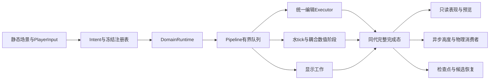

# Sandcastle 当前项目技术方案

更新：2026-10-20。本文描述正式四场景当前实现；固定数值、容量及兼容性见[当前技术规格](当前技术规格.md)，操作见[主场景操作](主场景操作.md)。

## 技术栈与入口

项目使用 Godot 4.7.2、GDScript、RenderingDevice compute shader 和 Godot材质shader。项目默认启动 [main.tscn](../scenes/main.tscn)，Windows驱动为D3D12，默认视口1280×720。Forward+、实际窗口、设备与VSync属于验证条件，不能从headless启动推导GPU或视觉通过。

main、test1_capture、test1_backwash、test1_geometry均直接绑定 [unified_playable_entry.gd](../scripts/beach/unified_playable_entry.gd)，根脚本继承Node3D。场景内固定 [UnifiedEditRuntime](../scenes/unified_edit_runtime.tscn) 与SurfaceA/SurfaceB消费者槽，静态UI、相机、材质、网格和连接保存为资源。启动读取表现manifest和初态，不再沿旧recovery/gravel/async入口继承链构造后端。

Windows导出通过 [runtime_source_export](../addons/runtime_source_export/source_export.gd) 在正常资源导出之外保留运行时读取的原始文件：`project.godot`，以及assets、scripts、shaders、scenes和亮纹原型资源目录下的场景、资源、脚本、shader/include、JSON、初态`.variant`与二进制数据。`editor/export/convert_text_resources_to_binary=false`使场景和文本资源按原样加载，避免旧转换缓存遗漏自定义Resource新增的导出字段；脚本仍按导出预设编译，纹理仍由正常导入链加载。FileAccess使用原始字节校验表现manifest、冻结配置身份并编译compute。仅设置include_filter不能保证导入资源或编译脚本的原始路径可读。缺失或hash不符会中止沙水初始化，水面与编辑工具随之不可用。`python tools/validate_export.py --output <新输出目录>`用匹配版本的编辑器运行实际PCK；工作目录隔离到项目外，避免本地源码补齐包内缺失文件。

## 运行结构与模块边界

| 模块 | 当前职责与源码 |
|---|---|
| 输入 | [player_input.gd](../scripts/simulation/unified_edit/player_input.gd)将手势变为Intent及BEGIN/sample/END，领取结果；不持有writer |
| 声明与身份 | [profile_registry.gd](../scripts/simulation/unified_edit/profile_registry.gd)、[configuration.gd](../scripts/simulation/unified_edit/configuration.gd)验证并复制profile/模板，冻结有效配置和来源hash |
| 域生命周期 | [domain_runtime.gd](../scripts/simulation/unified_edit/domain_runtime.gd)维护当前、恢复候选、退休代和两个消费者槽 |
| 唯一调度 | [pipeline.gd](../scripts/simulation/unified_edit/pipeline.gd)管理接纳、工作槽、录制顺序、完成回执及释放证明 |
| 编辑 | [executor.gd](../scripts/simulation/unified_edit/executor.gd)安排候选、归约、材料、水响应、校验、条件提交和结果 |
| 水沙模拟 | [water.gd](../scripts/simulation/unified_edit/water.gd)、[coupled.gd](../scripts/simulation/unified_edit/coupled.gd)只录制已保留的数值子步，不单独调度 |
| 权威资源 | [state.gd](../scripts/simulation/unified_edit/state.gd)负责初始化、原始字节恢复和完整发布；运行时不由CPU打补丁 |
| 消费者 | [views.gd](../scripts/simulation/unified_edit/views.gd)、[height.gd](../scripts/simulation/unified_edit/height.gd)、[visuals.gd](../scripts/simulation/unified_edit/visuals.gd)读取完成态并独立管理读者所有权 |
| 存档 | [checkpoint_codec.gd](../scripts/simulation/unified_edit/checkpoint_codec.gd)、[checkpoint_router.gd](../scripts/simulation/unified_edit/checkpoint_router.gd)验证当前格式，受限迁移已登记旧数据 |
| 场景服务 | [beach_scene_service.gd](../scripts/beach/beach_scene_service.gd)保存、关闭、加载及失败回滚 |

## 统一编辑事务

产品默认catalog声明十一物理profile：挖/填/悬沙的圆盘及扫掠版、城堡、沙墙、铲子、平滑和压实。碎石是独立标签的显示输入，也使用同一队列和生命周期。profile只选择现有操作、形状、材料/水策略和合法参数；新增玩法流程见[扩展指南](unified-edit-extension-guide.md)。

公共Executor先读取当前权威态生成候选，归约实际变化和预算，再生成材料与水候选，统一检查身份、有限值、非负值、字段权限、守恒及授权。沙/材料在公共mode7提交，水响应在同一决定下经mode4提交；结果由实际GPU变化决定。原语不能直接写权威场、独立提交、发布或等待CPU。拒绝不留下半条沟、半笔材料或水响应，也不依靠整场备份再CPU回滚。

普通挖沙在每轮分配中使用相同的供沙集合计算权重和实际扣沙：仅覆盖权重大于0且剩余单格沙体积大于1e-6m³的格子参与。低于或等于阈值的薄层保留，不参与该轮扣沙；沙量不足时按实际可挖量完成。提交前同时核对实际减量、分配累计量、原始请求量和授权上限，误差使用既有ULP预算，不能用分配阈值放宽回执授权。

城堡按固定世界标高补至模板表面，高于模板的原沙保留；沙墙与铲子以公共笔画baseline和累计coverage约束目标高度。产品铲子使用CAPPED_SHOULDERS：中央挖量只受沙量、目标深度和命令授权约束，每侧独立接收不超过实际挖量的一半，达到笔画基准以上0.5m后停止加沙，放不下的部分按实际量记入sand_sink_m3。本笔挖过的格子可以再次接沙，回填后可再铲至已记录的沟底；没有实际挖量时不新增供沙覆盖标记。普通自由挖填及悬沙使用已知录制请求的名义源汇，目标高度和铲子未接收余量使用实际量结算，不能把两种账本精度混称精确守恒。

主场景默认策略2（动量 B），通过公共 [water_response.gd](../scripts/simulation/unified_edit/water_response.gd) / [water_response.glsl](../scripts/simulation/unified_edit/water_response.glsl) 执行。按本次实际接受的床面差施加动量，填沙外推、挖沙内拉；编辑阶段保持水深和悬沙，后续搬运由常规浅水tick完成。默认力度0.25，面板可调0–1；勾选“原连通排水”使用策略3及原位移/局部速度公式。公共策略2语义对所有调用者一致，三个test1入口仍默认策略3。公式、作用条件及参数见[编辑水响应规格](当前技术规格.md#编辑水响应与主场景开关)。

策略3的湿区排水使用[拓扑阶段](../scripts/simulation/unified_edit/water_packed_topology.glsl)建立原有连通分量和行序索引，再由[分阶段计算](../scripts/simulation/unified_edit/water_packed_parallel.glsl)完成容量、位移、残差与审计。逐格阶段分配到1024个64线程工作组；补偿归约保持各账目原来的逐格顺序，多账目并行计算，分量互相独立。11个计算阶段在初始化时特化，阶段间仅有GPU依赖，不新增CPU读回。拓扑超限、非法输入和审计失败继续交给原通用核复核，权威写入仍只有原公共条件提交。

接纳、GPU完成和物理收敛是独立边界。每批按队首工作类型及tick合并连续可录制编辑，最多64条；所有编辑、水tick和显示工作沿同一RD有序流录制；后继不等待CPU回执或碰撞。新样本遇背压明确拒收，END保留重试；已接纳命令继续排空。fatal/unknown属于所有权故障，不伪装成普通REJECTED，不重放未知命令。

工作槽在真实回读完成、CPU消费回执及Transport确认回收后复用。Pipeline记录其创建线程作为槽位所有者；渲染回收与槽位所有者同线程时立即确认，现有pump可在消费回执后继续使用空槽，不增加调度循环。跨线程回收仍通过deferred通知所有者，不能从渲染线程直接修改CPU槽位，也不保证同帧复用。

## 水、悬沙与材料模拟

水在二维高度场上使用浅水数值核，状态为水深与水平动量。GPU CFL选择子步，保留共享边通量、出流缩放、状态更新及边界注入；实际推进时间由完成态累计actual_dt决定。水沙耦合包含悬沙输运、侵蚀/沉积、沙坡与材料更新，使用当前配置的数值核及容量侵蚀规则。

默认一阶水步和耦合阶段在初始化时缓存固定的pipeline、uniform绑定及push常量，按双槽索引直接录制，避免每个子步重复查询字典和构造参数数组。缓存只由数值模块创建，不能由工具profile配置执行顺序；它借用当前所有者的RID并随所有者释放。64轮间接派发、GPU CFL决定的有效轮数、各阶段顺序和计算列表边界保持，CPU不读取CFL结果来决定当轮工作。

海侧潮汐/波包属于统一水步中的边界输入。主场景与各test1使用不同初态/边界；geometry采用20模拟秒低位→抬升→回落周期，是Godot适配。暂停不推进模拟或表现时钟，但可录制编辑和碎石投放。细节参数随场景manifest、boundary配置和材料资源冻结，不从历史测试脚本默认值推断。

## 几何与表现

权威床面由rock+sand构成，水面使用床面及水深。表现通过同generation、完整state_seq及实际完成时钟绑定沙、水、悬沙、白沫、亮纹与接触，不能混读正在写的双槽。显示细分与着色重建不提高256²权威模拟或物理高度分辨率。

- 沙体：固定网格读取完成床面，结合湿度、压实度、法线及受光；geometry额外显示沙体侧面。
- 水：当前静态表现资源使用RGB吸收透底、流向细法线、角度反射权重、窄太阳高光和带完整mip的三维纹理亮纹。该亮纹是纹理采样动画，不能称实时光线焦散。
- 浪与白沫：边界驱动水场，现有前缘/白沫/岸脚表现读取完成态及其历史；不能从单帧外观确认原作时序。
- 水侧壁：固定[WaterSides组件](../scenes/components/water_boundary_sides.tscn)共享水面材质输入与时钟，上沿对应水边界，下沿贴可见沙床；随挖填、涨退水和换代更新。
- 碎石：GPU表现颗粒随水输运、搁浅并贴床；不增加权威沙量，不阻水，也没有逐颗刚体碰撞。

实际运行表现为 `scenes/unified_edit/presentation/` 与 `assets/unified_edit/presentation/`，通过[presentation.gd](../scripts/simulation/unified_edit/presentation.gd)绑定manifest、材质和初态。原candidate目录、公共shader与纹理仍可能是直接运行依赖，名称含candidate不构成删除依据。原RDC事实、Godot适配和未知项见[竞品入口](competitor/README.md)。

## 碰撞、恢复与关闭

高度worker完成后，物理消费者按块分帧应用：每个Height所有者在一个渲染帧内最多尝试8块，并在累计原生形状调用达到1.5ms后停止继续应用；单次调用不可中断，因此这不是整帧耗时的硬上限。同一渲染帧内的多次物理通知共用预算，两个高度槽轮流获得后续帧的消费机会。部分应用保留快照游标和真实读者租约，全部消费后才确认GPU脏块；关闭可丢弃剩余CPU形状工作，旧版本不能覆盖较新块。候选仍须完整备齐64块后换代，漂浮道具仍依照实际已应用版本和既有接触误差条件等待。

沙床物理代理分64块。高度回读与worker生成不阻塞工作槽；物理线程应用已完成任务，拾取可使用上一份完整碰撞面。未变化块允许保留较早版本，停止输入后消费者收敛。

保存先结束笔画并取得完整完成态，保留原始双槽、材料/历史、控制状态、账本、配置与身份。恢复不重放工具：先验证SANDUE06或允许的旧数据，在同一种Pipeline候选中准备完整64块同代碰撞，物理提交阶段统一替换材质、碰撞与当前域。highwater沿用，command_id不能从1重用。

退休代保持在途回执与读者租约；只有获得真实终结/解绑证明后释放。当前和退休的高度、检查点、预览等读者都按维护节奏重试。未知证明不授权force-free或伪造成功。场景切换使用相同生命周期；各场景本次运行进度独立缓存，目标失败按原正式入口恢复。

## 工程维护与验证

数值/ABI或writer变更先更新相关契约，再做编译、短运行、负例和受影响功能回归；表现变更先固定初态/seed/tick/机位/profile做单变量对照。配置稳定后才集中做代表性成本和长稳，文档修改无需重跑GPU长稳。

架构检查从正式根、服务和catalog建立保守引用闭包，检查敏感方法、writer、资源身份和九类违规样例。它有明确调试器/旧codec数据验证边界，不是任意GDScript程序的完整调用图证明；不能自动重生成seal来批准代码改动。

维护命令与ABI见[技术规格](当前技术规格.md)。交互式执行指南由本地生成器读取当前源码生成。

## main漂浮道具消费者

main固定组件包含水瓶、木板、木棍和通用FloatingPropsService。它通过公共只读Probe读取完成态，按实际水时钟余额准入原生Jolt世界步；不拥有GPU执行器，不回写水沙。使用现有HeightMap和类型化Profile，暂停/保存局部保持，成功恢复或重进重置；三个test1不投放。结构、受力、版本和扩展见[漂浮道具](漂浮道具.md)。

静态FloatingPropsPanel包含三道具槽和落点光圈。选择槽位后左键投放或移动，拾取模式把既有实例收入槽位；世界中有效物体为0–3件。UI与沙刷通过互斥模式分发输入，Terrain/Prop射线分层，右键取消不捕获相机。服务在局部物理边界等待旧探针真实终结、换owner并重新采样目标位置，其他物体保留运动状态；生产水沙队列继续推进。全拾取时停止空采样，恢复/重进仍按预存三件布局初始化。
