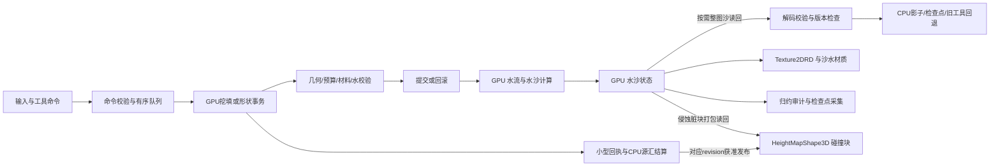
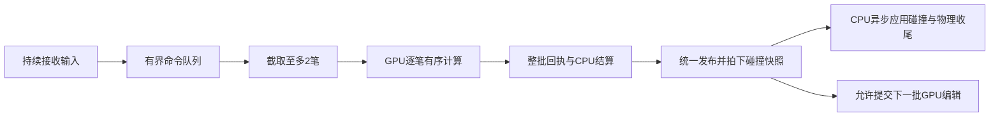

# Sandcastle 当前项目技术方案

沙子部分更新：2026-10-16。当前沙子是**256²二维高度场上的GPU沙床/悬沙/材料计算，加上GPU编辑事务、CPU回执结算和异步碰撞代理**，并非逐粒沙子刚体。普通挖填现接入整批上传、回执与碰撞收尾流水线，见[5.1节](#51-普通挖填合批流水线2026-10-16)；96项短验通过，成组处理更快但最长帧变差，尚未通过正式性能门。2026-10-15的形状刷子/材料/恢复核对及下方旧水体、视觉测量保留原范围；本轮源码与证据身份见[流水线核对索引](edit_pipeline_sources_20261016.json)，此前索引不覆盖、不改写。

| 当前能力 | 实现及验收边界 |
|---|---|
| 普通挖沙/填沙 | 自由源汇、无背包限制；main已启用每批最多2笔的GPU有序合批，CPU碰撞收尾与下一批GPU编辑可重叠；不以每笔CPU整图分配为前置 |
| 沙墙、城堡、铲子 | 五工具/预览已接三个正式入口；城堡采用固定世界标高、低填高留、重复不叠高；铲子只搬运实际沙量 |
| 侵蚀、沉积与局部保形 | GPU持续演化已接；有真实mold_support双槽及刷子材料/水事务，但普通沙对照和严格续跑仍有遗留 |
| 保存、碰撞、切换 | edit v4/native v2及候选校验/失败回退已接；瞬时精确恢复不等于长期严格续跑通过 |
| 当前交付状态 | 形状刷子按用户认可效果收尾；原技术42/50、G4/G8/G9未通过、性能3/3停止保留；固定标高追加修订已另验 |

细节见第5、6、8、9、12节；操作见[主场景操作](主场景操作.md)，证据见[形状刷子收尾](../task/sandcastle_shape_brushes/收尾记录.md)及[固定标高修订](../task/sandcastle_shape_brushes/验收/G5_固定标高放置.md)。GPU碎石另属只读水沙的表现层，不能计为权威沙量或沙体接触求解；漂浮道具目前只有[实现计划](../task/sandcastle_floating_props/总纲.md)。

2026-10-13工具语义更新：main及两个可编辑继承场景启用`unrestricted_sand_tools`，独立挖填，无背包限制；实际增减量结算到沙源汇，原生恢复header v3显式记录`external_v1`，原库存实验保持原账户模式。范围与回归见[自由挖填契约](knowledge/water_sand/ADR_自由挖填沙_external_v1.md)。

2026-10-13场景复用更新：main使用`beach_playable_entry.gd`继承原恢复/交互控制器，新增`BeachScenes`autoload协调检查点保存、GPU关闭、目标加载与失败回退。两个test1可编辑场景继承main，复用全部工具/碰撞/材质/恢复；它们的捕帧初态映射和周期水位是项目适配，原独立逆向核保持单独入口。配置、验证和扩展方式见[场景切换与功能复用](场景切换与功能复用.md)。下方2026-10-11架构索引保留原范围。

2026-10-12水材质更新：默认main与正式fixed/coupled已采用rdc_v1视觉链，包含RGB吸收透底、完整mip体纹理焦散、流向/相位细法线与指数1500高光。GPU堆挖v1.60/E3、相机/UI与权威计算保持原样；最新资源身份和回归见[水材质RDC适配](水材质_RDC适配.md)。下文与technical_scheme_sources.json保留此前架构核对范围，不能把旧材质参数当作最新默认配置。

2026-10-11收尾整合更新：项目默认`scenes/main.tscn`现直接继承完整耦合沙滩，使用`scripts/beach/beach_recovery_entry.gd`，GPU堆挖与v1.60优化组合、水位移+速度E3及原生保存恢复已接入。旧通用主入口曾保留在`scenes/legacy/main_preview.tscn`，后续场景清理已删除该文件；历史记录保留原结论。本文下方描述的是此前正式路径；当前入口和候选验证边界以[主场景整合记录](history/sandcastle_gpu_edit_validation/主场景整合与临时清理.md)为准，G5成本与长稳仍未完成。

基础架构核对日期为2026-10-11，沙子接线已按2026-10-16更新。GPU原生笔刷、局部水位移、有界速度响应及普通挖填合批已经实现；其覆盖范围和验证限制不能再沿用“尚未实施”的旧描述，也不能据已实现推定所有大块水下编辑、严格一致性或完整性能目标均已通过。

test1 定向逆向母任务最后判定仍为 **14/15，暂停，RG4未通过**。GPU堆挖专项已经[收尾并整合主场景](history/sandcastle_gpu_edit_validation/主场景整合与临时清理.md)，后续形状刷子也已收尾；不能把这些功能交付累计为母任务放行。旧源码/配置核对身份仍保存在[2026-10-11索引](technical_scheme_sources.json)。

## 1. 技术栈与实际启动入口

工程使用 Godot 4、GDScript、RenderingDevice compute shader（GLSL）和空间材质 shader。`project.godot` 声明 `4.7` / `Forward Plus`，Windows rendering driver 为 `d3d12`，3D 物理引擎为 Jolt；默认 viewport 为 1280×720。当前autoload为开发辅助 `GodotIQRuntime` 和场景切换协调 `BeachScenes`；水沙域、求解器和工具队列仍由场景入口持有。[工程配置](../project.godot)

本机两个引擎路径的 `--version` 已分别核对：

| 二进制位置 | 实际版本 | 证据使用范围 |
|---|---|---|
| `D:/godot/Godot_v4.7.1-stable/Godot_v4.7.1-stable_win64_console.exe` | `4.7.1.stable.official.a13da4feb` | 最近碎石交付的实测引擎；刷子恢复另外校验实际进程二进制SHA256，不凭目录名推定兼容 |
| `D:/godot/Godot_v4.6.2/godot.exe` | `4.7.beta.custom_build.dff2b9bb6` | 旧 test1 RG3/RG4 测量所用版本；目录名不是引擎版本 |
| `D:/game/steam/steamapps/common/Godot Engine/godot.windows.opt.tools.64.exe` | `4.7.2.stable.steam.ed1daf0bf` | 2026-10-11测试脚本默认路径及T00首轮诊断版本；不是所有后续报告的统一引擎 |

这些版本的运行数据需要分别标注，不能只凭相同场景名直接比较成本。

| 入口 | 当前接线 | 运行配置 |
|---|---|---|
| [main.tscn](../scenes/main.tscn) | 默认入口，静态继承rdc_v1_coupled，当前脚本为gravel_playable_entry，继续继承完整shape_brush链 | GPU水沙、五工具/预览、外部沙源汇、局部材料和水响应开启；native v2/edit v4；不是旧CPU/GPU子场景切换器 |
| [test1_capture.tscn](../scenes/playable/test1_capture.tscn) / [test1_backwash.tscn](../scenes/playable/test1_backwash.tscn) | 继承main，通过scene_key选择初态/水位输入 | 与main共用编辑、碰撞、材料与恢复；各场景进度独立保存 |
| [gpu_water_preview.tscn](../scenes/gpu_water_preview.tscn) | 通用 GPU 水沙预览，使用 `gpu_water_preview.gd` | 256²、0.125 m/格、目标 30 Hz；侵蚀和构件按开关启用 |
| 历史 `cpu_reference.tscn`（已删除） | `sandcastle_demo.gd` + `ShallowWaterReference` | 64²、8×8 m、目标 30 Hz；CPU 比较与交互参考 |
| 历史 `sandcastle_test1_beach_fixed.tscn`（已删除） | 固定沙床视觉入口，使用 `test1_beach_fixed_entry.gd` | `fixture_id=water_render_demo_v2`，侵蚀关闭、构件关闭 |
| 历史 `sandcastle_test1_beach_coupled.tscn`（现由 [rdc_v1_coupled.tscn](../scenes/water_material_natural_candidate/rdc_v1_coupled.tscn) 直接继承） | 实时沙滩入口，使用 `test1_beach_edit_worker_entry.gd` | `fixture_id=water_render_coupled_v2`，侵蚀/材料耦合开启、构件关闭 |

当前main已经继承耦合沙滩；两个可编辑test1布局再继承main，并非独立的旧fixed/coupled默认入口。历史夹具及[test1_beach_release.json](../assets/test1_beach/test1_beach_release.json)继续是部分运行依赖，按实际继承/profile消费；旧“固定沙床”验证模式不代表当前三个可编辑入口关闭侵蚀。布局及继承关系见[场景复用](场景切换与功能复用.md)。

## 2. 模块划分与运行数据流

| 模块 | 当前实现职责 |
|---|---|
| [SandWaterDomain](../scripts/simulation/sand_water_domain.gd) | 网格/单位、CPU 状态数组、工具分配、桶库存与源汇、快照；GPU 模式下承担需要同步版本的 CPU 影子 |
| [SandcastleGpuShallowSolver](../scripts/simulation/gpu_shallow_solver.gd) | 主 RenderingDevice 资源、双缓冲、水通量/动量更新、潮位边界、CFL 和水审计 |
| [BrushQueue](../scripts/sand/brushes/brush_command_queue.gd) / [BrushScheduler](../scripts/simulation/brushes/brush_scheduler.gd) | 单队列接纳/排序，显式区分legacy_v1普通编辑与brush_v2形状命令；保留同域写锁及回执结算 |
| [流水线编辑器](../scripts/simulation/edit_validation/frame_pipeline/editor.gd) / [BrushMaterialSolver](../scripts/simulation/brushes/brush_material_solver.gd) / [BrushGPU](../scripts/simulation/brushes/brush_gpu.gd) | main启用合批时，工厂选择继承BrushMaterialSolver的编辑器；保留普通沙水/材料事务，形状命令仍由BrushGPU执行；关闭合批时选原编辑器 |
| [流水线控制器](../scripts/simulation/edit_validation/frame_pipeline/controller.gd) | 整批回执校验、逐笔账本/前缀、一次发布和碰撞请求；跟踪碰撞与物理完成，允许下一批普通编辑提前提交 |
| [GpuSedimentCoupler](../scripts/simulation/erosion/gpu_sediment_coupler.gd) | 按水通量搬运悬沙，侵蚀/沉积，输出沙床变化摘要 |
| [GpuMaterialCoupler](../scripts/simulation/material/gpu_material_coupler.gd) | 湿度、压实度、共享边坡面松弛及状态提交 |
| [GpuCollisionProxy](../scripts/collision/gpu_collision_proxy.gd) | 分块高度碰撞；工具操作可直接使用 CPU 影子，GPU 侵蚀使用异步分块读回 |
| [StructureField](../scripts/structures/structure_field.gd) / [GpuObstacleRemap](../scripts/structures/gpu_obstacle_remap.gd) | 可选构件、损伤/支撑和阻水掩码重映射；test1 正式配置未开启构件层 |
| [GpuFoamField](../scripts/visual/gpu_foam_field.gd) | 只供显示使用的白沫及上一 tick 水深/床高历史 |
| [CheckpointStore](../scripts/simulation/checkpoint_store.gd) | 带版本、大小限制和校验和的本地二进制检查点 |
| 场景入口脚本 | 组织固定步、输入、异步回调、材质纹理发布、碰撞与检查点时序 |

通用 GPU 入口和 test1 入口共享求解器等底层模块，但存在两份调度脚本：`scripts/demo/gpu_water_preview.gd` 与 `tests/visual_water_alignment/prototypes/reference_preview.gd`。test1 的脚本继承链为：

正式入口的上层链为`gravel_playable_entry → shape_brush_playable_entry → shape_brush_entry → beach_playable_entry → beach_recovery_entry → beach_interaction_entry → beach_gpu_entry → beach_checkpoint_entry`，再经原沙滩/视觉适配到`reference_preview`。旧`test1_beach_edit_worker_entry`仍是继承链的一段，不是当前根入口。

下面是实时耦合场景的数据流。工具 CPU 影子不是 GPU 沙床每一步都会同步的副本。



主线程处理场景、输入、CPU工具结算和物理碰撞形状；RenderingDevice的创建、dispatch、读回请求和释放通过`RenderingServer.call_on_render_thread`进入设备允许的执行上下文。该API名称不证明本机一定存在独立CPU渲染线程；本轮流水线指GPU异步作业与CPU碰撞收尾的调度重叠。test1耦合子类另将显式沙同步的解码/逐值校验交给WorkerThreadPool，再回主线程更新影子和续接命令；没有把整个工具系统移入工作线程。

`reference_preview.gd`保留`_create_solver()`工厂；正式beach/shape入口已经覆盖工厂构造GPU编辑器。`release_config.gd`固定v1.60组合（staged slope、补偿容量、packed/cached runs、速度预取），不是用任意实验CLI参数临时切换主场景。原T00追踪子类及其报告只代表当时基线。

## 3. 网格、权威状态与单位

正式 GPU 域为 **256×256 格、32×32 m、0.125 m/格**。坐标使用世界 XZ 平面、Y 高度，索引为 `z×N+x`，单元中心映射为 `((x+0.5−N/2)Δx, (z+0.5−N/2)Δx)`。纹理行方向由物理索引定义。[冻结数据契约](knowledge/water_sand/状态与数据契约.md)

| 状态 | GPU 格式 | 单位及用途 |
|---|---|---|
| `rock` | R32F | 不可侵蚀基底高度，m |
| `sand` | 双缓冲 R32F | 参考密度等效沙厚，m；当前也直接作为几何厚度 |
| `water` | 双缓冲 R32F | 有效水深 `h`，m |
| `momentum_x/z` | 双缓冲 R32F，各一张 | `hu/hv`，m²/s；不是直接存储的 m/s 速度 |
| `sediment` | 双缓冲 R32F | 悬浮沙等效厚度，m；浓度由悬沙厚度/水深派生 |
| `wetness/compaction` | 双缓冲 R16F | [0,1] 的湿度/压实度 |
| `obstacle` | R8_UNORM | 首版二值阻水掩码 |
| `flux` | 双缓冲 RGBA32F | −X/+X/−Z/+Z 四向非负出流，m³/s |
| `edge_x/z`、`drain` 等 | RGBA32F、R32F 等 | 有符号共享边通量、出流缩放和归约工作数据 |

实际创建格式见[求解器初始化](../scripts/simulation/gpu_shallow_solver.gd)。双缓冲是计算时的读写隔离，不是所有状态每个 pass 都同时翻转；材料模块另有 commit 将两份相关状态对齐。

当前几何关系固定为 `bed=rock+sand`、`eta=bed+water`。**压实度改变侵蚀强度和坡面支撑，不通过密度曲线直接压低几何高度。**该域是单值高度场，不能表达任意洞穴、悬挑和多层水体。CPU 参考入口实际调用独立浅水比较器；`SandWaterDomain.step_water()` 中保留的虚拟管道算法不是当前 GPU 生产水通量的定义依据。

## 4. 固定步与浅水求解

模拟步长为 `1/30 s`。帧累加器最多保留 4 个固定步的时间，每次 `_process` 至多发起一个 tick，且不在已有 tick 飞行中重复启动。长卡顿后超过上限的时间会被丢弃；目标 30 Hz 不等于任意负载都能完成 30 tick/s。[实时调度实现](../tests/visual_water_alignment/prototypes/reference_preview.gd)

正常 CFL 路径的顺序为：

1. 工具按接纳队列有序执行；普通挖填可按批提交，批内仍保留命令顺序与逐笔结算。普通GPU挖填/形状笔刷不以整图CPU分配为前置，smooth/compact等旧CPU回退才按需同步影子并上传补丁。
2. 更新 `x=0` 海侧的潮位/波包边界，记录水源汇；开启侵蚀时处理边界后的悬沙状态。
3. 提交潮位账本与 CFL 归约读回，两者完成后决定子步数。256² 的 CFL 输出为 32×32 个最大波速值，约 4 KiB。
4. 每个水子步执行共享边通量 → 出流缩放 → 水深/二维动量更新；开启耦合时紧接悬沙搬运、侵蚀/沉积、材料和坡面更新。
5. 更新显示白沫和局部浪前，发起需要的审计/脏块摘要，发布当前纹理引用，再由主线程完成回调推进 `completed_ticks`。

水通量代码采用静水重构与 **Rusanov 型数值通量**：共享边使用较高床面 `zmax`，重构 `h*=max(0,bed+h−zmax)`；通量为两侧物理通量平均减去由最大波速控制的耗散项。每格只负责其 +X/+Z 边，邻格复用同一边结果。`drain_scale` 按供体可用水量限制总出流，更新核附加床面压力修正、干格归零与速度上限保护。依据：[边通量](../shaders/simulation/shallow_edge_flux.glsl)、[出流缩放](../shaders/simulation/shallow_drain_scale.glsl)、[状态更新](../shaders/simulation/shallow_update_state.glsl)。

CFL 系数为 0.35，子步数按 `ceil(Δt×最大波速/(0.35×Δx))` 计算，至少 1，超过 64 时记录过载并拒绝本 tick。正式路径没有启用固定子步、批量潮位账本或同步读回候选，不能将这些试验开关写成默认性能方案。

`generation` 标识场景代际，`state_revision` 标识 GPU 状态修订，`completed_ticks` 标识已完成固定步；工具补丁也能推进 revision，三者不能互换。异步回调按 generation/revision 丢弃旧结果。test1 表现时钟在完成 tick 后设为 `completed_ticks/30`，暂停时不会继续按墙钟播放 shader 动画。[时钟与有效配置发布](../scripts/visual/water_render_staging_entry.gd)

## 5. 堆沙和挖沙的当前实现

2026-10-16核对：正式工具共享接纳队列及单个GPU编辑写者，命令检查domain/generation、到期tick、单调ID、笔序与预算。普通挖填现在区分接纳、GPU结算发布、碰撞及物理完成三个阶段；接纳不等于成功，GPU发布也不等于碰撞已经追上。下一批普通挖填可与上一批CPU碰撞收尾重叠，形状笔画等保留原事务边界。

| 路径 | 当前实现 |
|---|---|
| 普通挖/填，legacy_v1 | 保留每笔128字节命令/回执及原沙水计算；当前合批把命令数组一次上传、回执数组一次回读，逐笔结算后统一publish与碰撞请求；直接单笔API保留原路径 |
| 城堡/沙墙/铲子，brush_v2 | 独立256字节命令/回执，显式magic/version/stride及int64身份；BrushGPU维护单笔GPU基准与coverage，经prepare/reduce/validate/commit；铲子有shovel_allocate，异常使用备份回滚 |
| smooth/compact等保留CPU路径 | 需要完整完成态影子后运行旧算法，再上传脏格补丁；旧库存模式和旧探针仍遵守各自账户契约，不能推广成main的当前默认流程 |

当前main启用`unrestricted_sand_tools=true`：普通填沙记`sand_source_m3`，挖沙记`sand_sink_m3`，无背包预留限制。新形状工具只在external_v1授权范围执行；不通过未知命令落入普通填沙分支。源码见[beach_gpu_entry](../scripts/beach/beach_gpu_entry.gd)、[shape_brush_entry](../scripts/beach/shape_brush_entry.gd)、[BrushGPU](../scripts/simulation/brushes/brush_gpu.gd)及[形状冻结细目](../task/sandcastle_shape_brushes/契约/G1A_冻结细目.md)。

| 工具 | 已实现行为与边界 |
|---|---|
| 挖沙/填沙 | 0.01–1.00m³/次，默认0.10；实际量结算，rock不可挖；连续拖动按现有距离采样 |
| 沙墙 | 同笔固定目标，重复经过只补足，不无限叠高；整笔生命周期结束后释放基准/coverage |
| 城堡 | 世界Y=0为模板基准，最高标高0.5–1m、尺寸4–6m；`Snew=max(Sold,template_height*height_m-rock)`。低处补齐、高处沙石保留，同笔/新笔相同参数重复不叠高；取消旧25cm落差拒绝，obstacle格保留，实际新增量上限48m³，越界/超预算/事务失败整笔拒绝 |
| 铲子 | 从donor实际挖出并分配到左右receiver；移除量与两侧接收量按预先量化预算核对，外部源/汇/库存精确不变；同笔重走不重复深挖，无足够接纳容量时拒绝原子事务 |

城堡最新规则为用户指定的Godot适配，见[固定标高专项](../task/sandcastle_shape_brushes/验收/G5_固定标高放置.md)。城堡GPU120/独立155、UI65及正式三入口165/独立378项已验证，不解除旧严格续跑或性能遗留。较高结构只在对应格保留，不抬高其他部分；挖削或侵蚀后再次放置只补回固定目标。原区域最高点/25cm规则已由[ADR-B26](../task/sandcastle_shape_brushes/决策记录.md#adr-b26城堡固定世界标高低填高留)修订，不能将竞品印章指令当作该放置基准的证据。参数操作见[五工具说明](主场景操作.md)。

普通编辑默认`water_policy=3`、`signed_speed_m_s=0.25`，即水位移与有界速度响应组合E3；形状编辑已接mixed-delta正负床差水事务及材料事务，失败回滚沙/水/材料及coverage。不能继续把“所有工具都不修改water/momentum”写成当前实现，也不能把这些局部策略当作完整三维排水求解。旧20/80cm平顶对照只描述当时旧补丁/求解器，见[历史调查](search/underwater_deposit_report.md)；当前功能及未知分别见[形状整合](../task/sandcastle_shape_brushes/验收/G8_正式入口阶段.md)和[收尾边界](../task/sandcastle_shape_brushes/收尾记录.md)。

CPU影子、整图读回、旧补丁和工作线程路径仍为保存、兼容工具及相关验证所用；“普通GPU笔刷不依赖逐笔整图CPU分配”不等于项目没有GPU→CPU同步或碰撞读回。

### 5.1 普通挖填合批流水线（2026-10-16）

当前[main根节点](../scenes/main.tscn)显式配置如下。两个playable场景继承这些值，但本轮96项新验证仅覆盖main，不能当作三入口新增回归已通过。

| 配置 | 当前值 | 实际作用 |
|---|---:|---|
| `edit_frame_pipeline_enabled` | `true` | 普通挖沙/填沙使用有序合批；改为false并重新启动场景可恢复逐笔调度 |
| `edit_frame_batch_limit` | `2` | 每批最多2笔，范围1–64；余下输入保留，队列总容量仍为64笔 |
| `edit_physics_wait_count` | `1` | 逐笔兼容路径等待1次物理帧信号；合批控制器另按碰撞就绪后物理帧号实际推进确认收尾 |
| `edit_tick_overlap_enabled` | `true` | 保留普通逐笔编辑发布后与模拟tick重叠的路径；整批提交期间不同时启动该tick，不代表所有编辑和水沙tick任意并发 |

当前流程由[输入入口](../scripts/beach/beach_interaction_entry.gd)、[调度器](../scripts/simulation/edit_validation/gpu_edit_scheduler.gd)、[批控制器](../scripts/simulation/edit_validation/frame_pipeline/controller.gd)和[GPU批后端](../scripts/simulation/edit_validation/frame_pipeline/editor.gd)共同实现：

1. 鼠标事件持续接纳。普通挖填可用上一份完整碰撞面确定XZ落点，即使对应新碰撞尚在更新也可入队；不是读取半写入的碰撞，也没有取消GUI、场景代际、域范围及容量检查。队列满仍可能拒绝输入。
2. GPU编辑可提交时，截取已到期、同水策略的普通挖填队首前缀，最多2笔。后到输入进入下一批；形状命令和投流沙不混入该批。不保证每个渲染帧都能提交或完成一批。
3. 一次上传N份命令，GPU保持逐笔沙床、水位移、速度及局部材料事务的顺序，内部仍有多个dispatch和依赖。没有把挖填量简单相加，也没有采用“改沙N次只响应一次水”的近似。
4. 一次回读回执数组，校验身份与revision链，逐笔结算实际源汇并保留原始回执、实际execution_tick及edit v4前缀；统一发布已验证结果、合并碰撞脏区。
5. 在下一批写沙前，先为本批碰撞区域拍下独立高度快照。尚有未拍下快照的请求时禁止下一批写入；已拍下的快照可异步读回，由CPU准备和替换形状。之后下一批GPU编辑可在上一批CPU收尾尚未结束时提交。
6. CPU观察各块`applied_revisions`达到目标，再观察物理帧号推进，标记该批完全完成。判据是实际完成状态，不是“上一帧提交过”。Godot/Jolt常规物理仍按固定时钟运行，不只在挖填后执行。



合批路径中的`scheduler.terminal`在GPU结算发布后记录；整批碰撞/物理完成另由控制器跟踪，未完成期间`busy`仍为true，不能把terminal数量当成碰撞已完成数量。保存、恢复、形状笔画、碎石投放及直接单笔API继续遵守完整收尾门禁。

批次不是全有全无的大笔刷：某笔正常拒绝时停止其后尾部，前面的成功前缀可保留；传输或回执校验异常则利用批前备份回退并停止该后端。备份覆盖sand、water、sediment、momentum_x/z、mold_support和compaction各双槽，共14份纹理；它不是完整检查点。材料阶段采用间接派发，使未执行尾部不修改材料。

### 5.2 挖沙与填沙的沙水过程

普通挖沙降低沙床，受rock和实际可挖沙量限制，实际移出量计入`sand_sink_m3`。纯降低床面不产生填高排水需求，编辑响应阶段不会凭空补水；后续实时浅水求解再重新分配水深、向低处流动。暂停时仍可完成编辑事务，但不会推进后续流动tick。

普通填沙抬高沙床，实际新增量计入`sand_source_m3`。湿格被抬高时，保守水位移尝试把对应水量移到原连通水域中有容量的位置，并处理伴随悬沙和动量；容量不足时保留未搬走的水并报告限制，不删除水。两种操作都继续使用当前E3配置的有界速度扰动；不假定挖沙自动向内吸水、填沙自动向外推水。合批改变提交和收尾时序，保留这些逐笔数值语义。

## 6. 悬沙、材料和构件

[悬沙核](../shaders/simulation/erosion/sediment_step.glsl)使用水求解器的四向出流和供体旧浓度守恒搬运 suspended sand；2026-10-16起，交换容量改用同一完成态的水平速度长度乘饱和水深权重，容量系数0.003 s、饱和深度1/30 m，不再用出流代理或湿度/压实抗力。低于容量时起沙，超容量时沉积，干格容量为零并逐渐落床；实际强制海水库列抑制交换。侵蚀/沉积等效速率约0.729563/0.241965 s⁻¹，每子步转为指数比例，保留rock下限和沙库存限制。公式结构依据竞品，米制与时间换算为本项目适配，详见[容量侵蚀v2 ADR](knowledge/water_sand/ADR_竞品容量侵蚀_v2.md)。

[材料核](../shaders/simulation/material/material_step.glsl)处理积水湿润、四邻扩散、向残余湿度干燥及湿沙压实；[坡面核](../shaders/simulation/material/slope_relax.glsl)根据共享边两侧的湿度、压实度和可选黏聚高度决定休止落差，将沙从高格转移到低格，单边转移不超过供体沙厚的四分之一。当前没有把沙体简单做高度模糊。材料 dispatcher 按 material_step → slope_relax → commit 执行，commit 对齐状态副本。

正式shape工厂实际选择[brush_material_coupler](../scripts/simulation/brushes/brush_material_coupler.gd)，继承[staged_slope_coupler](../scripts/simulation/edit_validation/staged_slope_coupler.gd)的分阶段提交，并以`molded_slope`替换坡面核、沿用`staged_slope_consume`；不是只使用旧全域slope_relax。形状编辑还使用[局部材料事务](../scripts/simulation/brushes/brush_material_transaction.gd)和真实`mold_support`双槽。它已能参与造型保形及后续挖削/演化，不能再描述为只有设计草案；但support=0普通沙对照、长期严格继续与C05/C07最终冻结未过，仍按[形状刷子收尾](../task/sandcastle_shape_brushes/收尾记录.md)保留，不声称所有保形与原算法等价。

构件层记录独立的体积、形状、压实、损伤和支撑数据，并通过沙床补丁实现建造/坍塌。普通沙构件不自动写成阻水 obstacle；显式 `blocks_water` 构件另走掩码更新和水/悬沙重映射。没有可接纳邻格的封闭水会保留并报告受困区域，不能吞水。该能力在旧 T06 有专项验证，但 **test1 的 `enable_structures=false`**；旧构件的支撑/损伤更新使用滞后 CPU 影子，属于近似，不能表述为逐子步完全同步的刚体断裂模拟。[构件历史验收](history/sandcastle_water_sand_coupling/验收/T06_构件与支持破坏_20260929.md)、[集成与近似边界](history/sandcastle_water_sand_coupling/验收/T08_长稳与过载_20260929.md)

## 7. test1 沙滩的显示方案

沙、水材质用 Texture2DRD 直接采样主 RD 状态，显示结果不回写模拟纹理。当前 `render_subdivision=2`，运行时生成 512×512 个采样顶点的显示网格，而物理网格仍是 256²；两者不是同一个分辨率。节点、相机、太阳、接触层和细沫资源绑定已固化在场景，常规沙/水网格仍由共享 `_make_grid_mesh()` 在初始化生成，尚未全部固化为资源。

| 层 | 当前实现与边界 |
|---|---|
| 沙体 | [test1_bed_lit_fast](../assets/test1_beach/test1_bed_lit_fast.gdshader)按 rock+sand 做顶点位移和分片重构，坡度法线、顶点受光、颗粒色调调制及干湿/压实映射表达体积。颗粒不产生几何沙粒。太阳可见，但投射阴影被场景与入口明确关闭 |
| 浅/深水 | [test1_water_front](../assets/test1_beach/test1_water_front.gdshader)为自定义 unshaded 水材质，读取屏幕颜色与深度，用水深、法线、衰减和深度保护做透底/折射，再合成反射与白沫；`depth_draw_always` 写深度 |
| 浪前形体 | [local_front](../tests/visual_water_alignment/prototypes/reference_local_front_field.gd)由当前/上一 tick 自由水面变化，经局部 X/Z 窗口得到浪前位置与活动强度；水 shader 根据该场抬升显示浪峰。该抬升只改变显示顶点，不增加权威 water，也不是三维翻卷求解 |
| 面内白沫 | [visual_foam_step](../shaders/simulation/visual_foam_step.glsl)保存 RG32F 历史：覆盖量、上一 tick 水深，另存 R32F 床高历史；按流速回溯采样、指数衰减，以水面上涨和压缩等条件生成 |
| 独立细沫 | [预存稀疏网格](../assets/test1_beach/test1_front_foam_sparse_mesh.tres)为 64×128 细片布局，[细沫 shader](../assets/test1_beach/test1_front_foam_splats.gdshader)随水面/浪前位移并按活动条件显示；是网格细片表达，不是完整沙粒/水粒子物理系统 |
| 岸脚接触 | [接触 overlay](../tests/visual_water_alignment/prototypes/reference_shore_contact_overlay.gdshader)重构床面/水深，检查邻近干格、白沫与浪前活动；在浅水岸边形成条件性薄层，不用常驻白环 |
| 底面亮纹 | `caustic_fold_v1.png` 在沙底材质中取样、随表现时钟移动并按水深衰减；当前是纹理驱动的亮纹适配，没有光线追踪生成真实焦散 |
| 平面反射 | [反射入口](../tests/visual_water_alignment/prototypes/rock_reflection_candidate_entry.gd)使用共享 world 的 960×540 SubViewport，镜像相机关于 Y=0，`cull_mask=4`；只拍指定层。反射平面不会逐格跟随局部自由水面 |

当前 profile 的关键参数为：

| 参数 | 当前值 | 含义 |
|---|---:|---|
| `surface_bias_m` | 0.003 m | 显示水面偏置 |
| `crest_height_m` | 0.25 m | 显示浪峰参数上限；不是每个物理波包的实际水位增量 |
| `shallow_extinction_m` | 0.25 m | 浅水光学衰减参数 |
| `refraction_scale` | 0.02 | 屏幕折射偏移比例 |
| `whitewater_gain` | 0.32 | test1 主水面白沫增益 |
| `splat_diameter_px` | 3.5 px | 细沫目标直径参数 |
| 底面亮纹 softness / strength / UV scale | 1.0 / 0.8 / 2.0 | 纹理柔度、强度和缩放 |

profile 的 8 个能力字段都声明 implemented/enabled，但 **implemented 只表示代码路线已接线**。[配置校验器](../scripts/visual/water_render_profile.gd)明确注明这不等于视觉或成本验收通过。入口在初始化/完成 tick 后记录实际材质、资源和参数，生成 effective profile 及 hash；判定应读取实际消费值，不能只看 JSON 标签。

波包调度与显示 profile 分开：[wave_workload](../scripts/visual/water_render_wave_workload.gd)的当前连续负载从 tick 8 开始，间隔 180 tick，单包时长 6 s、边界幅度 0.18 m，一次预排 80 包。它不是无限时长自动续包；长测需由探针另行配置足够负载。物理波包幅度、shader 显示浪峰抬升和大块加沙引起的 `eta` 升高是不同来源，排水诊断须分别隔离。

## 8. 碰撞与拾取

256² 域划分为 8×8、共 64 个碰撞块；每块覆盖 32×32 格，使用 33×33 高度样本的 HeightMapShape3D。玩家射线拾取使用这些物理碰撞，而不是仅看 GPU 顶点位移后的画面。

正式GPU工具成功回执给出dirty范围与输出revision，获准publish后请求对应碰撞块。当前普通挖填合批允许下一批先提交、输入使用上一份完整碰撞面，完整完成仍须等块revision及物理边界；形状工具等保留原拾取/收尾等待，不能泛化为所有工具均可使用滞后碰撞。侵蚀/坡面另通过GPU脏块摘要选择更新；CPU影子直更是保留路径，不代表当前GPU工具每笔走CPU分配。回调检查generation/块修订号，形状替换在主线程完成。[GPU发布](../scripts/beach/beach_gpu_entry.gd)、[碰撞实现](../scripts/collision/gpu_collision_proxy.gd)

2026-10-14相同高度与变换的块会跳过重建但推进有效revision，GPU回读使用原生分块切片，完整CPU回调成本与跳过数进入面板；114项功能检查的范围及短测限制见[碰撞计时修订](性能面板.md#未变化碰撞块与完整回调计时2026-10-14)。

碰撞是异步代理，不承诺任意时刻与最新 GPU 沙面零延迟一致。历史检查覆盖全块样本和连续编辑，不能由“已有 64 块”推定所有新水/沙策略下的拾取、接缝及延迟已通过。

## 9. 撤销、检查点与生命周期

当前正式三入口由beach/shape恢复链处理native v2/edit v4：保存混合legacy_v1/brush_v2前缀、external_v1账本、实际材料双槽和配置/源码/模板/实际引擎程序SHA256。候选世界先构建、校验及核对原字节，再提交并重绑；失败释放候选，活动世界不替换。切场景保存各自进度并等待在途编辑/模拟。碎石通过独立可选`visual_extensions.gravel_v1`共存，不并入沙量或材料字段。瞬时27字段一致与切换已验证，300tick严格继续仍有悬沙双槽微差；两者不能混称“完全恢复通过”。见[当前恢复实现](../scripts/beach/beach_recovery_entry.gd)、[刷子恢复](../scripts/beach/shape_brush_entry.gd)和[最终刷子审计](../task/sandcastle_shape_brushes/验收/G9_最终交付.md)。

以下同tick撤销与`main.gd`外层重演是保留的旧通用路径说明，不表示当前main挂载该外层控制器，也不把v4检查点恢复当成新形状命令已提供完整用户撤销/重做。

同 tick 快速撤销由队列快照实现，保留最多 32 份 undo 快照；GPU 入口比较撤销前后 sand/compaction 并上传差分补丁。`applied_log` 的命令历史没有相同的 32 条上限，不能把它写成全部历史有界。

`main.gd` 另外实现暂停时的跨 tick 撤销/重做及存档载入：选择合法检查点或相同初态，创建隐藏候选 GPU 子场景重演；核对 tick、命令顺序、待处理队列和碰撞完成情况后替换旧场景，失败保留旧场景。**独立 test1 场景没有 `main.gd` 这一外层调度；其 Z/Y 调用的是共享同 tick 快速路径。**test1 的底层检查点采集/恢复已用于配对探针，不能因此宣称独立入口的跨 tick 用户撤销已接通。

检查点采集会暂停新 tick 派发；耦合模式先同步 sand/sediment/wetness/compaction，再读取同 revision 的 water、momentum_x/z，按需保存 foam 与 local_front 历史。payload 还包括 CPU snapshot、桶与源汇、命令前缀、波包、构件/支撑事件；test1 staging 额外绑定 profile 路径、源 hash 与表现时间。内存检查点最多保留 8 份。

[CheckpointStore](../scripts/simulation/checkpoint_store.gd)实际格式为 `SANDCP01`、版本 1、最大 32 MiB payload、SHA256 校验，临时文件写入后 rename，已有目标返回 `already_exists`。载荷使用 Variant 值类型，不进行对象反序列化。它不是 GPU 全部纹理的原字节转储：动态边通量、drain 等工作纹理由求解器重建，不能把冻结契约中的状态列表直接等同于当前每张 GPU 纹理都被精确保存。

退出时完成相关工作线程任务、清空 Texture2DRD 引用并由渲染线程释放资源；替换场景推进 generation，旧回调失效。真实设备丢失后的完整重建仍是历史登记的缺口，现有生命周期测试不是设备丢失处理已实现的证明。

## 10. 守恒、审计与当前验证边界

守恒账户使用体积：水为 `Σh×A_eff` 并计潮位/边界源汇；沙为 `Σ(sand+sediment)×A+工具桶`，调试加沙、外流及构件结算须分别记账。当前二值障碍是重映射事务的一部分，不允许用阻水掩码直接吞掉水/悬沙。

GPU 提供水深最小值、非有限/负值数量和水量 tile 归约，以及沙/悬沙归约；256² 水审计输出约 16 KiB，常规入口在首 tick 和每 30 tick 发起周期审计。冻结判据包括闭水 5 分钟相对误差 ≤0.5%、工具搬运 ≤0.5%、耦合沙量 ≤1%；这些是验收门槛，不是每个输入都天然满足的数学保证。[数据契约](knowledge/water_sand/状态与数据契约.md)、[验收契约](knowledge/water_sand/场景与自动验收契约.md)

shader 存在非负截断和限速防护；历史 T03 留有中间 pass 异常计数缺口。健康样本的 NaN/负值为零，不能推定所有截断、限速和中间异常已完整计数。

| 已有记录 | 判定与适用范围 |
|---|---|
| RG3 固定沙滩 | 固定样片门通过，有三机位、单层消融和连续序列；不是与 RDC 逐像素等价，也不是实时耦合成本验收。[RG3](history/sandcastle_test1_reverse_rebuild/验收/RG3_固定沙滩浪与白沫样片.md) |
| 工作线程入口三笔编辑 | 沙量含桶闭合、64 碰撞块、tick180→210 检查点配对等通过；只覆盖其实际小体积输入。[原始 manifest](history/sandcastle_test1_reverse_rebuild/implementation/g04_probe_worker_integrated/manifest.json) |
| 旧 S06 严格恢复 | 当前历史记录有两轮通过，但此前间歇性逐位差异仍未归因，不能删掉失败或改成稳定修复。[RG4](history/sandcastle_test1_reverse_rebuild/验收/RG4_实时沙滩与联合验收.md) |
| 2026-10-11 T00 | 已冻结初始化输入、固定 tick 命令和观测口径，补充独立暂停像素对照；GPU 设备级真正开始/结束时间仍 unknown。T00 完成不等于候选正确性、性能或 RG4 通过，G0 仍等待 T01 契约。[冻结报告](history/sandcastle_gpu_edit_validation/验收/T00_基线与观测冻结.md) |

## 11. 性能现状及测量口径

连续挖卡顿的候选原因、竞品结构证据和Godot适配顺序见[2026-10-16分析](search/continuous_dig_stutter_20261016.md)。当前仍有单工作组全域水归约和每批14张备份分配；用户报告的低占用卡顿尚未由同窗口时间线定位，不能把成组耗时收益等同画面流畅度收益。

2026-10-16普通挖填流水线短测使用当前main、1920×1080可见窗口、Godot4.7.2 Steam、D3D12 Forward+、GTX1050及VSync关闭。两种模式从相同初态开始，先创建真实molded墙体，再执行12笔交替挖填，计时包含碰撞及物理收尾：

| 同轮配置 | 12笔完成耗时 | 窗口最长帧 |
|---|---:|---:|
| 原逐笔流程 | 1460.083 ms | 50.000 ms |
| 合批流水线，每批最多2笔 | 763.151 ms | 74.353 ms |
| 流水线执行中追加输入的后续窗口 | 719.869 ms | 63.885 ms |

前两项成组处理耗时减少约47.7%，但最长帧更差；第三项是后续状态上的连续输入检查，不能当成第三个同初态成本对照。96项检查包括14份沙水/材料双槽逐字节一致、忙时接纳、拒绝后尾部不执行及字段不变、形状笔画、碎石、继续模拟与释放。时间记录支持“上一批CPU碰撞应用期间，下一批GPU作业已提交且尚未回执”，没有证明硬件精确同时执行的时长。

准备阶段观察到另一Godot进程，其整个测量期的存续情况未独立确认；窗口短、样本少，未做长稳、新版全存档/三入口回归或正式性能验收。记录的最长帧不是长期p99。原始[结果](../test_output/physics_threading/frame_pipeline_preview_20261016_03/result.json)、[进程与日志判定](../test_output/physics_threading/frame_pipeline_preview_20261016_03/exit.json)、[源身份](edit_pipeline_sources_20261016.json)及[预览报告](../task/sandcastle_physics_threading/验收/普通挖填按帧合批流水线预览.md)可复核；旧成本FAIL不改判。以下旧测量保留各自版本和口径。

以下是已有记录，不是本次文档整理的新性能验收。旧 RG4 环境为 GTX 1050、D3D12 Forward+、Godot beta、真实 1920×1080 全屏、VSync off、持续波包和相应编辑负载。

| 样本 | 数值 | 可得结论 |
|---|---|---|
| 旧正式工作线程入口，20 笔编辑反馈 | 最大 60.818 ms | 本轮通过 ≤100 ms 短反馈门；口径为提交到对应 revision 后首个绘制完成帧，不独立证明逐像素首可见，也不证明跨负载冷首笔稳定。[manifest](history/sandcastle_test1_reverse_rebuild/implementation/g05_edit_worker_integrated_feedback/manifest.json) |
| 同逻辑工作线程回收版，60 s / 20 笔 | 墙钟帧 p99 36.937 ms，完成 tick/s 29.959 | 未过 33.3 ms / 30 Hz 完整门；不是当前正式入口的新完整成本通过证据。[manifest](history/sandcastle_test1_reverse_rebuild/implementation/g05_cost/release_edits_worker_sand_cleanup_60s_coupled_manifest.json) |
| T00 首轮，Godot 4.7.2 stable，20 s / 20 笔 | CPU 工具最大 1.441 ms，revision 回调后 post_draw 最大反馈 58.871 ms；process_frame 间隔 p99 34.066 ms | 仅诊断。该首轮外部编辑器 GPU 负载未核实，有追踪开销且缺 GPU 完成/像素可见；不能与旧窗口直接比收益或改判 RG4。[首轮报告](history/sandcastle_gpu_edit_validation/验收/T00_基线追踪_首轮.md)、[运行配置](history/sandcastle_gpu_edit_validation/evidence/20261011_005334_baseline_trace/runtime.json) |

上述成本是旧CPU工具/过渡入口的记录，不能当作2026-10-15默认GPU笔刷的成本拆分。GPU编辑、碰撞跳过及形状刷子的阶段测量已分别存在；当前沙子完整性能仍未放行，形状专项3/3轮已用完并按用户要求停止，保存历史平台检查FAIL保留。最新范围见[性能收尾](../task/sandcastle_shape_brushes/验收/G9_性能收尾.md)，不在文档更新中重开测量。

帧 p99、GPU pass 时间、提交→回调、提交→首绘制和完成 tick 吞吐是不同指标。性能验收应使用实际可见窗口、实际输出尺寸、完整持续负载，记录引擎/硬件/后端/VSync、requested/effective profile、源码 hash、冷首笔、时间窗口与并发负载；导出成功或 `post_draw` 有回调不等于性能 PASS。

## 12. 当前缺口与尚未实施的方案

| 项目 | 当前状态 |
|---|---|
| GPU原生普通/形状笔刷 | 已接正式入口，普通legacy_v1与brush_v2分路；功能交付不改变旧严格门/成本FAIL |
| 普通挖填合批流水线 | 已启用main预览，每批最多2笔；成组耗时下降、最长帧仍变差，尚缺长稳、正式成本与新版完整保存/切换回归；继承入口的新验证未补做 |
| 大块加沙的水响应 | 局部保守位移、有界速度响应及形状mixed-delta事务已接；覆盖输入按实际专项报告，不声称任意体积/地形均已完整验证 |
| 局部材料与普通沙一致性 | 已有真实材料双槽/保形；普通/零支持对照及300tick严格继续仍有遗留，C05/C07最终冻结未完成 |
| 完整场景成本与冷首笔稳定性 | 旧完整成本仍未过，短反馈单次通过不足以关闭问题 |
| 跨 tick 恢复与独立 test1 用户撤销 | 底层已有恢复与历史配对；旧 S06 间歇差异、独立入口外层撤销调度分别核验 |
| 无限时长资源稳定、设备丢失重建 | 现有窗口健康不等于无限时长无泄漏；设备丢失路径未完整实现 |
| 原作精确公式/动态时序 | 仍有未知项，Godot 适配不得冒称原作算法 |

test41已直接证明实际Ground.Paint和两次专用Water.Paint；单帧不能证明毫秒成本、快速散水因果或全局守恒。原作0.045、5、packed字段及全域dispatch不直接作为本项目米制参数。当前GPU事务、水响应和固定标高城堡均为Godot适配；原作技术事实另见[竞品知识](competitor/README.md)，不因项目已实现而提升原作未知算法的可信度。

## 13. 目录与复验入口

| 位置 | 内容与使用约束 |
|---|---|
| `scenes/` | 默认入口、CPU/GPU 预览、test1 固定/耦合及候选场景 |
| `scripts/`、`shaders/` | 通用模拟、工具、碰撞、结构、显示和检查点 |
| `assets/test1_beach/` | 当前 test1 profile、沙/水/细沫 shader 和预存细沫网格 |
| `tests/visual_water_alignment/prototypes/` | 仍被正式 test1 入口继承和加载的运行代码、场景、compute 核、纹理；不能整体当作可删除的测试产物 |
| `tests/`、`test_output/` | 回归/探针与测试新输出；固定参照图位于 `tests/fixtures/visual_water_alignment/` |
| `docs/knowledge/`、`docs/search/`、`docs/history/` | 冻结契约、调查报告、原始历史判定和已迁移验收附件 |
| `task/`、`sandcastlegame/`、`rdc/` | 仍保留的专项机器证据/工具和竞品输入；原包/RDC 只读，取数先核对源 hash |

可复用入口包括 [tests/run.ps1](../tests/run.ps1) 的 17 项模拟契约、3 项场景集成与拓扑检查，[GPU 标准场景探针](../tests/run_gpu_standard_scenario.ps1)，以及[新专项基线追踪](../tests/edit_validation/run_baseline_trace.ps1)。它们覆盖不同范围；CPU headless 通过不能替代 GPU 数值、可见窗口视觉或完整性能验收。

直接查看当前实时沙滩的启动方式为：

```powershell
$GodotExe = 'D:/game/steam/steamapps/common/Godot Engine/godot.windows.opt.tools.64.exe'
& $GodotExe --path 'D:/godot/project/sandcastle' --rendering-driver d3d12 res://scenes/main.tscn
```

2026-10-11目录迁移改变了资源路径和hash。旧manifest内的`res://task/`及旧hash保留历史含义，应按[迁移清单](history/migration_manifest.json)定位；部分历史索引未保留全部配套字节，不能仅凭索引声称取证完整。2026-10-15那轮沙子文档核对没有新增运行；2026-10-16本次文档同步引用已完成的96项流水线短验，不新增运行或性能PASS。形状刷子交付仍以[刷子收尾](../task/sandcastle_shape_brushes/收尾记录.md)及固定标高追加修订为准。
