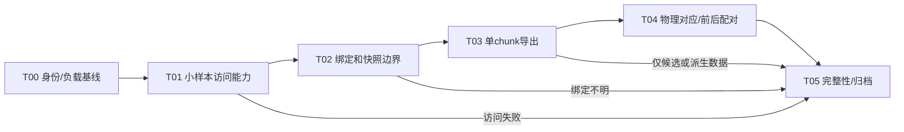

# [已完成] 竞品运行时碰撞网格取证计划

日期：2026-10-12。角色：execution_plan。执行方式：单主执行者串行。来源：用户“来一份计划，测试下能拿到运行时的物理网格数据”。本文规划测试，执行结果另存；旧调查不累计为本任务完成。

## 1. 目标

验证能否从竞品运行时导出一个沙面 PlaneChunk **实际绑定到 MeshCollider.sharedMesh 的完整输入网格**：顶点、索引、submesh、变换和碰撞配置，并用真实物理射线核对它参与了碰撞。首个样本成功后，再取同一chunk一次沙面编辑前后的数据。

这里的“物理网格”指碰撞器绑定的输入几何；不声称取得PhysX内部烘焙形状、加速结构或Godot可直接复用的资源。MeshCollider.sharedMesh的含义见[Unity官方接口](https://docs.unity3d.com/6000.0/Documentation/ScriptReference/MeshCollider-sharedMesh.html)。运行时取数能力现已实测，结果见最终验收；该接口链接仅用于输入网格定义。

依据：[命中代码补证](../../docs/competitor/笔刷命中检测_代码补证.md)。已有Ground.planeChunks、PlaneChunk.meshC/meshCollider/verticesOS/readbackIndices以及更新后重新绑定sharedMesh的静态证据。旧RVA只在源hash相同时作为定位入口，不能据此假定运行时指针有效。

## 2. 范围

| 项目 | 分类 | 完成边界 |
|---|---|---|
| 单chunk真实绑定网格导出 | MVP | 同一快照取得顶点、全部submesh索引、实际sharedMesh身份和碰撞配置 |
| 原字节、索引、溯源、失败记录 | MVP | 与源文件/进程/模块/对象/快照对应，独立脚本能复验 |
| 物理射线与导出几何对应 | MVP | 同碰撞器、同快照版本，命中点/距离/法线核对及负例 |
| 同chunk编辑前后两份快照 | MVP | 记录实际发布顺序与时间；不推导游戏未观测时长或性能 |
| 预览OBJ/线框图 | MVP | 派生预览能追溯到raw；不代替原始顶点/索引 |
| PhysX烘焙形状及内部BVH | vNext | 本轮不实现；输入网格成功不抵充此项 |
| 全域/多场景批量导出 | vNext | 单样本及动态配对成功后另行扩范围 |
| 性能优化、Godot集成、延迟基准 | out_of_scope | 本轮只验证取数和身份，不修改主场景/模拟/碰撞语义 |
| 工具业务、库存、任务、UI、存档、平台分析 | out_of_scope | 仅正常进行一个沙面编辑动作，不追业务调用链 |
| 占位功能 | placeholder | 无；缺数据按partial/failed记录，不提供假数据 |

## 3. 需求映射

| ID | 需求 | 任务 | 契约/验收 |
|---|---|---|---|
| R01 | 取得运行时物理网格 | T01–T03 | C01身份与快照、C02网格、G2/G3 |
| R02 | 证明是碰撞器使用的网格 | T02/T04 | C03绑定与射线、G3/G4 |
| R03 | 可复验且不改原包/项目 | T00/T05 | C04证据、G0/G5 |
| R04 | 初态/编辑后均能取到 | T03/T04 | C01发布序号、G4 |
| R05 | 失败也能判断边界 | T01/T05 | C05错误与结果分类、G5 |

## 4. 契约

字段级输入、输出、原始文件和错误契约见[取证数据契约](契约/取证数据契约.md)。本任务是本地探针，无网页、数据库或远程API；核心接口是probe请求JSON、run manifest、snapshot JSON和raw_index.jsonl，不生成无关OpenAPI或前端契约。

契约在G1冻结：目标进程所有权、版本、可用runtime API/ABI、快照边界、字段布局、坐标系、射线容差和数据上限。冻结后只在独立工具目录实现；规则修订记录到[决策记录](决策记录.md)，实际测试另写验收。

## 5. 执行DAG和运行模式



| 模式 | 依赖 | 用途/结果限制 |
|---|---|---|
| offline_baseline | 原包、metadata、旧索引/工具 | 核对身份、字段与候选入口；不能通过运行时网格验收 |
| owned_runtime | 自有竞品测试进程、定向探针、可用Unity/IL2CPP访问接口 | 唯一运行时取证模式；记录真实可见窗口、模块基址、线程与工具版本 |
| offline_verify | 已封存快照及独立解析/求交工具 | 验证raw/绑定/几何、生成预览；不重跑竞品、不伪装成第二类运行证据 |

T00–T04串行。当前观察到已有用户Godot和Steam竞品进程，执行时重新盘点；默认不附加、不暂停、不停止这些进程。优先建立自有测试实例，在其他GPU调查窗口结束后运行；启动失败只记失败，不修改原包或扩展平台接入。文件来源可用复制件时，先验证hash一致；原包/RDC只读。没有并行agent或共享shader/场景/profile修改。

## 6. Gate

- G0：[阶段通过] 原包/实际运行版本/工具/自有进程/运行窗口可追溯。Steam安装目录与旧包hash不同则重新定向定位。
- G1：[通过，契约冻结] 最小只读访问探针成功，线程和ABI正确，契约冻结；字符串/静态字段不算运行时对象访问。
- G2：[通过] 一个PlaneChunk、meshCollider、meshC和非空sharedMesh的身份链明确，取得一次成功绑定后的稳定快照。
- G3：[通过] 顶点与全部索引真实导出、数量/格式/范围一致，完整来源hash与raw配对。
- G4：[通过，正常桶编辑配对C2归因] 物理射线对应及负例通过，同chunk编辑前后可配对；重放/派生形状不作为真实物理查询。
- G5：[通过，最终封存] 独立复验、源hash后查、探针收尾完成，可靠结论写回docs/competitor并更新入口。

G1/G2/G3失败时走T05交付失败定位和下一证据，后续依赖任务标[已跳过]或[阻塞]并说明原因；不能把“调查已结束”写成“网格获取成功”。

## 7. 进度

总体：[已完成]，18/18个执行小目标，100%；最终A级，原始B阶段及失败保持原样，见最终验收。计划编写不计执行进度，旧C3结论仅为输入。唯一实际进度入口：[执行状态](执行状态.md)。

| 大任务 | 状态 | 小目标 | 进度 | 负责人 | 验收 |
|---|---|---|---:|---|---|
| T00 基线 | [已完成] | 3/3 | 100% | 主执行者 | G0 |
| T01 访问能力 | [已完成] | 3/3 | 100% | 主执行者 | G1 |
| T02 绑定边界 | [已完成] | 3/3 | 100% | 主执行者 | G2 |
| T03 数据导出 | [已完成] | 3/3 | 100% | 主执行者 | G3 |
| T04 对应与配对 | [已完成] | 3/3 | 100% | 主执行者 | G4 |
| T05 复验归档 | [已完成] | 3/3 | 100% | 主执行者 | G5 |

## 8. 任务细则

### T00 身份和执行基线

- T00-G01 [已完成本阶段] 核对选用EXE、GameAssembly、metadata及必要资源路径/大小/hash；核对旧证据文件实际可用性。
- T00-G02 [已完成本阶段] 记录自有PID/启动命令、实际模块路径/基址与GPU进程窗口；禁止复用另一版本的RVA/字段布局。
- T00-G03 [已完成本阶段] 建立唯一英文run目录、source/tool manifest与源文件前查；保存输入动作、相机、场景与时间条件。

### T01 最小运行时访问探针

- T01-G01 [已完成本阶段] 查本机可用Win32调试/内存读取或Frida等定向探针工具，先验证附加自有实例和模块枚举；不因候选工具名称存在宣称兼容。
- T01-G02 [已完成本阶段] 只在碰撞相关对象链上验证一个只读getter：对象身份、非负vertexCount和主线程安全调用。IL2CPP runtime_invoke/原生wrapper参数与返回ABI须先验证，不能在工作线程盲调Unity接口。
- T01-G03 [已完成本阶段] 选一条实际可用网格读取路线并冻结契约。优先实际sharedMesh的只读顶点/索引API；若当前build缺可调用入口，再评估已定位字段的有界内存读取。NativeArray只能作为候选原始数据，缺真实索引/绑定不能升级为成功。

[Mesh.AcquireReadOnlyMeshData](https://docs.unity3d.com/6000.0/Documentation/ScriptReference/Mesh.AcquireReadOnlyMeshData.html)等只读API是候选，不假设原作build保留了这些调用入口；若使用需及时释放读快照及临时资源。不得通过改isReadable、改数组长度或空返回绕过访问失败。每条路线先取一个样本，失败即登记；不开展全量方法恢复。

### T02 锁定实际绑定和快照边界

- T02-G01 [已完成本阶段] 关联Ground.planeChunks中的一个chunk、meshCollider、meshC；记录运行时对象/mesh实例身份和完整localToWorld。
- T02-G02 [已完成本阶段] 仅观察UpdateMeshCollider和sharedMesh绑定边界；跳过设null的中间态，成功返回后读当前sharedMesh验证与meshC同一性。
- T02-G03 [已完成本阶段] 建立单调binding_seq/update_seq及时间戳。快照采集前后验证绑定/内容版本未变化；直接内存读取时必须有覆盖Job写入与mesh更新的稳定边界，仅同frame号不足以证明一致。

### T03 导出一个chunk

- T03-G01 [已完成本阶段] 从真实sharedMesh取得本地顶点和全部submesh索引，保存原始字节、stride/indexFormat/baseVertex/topology及对象配置。
- T03-G02 [已完成本阶段] 可用时同时保存verticesOS、readbackIndices、实际colliderResolution/chunks和相关ReadbackCell；单独记录取得方式和完整性，不代替sharedMesh数据。
- T03-G03 [已完成本阶段] 校验数量、有限值、索引范围和bounds，生成可追溯OBJ/线框预览。若只取得规则拓扑推算结果或RDC渲染网格，标derived/partial。

### T04 物理对应和编辑配对

- T04-G01 [已完成本阶段] 在网格冻结边界/自然物理更新后，查询中心、斜向、边缘至少三条实际Physics.Raycast；保存mask、距离上限、最近hit.collider及原始hit，避免落入PlayerControls平面回退。
- T04-G02 [已完成本阶段] 对同快照导出网格做离线射线求交，核对命中对象、世界交点、距离和变换后的法线。增加域外miss、邻chunk命中、非PlaneChunk绑定过滤负例；不通过修改layer/禁用其他碰撞体制造对应。
- T04-G03 [已完成] 通过正常输入做一次局部沙面编辑，取同chunk下一次成功发布快照。检查对象身份/变换/拓扑是否稳定、顶点是否实际变化、射线是否随变化；没有可归因变化则重定位目标或记partial，不把时间不同视为编辑证据。

### T05 独立验证和归档

- T05-G01 [已完成本阶段] 独立读取封存raw及索引复算hash、范围、数量和求交；检查前/后快照同一性及失败链。
- T05-G02 [已完成本阶段] 核对原包/工具hash、分离临时资源、退出自有探针和自有实例；保留用户及其他任务进程。
- T05-G03 [已完成本阶段] 写最终判定、数据可用性和复验命令至验收；可靠事实归档docs/competitor命中/碰撞主题，更新README和专项证据索引。C0/C1保留待验证，旧失败不覆盖。

## 9. 验证与证据

| 用例 | 观测 | 判定 |
|---|---|---|
| V01 版本差异 | 运行模块与旧包hash | 不同则旧RVA定位拒绝，重新定位后才执行 |
| V02 真实绑定 | sharedMesh getter/成功绑定记录 | 与meshC同一对象，enabled/active/config记录完整 |
| V03 数据完整 | 所有顶点/submesh索引、baseVertex/格式 | 无缺段、数量/索引范围一致，无伪造数组 |
| V04 物理对应 | 三条hit及离线几何、负例 | 同对象/稳定快照；按G1冻结容差通过 |
| V05 更新配对 | 编辑前/后同chunk/发布序号 | 两份raw及变化有直接观测，不能只有派生高度图 |
| V06 读数失败/并发变化 | API异常、空mesh或版本变化 | errors.jsonl记录、snapshot不提交为完整 |

结果分级：A=G0–G5全部通过，完整实际绑定网格及动态对应成功；B=单快照G3通过、动态/物理对应未过；C=仅候选CPU数组、渲染网格或重建几何；D=运行时访问失败。B/C/D都保留证据，不写“已拿到完整运行时物理形状”。A也不等于取得PhysX烘焙形状或确认性能原因。

实际冻结命令接口见契约；原草案接口与已实现CLI分别说明，不把设想当已有功能。每次运行先小样本兼容性检查，实际命令/退出码/异常放在`验收/GateN_验收记录.md`与run日志。

## 10. 文件结构

```text
task/competitor_runtime_collider_probe/
  总纲.md                         execution_plan
  执行状态.md                     execution_state
  决策记录.md                     decisions
  契约/取证数据契约.md             contract draft
  验收/README.md                  验收记录入口
tests/investigation/brush_hit_competitor/runtime_collider/
  probe_runtime.py / probe_agent.* 已实现，主执行者唯一修改
  export_mesh.py / verify_mesh.py  已实现
test_output/brush_hit_competitor/runtime_collider/<run_id>/
  source_manifest.json / tool_manifest.json / request.json
  raw/ / snapshots/ / derived/
  raw_index.jsonl / errors.jsonl / verification.json
```

## 11. 执行起点

先执行T00，尤其确认Steam安装版是否与旧原包同hash。再执行T01–T03，以“一个实际绑定chunk的完整顶点和索引”为首轮止点；成功后才做T04。上述是原计划交付时的边界说明。现已执行自有实例取证；实际阶段结果与剩余项见执行状态及验收，未改正式场景/模拟代码。
