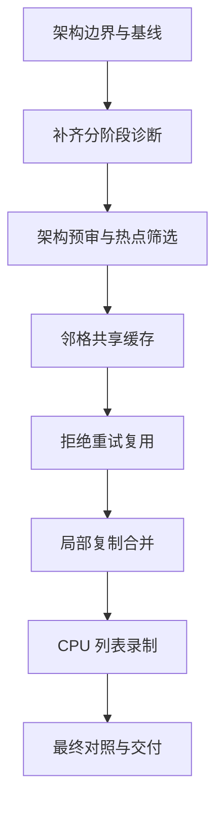

# MUSCL 第二轮性能优化计划

文档角色：execution_plan。日期：2026-10-24。状态：执行中，实际进度见执行状态。

来源：[入门讲义](../muscl_explainer/index.html)、[上一轮优化记录](../water_execution_optimization/结果.md)、当前 `water_muscl.gd`、MUSCL shaders 与已有性能探针。旧结果仅作背景，不累计为本轮完成。进度以[执行状态](执行状态.md)为准；实际结果进入[验收目录](验收/README.md)。

## 1. 目标与成功标准

**首要约束：架构稳定和完整优先于性能收益。** 模块职责、权威状态、同步与生命周期、故障处理及恢复链路必须完整成立，随后才评估数值等价与性能。任何 FPS 或局部耗时改善都不能抵消架构缺陷；无法证明边界完整的候选不合入。

在上述约束及保留当前水运动、水沙耦合与交互语义的前提下，减少 MUSCL 的重复计算、状态搬运和 CPU 命令录制成本。主测场景为 `test1_geometry`（场景 2），`main` 做受影响功能回归。

这轮先梳理架构边界，再回答“时间花在哪里”，最后逐项筛选四个候选：邻格数据共享、拒绝重试复用、状态复制合并、CPU 列表录制优化。每项在原型前和合入前都检查架构；只保留架构、数值与成本均通过的候选。被架构约束否决或没有收益的候选也要留下结论，不能为了完成清单而合入。

- **架构目标：**单一权威状态、模块责任和资源所有者清晰；正常、异常、关闭及恢复路径完整；不增加绕过统一流程的特殊通道或另一套长期维护的模拟逻辑。允许模块内部受控重构，接口与契约须保持可验证。
- **数值目标：**相同输入下，权威字段、原有双槽、接受／拒绝序列、完成时间及账本保持一致。第一选择是逐字节比较；出现差异时修复或撤回候选，不在本轮自行放宽为“看起来一致”。
- **性能目标：**场景 2 在相同条件下减少平均帧间隔或长帧；同时单独报告每推进一秒模拟时间的 GPU 成本与 CPU 录制成本。不卡住模拟进度来换 FPS。
- **交付目标：**产出可复验的瓶颈报告、每项候选的保留／撤回／跳过理由，以及最终累计对照。若没有候选达标，如实交付分析结论，不宣称已加速。
- **不承诺固定帧率：**历史 32.78 FPS 不是本轮基线，也不把“稳定 60 FPS”设为未经测量的承诺。

## 2. 范围与需求映射

| 项目 | 分类 | 本轮处理 |
|---|---|---|
| 架构边界核对、冻结基线、分阶段计时、子步／重试统计 | MVP | 必做，所有候选的前提；诊断本身也遵守架构契约 |
| 邻格共享缓存、拒绝试算复用 | MVP | 架构预审通过才做有界原型和对照；通过全部门禁才保留 |
| 状态复制合并 | MVP | 仅限职责边界内的局部融合，保留公共槽 0 和原双槽完成态 |
| CPU 计算列表整理 | MVP | 使用当前 Godot RenderingDevice；统一录制入口，保留正确同步 |
| 预计算全场重构结果 | vNext | 若共享缓存无收益，报告原因；本轮不自动追加另一套大实现 |
| 全局读写槽轮换、原生 C++ 录制器 | vNext | 涉及更多消费者或构建依赖，另立后续范围 |
| 占位功能／界面 | placeholder | 无；不新增不能工作的开关 |
| 改 CFL、步数容量、分辨率、精度、耦合频率、波浪参数、求解器 | out_of_scope | 均不改；不引入竞品式求解器或静水冻结近似 |

| 需求 | 任务 | 契约 | 验收 |
|---|---|---|---|
| 架构稳定和完整优先于性能 | T00–T07 | C0 | GA 前置与合入复查；正常、异常和生命周期链路完整 |
| 找到真实热点，避免测量改变执行路径 | T00–T02 | C1、C3 | 诊断开关等价、样本身份与时间戳完整 |
| 相邻线程减少重复读取／重构 | T03 | C1、C2 | 精确对照、干湿与边界负例、GPU 成本 |
| 拒绝后保留可复用中间结果 | T04 | C1、C2 | 连续重试、失效与故障路径、拒绝成本 |
| 减少全场复制 | T05 | C1、C2、C4 | 双槽与消费者一致、复制成本 |
| 降低 CPU 录制开销 | T06 | C2、C3 | 同步依赖、CPU 录制与场景帧时间 |
| 场景效果与体验不退化 | T07 | C1–C4 | 可见窗口对照、交互、暂停、恢复 |

## 3. 实施契约

### C0：架构稳定与完整性（所有候选的前置条件）

- **职责不穿透：**沿用统一入口 → pipeline → 水求解／耦合 → 完成态发布 → 消费者的责任边界。录制器只组织计算，不另行接管提交、发布或每步读回；渲染、UI 和诊断不得成为权威状态写入者。
- **单一事实来源：**保留一套数值公式、参数校验与资源描述。缓存是可丢弃、可重建的派生数据，不成为第二份需要跨模块同步的权威状态；不复制一套限幅、通量或耦合算法来维持“快路径”。
- **所有权闭合：**每个新增资源都明确创建者、使用线程、持有者、有效期、失效条件与释放点；初始化中途失败、在途任务关闭、恢复和换场景均有对应处理，不能只覆盖正常运行。
- **链路完整：**保留统一调度、正确同步、接受／拒绝、错误传播、完整状态发布、账本与恢复校验。数值测试通过不能代替这些链路的检查，不以删除检查、错误分支或测试来换性能。
- **变更可维护：**模块内部可以重构，但不得依赖其他模块的未声明私有字段、散落的缓存失效通知或场景特例。跨模块需求先通过现有明确契约判断；若需要改变职责、公共 ABI、存档格式或引入跨模块第二套状态机，本轮跳过，单独规划架构演进。
- **诊断可移除：**诊断关闭后不影响调度与结果；诊断队列饱和、读取失败或关闭时，只丢弃诊断数据并报告，不阻塞或改写模拟，不让测试工具成为正式运行依赖。
- **候选可撤回：**每次只改一个可归因因素；参考实现留在测试快照，正式路径不长期并存多套试验分支。合入时清理临时开关与无消费者的接口，保留既有正式一阶路径及其语义。

每项候选的架构记录只需一份简短影响表：涉及模块与职责、字段读写与所有者、同步边界、资源生命周期、异常／恢复路径、移除候选的方式，以及仍未解决的问题。预审有未解决的正确性或生命周期问题时不进入实现；合入复查有此类问题时撤回候选，性能收益不能豁免。

### C1：数值与时间

- 保留 256×256、格距 0.125 m、当前浮点格式、MUSCL 重构／限幅、Rusanov 通量与 SSPRK2 组合。
- 保留 CFL=0.2、阶段后复查、拒绝后缩小步长、64 次候选容量、湿干与速度保护、出流限制、有限值与非负检查。
- 只累计接受子步的真实 `actual_dt`。`advanced_time_s`、`accepted_count`、`rejected_count`、`state_seq`、`sim_tick`、错误状态与既有账本语义不变。
- 水与悬沙沿现有阶段通量搬运；侵蚀／沉积与材料更新仍在每个接受子步原定位置执行。
- 正常数值对照按 tick 比较；性能按相同完成模拟时间或明确的完成态窗口比较，不能只比录制次数。

### C2：公共接口、资源与同步

- `request_tick(dt)` 的输入、错误返回和完成通知保持不变；不新增业务 API、HTTP API、数据库或 UI 路由。
- 公共水深、动量、悬沙、沙、材料与通量字段的名称、单位、格式不变；公共槽 0、原有备用槽在可观察完成点保持一致。
- 同一共享边两侧的搬运、场景绑定、generation 与完整完成态发布不变。缓存只属于当前求解器实例，不跨 tick、编辑、边界改写、恢复或换场景误用。
- 新增缓存只作私有暂存，不进入存档；记录实际显存增量，并在释放时销毁。不得复用已释放的 RID。
- 不改变标准／自定义耦合回调语义。缓存键继续覆盖 dt、格距、边界、保波值、耦合 Callable 与 prescribed_tide_boundary。
- 同一列表内多 dispatch 必须保留纹理／缓冲读写，以及“GPU 写间接参数 → 间接派发读取”的正确依赖。不能只删 `begin/end` 或依赖单个工作组的 barrier 代替全场同步。

### C3：测量与报告接口

只增加开发诊断入口，默认关闭，不写用户参数文件。开发工具的结构化输出采用下列最小字段；不改公共模拟 ABI。

| 数据组 | 必需字段与口径 |
|---|---|
| 身份 | `run_id`、`variant`、源码／资源／配置 hash、引擎身份、GPU、后端、实际窗口尺寸、VSync、机位、初态与输入序列 hash |
| 样本关联 | `generation`、记录序号、完成 `state_seq`／`sim_tick`、GPU timestamp frame、候选槽 `0..63`、RK 阶段 `0/1`、阶段名 |
| 时间 | CPU 单调时钟 μs、GPU 时间戳 ns、区间起止、实际累计模拟秒；CPU/GPU 不跨时钟相减 |
| 工作量 | 接受数、拒绝数、无效槽数、容量耗尽次数、实际推进时间；无效槽数按 `64−接受−拒绝` 仅用于无故障完成样本 |
| 状态 | 是否启用详细计时、是否命中标准缓存路径、丢标记／丢样本数、焦点、错误、来源漂移、跳过原因 |
| 汇总 | 帧间隔均值/P50/P95/P99、FPS、CPU 录制、按阶段 GPU 标记区间、GPU ms/模拟秒、完成模拟秒/墙钟秒 |

`null` 表示未取得数据，不用 0 代替。CPU 与 GPU 区间不能当成可直接相加的整帧分解；嵌套区间不重复计费。GPU 时间戳区间也不宣称是排除了所有调度影响的纯算术耗时。

现有 `scene_profile.gd --detail-gpu` 通过替换耦合 Callable 来计时，而当前录制器只对原始标准 Callable 展开缓存。因此，**该方式不能直接作为本轮优化路径的计时依据**。新诊断需在已缓存阶段描述的录制位置打标记，保持原 Callable、顺序和快路径；报告实际命中状态。

### C4：交互、恢复与回退

- 挖填铲、造浪、浮物采样、白沫、碎石、植被与碰撞继续读取同一 generation 的完整完成态。
- 不取消现有来源指纹校验。优化前后的源码不同，不承诺旧检查点直接加载；版本对照应从相同原始初态和输入构造各自实例，不能绕过校验。
- 冷启动恢复测试在每个固定候选版本内保存、另起进程恢复并继续推进。
- 候选未通过时，在测试副本撤回该候选；不在游戏中加入自动重启、自动迁移或复杂回退流程，不重置用户的其他工作区改动。

## 4. 测量模式

| 模式 | 设置 | 用途 |
|---|---|---|
| 正常可见窗口 | 详细 GPU/CPU 诊断关闭，保留轻量帧与完成态记录 | 场景 2 的实际体验结论 |
| 分阶段诊断 | 真实窗口、原缓存路径、稀疏打点、异步或完成后读取有身份的快照 | 热点归因、重试统计；该模式 FPS 不作为最终收益 |
| 数值等价 | 固定初态、输入、步长序列；允许完成后同步读取 | 校验候选结果，耗时不计性能 |
| 冷启动恢复 | 固定源码副本，两个独立引擎进程 | 检查存档与继续模拟 |

基线条件默认沿用历史可比条件：场景 2、D3D12 Forward+、真实 1280×720 窗口、VSync 开启、参数窗隐藏、固定机位与完整消费者。硬件和引擎记录实际值；不以历史型号替代检测。初始化后预热 5 秒、稳定 2 秒；正常段 20 秒，暂停绘制诊断段 10 秒。

正式 A/B 使用独立进程、相同初态／输入，按 A→B→B→A 串行运行。交互输入按完成 tick 调度，避免低帧率改变工具输入量。测量期间不改配置，保存实际有效参数；用户配置使用隔离副本，启动失败也不能回写真实参数文件。

## 5. 执行顺序与并发边界



默认单主执行者串行处理；不启动 subagent，不并发运行 Godot 成本测量。共享 shader、录制器、耦合、profile 和契约始终只有一个修改者。T02 先按 C0 筛选，再按成本判断；T03–T06 原型后各自复查 GA。可跳过低价值或无法守住契约的候选；跳过也要记录理由，后续任务依赖“前项已处置”，不要求前项必须合入。

## 6. 任务细则

### T00：冻结本轮基线

前置工作：画出当前模块调用／数据流，确认权威字段写入者、GPU 资源所有者、调度与发布边界、错误出口和恢复入口。登记影响本轮优化的已知缺口；未解决的依赖缺口阻止相应候选，不能随优化顺带扩成整套架构重写。

1. 核对当前工作区和新一轮执行时的源码，不使用旧 HEAD 覆盖已有改动。保存基线实现、完整配置与资源身份、初始化数据、固定输入、引擎身份及 SHA256。
2. 创建测试专用配置／源快照。沿用正式启动初始化，验证隔离确实生效；不要盲目假定某个引擎命令行参数能隔离 `user://`。
3. 复验当前版本基础数值与场景 2 成本。旧精确探针支持 `--reference`，需明确指向本轮基线；旧 CPU 探针写死历史录制器路径，需要改为本轮 reference 后才能比较。
4. 留下两个无改动基线段，用来估计本机测量波动。通过后冻结本轮比较对象。

产出：架构边界表、基线源码／配置索引、场景基线、测试入口表。完成条件：本轮依赖边界明确、来源一致、无未解释故障、隔离配置未回写用户文件。

### T01：分阶段 GPU 与 CPU 诊断

1. 给缓存描述增加仅供诊断的阶段标签，覆盖初始验证、两阶段 edge/drain/euler、decision、finalize、耦合、normalize、末端验证与尾部消费者；标准耦合仍使用展开后的描述表。
2. 默认每 8 个录制 tick 选一个 tick，在其中轮换采样一个候选槽 `0..63`。每个渲染帧最多额外 64 个时间戳，预算不足跳过并计数，不能阻塞模拟。诊断采样窗口默认 40 秒；分组统计有效／拒绝／无效槽，不能用混合平均冒充有效子步成本。
3. 采样 tick 的 decision/audit 等信息先复制到有身份的诊断暂存；完成后再读，避免下一 tick 覆盖。采样队列有上限，满时丢弃诊断样本并记数，不同步等待 GPU、不逐子步 CPU 读回。
4. 检查时间戳容量与结果关联。阶段标签缺失、跨帧配对失败或覆盖错误的样本不得参与阶段占比；保留丢弃计数。采样覆盖不足时只补缺失覆盖，不持续重跑相同配置。
5. 开关诊断各跑一次同输入精确对照，确认诊断不改变状态、回调路径和缓存键行为。正常性能样本关闭详细诊断。

产出：独立开发采集／分析工具和有身份的分阶段报告。工具拟置于 `tools/muscl_performance/`，不把入口放在临时输出目录。

### T02：决定哪些候选值得实现

先为四项候选填写 C0 影响表并完成 GA 预审。收益判断只针对通过架构预审的候选；涉及全局状态约定、跨模块职责或新增并行维护路径的方案移入 vNext，不因预计收益高而例外。

1. 列出 GPU edge、更新、控制、复制、耦合和尾部消费者成本，CPU 录制成本，以及接受／拒绝分布；分别解释平均与长帧。
2. 候选 1 用 edge 成本估计可优化上限；候选 2 仅使用拒绝重试中重复的第一阶段成本，不把全部拒绝耗时视为可省；候选 3 统计实际重复复制；候选 4 使用 CPU 录制 self/区间数据。
3. 若某候选即使消除其全部目标成本，也不足以带来主测量通道 3% 的收益且不关联 P95/P99 长帧，则记录为低优先级并跳过本轮实现。CPU 与 GPU 通道分别判断，不直接相加。
4. 若主瓶颈在表现或其他消费者，报告这一结论；本轮不自动扩大到材质、反射或整个游戏优化。

产出：每项候选的架构预审、测量依据、可省工作、继续／跳过判断。此处是投入筛选，不是收益承诺。

### T03：邻格共享缓存

1. 首个候选保持 8×8 工作组与原有派发结构，在 `rk_edge` 中合作装载局部状态；按现有邻格读取范围覆盖两格 halo。先缓存原始数据，复用原有 `primitive/reconstructable/face` 算术顺序。
2. 越界 halo 用显式掩码处理。提前装载不能把原来不会消费的数据当作有效输入，也不能提前触发有限值／负值错误标记；所有线程按一致路径到达组内 barrier。
3. 尽量复用重构量，但不改变两侧共享边的值、限幅公式、源项或 CFL 归约结果。缓存读取仍复用统一数学实现，不复制第二套公式。不同时改组大小、精度或使用 fast-math。
4. 编译、短运行和精确对照通过后再测成本。若共享缓存及同步抵消收益，撤回原型；本轮不自动叠加全场预计算方案。

重点验证：全湿、干湿交界、障碍边界、域边缘、保波 0/0.5/1、异常输入、两阶段来源不同。

### T04：拒绝重试复用

1. 保留同一未提交初态的第一阶段边通量、床面修正／源项和速度上界，供 CFL 拒绝后的下一尝试使用。当前 correction、bed_source、speed_tiles 会被下一阶段覆盖，必须先解决存活期，不可只加一个“已缓存”布尔值。
2. 缓存只在当前 tick、同一个未接受初态的连续重试中有效。接受子步、边界改写、新 tick、编辑、恢复、参数／资源改变和故障都使其失效。由求解器所有者在现有边界集中管理，不要求工具、渲染或场景脚本额外维护缓存正确性；做不到时跳过该候选。
3. 仅复用与 Δt 无关的量；drain、Euler 更新和第二阶段一律用新 Δt 重算。保留尝试次数、CFL 值、审计、错误标志与阶段状态。
4. 额外存储和缓存维护纳入普通无重试场景的成本。高重试合成用例变快、场景 2 变慢时，不以合成收益替代实际收益。

重点验证：至少一次真实拒绝、连续拒绝、拒绝后接受、64 槽耗尽、故障与下一 tick 重置。

### T05：局部状态复制合并

1. 对 finalize、材料提交、sediment copy 与 normalize 建立读写依赖表，标出每份源数据最后一次读取和目的槽第一次读取。
2. 只合并能证明安全、且职责边界内的同格写入／复制，目标是少一次全场遍历或少一次重复写；公共槽 0 及原备用槽在完成点仍与基线相同。不能为了融合把材料业务塞入水核、把发布责任塞入耦合核，或让两个模块共同管理同一份私有缓存。
3. 若消除主要复制必须引入全局槽轮换，停止本项实现，记录为 vNext。不得以“渲染只读当前槽”为由忽略编辑、恢复、诊断和耦合读取。
4. 精确测试不能删除备用槽比较来制造通过。任何融合均需保留故障时不发布半成品的行为。

重点验证：材料／侵蚀开启和关闭、连续多子步、编辑后立即 tick、场景切换、暂停与恢复。

### T06：CPU 列表录制优化

1. 保留已缓存描述与统一录制入口，先在当前 Godot 版本做最小读写＋间接派发验证；随后仅把能明确同步的相邻阶段合入同一计算列表。避免维护另一套顺序不同的优化专用命令链；阶段依赖保持可读、可检查。
2. 对纹理、storage buffer、间接参数列出写后读依赖并设置适当 barrier。保留动态边界和自定义回调所需的列表边界；不缓存跨 tick 的 compute-list ID。
3. 若当前 RenderingDevice 不能可靠表达需要的依赖，保留原边界，记录限制；不改引擎、不添加原生扩展。
4. 用独立 CPU 对照确认录制成本，再用关闭诊断的场景对照确认体验。只有 CPU 改善时，结论只写 CPU 改善。

重点验证：间接工作组为零、拒绝／接受分支、参数键失效、回调包装／恢复、D3D12 实际后端。

### T07：累计版本与最终交付

先复查组合版本的 C0：各模块职责、资源持有／释放、错误传播、发布与恢复形成完整链路；清理试验分支，确认不存在单项测试未暴露的组合耦合。随后执行以下验证。

1. 将保留项组合，与本轮原始基线再做完整数值对照，防止各自通过但组合失效。
2. 完成场景 2 正常无操作、固定造浪、固定挖填铲输入的成本对照，及 main 的功能回归；检查浮物和表现消费者完整态。
3. 每个最终版本内做跨进程保存恢复。做一次 120 秒连续可见运行，检查故障、显存持续增长、队列积压和模拟进度；不宣称为无限长稳保证。
4. 输出每项保留／撤回／跳过原因、累计收益及测量限制。更新受影响的当前规格、技术方案和既有文档生成入口；未实现候选继续标注为候选。

## 7. Gate 与收益判定

| 门禁 | 通过条件 | 未通过处理 |
|---|---|---|
| G0 基线可信 | 架构边界与相关缺口明确、当前来源冻结、配置隔离、正式初始化、可重复数值与成本样本 | 修正基线，候选不开始 |
| G1 诊断可信 | 保留缓存快路径、采样身份完整、明确扰动与丢样本、开关数值一致 | 修复探针，不据此选热点 |
| GA 架构稳定与完整 | 候选原型前审查及合入前复查 C0；职责、所有权、同步、异常／关闭／恢复完整，无未解决的正确性问题 | 预审失败不实现；复查失败撤回或转入独立架构计划，不接受收益豁免 |
| G2 单项正确 | 编译、短运行、相关负例、权威／双槽／时钟／账本精确一致 | 修复或撤回该候选 |
| G3 单项有益 | 达到下述成本判据且无可确认的体验退化 | 保留证据，撤回或标为无结论 |
| G4 累计可交付 | 组合版本再次通过 C0/GA，数值对照、正式场景、交互、恢复与文档通过 | 仅保留架构完整且已单独、组合验证的子集 |

GA 是必需前提，不与 G2/G3 的数值或性能分数加权抵扣。以下收益规则只适用于架构通过的候选，是本轮实验筛选默认值，不是对可达性能的预测：

- 两个基线 A 段相对差作为该指标的波动估计 `noise = |A1−A2| / mean(A1,A2)`，它不是严格置信区间。分别计算 mean、P95、P99、CPU 与 GPU 指标。
- GPU 主目标改善至少 `max(5%, noise)`，或 CPU 录制改善至少 `max(10%, noise)`；两组配对都应同方向。CPU 达标但 FPS 无显著变化，只报告局部收益。
- 帧均值/P95/P99 不得出现超过 `max(5%, 各自 noise)` 的可复现退化；完成模拟时间比例不能出现超过窗口量化误差的下降。若正常窗口受 VSync 限制，结合 GPU 成本及长帧判断，不靠平均 FPS 一个数。
- 若基线波动超过 10% 或配对相互矛盾，先排查焦点、来源漂移、热状态、桌面负载和采样边界；修正后最多补一组，仍不确定则标“收益未确认”，不把微小差异当收益。

## 8. 验证范围与证据

| 范围 | 代表用例 |
|---|---|
| 架构完整性 | 正常数据流、单一权威写入者、初始化部分失败的清理、在途关闭、诊断失败隔离、缓存重建、资源释放、发布／恢复链路 |
| 基本水流 | 静水、普通湿床、干床、障碍、边缘、保波 0/0.5/1 |
| 数值保护 | 高速、负水深、非有限输入、无效 dt、连续拒绝、容量耗尽 |
| 水沙与交互 | 侵蚀／材料、动量 B、连通排水、强铲冲量、固定造浪 |
| 生命周期 | 缓存键改变、标准／包装回调切换、暂停、换场景、释放、跨进程恢复 |
| 成本 | 场景 2 完整负载、无操作／造浪／工具；main 受影响回归；累计版本短长稳 |

复用 `water_execution_exact_probe.gd`、现有异常输入／强铲探针、`scene_profile.gd --timing-off`、`run_muscl_restart.py`，但以 T00 核对后的入口为准。新缓存增加私有字段时，明确列出“原字段必须精确相同”和“新增暂存的身份／失效检查”，不要把私有布局变化误判为物理变化，也不能借此放宽原字段。

失败记录原样保留；修复后使用新的输出目录。临时测试写入 `test_output/muscl_performance_round2/<run_id>/`；交付前把必要源码快照、命令、退出码、采样、对比和 hash 迁入本任务验收目录，不能只保留指向临时目录的链接。

## 9. 进度、文件与下一步

本轮实施为 **[进行中]，1/8 个主任务完成**。规划与只读核对不算优化完成；各任务及小目标进度见[执行状态](执行状态.md)。

```text
task/muscl_performance_round2/
├── 执行计划.md       范围、契约、任务、门禁
├── 执行状态.md       实际进度、单写者锁、处置决策
└── 验收/
    ├── README.md     证据要求与索引
    └── <run_id>/     原始运行、源码快照、身份与对照
```

T00 已建立本轮架构边界、冻结来源、参数隔离、无改动可见成本及数值自对照。继续 T01 的有身份分阶段诊断，补全成本分布与接受／拒绝统计；通过架构预审的候选再按默认顺序验证。实际结果与限制保存于验收目录，不将基线通过等同于优化完成。
