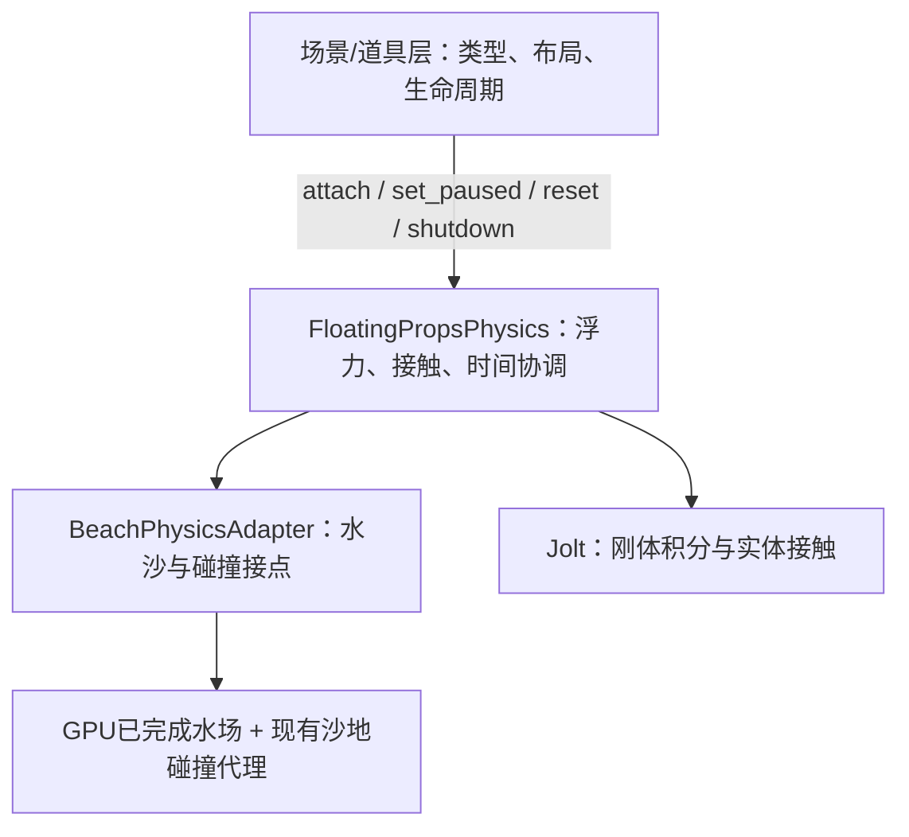

# [未开始] 漂浮道具第一阶段

2026-10-15。角色：execution_plan。目标：在当前main中预置木棍、水瓶、小船各1件，完成漂浮、随流、沙地碰撞、搁浅和再次起浮。道具在重新进入或成功恢复场景时按固定布局重置。

## 交付范围

| 需求 | 第一阶段结果 | 任务 |
|---|---|---|
| R01 三类道具 | 可辨识模型、实体碰撞体，各1件，共3件 | T02/T04 |
| R02 漂浮与随流 | 升沉、倾斜、随局部水流移动 | T01/T02 |
| R03 岸边接触 | 与沙地、其他道具碰撞；退水搁浅、来水再起浮；堆挖后保持支撑正确 | T03 |
| R04 基础接入 | main直接启动可见，暂停同步，重新进入/恢复时重置，退出释放干净 | T04 |

竞品依据见[已核对配置](../../docs/competitor/碎石输运与道具浮力.md#prop-implementation-02漂浮道具专项复核与实现思路)：多点Buoyancy、Rigidbody和实体Collider有配置证据。具体受力公式和时间协调采用Godot适配。木棍3个浮力点、水瓶2个、小船4个；小船4点为项目方案。

## 实现方式

按“场景层 → 道具物理服务 → 当前后端适配”分层。场景层只配置三类道具及布局，调用挂接、暂停、重置和关闭接口；浮力、采样、碰撞版本、物理步和资源回收由物理服务承担。第一阶段新增一层专用接口及默认适配，复用当前可用物理实现即可开始开发。

GPU从已完成的水沙状态批量采样床高、水深和水平流速；CPU/Jolt计算浮力、阻力、旋转与实体接触。复用现有沙地HeightMap碰撞和完成通知。网格、Collider、采样点和3件固定布局保存为场景/资源。

水沙完成态 → 批量水样与所需碰撞就绪 → 道具有效物理步 → 下一共同时间边界。

这是物理服务内部的候选时序，先在T01验证时间、接触和等待成本，再决定接线。场景层调用异步服务接口，无需读取碰撞代理内部字段或自行等待GPU/计算物理帧数。实际物理频率以运行值为准，水样身份和步预算保证暂停及慢帧时两者时间一致。[实现约定](实现约定.md)集中说明接口、受力和重置行为。

## 4个任务

顺序：T01固定接口并接通当前后端 → T02 → T03 → T04。负责人：主执行者，串行执行。三类预制体与布局可在接口确定后准备；接真实后端后的功能验收仍按顺序完成。进行中的物理优化任务不进入本阶段依赖链。

| 任务 | 小目标 | 交付/放行条件 |
|---|---|---|
| T01 物理接口与默认适配 | G01 固定场景层接口及宿主接点；G02 接当前后端并完成批量采样/版本校验；G03 用单刚体验证物理步、暂停和等待成本 | 场景层只调接口；真实水场值正确、时间不漂移、接触不爆冲，冻结实现约定 |
| T02 三类道具 | G01 固化模型/shape/浮力点；G02 实现多点浮力和相对流阻；G03 验证三类静水、倾斜和正反向流 | 各1件可稳定漂浮、随流，受力与旋转可解释 |
| T03 岸边碰撞 | G01 接入足迹碰撞版本；G02 实现搁浅、唤醒和堆挖后的接触处理；G03 验证跨块与道具互碰 | 同一物体完成漂浮→搁浅→再起浮，没有持续明显穿插 |
| T04 main接入 | G01 通过接口接入3件布局及暂停/重置/释放；G02 验证实际浪、编辑和场景重进；G03 完成短成本对照与交付 | main直接启动可用，成功恢复后重置，道具开关成本及连续动作有证据 |

总体[未开始]：0/4任务、0/12小目标、0/4 Gate，0%。逐项进度见[执行状态](执行状态.md)，验收用例见[验收计划](验收/README.md)。本次仅简化计划。

## 与进行中的物理任务衔接

道具开发无需等待物理线程优化完成。默认适配器先接当前baseline、独立物理线程关闭的实现。后续获选物理优化通过适配器或后端配置接入；接口语义不变时，场景/道具配置无须跟着修改。

适配器负责现有碰撞提交、两次physics_frame编辑完成边界及worker回收；运行时等待必要的水样/碰撞结果由底层异步处理。共享宿主接点集中一处，修改前核对最新diff，保留main→gravel→shape入口和恢复链。性能测量窗口仍与另一任务错开，这不阻塞接口及功能开发。若后端改变完成态或输入准入语义，需重新核对契约与相关用例，不能靠接口包装宣称等价。

[原衔接审查](物理线程衔接审查.md)及来源JSON保留为取证记录，执行范围以本总纲为准。

## 文件与下一步

拟新增scripts/props/下的floating_props_physics.gd服务、beach_physics_adapter.gd适配器、采样器与刚体脚本，shaders/simulation/prop_probe.glsl，scenes/components/floating_props.tscn及scenes/props/三个预制体，assets/props/模型与profile。验证入口放tests/floating_props/，证据放test_output/floating_props/<fresh_run_id>/。

从T01开始，固定场景层的4个调用接口，以当前后端接通1件测试刚体，再扩到3件道具。
