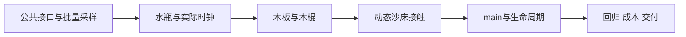

# [已完成] 水瓶、木板、木棍漂浮第一阶段

更新：2026-10-19。角色：execution_plan。来源：用户本轮要求“先支持水瓶、木板、木棍”，以及当前技术方案/规格和本轮接入审查。原计划阶段仅交付文档；用户随后以 /goal 授权按本总纲执行，当前状态见执行状态。

目标：在正式main预置水瓶、木板、木棍各1件，完成漂浮、随局部水流运动、倾斜、沙地及道具互碰、退水搁浅、再浸水起浮，并接通暂停、保存期间保持、成功恢复/重进重置与安全关闭。共用当前统一水沙流程，水沙写入和编辑准入不等待道具。

## 当前进度与文档角色

总体[已完成]：6/6任务、18/18小目标、6/6 Gate，100%。此前取证、计划及统一流程36/36不计入本任务实现进度。

| 文档 | 角色 | 用途 |
|---|---|---|
| 本文件 | execution_plan | 范围、依赖、需求和Gate |
| [实现约定](实现约定.md) | contract / frozen | 场景接口、探针字段、时钟、碰撞及生命周期边界 |
| [任务细则](细则/README.md) | implementation_plan | 分任务输入、修改范围与验收 |
| [执行状态](执行状态.md) | execution_state | 三层进度、冻结状态、锁与决策 |
| [验收计划](验收/README.md) | verification_plan | 测试方法、预算与证据位置；实际报告另存 |
| [旧计划快照](归档/20261018_旧三件计划/README.md) | archive | 四份旧文档原字节与hash；原小船范围不再执行 |

原物理线程衔接审查、来源核对JSON、历史草案和旧验收JSON均按原范围保留，不能指导当前后端接线。

## MVP边界

| 项目 | 分类 | 交付口径 |
|---|---|---|
| main固定三件 | MVP | bottle、wood_plank、wood_stick各1件，静态节点和布局保存为场景 |
| 可辨识外观 | MVP | 瓶身/瓶盖、扁平木板、细长木棍；首版使用项目自建或已有可用资源，不要求竞品美术精确复刻 |
| 受力与碰撞 | MVP | 浮力、相对流阻、转动、沙地支撑、互碰、搁浅/再起浮、堆挖后支撑变化 |
| 现有按钮/工具 | MVP | 沿用空格、保存恢复、场景切换；修正沙刷拾取掩码，不新增道具面板 |
| 三个test1入口 | MVP回归 | 本阶段不默认投放道具；共用代码变化后原功能必须保持 |
| 数据化扩展 | MVP | 一套受力/采样服务，三份类型化物理参数；不借用ToolProfile伪装刚体 |
| 额外产品按钮/API | placeholder：无 | 不制作不可用按钮或空实现接口 |
| 小船、浮标等其他种类 | vNext | 本阶段不实现 |
| 任意投放/拖拽/删除、道具姿态持久化 | vNext | 第一阶段固定布局；成功恢复/重进重置 |
| 开瓶/灌水、液体晃动、断裂、复杂埋沙黏结 | out_of_scope | 水瓶按封闭、固定有效排水体积处理 |
| 道具阻水/排水/挤沙、尾迹白沫 | out_of_scope | 本阶段水沙→道具单向作用；不改权威场及账本 |
| 竞品业务与生物AI | out_of_scope | 只复用已确认物理资源结构及必要参数线索 |

受力起点：水瓶2点、木板4点、木棍3点，共9个浮力点。木板4点是Godot适配，原包WoodPlank为2点。点位、质量、有效体积和阻力均按项目尺度校准；原包缩放、质量与buriedThreshold不直接当成已验证公式。取证入口：[道具分析](../../docs/competitor/漂浮道具种类与实现分析.md)。

## 需求映射

| ID | 需求/约束 | 分类 | 任务 | 契约 | 验收 |
|---|---|---|---|---|---|
| R01 | 水瓶/木板/木棍，各1件可辨识 | MVP | T02/T03/T05 | C01/C03 | V04/V05/V09 |
| R02 | 漂浮、随流、倾斜 | MVP | T01/T02/T03 | C02/C03 | V01–V05 |
| R03 | 沙地/互碰、搁浅、再起浮、挖填支撑 | MVP | T04 | C04 | V06/V07 |
| R04 | 时钟、慢帧、暂停编辑 | MVP | T02/T05 | C03/C05 | V03/V08 |
| R05 | 保存、成功恢复重置、失败保留、重进和退出 | MVP | T05 | C05 | V10/V11 |
| R06 | 公共采样、无私有writer/调度器，不阻塞水编辑 | MVP | T01/T06 | C02/C06 | V02/V12/V15 |
| R07 | 沙刷拾取、其他入口、权威数据无反作用 | MVP回归 | T05/T06 | C04/C06 | V09/V12 |
| R08 | 来源审计、兼容性、可见成本与文档 | MVP | T05/T06 | C05/C06 | V11/V13–V15 |

## 契约清单与冻结顺序

| ID | 内容 | 冻结任务 | 当前状态 |
|---|---|---|---|
| C01 | attach/pause/reset/shutdown、预制体与类型化Profile | T01，数值参数由T02/T03补齐 | 已冻结，三类数值见G2/G3 |
| C02 | 批量探针请求/响应/错误、GPU ABI、读者所有权 | T01 | 已冻结 |
| C03 | 实际时钟预算、受力、采样陈旧度与姿态误差 | T02通过真实Jolt实验后 | 已冻结，参数/证据见G2 |
| C04 | 足迹碰撞版本、唤醒、解穿透、拾取层 | T04 | 已冻结，G6补订见C04机器记录 |
| C05 | 保存保持、换代重置、失败保留、关闭与旧档策略 | T05 | 已冻结，G6补订见C05机器记录 |
| C06 | 单向作用、公共所有者、审计与性能证据口径 | T01/T06 | 已冻结，C06联合门 |

字段级定义集中于[实现约定](实现约定.md)。T01必须另交付可验证的探针ABI机器表和打包/解码哨兵结果，不能把仅有字段名的草案当冻结协议。

## 运行模式

| 模式 | 依赖 | 用途与限制 |
|---|---|---|
| 静态/编译检查 | 项目实际Godot版本、脚本/场景资源 | 解析和契约检查；不证明GPU浮力或视觉 |
| 单体/三体夹具 | 当前UnifiedEditRuntime、真实RD、Jolt、可见窗口 | 固定水/床场、延迟注入、正反流、碰撞与时钟 |
| 正式main | 原水沙/表现完整负载、同一公共后端 | 默认三件、实际浪、编辑、暂停和生命周期 |
| 其他正式入口回归 | 三个test1原配置 | 道具关闭，确保已有水沙/编辑/恢复不退化 |
| 成本A/B | 同源0件/3件，可见1280×720、实际VSync | 仅变化道具开关；功能稳定后集中测量 |

## 执行DAG与写入所有权

默认主执行者串行，全部共享shader/scene/profile/契约同时只有一名修改者。本计划不分派subagent。T01接口冻结后可以由同一执行者穿插准备离线模型；不能以此跳过G2时钟验证，也不同时运行GPU/性能探针。

| 任务 | 依赖 | 小目标 | 负责人 | 状态/进度 |
|---|---|---:|---|---|
| [T01 公共接口与批量采样](细则/T01_公共接口与批量采样.md) | 当前源码/契约复核 | 3 | 主执行者 | [已完成] 3/3 |
| [T02 水瓶与实际时钟](细则/T02_水瓶与实际时钟.md) | G1 | 3 | 主执行者 | [已完成] 3/3 |
| [T03 木板与木棍](细则/T03_木板与木棍.md) | G2 | 3 | 主执行者 | [已完成] 3/3 |
| [T04 动态沙床接触](细则/T04_动态沙床接触.md) | G3 | 3 | 主执行者 | [已完成] 3/3 |
| [T05 main与生命周期](细则/T05_main与生命周期.md) | G4 | 3 | 主执行者 | [已完成] 3/3 |
| [T06 回归成本与交付](细则/T06_回归成本与交付.md) | G5 | 3 | 主执行者 | [已完成] 3/3 |

## Gate清单

- [x] G1：原始水样、身份/ABI/错误与读者回收通过；不与预览争用，不阻塞生产队列。
- [x] G2：单水瓶静水/正反流通过；actual_dt缩短、延迟、暂停下实际时钟预算与接触成立。失败先返工时钟，不能改回水步等待道具。
- [x] G3：三件共用同一算法，仅配置差异；各自漂浮、倾斜和随流通过。
- [x] G4：足迹碰撞、跨块、互碰、堆挖、睡眠唤醒及三类搁浅/再起浮通过。
- [x] G5：main直接启动、沙刷拾取、暂停编辑、保存保持、成功重置、失败保留及退出通过；兼容性结论明确。
- [x] G6：四入口受影响回归、单向数据隔离、十轮生命周期、可见A/B成本、审计和文档通过；功能与成本分别判定。

## 推荐文件结构

- `scripts/props/`：floating_props_service.gd、floating_prop.gd、floating_prop_profile.gd；场景层不持有RD或私有solver。
- `scripts/simulation/unified_edit/`：扩展公共views的probe组件/核/ABI及height足迹就绪查询，全部挂在现有公共owner下。
- `scenes/props/`：bottle.tscn、wood_plank.tscn、wood_stick.tscn；`scenes/components/floating_props.tscn`预存三件布局与服务。
- `assets/props/`：三份Profile、模型和材质；新资源类型显式纳入审计。
- `tests/floating_props/`：实际GPU/Jolt夹具与验证入口；不新建生产后端。
- `test_output/floating_props/<fresh_run_id>/`：英文路径机器证据；Gate报告放本任务`验收/`。

## 交付状态

用户 /goal 授权范围已完成。正式main已接入固定三件；G1–G6通过，包括300秒连续观察、十轮生命周期、30组最终回归与三对可见成本。各Gate结果及来源见[执行状态](执行状态.md)和[G6报告](验收/G6_交付.md)。
