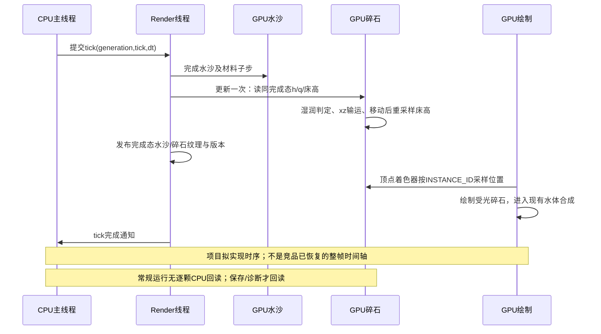
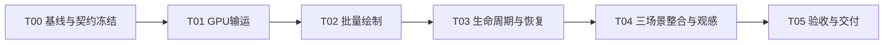

# [已完成] 水底碎石输运与搁浅实现计划

日期：2026-10-14。角色：execution_plan。范围取自用户最近的需求：“在水底加一些沙石，随波逐流，能搁浅到海滩上”；计划发布于2026-10-14；2026-10-15按本包实施，实际结果见执行状态与G0–G5报告。

目标：在当前可编辑沙滩中加入少量有体积、受光的碎石。碎石贴着床面被局部水流搬运，退水后留在海滩，再次覆盖且存在搬运水流时继续运动；暂停、挖填、保存恢复与场景切换保持连续。

先读[竞品实现思路](../../docs/competitor/碎石输运与道具浮力.md#gravel-implementation-summary-01实现思路与本项目移植边界)，再按本计划执行。竞品Gravel.Update的采样/位移指令有C3依据，完整搁浅再起动动作仅为C2解释；本项目的具体公式和绘制/恢复方案均为Godot适配。

## 0. 进度与文档角色

| 层级 | 对象 | 状态 | 进度 | 说明 |
|---|---|---|---:|---|
| 总纲 | 水底碎石MVP | [已完成] | 100% | 2026-10-15 G0–G5完成；真实证据与限制见最终报告 |
| 任务 | T00–T05 | [已完成] | 6/6 | 见[执行状态](执行状态.md) |
| Gate | G0–G5 | [已完成] | 6/6 | 历史逆向完整性PASS不计入这些Gate |

| 文件 | 角色 | 用法 |
|---|---|---|
| docs/competitor/碎石输运与道具浮力.md | confirmed_knowledge | 原作事实、推断与未知；避免在task再建一套原作结论 |
| 总纲.md、[需求映射](需求映射.md)、[细则](细则/README.md) | execution_plan | 新任务的范围、依赖与实施步骤 |
| [契约](契约/README.md) | contract | 已冻结的字段和跨模块边界，T03实际接口已回填 |
| [决策记录](决策记录.md) | planning_decisions | 方案选择与延期理由 |
| 执行状态.md | execution_state | 实际进度、当前Gate、资源修改锁与证据索引 |
| [验收](验收/README.md) | verification_plan / evidence | 原方案保留；G0–G5真实报告已分别交付 |

## 1. 范围

| 项目 | 分类 | 完成口径 |
|---|---|---|
| 少量碎石随流、贴床、搁浅、再起动 | MVP | 默认512颗，固定ID/数量；水流改变位置，退水停止，再覆盖可继续搬运 |
| GPU批量绘制、受光、水下可读、岸上可见 | MVP | 低面数实体网格，复用现有水体合成；不是白沫片或水面漂浮物 |
| 挖填/侵蚀后的床高跟随 | MVP | 同完成态床高；暂停编辑只重贴床，不能偷走一个移动时间步 |
| 暂停、保存恢复、三个可编辑场景切换 | MVP | 保存碎石状态，切回各场景继续；失败回退和旧generation回调测试通过 |
| 1024颗配置与短成本对照 | MVP | 容量1024，512为首个交付配置；1024用于容量/成本核对，不承诺先验性能 |
| 未来坡面滑动、沙床水平搬运接口 | placeholder | 记录扩展点，不放空实现假装已有功能 |
| 颗粒相互碰撞/堆叠、真实滚动、埋沙/释放 | vNext | 需额外接触、姿态或埋入模型，不纳入本轮验收 |
| 木棍、水瓶、小船、独立大石块的刚体浮力/碰撞 | vNext | 已整理竞品技术；按原作两套架构另立任务，不能共用细碎石贴床公式 |
| 碎石排水、阻水、尾流、转成权威沙量 | out_of_scope | 会改变模拟语义与守恒账本，需独立契约 |
| 物品业务、拾取、库存、任务、UI流程、竞品完整工程 | out_of_scope | 本次无需这些能力 |

MVP的“搁浅”指水平停止并继续贴床，不保证颗粒间不重叠，也不创建逐粒CPU碰撞体。“再次搬运”由实际局部流向决定；水重新覆盖却没有流速时应保持不动。不会为了演示回海而硬编码向海速度。

## 2. 项目接入方案

当前代码基线见[来源核对](来源核对.json)。仓库已有未提交改动，包括碰撞优化和形状刷子任务；T00执行时须重新核对，不能用本计划覆盖它们。

| 边界 | 已有入口 | 拟接入方式 |
|---|---|---|
| 权威输入 | solver的rock/sand/water/momentum_x/momentum_z | 同一完成态只读；h为米，q为m²/s，u=q/h为m/s |
| tick完成 | reference_preview.gd::_render_finish_tick，SIM_DELTA=1/30 | 水沙全部子步完成后，纹理发布前调用碎石更新；以完成tick去重 |
| 显示发布 | beach_gpu_entry.gd::_publish_textures | 现有published_sand/published_water/stable_q与碎石纹理共同发布；publish本身不推进输运 |
| GPU资源模式 | scripts/visual/gpu_foam_field.gd | 参考主RenderingDevice、ping-pong、render线程与release；白沫公式不复用 |
| 场景 | scenes/main.tscn及playable两个场景 | 预存GravelLayer组件和资源绑定；脚本仅创建动态GPU状态、绑定运行纹理 |
| 保存 | beach_checkpoint_entry.gd、checkpoint_store.gd | 独立可选visual_extensions.gravel_v1，单独统计回读完成；不混入原22项native计数 |
| 恢复 | beach_recovery_entry.gd、beach_restore_bundle.gd | 候选碎石资源随bundle构建/校验/提交/失败释放；提交后再重绑材质 |
| 切换 | BeachScenes / beach_scene_service.gd | 自动保存包含碎石，shutdown涵盖资源/在途回调；各场景独立状态 |

使用MultiMesh、浮点纹理和INSTANCE_ID的依据为[Godot实例化指南](https://docs.godotengine.org/en/stable/tutorials/performance/using_multimesh.html)；RenderingDevice纹理通过[Texture2DRD](https://docs.godotengine.org/en/stable/classes/class_texture2drd.html)提供给材质。MultiMesh整体裁剪，需要覆盖动态位置的[custom_aabb](https://docs.godotengine.org/en/stable/classes/class_multimesh.html)。指南标注尚未完全更新4.7，T00必须在项目实际4.7/D3D12上做小样本验证；不能把API可行性直接算成功能完成。

## 3. 执行DAG与任务

| 任务 | 交付物 | 依赖 | 负责人 | 状态 |
|---|---|---|---|---|
| [T00](细则/T00_基线与契约冻结.md) | 实际入口/版本基线、GPU纹理绘制小样本、冻结契约/参数 | 无 | 主执行者 | [已完成] |
| [T01](细则/T01_GPU输运.md) | GPU状态与初始化/输运/重贴床核，数值轨迹探针 | T00 | 主执行者 | [已完成] |
| [T02](细则/T02_批量绘制.md) | 预存组件、网格/材质/MultiMesh、位置纹理采样 | T01 | 主执行者 | [已完成] |
| [T03](细则/T03_生命周期与恢复.md) | tick/edit/pause、检查点扩展、候选恢复与release | T02 | 主执行者 | [已完成] |
| [T04](细则/T04_场景整合与观感.md) | 三个可编辑布局的分布profile、随流搁浅再起动闭环 | T03 | 主执行者 | [已完成] |
| [T05](细则/T05_验收与交付.md) | 受影响回归、代表性短成本、实际验收报告与操作说明 | T04 | 主执行者 | [已完成] |

默认串行，不创建subagent。只读证据整理可独立进行；共享shader、入口、profile、场景和恢复bundle均只有一个修改者。形状刷子等在途工作变更了相同入口/检查点时，先按最新源码合并契约与接口，不重置已有改动。

## 4. Gate

| Gate | 对应任务 | 必须通过的门槛 | 报告位置 |
|---|---|---|---|
| G0 | T00 | 当前基线可复现；一个RD位置纹理可驱动受光实例；坐标/时钟/版本/旧存档策略和初始参数冻结 | 验收/G0_基线与契约.md |
| G1 | T01 | 已知流场位移正确；干燥停留、再湿起动、无流负例、边界和有限值通过 | 验收/G1_GPU输运.md |
| G2 | T02 | 实体受光/深度、水下与岸上可读；移入原AABB外不消失；无逐颗CPU位置更新 | 验收/G2_绘制.md |
| G3 | T03 | 暂停/编辑/保存恢复连续，扩展异常在提交前拒绝；失败候选与旧回调不污染活动资源 | 验收/G3_生命周期.md |
| G4 | T04 | 三场景可运行；固定观测粒子完成随流→退水停留→再覆盖起动，保留连续证据 | 验收/G4_整合.md |
| G5 | T05 | 水沙权威字段与账本不受影响；受影响回归通过；512/1024短成本与限制如实交付 | 验收/G5_交付.md |

G5成本报告核对新增compute/draw/CPU提交与回读次数，不续跑已暂停的全项目性能任务，也不修改旧FAIL。若功能正常但1024出现明显新增帧尖峰，保留证据、默认仍为512；不得将1024容量检查称为1024成本通过。正式性能预算须另立判据。

## 5. 运行与验证入口

| 模式 | 入口 | 用途 |
|---|---|---|
| numeric_probe | 计划新增tests/gravel/gravel_transport_probe.gd | 真实RD执行人工流场，记录ID/位置/水深/速度/tick；与手算位移比较 |
| render_probe | 计划新增tests/gravel/gravel_visual_probe.gd | 真实可见窗口、冻结机位/状态、浅水/岸上/遮挡/AABB对照 |
| playable | 既有main/test1_capture/test1_backwash | 实际水沙+编辑+恢复+切换的完整闭环 |

详细输入、步骤、负例和证据字段见[验收计划](验收/README.md)。headless只做脚本检查；真实GPU绘制、动态行为与成本须在可见D3D12窗口验证。

## 6. 文件结构与下一步

本任务包：总纲、需求映射、执行状态、决策记录、来源核对、三个契约、六份任务细则、验收入口。拟新增的运行代码集中在scripts/visual/gpu_gravel_field.gd、shaders/simulation/visual_gravel_*.glsl、shaders/visual/gpu_gravel.gdshader、assets/gravel/、scenes/components/gravel_layer.tscn；验证代码集中tests/gravel/，原始运行结果用英文目录test_output/gpu_gravel/<run_id>/。

2026-10-15 T00–T05已按本包执行完毕：512颗完整闭环、1024容量/短成本、权威隔离和180模拟秒均有实际证据。复验从[交付报告](验收/G5_交付.md)选择受影响入口；源码/资源/hash和原失败结果保留，不将数量或操作日志替代行为验收。
