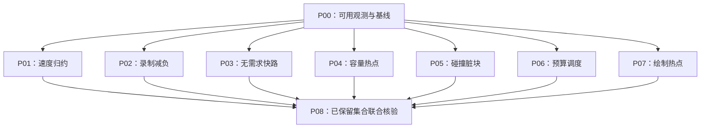

# [已收束：部分保留] GPU 优化执行计划

日期：2026-10-17。角色：execution_plan。任务身份：`sandcastle_gpu_optimization`。

来源：本聊天的 GPU 执行逻辑分析、优化建议，以及用户要求：“性能指标不列具体数值；列迭代耗时；一个性能优化最多半小时，超过则进行下一个。”

## 1. 目标与交付边界

在当前已启用的新 GPU 流水线上，提高有效并行程度、减少命令录制和无效工作、改善整帧与编辑响应。以同条件测量和正确性证据决定保留哪些优化，不以显卡占用百分比升高作为成功条件。

本计划于2026-10-17通过用户 `/goal` 启动并串行执行，现已收束。原计划范围、预算和Gate保留如下；实际结果见[联合交付](验收/P08_结果.md)及[执行状态](执行状态.md)。每个优化项只有一个累计最多30分钟的窗口，包含分析、实现、编译、验证、结果记录及保留/回退；本轮没有超时或自动追加轮次。

交付包括：经过验证的保留改动、所有优化项的处理结论、实际迭代用时、原始证据和遗留项。某项被跳过或未获收益不阻止独立后项；不得将“已评估”计为“优化成功”。

## 2. 文档与来源

| 文档 | 角色 |
|---|---|
| [总纲](总纲.md) | execution_plan：目标、范围、需求、DAG、Gate |
| [契约与计时规则](契约与计时规则.md) | contract_draft：执行预算、技术边界、观测字段 |
| [实施细则](实施细则.md) | task_details：逐项范围、小目标、修改位置与停止条件 |
| [执行状态](执行状态.md) | execution_state：唯一实际进度、时钟、锁和决策记录 |
| [验证计划](验证计划.md) | validation_plan：比较方法、受影响回归及证据 |
| [验收目录](验收/README.md) | verification_evidence：实际运行结果，未执行不填 PASS |
| [现有流水线契约](../sandcastle_gpu_pipeline/接口与状态契约.md)、[G7](../sandcastle_gpu_pipeline/验收/G7_功能交付.md) | source / execution_record：复用功能边界，不累计新进度 |
| [旧拖动 Profile](../../docs/search/drag_profile_20261016.md) | historical_evidence：旧模式线索，不作为新模式成本基线 |
| [当前项目技术方案](../../docs/当前项目技术方案.md) | source：正式入口和已有行为 |

当前聊天中的只读实时采样只能作为选题线索。执行前重新核对本机源码、加载身份、后台进程及有效配置。

## 3. 范围

| 项目 | 分类 | 本轮边界 |
|---|---|---|
| 新流水线观测、基线与采样开销核对 | MVP | P00；修正遗漏的时间戳类别，建立可复用比较入口 |
| 速度归约、录制开销、无排水需求快速路径 | MVP | P01–P03；各自独立限时，正确且收益可解释才保留 |
| 连通/容量计算、碰撞脏块、调度、绘制 | MVP | P04–P07；各选一个可在本项窗口内验证的候选 |
| 保留项联合验证与文档交付 | MVP | P08；不能借联合验证继续性能调参 |
| 未获收益/未验证候选的原因与后续建议 | placeholder | 记录文字、差异和失败证据；不挂载未验证运行分支 |
| 完整连通算法重构、原生录制器、独立 GPU 计算队列 | vNext | 若当前候选需要这些规模，记录后跳过，不在本轮无限扩张 |
| 减少输出尺寸、删视觉效果、降低模拟频率或放宽数值规则 | out_of_scope | 不通过减少既定负载制造收益 |
| 竞品取证、业务改造、新工具、撤销重做重建 | out_of_scope | 不恢复其他暂停/停止专项 |
| 网站/API/数据库/产品页面 | out_of_scope | 无新增外部接口；内部观测结构见契约 |

## 4. 需求映射

| ID | 需求 | 对应任务 | 验收 |
|---|---|---|---|
| R01 | 提高当前 GPU 工作效率 | P01–P07 | 同完成态、同输入和同负载对照，分析受影响阶段 |
| R02 | 性能指标不列具体数值 | 全部 | 只列指标名称与改善方向，不设 FPS、耗时、吞吐、占用率或百分比目标 |
| R03 | 每项优化最多半小时，超时下一项 | P01–P07 | 起止/截止/实耗可追溯，累计不重置，无隐形补测或换名续做 |
| R04 | 明确迭代耗时 | P00–P08 | 下表预算及执行状态的实耗字段 |
| R05 | 保持已有功能和状态一致性 | 全部 | 受影响数值、拒绝、时钟、碰撞、保存和所有权回归 |
| R06 | 可执行且进度可见 | 全部 | 总体、大任务、小目标独立展示；计划与结果分离 |

性能指标不设数字门槛，不影响执行证据保存真实测量值。现有数值正确性容差与协议容量继续沿用，不能借本要求放宽。

## 5. 排序与迭代预算

以下是每项全部尝试的总上限，不是每次尝试的上限。允许提前完成或提前放弃，剩余时间不转给其他项。

| 顺序 | 任务 | 迭代预算 | 处理范围 |
|---|---|---|---|
| P00 | 观测准备与基线 | 最多 30 分钟 | 新路径计时、固定输入和比较身份 |
| P01 | 速度/动量归约并行化 | 最多 30 分钟 | 分块计算与最终归约 |
| P02 | 水模拟命令录制减负 | 最多 30 分钟 | 参数复用优先；有余量才试列表组织 |
| P03 | 无排水需求快速路径 | 最多 30 分钟 | GPU 证明无位移需求后跳过对应求解 |
| P04 | 连通/容量热点的局部并行候选 | 最多 30 分钟 | 只改一个可隔离阶段，保留回退 |
| P05 | 碰撞真实脏块与更新选择 | 最多 30 分钟 | 降低无变化高度采集，不丢真实变化 |
| P06 | 编辑与水模拟预算调度 | 最多 30 分钟 | 有界调度、公平性与输入延迟 |
| P07 | 可见绘制热点优化 | 最多 30 分钟 | 保持效果，单因素减少冗余绘制计算 |
| P08 | 保留项联合核验与交付 | 最多 30 分钟 | 验证组合、回退冲突项、记录结果 |

七个性能优化项共最多 3 小时 30 分钟；加准备与交付，本轮计划窗口最多 4 小时 30 分钟。这里是执行预算，不保证每个候选均能实现或取得收益。规划时间不占未来执行窗口。

单项建议节奏：前 5 分钟定位并选定一个候选；随后 13 分钟实现；随后 7 分钟编译、短运行及配对比较；最后 5 分钟保留/回退并记录。到第 25 分钟停止新改法，不能把收尾全部推到截止后。

## 6. 执行依赖与串行窗口

图中横向节点相互独立，表示依赖关系，不授权并发。实际按 P01→P07 串行，每项从“最近通过验证的保留集合”分叉评估；前项失败不成为后项的技术依赖。P08 等待所有项得到处理结论，不要求每项成功。

安全并发窗口：本轮无并行写入、无并发 GPU 探针、无 subagent。P00 观测不足时使用已经验证的最小外部测量；仍不能比较的项目直接记录前提缺失并跳过，不能用无效证据推进 Gate。

## 7. Gate

- G0 基线可比较：当前新路径与实际加载身份已确认；输入、完成态、相机、profile、后端和测量窗口固定；观测不会改变算法。
- G1 单项可保留：编译/短运行和受影响负例通过；候选与父基线比较有效；收益方向可解释，其他关键体验无明显退化。
- G2 到时收束：每项都在截止内作出保留、回退、无收益、证据不足或前提缺失的决定；未验证候选退出默认路径。
- G3 组合可交付：仅核验保留项的交互和必要公共边界；失败按改动来源撤回，不增加优化轮次；默认路径可运行。

Gate 不包含具体性能目标。不因编译成功、单次数字更小、占用率更高或超时而自动通过。

## 8. 运行模式

| 模式 | 用途 | 验收口径 |
|---|---|---|
| 当前默认新流水线 | 父基线、最终默认入口 | 可见窗口与实际完整负载 |
| 单项候选 | 当前项目内单变量对照 | 明确源码/资源/配置身份，关闭候选可回到父基线 |
| 纯协议/解析检查 | CPU 布局和编译辅助 | 不能作为 GPU 性能、视觉或数值运行证据 |
| 旧路径 | 必要的算法/字段参考 | 不混作当前性能基线，也不覆盖其历史失败 |

## 9. 进度与下一步

执行总体：[已收束：部分保留]；完整小目标27/36，处理结论9/9，有范围限定的保留项4/7。P01/P03限阶段、P02限CPU录制、P05限请求公平性；P04回退，P06/P07跳过。详见[执行状态](执行状态.md)。

本轮没有待续窗口或后台探针。未完成目标和跳过项不自动重开；后续研究另行确定范围，不能挪用本轮未使用预算。
