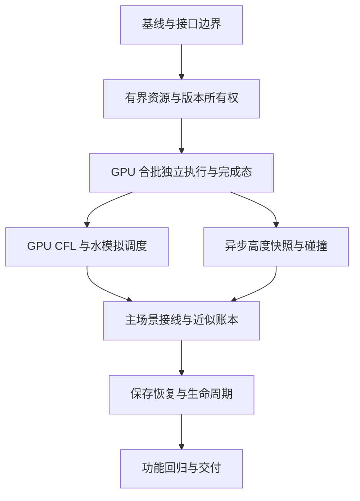

# [已完成] 普通挖填与水模拟流水线功能实现

日期：2026-10-17。角色：execution_plan。来源：本聊天用户确认的流水线目标及“维持合批发，GPU 自行处理”“性能指标可以先不管，先把功能实现”。

任务身份：`sandcastle_gpu_pipeline`，独立执行计划。按用户要求从旧线程计划的子目录移出；自行维护目标、32 项进度、契约和验收，不依赖旧计划关闭或旧性能 Gate 通过。旧 `sandcastle_physics_threading` 准备关闭，仅作为历史来源。

## 1. 目标与完成边界

在现有 main 实现持续收集输入、按帧合批上传、GPU 自主执行或跳过命令、GPU 自主推进水模拟、CPU 在后续物理阶段消费已就绪高度的完整流水线。容量允许时，下一批提交不依赖上一批 CPU 回执校验、精确账本、显示授权或碰撞完成。GPU 对共享水沙状态保持有序访问；本任务不要求多个 GPU 写任务并行。

交付是可直接操作的 main 功能和受影响入口回归。性能指标、GPU 核函数优化、输入到碰撞的固定帧数均不作为放行条件。完成本阶段不代表卡顿已经解决，也不改判旧性能 FAIL。

总体实现进度：[已完成]，32/32，100%。G0–G7通过，正式默认启用、十轮/三分钟联合回归和交付审计完成，见[G7](验收/G7_功能交付.md)。8 个任务均由主执行者串行完成；实时进度见[执行状态](执行状态.md)。旧实现和旧验收不累计到新阶段。

## 2. 文档角色和既有记录

| 文档 | 角色 | 用法 |
|---|---|---|
| 本文件 | execution_plan | 目标、范围、需求映射、依赖、门禁 |
| [接口与状态契约](接口与状态契约.md) | contract_draft | 字段和跨模块边界；P00 固定物理布局后冻结 |
| [实施细则](实施细则.md) | task_details | P00–P07 的实施位置、交付物、逐项目标 |
| [执行状态](执行状态.md) | execution_state | 唯一进度、锁和实际执行记录 |
| [验证计划](验证计划.md) | validation_plan | 功能场景、负例、证据格式和拟运行命令 |
| [验收目录](验收/README.md) | verification_evidence | 只存实际运行结论，不预填 PASS |
| [旧线程计划总纲](../sandcastle_physics_threading/总纲.md)、[旧执行状态](../sandcastle_physics_threading/执行状态.md) | source / execution_record | 旧计划准备关闭；保留原进度，不要求先通过旧 G4 |
| [旧合批预览](../sandcastle_physics_threading/验收/普通挖填按帧合批流水线预览.md) | source / execution_record | 复用起点；旧“失败取消尾部”和精确回执语义不沿用到新模式 |

本阶段对普通挖填的旧事务、精确账本和逐笔前缀要求作显式版本化修订，依据是用户本轮授权。旧契约原文和旧负例结果保留。网格、单位、有限值、完整完成态、场景代次及其他工具的既有业务语义继续约束实现；P00 形成兼容表，P07 将实现后的修订记录到项目技术文档。

## 3. 范围表

| 项目 | 分类 | 本阶段处理 |
|---|---|---|
| 普通鼠标挖沙、填沙、连续笔段、合批上传 | MVP | 有界输入与在途批次；同一渲染帧至多提交一个普通输入批次 |
| GPU 批内拒绝后继续、候选统一提交 | MVP | 每笔独立决定；保留输入顺序；去掉整批回滚依赖 |
| GPU CFL、潮汐/账本异步化、关联水沙模拟 | MVP | 主路径无 CPU 决策读回往返；编辑持续时水模拟仍获得调度 |
| GPU 完成态显示、CPU 异步碰撞 | MVP | 完整状态可显示；碰撞取实际高度，允许跨多帧落后 |
| 近似 CPU 账本、保守显示范围 | MVP | 不因质量闭合误差停机；数据有效性保护保留 |
| 普通快照保存恢复、切场景、暂停、退出 | MVP | 低频边界收尾；版本化快照，不依赖逐笔重放 |
| 形状刷子、投流沙、碎石等现有功能 | MVP 兼容边界 | 保持自身行为，进入旧路径前完成受控交接；不全部改造成异步新工具 |
| main 及两个继承的可编辑 test1 入口 | MVP | main 默认接线；共同继承路径及场景切换回归 |
| 现有面板/测试事件统计 | placeholder | 复用最小计数、状态；不新建产品 UI；测试观测字段属于 MVP |
| 多笔融合求解、并行水归约、GPU 核优化 | vNext | 保留当前批内逐笔计算，后续再优化算法 |
| 碰撞追赶、预测高度、GPU 拾取、固定反馈延迟 | vNext | 暂不优化，保留旧碰撞拾取的适用边界 |
| FPS、耗时、吞吐、占用率目标与正式性能采集 | out_of_scope（本阶段） | 不跑 WPR/ETW/RDC 性能专项，不设性能 Gate |
| 撤销、重做、逐笔精确重放、精确质量闭合 | out_of_scope（新模式） | 不作为运行和保存的前提 |
| 改视觉、减分辨率、改物理 Hz、启用独立物理线程、竞品逆向 | out_of_scope | 保持当前设置，不借本任务扩大范围 |

### 运行模式

| 模式 | 接线 | 用途与验收 |
|---|---|---|
| 既有路径 | 保留已有入口/测试语义 | 兼容对照；不得把它的成功计为新模式通过 |
| 流水线候选 | main 使用可辨识的候选配置，继承入口同源 | P01–P06 开发验证；记录实际消费的配置 |
| 正式流水线 | P07 后 main 默认启用 | 本阶段交付；旧工具经过边界交接；不因故障静默退回旧路径 |

不复制工程。普通 GPU/碰撞验证使用当前支持的真实可见窗口；纯布局/队列测试才可独立运行。编辑器或 headless 导入通过不能代替 GPU 功能验证。

## 4. 目标运行过程

1. 输入回调持续记录命令。帧内截取后到来的输入留在队列；工具/模式边界不能被批次跨越。
2. CPU 在帧前段收集完成通知；碰撞数据在合法物理更新时机应用。没有新快照则保留旧形状，不等待。
3. 有可用上传槽时，取有界批次一次上传；槽忙只停止本次提交，不等待或覆盖在途数据。默认先保留现有每批 2 笔、队列 64 笔，批量 1–64 可配置；在途批次初始 3 槽，不按负载自动扩容。这是容量起点，不是性能最优结论。
4. GPU 按顺序选取命令，计算候选、检查基本有效性、统一提交或跳过。失败不取消同批和后续批的其他合法命令。
5. 每个已提交输入批次后给到期的水 tick 留出执行位置；无输入时也照常模拟。GPU 处理 CFL 与子步决策，CPU 不等待 CFL/潮汐回执再调度。暂停态不安排自动水 tick。
6. 在完整完成边界更新显示状态；安排受影响区域的不可变高度快照。快照槽忙时保留脏区，之后取最新高度，不能因碰撞积压封锁所有写入。
7. CPU 后续消费完成信息、更新近似统计、应用高度；批次缓冲与快照缓冲按各自所有权回收。提交、GPU 完成、碰撞应用是三个不同状态。

Godot 常规物理时钟保持不变；不手动多跑物理帧，也不保证每个渲染帧恰好有一次物理步。正常路径无应用层主动同步等待，不承诺引擎/驱动永远没有 fence 等待。

## 5. 需求映射

| ID | 用户目标 / 必要边界 | 任务 | 契约 | 验收用例 |
|---|---|---|---|---|
| R01 | 持续输入、按帧合批、GPU 自行处理 | P01/P02/P05 | C01/C02 | V01/V02/V09 |
| R02 | CPU 不逐笔验收，不阻挡后续批次 | P01/P02/P05 | C02/C03 | V02/V03 |
| R03 | 一笔拒绝，后续继续；无半笔修改 | P02 | C03 | V03/V04 |
| R04 | CFL 与水模拟调度在 GPU，持续输入不饿死模拟 | P03/P05 | C04 | V05/V06/V10 |
| R05 | 碰撞读真实高度，允许落后、失败也可刷新 | P04/P05 | C05 | V07/V08 |
| R06 | 近似账本、移除整批临时备份 | P02/P05 | C03/C06 | V04/V11 |
| R07 | 不做撤销回放；普通保存和现有工具可用 | P05/P06 | C06/C07 | V12/V13/V14 |
| R08 | 异常隔离、旧结果过滤、资源有界 | P01/P04/P06 | C02/C05/C07 | V08/V09/V14/V15 |
| R09 | main 可直接使用；现有视觉/交互功能不被破坏 | P05/P07 | C01/C04/C07 | V01/V10/V12/V16 |
| R10 | 功能先行，控制磁盘与改动范围 | P00/P07 | 本总纲/验证计划 | V16/交付文件检查 |

## 6. 执行 DAG 与所有权



实际顺序：P00 → P01 → P02 → P03 → P04 → P05 → P06 → P07。P03/P04 在接口上可独立准备，但仍单主执行者串行修改和验证；本计划不启动 subagent。不同时启动多份 GPU 验证进程，不同时修改共享 shader、场景、profile 和契约。

| 任务 | 大目标 | 小目标 | 主要依赖 | 初始状态 |
|---|---|---:|---|---|
| P00 | 记录当前基线、固定新旧语义及接口布局 | 4 | 无 | [未开始] 0% |
| P01 | 有界队列/缓冲、完成通知、版本所有权 | 4 | P00 | [未开始] 0% |
| P02 | GPU 合批独立执行、无整批回滚、完整发布 | 4 | P01 | [未开始] 0% |
| P03 | GPU 自主 CFL、水 tick 与统一时钟 | 4 | P02 | [未开始] 0% |
| P04 | 无写入阻塞的高度快照、物理阶段消费 | 4 | P02 | [未开始] 0% |
| P05 | main 调度、近似账本、旧工具交接 | 4 | P03/P04 | [未开始] 0% |
| P06 | 快照存档与暂停/切换/退出 | 4 | P05 | [未开始] 0% |
| P07 | 联合功能验收、正式配置、文档交付 | 4 | P06 | [未开始] 0% |

## 7. 功能 Gate

- [x] G0（P00）：入口/引擎/源码身份明确；旧契约修订边界、字段布局、容量和测试适配表完成，见验收/G0_基线与接口.md。
- [x] G1（P01）：多个批次可在途，槽位不提前复用，主线程不主动等待；重复通知只回收一次。资源层证据见验收/G1_资源与完成状态.md。
- [x] G2（P02）：候选后端失败后继续、拒绝不改权威字段、无整批14份备份、GPU完整发布通过；main接线仍待P05。见验收/G2_GPU合批执行.md。
- [x] G3（P03）：候选后端GPU动态CFL、奇偶归一、超限时钟、关联模拟及编辑/水交错通过；main自动调度仍待P05。见验收/G3_GPU模拟调度.md。
- [x] G4（P04）：候选快照真实GPU标签/高度、物理应用、乱序/旧代次/损坏负例及停手收敛通过。见验收/G4_异步碰撞.md。
- [x] G5（P05）：main 输入到显示到碰撞闭环；近似账本不触发严格闭合停机；旧工具交接成功，见验收/G5_主场景功能.md。
- [x] G6（P06）：保存恢复、暂停、切换、退出在各在途阶段及可控异常下可收尾；未确认资源保留、旧代次不回写，见验收/G6_保存与生命周期.md。
- [x] G7（P07）：相关编译、真实 GPU 功能、负例、三入口与连续操作回归通过；新路径成为 main 有效配置，文档和证据齐全。

Gate 只检查功能。测试超时用于判断是否终止/死锁，不转为延迟 KPI；碰撞落后本身不判失败，但停手后必须能收尾。某 Gate 失败就修复受影响范围，不用旧 PASS 填补。

## 8. 需要优先解决的实现问题

| 问题 | 确定处理方向 | 归属 |
|---|---|---|
| 当前输入编码假设 revision + index；拒绝后无法接续 | 输入序号与 GPU 状态版本分离，GPU 从实时控制块取前态；每笔在所有成功/拒绝分支正确推进控制流 | P00–P02 |
| 现有单批回执、发布锁与共享临时状态 | 多槽输入/结果所有权；共享 scratch 仅由单 GPU 序列访问，所有资源等待最后消费者完成后释放 | P01/P02 |
| 动态 CFL 改变子步数和双缓冲奇偶 | GPU 决策缓冲 + 有界间接派发；先选择结束时归一到已知完成槽的实现，关联侵蚀/材料使用同一步长 | P03 |
| 碰撞快照未取得就阻止下一笔修改 | 快照提取在 GPU 序列内排序；独立快照槽忙时累积区域，不锁全部水沙写入 | P04 |
| 普通账本近似后，旧保存/旧工具仍假设精确 prefix | 新快照版本标记账本精度；旧工具低频交接，库存工具保留自身真实库存；不伪造旧回执或旧格式 | P05/P06 |
| 去掉回滚后，材料字段可能还有旁路写入 | 审查沙/水/悬沙/动量/材料全部写入点；候选阶段只写 scratch，统一通过后提交；未验证前不删备份保护 | P02 |

不需要用户再次批准已明确的取舍。具体字节布局和局部实现由 P00/P01 固定并记录；若实测证明目标路径不可用，应记录失败与影响，不能静默缩小“完整流水线”范围。

## 9. 计划初始文件结构与执行顺序

本目录仅六份小型 Markdown；计划、状态、证据分开。不新建 worktree、工程副本、大型 checkpoint 集或采集包。

```text
task/sandcastle_gpu_pipeline/
  总纲.md
  接口与状态契约.md
  实施细则.md
  执行状态.md
  验证计划.md
  验收/README.md
```

初始执行要求为先执行P00（现已按顺序完成G0–G7）：复核当前 checkout 与共享修改、记录实际启动链、逐一映射旧等待条件，固定协议布局与功能测试入口。随后 P01 建立有界在途资源；不先用删除 await 的方式绕开资源所有权。每完成一个 Gate 更新状态和实际证据，再开始下一任务。
