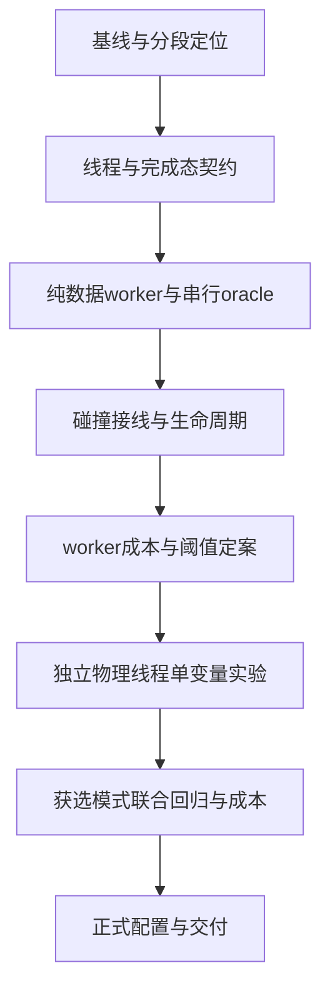

# 沙面碰撞多线程优化执行计划

2026-10-17：按用户安排，本计划**准备关闭**，不再承载新增流水线工作。后续功能另建为[独立 GPU 流水线计划](../sandcastle_gpu_pipeline/总纲.md)，当前仅计划交付、实现 0/32。下文是旧线程/性能计划及其原始判定；未完成项不补标通过，新计划也不依赖旧性能 Gate。

日期：2026-10-14。角色：execution_plan。状态：[阻塞]。

目标是降低挖填沙的主线程峰值和反馈延迟，并查明多线程能改善哪些等待。先测量当前完成态，再分别验证碰撞数据准备线程池、Jolt独立物理线程，最后选择有可归因收益的配置。GPU水沙继续使用现有计算；碰撞形状发布、版本确认和编辑完成条件保持一致。

原计划创建时只交付计划包；用户于2026-10-14通过/goal授权实施，当前执行已到T04（G0–G3通过，G4进行中）。旧test1母任务及历史性能任务保持原状态；已有114项碰撞/面板/自由工具检查是复用起点，不计为本任务完成。开发默认由一个主执行者串行推进。

## 1 项目目标与现状

当前GPU读回回调交给主线程解码、验证有限值、切片33×33高度、比较现有形状并更新HeightMapShape3D。每笔编辑还等待收据、纹理发布、碰撞revision及两次physics_frame。等待与CPU计算必须分开统计，异步await不是CPU忙碌时间。

2026-10-14已增加完全相同高度/变换跳过重建、原生数组切片和完整碰撞CPU计时。历史600ms停顿中一次快照关联到D3D12帧复用fence等待；它不能证明今天的所有卡顿都来自GPU或碰撞。工作线程主要能分担数据准备，不能预先保证消除这些停顿。

源入口：

- [当前项目现状](../../docs/README.md)、[最新碰撞修复与计时口径](../../docs/性能面板.md)。
- [沙面物理与竞品比较](../../docs/competitor/沙面物理构建与当前项目对比.md)、[历史原生等待定位](../../docs/history/sandcastle_gpu_edit_validation/验收/T06_离线展开栈与D3D12等待定位.md)。
- [可复用契约](../../docs/knowledge/README.md)、[编辑事务](../../docs/history/sandcastle_gpu_edit_validation/契约/编辑事务与水响应契约.md)、[自由挖填沙](../../docs/knowledge/water_sand/ADR_自由挖填沙_external_v1.md)。
- [WorkerThreadPool](https://docs.godotengine.org/en/stable/classes/class_workerthreadpool.html)、[线程安全API](https://docs.godotengine.org/en/stable/tutorials/performance/thread_safe_apis.html)、[Jolt线程支持](https://docs.godotengine.org/en/stable/tutorials/physics/using_jolt_physics.html#thread-safety)。实施时固定实际引擎版本与源码；官方称独立物理线程支持仍为实验性。

## 2 范围与运行模式

| 工作 | 分类 | 完成条件 |
|---|---|---|
| 当前main/playable堆挖分段基线和瓶颈归因 | MVP | 定位CPU准备、形状提交、GPU排队与事务等待的占比 |
| 碰撞数据准备线程池及生命周期回归 | MVP | 逐位相同高度、非阻塞任务回收、无旧代际发布 |
| worker数量与小批串行阈值选择 | MVP | 1/2/4工作任务的收益、退化和CPU争用有对照 |
| Jolt独立物理线程 | MVP实验 | 单变量验证并明确采用或拒绝，不要求强制启用 |
| 最终组合性能、三场景、保存恢复、退出回归 | MVP | 满足既有门槛并取得新证据 |
| 线程耗时调试显示 | placeholder | 先导出证据；仅需要观察时加到现有面板 |
| 原生C++/GDExtension数据准备 | vNext | GDScript线程池证实受解释执行成本限制后再立项 |
| 改两物理帧、放开多笔GPU事务、GPU直射线拾取 | vNext | 另立完成态契约与因果验证，不混入本轮 |
| 重写水沙公式、缩小网格、降采样碰撞、改后端/视觉 | out_of_scope | 保持对照可归因 |
| 竞品业务、存档业务、整个工程重建 | out_of_scope | 仅复用已确认物理技术事实 |

| 模式 | 数据准备 | 物理推进 | 用途 |
|---|---|---|---|
| A baseline | 当前串行准备、原生切片、未变跳过 | 当前有效设置 | 正式对照 |
| B worker | 快照准备交给线程池，主线程提交形状 | 同A | 单变量候选 |
| C physics | 同A | 独立物理线程 | 单变量候选，独立启动进程 |
| D combined | 已通过的B策略 | 已通过的C设置 | 二者分别成立后测组合 |
| fallback | 与A一致 | 与A一致 | 启动时关闭候选，明确恢复默认 |

正式接线模式仍待T03；纯数据serial/worker1/worker2/worker4已于T02实现并验证。B不可默默修改C设置；C不可同时改VSync、帧上限、物理Hz或GPU后端。失败候选不进入D。生产配置只有G7选择后才能更新。

## 3 需求与契约

[需求映射](需求映射.md)将卡顿、线程化、安全发布和可归因成本映射到T00–T07及G0–G7。

| 契约 | 主要边界 | 冻结点 |
|---|---|---|
| C01 线程与完成态 | 哪个线程可以读写什么、发布revision的时刻、顺序/代际 | G1 |
| C02 任务数据API | 请求/结果字段、无效批次、任务回收、队列/内存上限 | G1 |
| C03 性能与验证 | 时间口径、同态对照、放行/退回条件 | G1；T00补实际环境 |

详见[契约与字段定义](契约/线程与完成态.md)、[任务接口](契约/任务数据接口.md)、[验证计划](验证计划.md)。没有HTTP接口、数据库或网页路由；内部任务API使用字段表冻结，无需虚构OpenAPI。

## 4 执行DAG与所有权



| 任务 | 名称 | 小目标 | 依赖 | 状态 | 进度 |
|---|---|---:|---|---|---:|
| T00 | [基线与分段定位](细则/T00_基线与分段定位.md) | 4 | 无 | [已完成] | 100% |
| T01 | [线程与接口契约](细则/T01_线程与接口契约.md) | 4 | G0 | [已完成] | 100% |
| T02 | [纯数据worker](细则/T02_纯数据worker.md) | 4 | G1 | [已完成] | 100% |
| T03 | [碰撞接线与生命周期](细则/T03_碰撞接线与生命周期.md) | 4 | G2 | [已完成] | 100% |
| T04 | [worker成本与定案](细则/T04_worker成本与定案.md) | 4 | G3 | [阻塞] | 50% |
| T05 | [独立物理线程实验](细则/T05_独立物理线程实验.md) | 4 | G4 | [未开始] | 0% |
| T06 | [联合回归与完整成本](细则/T06_联合回归与完整成本.md) | 4 | G5 | [未开始] | 0% |
| T07 | [正式配置与交付](细则/T07_正式配置与交付.md) | 4 | G6 | [未开始] | 0% |

主执行者拥有共享碰撞代理、入口、profile及契约的唯一写锁。执行前复核形状刷子T02和其他任务的Active Locks；重叠文件等待释放或划分不重叠提交后再改。多个worker在运行时并行处理独立数据，并不意味着多名agent并发修改代码。

允许的并发窗口仅为实施时的独立块数据准备，以及已冻结模式下的CPU准备与正常画面处理。两个模式性能进程不同时运行。共享代码、场景、profile、检查点格式及RD生命周期不能由多个执行者同时修改。

## 5 Gate与进度

| Gate | 必须满足 | 当前状态 |
|---|---|---|
| G0 | 当前源/引擎身份、完整初态、时间口径、基线与外部负载可用 | [已完成] |
| G1 | 线程、API、队列/内存、错误和关闭契约冻结 | [已完成] |
| G2 | worker结果逐位一致，非法批次不部分发布，完成任务正确回收 | [已完成] |
| G3 | 真Jolt拾取、过期/乱序、恢复/切换/退出和原工具链通过 | [已完成] |
| G4 | B相对A成本明确；小批阈值和保留/退回决定有证据 | [未开始] |
| G5 | C相对A功能/线程安全/成本明确，D是否可测已定案 | [未开始] |
| G6 | 获选模式三场景、同态成本与长稳通过 | [未开始] |
| G7 | 默认/回退配置、编辑器直接启动、报告与锁释放完成 | [未开始] |

总进度：18/32小目标，56.25%。[执行状态](执行状态.md)保存执行进度和锁；各细则保存小目标；[验收目录](验收/README.md)只保存实际结果。计划创建和静态阅读不计G0通过，旧PASS不累计。

## 6 验证与放行原则

沿用用户已接受的底线：真实1080p完整负载下完成吞吐≥15tick/s、p99帧间隔≤63ms、暂停编辑碰撞反馈≤100ms。固定模拟步仍是1/30s。记录首可见、事务完成、p99.9、最大帧、>100/250/500ms停顿次数；这些不是可被平均FPS遮盖的指标。

候选只有在相关功能与生命周期通过、同态交错窗口能归因到该项的收益且总体体验不退化时才能选为默认。线程数量更大不算收益。未测出收益则保留基线、报告限制；不得以“多线程已接入”宣称卡顿已解决。收益阈值在T00的重复性/噪声测量后于G1冻结，不能测完后择优改门槛。

详细模式、用例、命令草案、300秒窗口和30分钟长稳见[验证计划](验证计划.md)。预期成果是阶段耗时拆分、可重复对照、选型与回退；GPU fence根因若仍未知，明确保留，不归给worker失败或Jolt。

## 7 文件结构与下一步

```text
task/sandcastle_physics_threading/
  总纲.md                  目标、范围、DAG、Gate
  需求映射.md              用户要求到任务/契约/用例
  执行状态.md              进度、Active Locks、执行记录
  决策记录.md              范围和候选决定
  验证计划.md              模式、指标、用例、测量方法
  契约/线程与完成态.md      线程边界和发布/恢复语义
  契约/任务数据接口.md      请求、结果、失败、内存与回收
  细则/T00..T07            每任务输入、改动范围和4个小目标
  验收/README.md           实际结果入口，G0–G3报告与G4阶段证据
  计划来源.json            创建计划时的源身份，实施前重核
```

拟定代码：`scripts/collision/collision_prepare_job.gd`、`collision_prepare_scheduler.gd`；拟定测试：`tests/integration/collision_worker_probe.gd`、`collision_thread_lifecycle_probe.gd`；成本runner放 `tools/physics_threading/`，机器证据放英文 `test_output/physics_threading/<run>/`。纯数据job/scheduler、接线与显式生命周期探针已创建并通过G3。

当前执行入口是T04：worker成本、阈值及三对300秒正式单变量窗口；G4选型后进入独立物理线程实验。不直接改生产默认或编辑完成条件。

执行更新：G3已通过，当前入口T04；T03候选仍默认关闭，影子同步完成契约保留，成本与默认选型不提前验收。

当前阻塞：连续三次B窗口因其他Godot探针污染而无法形成有效配对；自有测量已停止，源与默认保持。需独占GPU测量窗口/明确协调授权后恢复，全部目标与G4–G7范围不变，见G4报告的阻塞审计。
