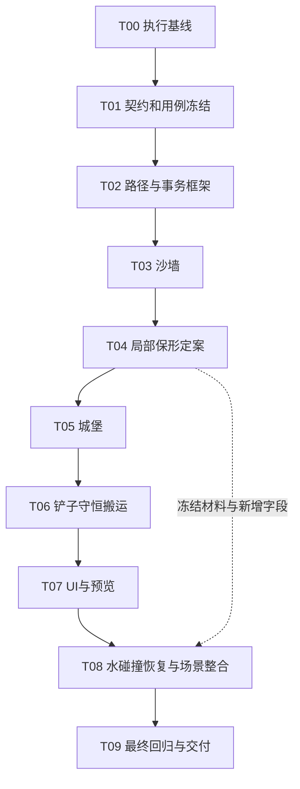

# [未开始] 城堡、铲子与沙墙刷子执行计划

日期：2026-10-14。角色：execution_plan。版本：draft v1。

来源：用户要求支持“点击放一个城堡形状沙堆”“长按拖动将沙向两边排开”“长按拖动形成沙墙”，并要求列出详细执行计划。截图仅作交互意图参考，本方案属于本项目的 Godot 适配，不宣称原游戏采用同样算法。

本次交付仅编写计划。实现、运行验收与 main 接入均未开始。默认单主执行者串行推进，不启动 subagent；旧 test1 任务继续暂停，旧性能 FAIL、严格恢复未知项及历史进度保持原判定。

## 1. 项目目标

在现有权威水沙高度场上增加三种可操作刷子，复用当前 GPU 编辑事务、实际沙量账本、完成态发布、分块碰撞、自由相机与场景保存恢复。先通过独立刷子验证场景，再接入 main 和两个可编辑 test1 继承场景。

用户最终可以选择刷子、调节尺寸、看到作用预览，并完成以下闭环：

1. 城堡：一次点击生成有底座、围墙、四个塔楼和可读城垛的沙堡，可调尺寸与绕 Y 轴旋转。
2. 铲子：按住左键拖动开沟，中间低、左右高；两侧只接收实际挖出的沙，域内沙总量不因刷子操作改变。
3. 沙墙：按住左键拖动筑墙，直线、弯线和拐角连续，同一笔重复覆盖不无限加高。
4. 新形状能够受水与塌坡影响，支持后续普通挖填和新刷子编辑，保存恢复后形状、材料与账本一致。

## 2. 总体进度与文档角色

| 层级 | 对象 | 状态 | 进度 | 说明 |
|---|---|---|---:|---|
| 总纲 | 三种形状刷子 | [未开始] | 0/50 小目标，0% | 计划已生成，实施未启动 |
| 大任务 | T00–T09 | [未开始] | 0/10 | 全部待执行 |
| Gate | G0–G9 | [未开始] | 0/10 | 没有运行验收证据 |

实际进度只在[执行状态](执行状态.md)更新；本表保留计划起点。已知旧能力不计入本任务完成度。

| 文档 | 角色 | 用途 |
|---|---|---|
| 本文件 | execution_plan | 目标、范围、依赖与调度入口 |
| [需求映射](需求映射.md) | traceability | 需求、任务、契约与用例对应 |
| [契约入口](契约/README.md) | draft_contract | 字段、几何、数值与生命周期边界；分 Gate 冻结 |
| [任务细则](细则/README.md) | implementation_plan | 每项任务的输入、修改范围、小目标与验收 |
| [执行状态](执行状态.md) | execution_state | 实际状态、锁、完成量与证据 |
| [决策记录](决策记录.md) | decision_record | 默认交互选择、保形分支与版本决策 |
| [验证计划](验证计划.md) | validation_plan | 用例、门槛、观察窗口与命令 |
| [验收目录](验收/README.md) | verification_evidence | 实测报告、失败定位及数据索引 |
| 旧 task 与 docs/history | archive / execution_record | 可复用技术和原判定；不是本任务状态 |

## 3. MVP 范围

| 项目 | 分类 | 本次边界 |
|---|---|---|
| 一个城堡模板、平放、尺寸和 yaw | MVP | 四塔楼、围墙、底座、城垛；模板是沙高数据，真实写入沙场 |
| 铲子双侧守恒搬运 | MVP | 沟宽、深度、两侧肩宽；默认等量分两侧，接纳不足缩小搬运或拒绝 |
| 沙墙路径塑形 | MVP | 梯形或圆顶截面；高度、底宽、顶宽；同一笔目标覆盖 |
| 连续拖动与按距离采样 | MVP | XZ 距离，保留转折，队列背压；静止不持续挖填 |
| 普通挖沙/填沙 | MVP 兼容 | 保留当前自由挖填，原默认体积范围与账本语义不改 |
| 预览、五种工具选择和参数面板 | MVP | 静态场景节点和信号；无效位置、等待、失败可辨认 |
| 局部压实与有限保形 | MVP | 不每帧强写模板；正常沙与 molded 区域分开验证 |
| 水响应、碰撞、保存恢复、切换 | MVP | main 及两个可编辑 test1 场景共享；同一完成态 |
| 模板资源格式与 ID 白名单 | MVP | 内置资源可扩展，模板/profile/hash 纳入配置身份 |
| 多模板选择格 | placeholder | 数据入口留白名单扩展能力；MVP UI 只显示一个城堡模板 |
| 模板导入器、模型烘焙、丰富城堡库 | vNext | 第一版用可复现程序生成模板，不安装建模工具 |
| 多次加高模式、铲子单侧排沙、压感 | vNext | MVP 固定单笔目标覆盖和双侧等量语义 |
| 门洞、悬挑、洞穴、任意体素沙体 | out_of_scope | 当前单值高度场无法表达上下重叠实体 |
| 撤销/重做 | out_of_scope | 用户此前已取消该要求，不借本任务恢复 |
| 背包、工具经济、竞品业务、植被音效 | out_of_scope | 复用本项目现有业务，不扩展竞品调查 |
| 全局水算法重写、旧性能专项重启 | out_of_scope | 只验证本次新增负载与水语义；旧 FAIL 不改判 |
| 任意旧版本存档自动迁移 | out_of_scope | 延续源码/资源签名检查；不删除旧数据或伪装兼容 |

### 交互默认值与形状初值

以下是计划初值，G1A 冻结交互，G4 冻结经过实测的保形参数。调整需记录，不是已经验证的有效参数。

| 参数 | 建议起点 | 边界 |
|---|---|---|
| 城堡外包尺寸 | 约 3×3 m | 主要细节至少跨约 4 个物理格；过小尺寸禁止放置 |
| 城墙/塔楼高度 | 约 0.4 / 0.7 m | 超出预设安全高度拒绝；不靠归一化体积压扁模板 |
| 沙墙高度/底宽/顶宽 | 0.3 / 1.0 / 0.5 m | 顶宽≤底宽；窄于可读网格的参数禁用 |
| 铲子沟宽/目标深度 | 0.5 / 0.15 m | 不挖穿 rock；肩部宽度约 0.5 m/侧 |
| 采样间距 | ≤min(0.125 m, 有效半宽/2) | 角点保留，不能仅保留鼠标最新位置 |
| 正常松开 | 结束采样并排完已接收路径 | 形状刷子在按住静止时不持续编辑 |
| 重复覆盖 | 同一笔达到目标，下一笔可继续加高/加深 | 城堡每次按下只提交一次 |

城堡和沙墙的体积由几何实际需要计算，采用资源声明的有限安全体积上限；普通挖填的 0.01–1.00 m³ UI 不作为城堡模板的统一体积归一化参数。体积上限与预设尺寸在 G1A 固定，并核对大块水下加沙的已知边界。

## 4. 当前可复用基础与新工作

已读源码事实：

- main 静态继承 rdc_v1_coupled，实际使用 beach_playable → beach_recovery → beach_interaction → beach_gpu 链路。
- 活跃域为 256²，0.125 m/格，床面 bed=rock+sand；GPU 编辑当前只接收 remove_sand/place_sand，shape 只接受 circle/swept_segment。
- 当前 GPU 传输 v1 是 128 字节；kind/shape 通过二选一编码，不能直接加入新字符串并假定可工作。
- 当前 main 为 external_v1 自由模式，真实加减分别记 sand_source/sand_sink；同域 64 pending、1 在途，回执结算后发布。
- 拖动当前随 MouseMotion 提交，并有最小体积下限；需要重新定义新刷子的按距离采样和目标覆盖。普通工具是否使用新采样器必须做兼容对照。
- main 已启用侵蚀与 staged_slope 材料耦合，构件系统未启用；压实度不直接改变几何密度。
- 保存校验当前枚举固定字段、账户类型、命令种类和源码签名；新命令/新保形字段需要明确版本扩展，assets/brushes 等新依赖需显式加入签名范围。

执行前必须重新记录工作区状态、实际引擎版本和以上文件 hash。本机已有大量未提交修改，不能 reset、覆写或把它们归为本任务改动。

## 5. 契约与运行模式

本项目没有 HTTP API 或数据库；核心接口是 GDScript 提交、GPU 命令/回执、完成态发布与本地检查点。字段级契约见[命令与交互](契约/命令与交互.md)、[几何与数值](契约/几何与数值.md)、[状态与恢复](契约/状态与恢复.md)。

| ID | 契约边界 | 冻结点 |
|---|---|---|
| C01 | BrushDefinition、模板格式、实例参数及白名单 | G1A；保形字段于 G4 补充 |
| C02 | BrushCommand/BrushResult、GPU ABI、错误与版本路由 | G1A |
| C03 | stroke 采样、覆盖、背压、暂停与中断 | G1A |
| C04 | 模板/截面/搬运、float32 容差与源汇 | G1A |
| C05 | 压实、黏聚、局部保形和材料转移 | G4 |
| C06 | 水响应、候选提交、原子发布、碰撞与完成 | G1A；三种形状实测于 G8 |
| C07 | 检查点、配置身份、新字段与资源释放 | G1A 架构；G4 字段定案；G8 完整验收 |
| C08 | 真实输入、视觉/数值用例、证据与长稳范围 | G1A；结果另存验收 |

| 模式 | 入口/依赖 | 用途与限制 |
|---|---|---|
| cpu_contract | 现有 tests/run.ps1 与新纯数据探针 | 验证采样、模板、配额和字段；不能证明 GPU 或视觉正确 |
| brush_dry_lab | 拟建 tests/shape_brushes/brush_lab.tscn，当前 D3D12 GPU 编辑器 | 固定沙床/无水，暂停模拟逐笔对照；直接使用真实事务 |
| brush_coupled_lab | 同一实验场景，明确开启侵蚀、波浪、材料耦合 | 验证保形、水中增高与混合降床、连续演化 |
| playable_candidate | main 与两个可编辑继承场景的候选分支 | 验证真实输入、碰撞、保存恢复和场景切换 |
| playable_release | 通过 G8/G9 后正式 main | 参数资源与直接启动一致，不只捕图入口有效 |

## 6. 执行 DAG 与并发约束



这是默认实际执行顺序。逻辑上 T05/T06 的算法草稿与 UI 设计可独立准备，但本任务不启用并行 agent。后续只有用户明确要求并行才考虑拆分纯数据模板制作/只读测试分析；共享 shader、场景、profile、契约和恢复代码始终只有一名修改者。

| 任务 | 目标 | 依赖 | 状态 | 计划进度 | 关键交付 |
|---|---|---|---|---:|---|
| T00 | 基线与证据口径 | 无 | [未开始] | 0/5 | hash、引擎、现状、旧功能基线 |
| T01 | 契约和用例冻结 | T00 | [未开始] | 0/5 | 请求/回执、账本、采样、恢复版本 |
| T02 | 路径与事务框架 | T01 | [未开始] | 0/5 | 刷子资源、路径控制器、v2 候选管线 |
| T03 | 沙墙 | T02 | [未开始] | 0/5 | 连续截面、目标覆盖、拐角与体积 |
| T04 | 局部保形定案 | T03 | [未开始] | 0/5 | 单变量对照、最终材料字段与保持/破坏规则 |
| T05 | 城堡 | T04 | [未开始] | 0/5 | 模板、基底处理、单次放置与旋转 |
| T06 | 铲子 | T05 | [未开始] | 0/5 | 实际挖量、双侧分配、量化闭合 |
| T07 | UI 与预览 | T06 | [未开始] | 0/5 | 五工具静态布局、预览、等待/错误状态 |
| T08 | 水、碰撞、恢复与接入 | T07 | [未开始] | 0/5 | mixed-delta 水候选、新检查点、三场景共享 |
| T09 | 回归与最终交付 | T08 | [未开始] | 0/5 | 功能/数值/连续观察与操作说明 |

每项详见[细则](细则/README.md)，总计 50 个小目标。每个小目标必须有对应证据才计为完成，计划编写不计入上述 50 项。

## 7. Gate 清单

| Gate | 必须通过的条件 | 未通过时 |
|---|---|---|
| G0 基线 | 当前源码/资源身份、实际入口/引擎、脏工作区归属、旧挖填与恢复基线已记录 | 不冻结数值或声称旧恢复可靠 |
| G1A 基础契约 | 新旧命令路由、字段/错误、有限配额、stroke 生命周期、容差、恢复架构和用例固定 | 不开始共享接口实现 |
| G2 框架 | 无编辑负例逐位保持旧状态；代际、重复结算、失败回滚、队列/资源界限通过 | 修复事务与输入后再做形状 |
| G3 沙墙 | 直线/弯线/角点不断裂，覆盖不叠高，实际体积记源汇 | 不复制其算法到城堡 |
| G4 保形及材料契约 | 30 模拟秒干态轮廓门通过；普通沙负例不变；挖削可破坏；最终字段/保存方案冻结 | 采用局部保形候选并复验，不能关闭全域塌坡过门 |
| G5 城堡 | 单次放置、旋转/尺寸、接地、模板细节和预算拒绝通过 | 修复几何，不通过换机位掩盖 |
| G6 铲子 | 每笔实际挖量等于实际两侧量；薄沙/基底/容量/反向/交叉与失败回滚通过 | 修复搬运，不能用外部源汇抵消 |
| G7 UI | 真实鼠标与键盘操作、参数范围、预览一致、GUI/相机/失焦隔离通过 | 不正式接入 main |
| G8 整合 | mixed-delta 水、碰撞发布、普通保存恢复、切换和关闭所有权通过 | 只保留可复验候选，不声明全闭环 |
| G9 交付 | 三场景回归、冻结参数下连续观察、证据完整、文档与实际一致 | 明确未过项并返工；旧 Gate 不改判 |

G1A 不假装提前确定保形新增字段；G4 是 C05/C07 数据字段最终冻结点。若 G4 改变已冻结命令/ABI，先修订契约并重跑 G2/G3 受影响项，再继续。

## 8. 任务完成与验证节奏

每个候选按“资源加载/编译 → 数值短测 → 相关负例 → 单变量对照 → 10–30 秒模拟连续观察”推进。只有三刷子参数和材料策略稳定后，T09 集中做 5 分钟连续编辑/水沙观察；不是每次调整都跑长稳。

重点验收包括：路径采样一致性、目标覆盖、铲子沙量守恒、城堡/墙保形与可破坏、同时抬床降床的水量闭合、异步失败完整回滚、分块碰撞和同 generation 发布、保存恢复、新资源 hash 与旧账户回归。详细数值门见[验证计划](验证计划.md)。

性能只记录本次新增笔刷的提交/结算/发布/碰撞耗时、积压和资源峰值，识别明显新增卡死或无界增长；不重新处理旧整帧成本专项，也不把旧 33.3 ms / 30 Hz 门改为 PASS。GPU 数值与画面必须使用可见窗口，headless 只用于支持的纯数据检查。

## 9. 推荐文件结构

以下是未来实现路径，当前只创建 task 文档；命名可在 G1A 小幅调整并同步引用。

```text
scripts/sand/brushes/              # BrushDefinition、模板描述、路径控制器、参数校验
scripts/simulation/brushes/        # 新版本GPU编辑器与协议、参考分配、恢复扩展
shaders/simulation/brushes/        # wall/castle/shovel候选准备、归约、应用与材料候选
assets/brushes/                    # .tres预设、float32模板、生成索引与hash
scenes/components/brushes/         # 静态工具面板及预览节点
tests/shape_brushes/               # 独立验证场景、纯数据和GPU探针、运行脚本
test_output/shape_brushes/<run>/   # 英文绝对输出路径、原始字段、日志、截图与manifest
task/sandcastle_shape_brushes/     # 本执行计划、契约、状态与验收摘要
```

运行资源不得依赖 task/ 或 test_output/。尽量通过明确的版本路由接入现有 editor/scheduler/controller；已有大文件只做必要接线，不复制整份主场景控制器。

## 10. 主要问题与处置路径

| 问题 | 查证与处置 | 责任任务 |
|---|---|---|
| 城堡直壁被摊平 | 固定 preset/seed/tick，先对照 compaction，再对照有限黏聚；普通沙有变化则局部化支持 | T04 |
| 铲子凭空生沙 | 基底截断后归约实际挖量；接纳量约束挖量；量化后重核净变化 | T06 |
| 交叉/拐角形成鼓包 | 路径基准固定、同笔目标合并、发射顺序确定；只改一个采样/合成因素 | T02/T03/T06 |
| 水响应只适合单纯填沙 | 对正/负/混合 bed delta 分组核对，用同一次编辑前后场构造水候选 | T08 |
| 新字段丢失或签名漏资源 | codec 白名单/字段字节数/双槽/选项/hash 显式扩展，恶意数据负例 | T04/T08 |
| 长拖排队阻止模拟推进 | 有界路径缓存与分段提交，保存/切换清楚结束 stroke，记录积压与 tick 活性 | T02/T09 |

这是一张短期实施问题表，不另建长期风险库。问题按 ID 记录观测、候选解释、可区分观测和结论；若后续开展竞品取证，相关知识必须另遵守 docs/competitor/ 记录规范。

## 11. 立即下一步

实施启动时只执行 T00：保存本次脏工作区清单和关键 hash，确认实际 Godot 二进制、main/继承场景、当前编辑发布和恢复路径，建立旧挖填/保存恢复基线与可见窗口探针。随后执行 T01 冻结基础契约和新刷子预设范围，再开始 T02。

完整执行入口是本文件，当前状态入口是[执行状态](执行状态.md)。本次计划交付不启动引擎、不修改 shader/场景、不恢复暂停的旧任务。
