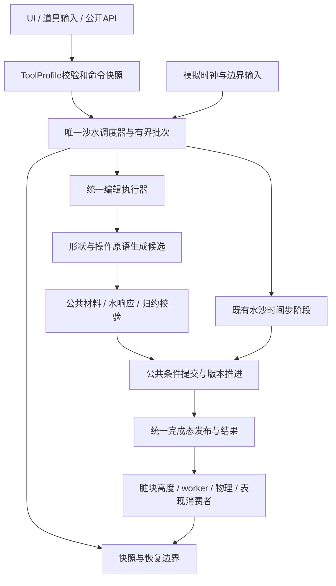

# [已完成] 沙水唯一主流程与配置化玩法执行计划

日期：2026-10-17。角色：execution_plan。来源：用户要求将优化后的流水线作为唯一路径，挖、填、城堡、沙墙、铲子等沙水玩法共用流程，其他玩法通过开关和数值复用，避免每增加道具就增加执行流程。

计划已由/goal启动并完成：36/36（100%），T00–T08全部4/4，G0–G8通过。正式四入口唯一统一后端、全部配置/消费者与原生生命周期、三份仅配置扩展、三分钟实际混合输入和十轮生命周期均已验收；G0冻结范围的可见成本独立通过，P99及推广边界保留unknown。当前结论见[最终联合门](验收/G8_联合门.md)与[交付索引](验收/G8_交付索引.json)。下方旧组件段保留原时间与范围。

## 1. 目标与完成定义

最新[工具前端生命周期组件](验收/G6_工具前端生命周期.md)完成四候选全部工具声明/切换、满队列END保存、三槽在途关闭和鼠标回归；修复DISK拖动声明，九例690项、独立1552项与185成员源码ZIP封存。正式切换/退役和完整在途矩阵仍缺，24/36、T06仍0/4。

最新[旧档迁移组件](验收/G6_旧档迁移.md)已通过：固定来源目录、两种真实旧档的实际候选恢复/原始数据保真、跨域拒绝与新格式故障恢复回归完成。六例174项可见检查、独立156项、CPU87项，两份ZIP封存；完整工具生命周期、正式切换与退役审计仍缺，24/36、T06仍0/4。

正式main、test1_capture、test1_backwash只有一个沙水调度主入口、一套编辑执行骨架、一处公共提交/版本更新规则、一套发布与异步消费者生命周期。工具只产出声明式意图：操作原语、形状、目标字段、材料/水策略和受限数值。工具不得拥有自己的水事务、最终提交、发布、碰撞、保存恢复或忙锁循环。

“唯一主流程”允许根据受影响字段跳过不需要的阶段，允许GPU核、worker、物理线程、IO分别执行自己的工作；不要求把所有功能塞进一个shader，也不要求压实空跑水模拟。阶段是否执行由公共执行器根据声明和实际候选决定，不由道具名称选择另一条流水线。

新增玩法的验收标准：既有原语能表达的玩法，只增加ToolProfile资源、形状/模板资源及必要展示资源；调度、公共校验、提交、发布、碰撞、生命周期代码均无需改动。确需新物理算法时，只增加受限的通用原语或阶段能力，并进入同一执行骨架，不建立道具私有后端。

## 2. 范围与旧任务关系

| 内容 | 分类 | 边界 |
|---|---|---|
| 挖/填、城堡、沙墙、铲子、悬沙、平滑、压实 | MVP | 所有正式编辑入口共用命令、候选、校验、提交、结果 |
| 有界队列、混合批次、GPU水tick、公平性和实际时钟 | MVP | 一个主调度器；模拟tick保留物理阶段，作为同域有序工作，不伪装笔刷 |
| 材料、水响应、守恒归约、实际脏块、发布与碰撞 | MVP | 公共阶段；整段/整批CPU回执不授权下一段GPU录制 |
| 笔画基准/coverage、预览、保存恢复、切换和关闭 | MVP | 统一版本与资源所有权；低频快照可以等待真实完成 |
| ToolProfile、参数白名单、功能开关、配置身份 | MVP | 不提供任意脚本、shader路径或执行阶段列表注入 |
| 碎石、白沫等现有表现层 | MVP边界整合 | 共享完成态与生命周期；不计入权威沙量，不强行进入沙量搬运 |
| 仅配置新增的测试玩法 | MVP验收夹具 | 不自动增加产品UI或新的正式道具 |
| 未实现的玩具、建筑业务、网络、经济和任务系统 | out_of_scope | 不为未来玩法预建完整业务系统 |
| 通用跨项目Job系统、任意流程DSL | out_of_scope | 优先提炼现有沙水后端，不先造通用调度平台 |
| 任意三维悬挑、逐粒沙、刚体反作用、新水物理 | vNext | 需另定义领域模型，不能仅凭配置宣称支持 |
| 占位运行接口/空核/自动回退 | placeholder：无 | 缺能力明确拒绝，不以占位实现通过验收 |

来源文档[全游戏统一调度草案](../sandcastle_system_pipeline/总纲.md)为source_plan，覆盖更广的系统调度设想；本计划独立收敛到用户当前明确的沙水主流程，不继承其0/32或“进行中”状态，不依赖尚不存在的scripts/runtime模块。旧[全工具迁移](../sandcastle_all_tools_pipeline/验收.md)是execution_record，证明共享队列接线，不证明公共执行内核已统一。[GPU优化结果](../sandcastle_gpu_optimization/验收/P08_结果.md)是execution_record，保留已验证优化和其收益边界。所有旧报告、失败和暂停状态保持原样。

## 3. 主流程与扩展点



图中“公共提交与版本推进”表示唯一的状态写入权限与提交规则；水tick内部保留已验证的多阶段数值算法，不强制与编辑使用完全相同的候选布局。图不授权水tick绕过调度器或提前发布半完成状态。

推荐模块职责，名称在T01冻结：

| 模块 | 职责 | 禁止事项 |
|---|---|---|
| ToolProfile / 注册表 | 形状、操作原语、参数范围、策略、展示映射 | 持有RD、异步回调或独立执行函数 |
| 命令适配器 | 旧公开格式转内部统一命令、参数快照 | 选择旧后端、改变冻结业务语义 |
| 公共调度器 | 顺序、批次、背压、依赖、租约、生命周期 | 判断castle/shovel等道具ID |
| 候选原语 | 体积增减、目标高度、守恒搬运、平滑、材料调整 | 写权威纹理、发布、等待CPU/碰撞 |
| 公共阶段库 | 材料、水响应、归约、条件提交、结果与脏块 | 每个道具复制一份阶段链 |
| 消费者和快照 | 同generation完整版本、最后消费者释放 | 旧回调覆盖新代、读到半提交状态 |

形状包括点/圆域、扫掠段、模板高度场；操作模式与形状正交。城堡/墙是目标高度补足，挖填是按体积操作，铲子是受约束的区域内搬运，不把铲子拆成两个独立增减事务。配置示例和字段见契约。

## 4. 需求映射

| ID | P0需求 | 任务 | 契约 | 验收 |
|---|---|---|---|---|
| R01 | 正式三入口只有一条主流程，无legacy回退 | T02/T06/T07 | C01/C06 | V01/V08 |
| R02 | 玩法由形状、原语、开关和数值组合 | T01/T03/T07 | C02/C03 | V02/V09 |
| R03 | 共享公共材料/水响应/校验/提交 | T03/T04 | C03/C04 | V03/V04 |
| R04 | 保持城堡、墙、搬运、源汇与材料语义 | T00/T03/T04 | C04 | V03/V05 |
| R05 | 继承已保留优化，去掉形状额外串行热点 | T00/T04/T08 | C04/C07 | V04/V10 |
| R06 | 混合命令有界合批，无逐段CPU授权门 | T02/T05 | C01/C03 | V05/V06 |
| R07 | 实际变化区域碰撞、显示与时钟一致 | T05 | C05 | V06/V07 |
| R08 | 保存恢复/切换/退出统一所有权 | T06 | C06 | V08 |
| R09 | 新配置不修改核心执行文件 | T07 | C02/C08 | V01/V09 |
| R10 | 计划、实施、证据分离，不改旧失败 | T00/T08 | C07 | V10/V11 |

所有条目均为MVP；当前完成G0–G6，正式四入口唯一接线和生命周期通过，下一阶段T08最终联合、长稳与成本验证。无HTTP、数据库或Web路由；核心API为本地GDScript命令/结果、GPU ABI与场景资源接口。

## 5. 任务、DAG与进度

负责人统一为主agent；默认串行，不启用subagent。实施总目标36个，当前36/36（100%）。

| 任务 | 内容/细则 | 依赖 | 状态 | 小目标 |
|---|---|---|---|---|
| T00 | [当前源码、行为与性能基线](细则/T00_基线.md) | 无 | [已完成] | 4/4 |
| T01 | [统一契约与配置模型](细则/T01_契约与配置.md) | T00 | [已完成] | 4/4 |
| T02 | [唯一调度和编辑执行骨架](细则/T02_执行骨架.md) | T01 | [已完成] | 4/4 |
| T03 | [公共候选与现有玩法迁移](细则/T03_候选与玩法.md) | T02 | [已完成] | 4/4 |
| T04 | [材料水响应与提交归约统一](细则/T04_公共阶段.md) | T03 | [已完成] | 4/4 |
| T05 | [合批、脏块与异步消费者](细则/T05_批次与消费者.md) | T04 | [已完成] | 4/4 |
| T06 | [生命周期和唯一正式接线](细则/T06_生命周期与接线.md) | T05 | [已完成] | 4/4 |
| T07 | [配置扩展实证与防分叉审计](细则/T07_扩展与审计.md) | T06 | [已完成] | 4/4 |
| T08 | [联合功能、成本与文档交付](细则/T08_联合交付.md) | T07 | [已完成] | 4/4 |

依赖链：T00 → T01 → T02 → T03 → T04 → T05 → T06 → T07 → T08。独立资料读取可批量进行；共享shader、profile、场景和契约同时只有一名修改者；GPU验证同一时间仅一份自有探针。测试运行期间不改其消费源码。用户已有运行实例不用于自动施加测试输入，也不自动关闭。

## 6. Gate清单

- [x] G0/T00：记录实际源码/配置、行为契约、可重现负载和当前阶段成本；冻结本轮比较口径。
- [x] G1/T01：字段、ABI、合法配置组合、误差与账本策略、资源读写权限可实现且可检查；390项纯数据检查通过。
- [x] G2/T02：隔离新后端一个主调度器/编辑循环，真实普通挖填与水tick、状态机故障410项及原始字节复核通过；正式路径审计留待G6/G7。
- [x] G3/T03：全部编辑工具只产出统一候选；目标高度/守恒搬运/coverage语义通过。当前源联合门见验收/G3_联合门.json；公共水完整矩阵和成本仍属G4。
- [x] G4/T04：公共材料、水、校验和提交；23水功能例GPU708/独立1468，6夹具144对阶段成本/独立1086；见验收/G4_联合门.json。
- [x] G5/T05：候选统一批次/实际脏块/高度/预览/材质完成版本及最后消费者通过；134共同运行来源一致，见验收/G5_联合门.json。正式接线与真实成本留待后续门。
- [x] G6/T06：正式四入口及保存恢复只有新路径；旧运行开关/入口fallback已退役，生命周期所有权通过；完整writer审计仍由G7负责。
- [x] G7/T07：三份配置夹具/全部16合法能力组合/实际Runtime及九类架构负例通过，核心51hash不变。
- [x] G8/T08：当前源码功能、成本、资源和扩展证据齐全，文档与代码一致；性能判定独立报告。

G2–G5允许开发中的隔离候选入口，必须标记候选，不能称为正式唯一流程。G6后正式场景不保留旧/新可选开关；历史实现只能作为不可由正式场景到达的测试参考，相关源码身份迁移另行版本化。

## 7. 运行模式与验证

| 模式 | 后端/依赖 | 用途 | 限制 |
|---|---|---|---|
| CPU契约测试 | Godot headless；纯数据/状态机 | 配置、协议、非法组合、状态机 | 不证明GPU行为或性能 |
| 隔离迁移候选 | 项目D3D12/Forward+，现有256²权威域 | 分阶段旧/新对照 | 不与正式流程并行写同域 |
| 正式三入口 | 唯一后端、实际场景资源和完整负载 | 功能/生命周期/成本 | 不静默降级、关闭功能或降低分辨率 |
| 历史参考夹具 | 固定旧源码/输入快照 | 行为、字段及成本对照 | 不成为游戏运行时fallback |

验证详细口径和未来命令在[验证计划](验证计划.md)。数值正确性与性能分别判定；无需先改为更宽容的数值规则来获得性能。保留现有优化集合的身份和算法范围，不恢复其他任务已经停止的无关候选。

## 8. 计划文件结构与立即下一步

```text
task/sandcastle_unified_edit_pipeline/
  总纲.md                         # 目标、范围、DAG、Gate和需求映射
  执行状态.md                     # 实施时唯一进度账本
  契约/主流程与扩展契约.md          # 字段与扩展边界草案
  细则/T00…T08_*.md               # 每项4个可验证小目标
  验证计划.md                     # 场景、负例、架构与成本验证
  来源核对.json                   # 本次规划读取的源码身份，不是运行验收
  验收/README.md                  # 实施证据入口；本次不预填PASS
```

实施从T00开始：核对工作区差异和单写者，保存源码/profile/引擎身份，建立相同初态下挖填/墙/铲的分阶段与输入延迟基线；随后在T01冻结配置/候选/结果ABI，再动运行代码。不要把删开关、改名或把旧shape调用包进同一函数作为完成。
