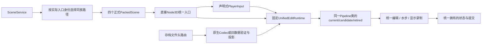

# G6 正式入口执行退役核对

本核对完成T06.3的正式入口、运行开关和旧fallback退役边界。它不是任意GDScript的通用静态分析器，也不替代G7的工具ID分支、权威writer及仅配置扩展审计。

## 逐边核对

| 边界 | 当前来源与检查 | 结论 |
|---|---|---|
| 正式启动/菜单 | project.main_scene、四wrapper、unified_scene_routes | 只到四个统一根；未知族返回空，不选择旧路径 |
| 根实例 | unified_playable_entry继承Node3D，实际静态节点白名单 | 不继承旧recovery/gravel/async类链；只有一个固定Runtime节点 |
| UI声明 | 根仅创建PlayerInput；PlayerInput只调Runtime提交 | UI不创建执行器，不直接向RD录制；工具选择不能选择旧运行后端 |
| 初始化/恢复 | Runtime的两个构造点均为Pipeline.new | current/candidate/retired可能有不同实例，但均为同一新类和独立所有权；不是第二套旧管线 |
| 常规推进 | Runtime._process只pump自己拥有的Pipeline | 新域仅在交接后准入；旧域只收尾已接受工作，不建立道具frame pump |
| 数值录制 | Pipeline._record_work固定调用executor/water/visuals | 复用原数值shader，录制权仍属于统一工作流；保留旧资源名称不等于旧控制流 |
| 水步owner | Pipeline创建新State并传入water.initialize(state) | water.solver是新State的引用；State.async_active是该录制器的兼容前置检查，false只拒绝初始化，无旧分支 |
| 旧API名称 | submit_legacy → Adapter.adapt → submit_intent | 仅数据转换，回到同一队列/冻结配置/提交器 |
| 旧检查点 | Router → Legacy数据检查 → Codec投影 → Runtime.restore | Recovery/Old/Store只调用静态读取或验证；未构造旧场景/求解器或运行重放 |
| 关闭/失败 | 统一shutdown/release_complete与真实终结证明 | 服务不再判断旧solver、旧collision或旧gravel所有权，也不转入旧运行模式 |

当前根、服务、Runtime、输入、存档路由与旧数据边界的构造/load/instantiate/脚本替换点逐项读取，源码身份随核对ZIP保存。正式根不接收可执行profile；目录/注册表仍执行已冻结的Resource类型、参数与来源校验。离线bake工具加载旧场景属于提取流程，正式入口不调用该工具。

## 机器证据与反例

`test_output/unified_edit_pipeline/g6_retirement_entry01`的`audit_entry_retirement.py`29项通过，包含当前构造边界和五个违规样例：恢复旧根基类、重新增加旧模式开关、额外构造旧writer、在输入适配器中录制GPU及恢复旧路径fallback，均被拒绝。来源ZIP逐成员SHA256/CRC验证。其实际静态节点依据是`g6_formal_static01`的33项检查；正式运行、族内回滚和资源释放依据见[正式接线组件](G6_正式接线.md)及后续生命周期证据。

该检查器对当前已审阅的入口结构失败关闭，不宣称能识别任意动态代码变体。证书的代码hash一旦变化须重验相应边界；不能因字符串检查通过就宣称所有writer或所有新增玩法合规。G7仍须检查实际权威字段写点、工具ID分叉和新配置轨迹，G8须在最终冻结源码上做联合验证。

## 明确保留项

原正式场景与原服务字节已封存，见[退役清单](G6_旧路径退役清单.md)。旧实验/历史脚本与静态数据验证依赖不删除；它们不再由正式场景或菜单构造为运行后端。正式Source路由和保存配置不支持用关闭开关重新进入旧流程。

project.godot还保留既有GodotIQRuntime调试autoload，实际路径经共享hub junction解析并记录hash。其无debugger时自行退出，有debugger时处理显式开发工具消息；它是已有调试信任边界，不是游戏的旧管线fallback。本轮只读取其初始化与入口身份，没有修改共享addon，也未对用户运行窗口发出消息或控制操作。
