# [未开始] 水渲染材质自然感改进计划 v1.0

日期：2026-10-11。角色：execution_plan。授权范围：编写计划；本次未启动实现。执行方式：单主执行者串行。

## 1. 目标与来源

以当前 test1 正式固定沙滩、实时耦合沙滩及 release profile 为基线，改善规则水纹、成片青色和孤立白沫亮点，使浅水能读沙底、浪面有细节与受光、白沫与岸脚自然相接。保留既有水沙模拟、浪形输入和交互语义；原作算法未知处采用可归因、可复验的 Godot 适配。

来源：
- [竞品已知实现统一入口](../../docs/competitor/README.md)：确认技术事实、适用范围、证据可用性与未知项的统一查阅位置。
- 用户要求：“帮我看看竞品的水渲染材质和当前godot的渲染材质差异”“来一份计划”。
- [本次对比记录](../../test_output/water_material_compare_20261011/comparison.json)：source_analysis，包含当前代码/运行参数与待验证观感假设，不计新任务完成。
- [预期效果示意图](references/water_material_target_v1.png)：ai_generated_visual_target_draft；基于当前近景与竞品水材质参考生成，仅表达视觉方向，不作为Godot实机、算法、动态或性能验收证据。[提示词与生成记录](references/water_material_target_v1.json)。
- [竞品水面分析](../../docs/history/sandcastle_test1_reverse_rebuild/analysis/water_report.md)、[白沫分析](../../docs/history/sandcastle_test1_reverse_rebuild/analysis/foam_contact_report.md)：historical_evidence；配套原始数据须重新核查。
- [当前 GPU 堆挖专项状态](../sandcastle_gpu_edit_validation/执行状态.md)：独立 execution_state。计划编写时 T05 在执行，共享入口与候选目录存在写锁。
- [项目现状](../../docs/README.md)、[冻结水沙契约](../../docs/knowledge/README.md)：现状与实现约束。旧母任务暂停、RG4 未通过的判定保留。

## 2. 范围

| 分类 | 内容 | 本期处理 |
|---|---|---|
| MVP | 原始水法线复取、细法线、受光/阴影、透底/散射、白沫形态、反射扰动、已有底部亮纹的层次 | 按顺序做单变量候选和组合验收 |
| MVP | 固定沙床优先、实时耦合兼容、暂停/普通保存恢复、直接启动与捕图一致 | 使用同一完成态与有效配置 |
| MVP | 短运行和最终代表性成本增量记录 | 只衡量本次视觉变化；不重启旧完整性能整改 |
| placeholder | 原作完整反射公式、法线动画公式、粒子出生/寿命 | 登记 unknown；缺证据不虚报复原 |
| vNext | 精确屏幕反射/更完整反射环境、三维焦散生成、完整成本与长稳整改 | 本期不扩展；旧性能失败保留 |
| out_of_scope | 水位移/动量求解器、GPU 笔刷、账本、侵蚀、碰撞算法、撤销/重做 | 不改物理语义，不重开已取消范围 |
| out_of_scope | 植被、玩具、UI、音效及竞品业务代码 | 不纳入视觉专项 |

本期先建立独立候选资源、入口与验证器；通过 G3 后才安排向正式入口合并。兼容 GPU 堆挖候选不等于替它通过 G4/G5，不能顺带替换正式物理后端。

## 3. 需求映射

R01 基线可复验 → T00；R02 不规则细法线 → T01；R03 水/细沫受光与遮挡 → T02；R04 浅水透底与深水层次 → T03；R05 白沫大小/疏密与贴合 → T04；R06 反射、底部亮纹分层 → T05；R07 集成、时钟与状态隔离 → T06。

字段、优先级和验收对应关系见[需求映射](需求映射.md)。

## 4. 契约清单

| 契约 | 状态 | 约束 | 冻结位置 |
|---|---|---|---|
| 原始资源与证据 | draft | 源 hash、对象完整身份、RDC 选择器、工具版本、原字节/派生产物分开 | T00 / G0 |
| 完成态与显示坐标 | 继承 frozen v1；本专项补充 draft | 同 generation、revision、completed_tick；共用可见床面和表现时间 | T00 / G0 |
| 候选 profile 与 shader 字段 | draft | 类型、单位、默认值、范围、开关消费、资源 hash、失败语义 | T00 / G0；新增字段先版本化 |
| 光学、受光与白沫边界 | draft | 光照不重复乘已受光场景色；深度保护；覆盖与颜色分开；不回写权威场 | T00 / G0，算法方案在对应任务定稿 |
| 捕图与运行配置 | draft | A/B 一致状态、机位、曝光、分辨率、backend；有效参数与输出配对 | T00 / G0 |

详见[视觉与参数契约](契约/视觉与参数契约.md)。本专项没有 HTTP API、数据库或网页路由；字段级接口是候选 profile、shader 参数及证据 manifest，无需 OpenAPI。

## 5. 执行 DAG 与并发边界

```mermaid
flowchart LR
  T00["T00 基线/证据/契约"] --> G0["G0 冻结"]
  G0 --> T01["T01 细法线"]
  T01 --> G1["G1 法线候选"]
  G1 --> T02["T02 受光与阴影"]
  T02 --> T03["T03 透射与散射"]
  T03 --> G2["G2 光学候选"]
  G2 --> T04["T04 白沫"]
  T04 --> T05["T05 反射与亮纹"]
  T05 --> G3["G3 固定样片"]
  G3 --> T06["T06 整合与回归"]
  T06 --> G4["G4 视觉交付"]
```



不启动 subagent。共享 shader、场景、profile 和契约只有一个修改者。与 GPU 堆挖专项同时存在时，只读其基线和结果；本专项在独立目录准备候选。正式合并前重新检查该专项执行状态、源码 hash 和锁，无法取得写窗口时先完成候选验证，正式合并保留未完成状态。性能测量时不得同时运行另一 GPU 任务。

## 6. Gate 门禁

- [ ] G0：源/RDC hash、可用数据、三机位、固定完成态、ROI、有效 profile、参数接口和验收口径冻结；缺失数据有登记。
- [ ] G1：细法线开关在实际光学分支生效；无细法线/旧正弦/贴图候选能逐项区分；真实坡度和浪形保留；无显著规则网格伪影或空间翻转。
- [ ] G2：太阳高光、遮挡/阴影、透射距离、散射各有独立证据；浅水底形保留，深水过渡连续；前景折射保护通过。
- [ ] G3：三个机位、浅/深/接触/浪前 ROI 和 60 秒连续序列通过；白沫大小与聚集层次改善；无干沙白环、穿岸、悬空和反射边缘拉伸；权威场不受视觉开关影响。
- [ ] G4：正式固定/耦合入口同配置启动、暂停、普通保存恢复和继续兼容；有效 profile 与捕图一致；最终 60 秒成本增量报告完成，回滚路径可复验。

G4 是本专项视觉交付门，不替代旧 RG4 或 GPU 堆挖专项 Gate。主观“更自然”须附同条件 A/B 与逐项评语；整图相似度不作复刻证明。成本若存在明显回退，记录来源并返工候选，不能把“操作成功”写成验收通过。

## 7. 进度仪表盘

总体：**[未开始] 0/7 任务，0/21 小目标，0%**。当前 Gate：G0 [未开始]。当前锁：无。

| 任务 | 小目标数 | 状态 | 完成 | 进度 | 负责人 | 验收证据 |
|---|---:|---|---:|---:|---|---|
| T00 基线与契约 | 3 | [未开始] | 0/3 | 0% | 主执行者 | 待产出 |
| T01 细法线 | 3 | [未开始] | 0/3 | 0% | 主执行者 | 待产出 |
| T02 受光与阴影 | 3 | [未开始] | 0/3 | 0% | 主执行者 | 待产出 |
| T03 透射与散射 | 3 | [未开始] | 0/3 | 0% | 主执行者 | 待产出 |
| T04 白沫 | 3 | [未开始] | 0/3 | 0% | 主执行者 | 待产出 |
| T05 反射与亮纹 | 3 | [未开始] | 0/3 | 0% | 主执行者 | 待产出 |
| T06 整合与回归 | 3 | [未开始] | 0/3 | 0% | 主执行者 | 待产出 |

执行时只更新[执行状态](执行状态.md)；规划变更需版本号/决策记录。历史对比、旧 RG3 或旧截图不累计新完成数。

## 8. 任务拆分

每项三个小目标、明确输入/允许修改/禁止修改/验收标准，见[任务细则](细则/任务细则.md)。优先顺序：细法线 → 受光 → 光学 → 白沫 → 反射/亮纹 → 整合；某层无改善时保留基线并记录反证，不以多参数同时调节遮盖问题。

## 9. 运行模式、验证与证据

| 模式 | 入口/依赖 | 用途与判据 |
|---|---|---|
| 静态编译/资源检查 | 当前 Godot，候选代码/资源 | 只验编译、资源与字段；headless 不代替 GPU 视觉 |
| 固定沙床候选 | 正式固定场景的独立继承候选、主 RD、D3D12 | 冻结水态比较材质；连续波序列比较时钟/动态显示 |
| 正式耦合候选 | 正式耦合场景的独立继承候选 | 旧正式模拟不变，检查编辑/接触/普通恢复兼容 |
| GPU 编辑候选兼容 | 该专项当次冻结版本，单独运行 | 仅验渲染兼容；其物理/恢复缺口单独归属 |
| 正式直接启动 | G3 后选中的正式配置 | 与捕图使用同一初始化与资源消费路径 |

默认先验证 1280×720 三机位，再检查真实可见 1920×1080。最终成本取当前硬件/引擎/D3D12/Forward+/VSync 实际配置，固定相同负载与窗口，至少一组基线/候选各 60 秒；另报编译/冷启动。候选预算在 T00 冻结，报告增量及绝对值，旧完整性能目标不改判。

每轮只做：编译 → 5–10 秒短运行 → 相关负例 → 单变量 A/B → 受影响的连续观察。T05 稳定后集中做三机位连续观察及最终短窗成本；纯视觉变化不重复完整物理长稳。视觉触碰恢复接口才重跑对应恢复用例；已有冷恢复差异须保留，按本次增量另行归因。

证据：
- 人可读结果放 `验收/Txx_*.md`；截图、录像、原字节、日志、manifest 放英文路径 `test_output/water_material_natural/<run_id>/`。
- manifest 记录 source/profile/shader/resource hash、tick、generation、revision、表现时间、相机、实际尺寸、曝光/色彩设置、驱动及完整负载。
- 重要结论区分事实/推断/Godot 适配及 C0–C3，记录定位、复验、反证、未知与适用范围。

## 10. 推荐文件结构

```text
task/sandcastle_water_material_natural/
  总纲.md                         execution_plan
  需求映射.md                     traceability
  执行状态.md                     execution_state
  决策记录.md                     decisions
  契约/视觉与参数契约.md           draft contract
  细则/任务细则.md                 T00–T06 / 21 个小目标
  验收/README.md                  证据组织规则，尚无验收结果
assets/water_material_natural_candidate/   执行阶段再创建
scenes/water_material_natural_candidate/   静态候选节点/继承场景
tests/water_material_natural/              专用捕图与字段探针
test_output/water_material_natural/        英文机器证据目录
```

## 11. 启动后的最小下一步

1. T00 G01 重新核对共享写锁、正式资源 hash 与竞品法线可用性；只读原包/RDC。
2. T00 G02 固定三机位和完成态，补当前基线图、有效 profile、浅/深水与浪前 ROI。
3. T00 G03 冻结候选参数、成本预算和新捕图校验器接口。旧校验器把 `screen_world_glint=false` 等作为固定预期，不能直接用于本候选。
4. G0 通过后，T01 先修候选细法线开关，再按同完成态做“旧正弦 / 无细节 / 不规则贴图”对照。先判断条带来自几何、法线还是合成，再决定参数。
