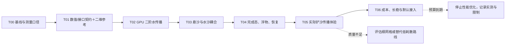

# [已完成] 铲沙真实水波传播执行计划

日期：2026-10-20。角色：execution_plan。主执行者：单主 agent，串行实施。

目标：关闭连通排水后，铲沙产生的真实水面与流速扰动可以向外传播，并在远处保持更清楚、更持久的起伏；现有浮物使用同一水场产生响应。保留水沙账本、湿干、编辑、完成态与恢复契约。第一交付档针对约 1–2 m 波长。

来源：[方案与比较依据](方案.md)、用户对真实水波及竞品比较的要求、[竞品水运动证据](../../docs/competitor/水体运动与回落.md#motion-compare-wave-01水波传播与当前求解器的比较)、[现有状态契约](../../docs/knowledge/water_sand/状态与数据契约.md)。MVP已完成：T00–T06共28/28小目标，按D09接受平床差距、按D06带性能限制交付；见[最终报告](验收/G6_最终交付.md)。

执行约束：按用户补充要求，性能标准放宽为720p短测与尽力目标，性能专项累计最多30分钟，到时停止优化并报告限制。数值正确性、稳定性和恢复要求不降低；详见[C03](契约/C03_验证与成本.md)和[D06](决策记录.md#d06性能放宽与半小时优化上限)。

## 0. 总体进度

| 层级 | 对象 | 状态 | 进度 | 口径 |
|---|---|---|---:|---|
| 总体 | 真实水波 MVP | [已完成] | 28/28 小目标，100% | 按D09/D06带明确限制交付 |
| 大任务 | T00–T06 | [已完成] | 7/7 | 各项有实际验收证据 |
| Gate | G0–G6 | [已完成] | 7/7 | G5按D09；G6性能子项未达，按D06交付 |

动态进度以[执行状态](执行状态.md)为唯一主表；更新状态时同步任务细则小目标，不把旧探针通过折算为新任务完成。

## 1. 文档角色

| 文档 | 角色 | 用途 |
|---|---|---|
| [方案](方案.md) | source / design_proposal | 物理解释、竞品比较、先行量测与路线依据 |
| 总纲、[需求映射](需求映射.md)、[细则](细则/README.md) | execution_plan | 范围、顺序、交付和完成条件 |
| [契约](契约/README.md) | frozen_design_contract | G1已冻结，C01布局诊断细化至v1.2；实现/验收逐Gate区分 |
| [执行状态](执行状态.md) | execution_state | 状态、进度、修改锁、证据 |
| [决策记录](决策记录.md) | planning_decisions | 路线和范围变化 |
| [验收目录](验收/README.md) | verification_plan / evidence | 实际报告、命令和机器产物索引 |

当前技术文档只在实现生效后更新；本计划不将候选描述写入当前技术规格。

## 2. 范围

| 内容 | 分类 | 完成边界 |
|---|---|---|
| 256² / 0.125 m 下 MUSCL＋SSP-RK2 水传播 | MVP | 保守量仍为 h/hu/hv；保静水、非负、湿干与共享边通量 |
| 两阶段悬沙输运及一次侵蚀/材料更新 | MVP | 同阶段水/沙通量与合成权重一致，不重复源项 |
| GPU CFL、实际时钟和完成态 | MVP | 阶段稳定性有依据；中间态不发布，实际推进时间可审计 |
| 当前 main 和三个 test1 统一入口 | MVP | 使用同一数值实现；默认 main 与用户复现入口验实际传播，其余入口验兼容 |
| 铲沙、现有浮物、材质显示 | MVP | 原输入优先；最终通过实际波形/视频与浮物受力验证 |
| 保存恢复、暂停、切场景、关闭 | MVP | 支持的新配置闭环；现行合法来源有明确兼容路径，失败保留旧域 |
| 源码/参数身份、回退方式、真实窗口成本 | MVP | G6按放宽性能目标及30分钟预算评估，可明确带性能限制交付 |
| 独立数值 profile 身份及诊断指标 | MVP | 实际执行值纳入 hash；未知算法 ID 拒绝 |
| 512² 质量档与交错边速度比较器 | placeholder | 仅有进入条件和评估清单，不创建空运行实现 |
| 512² 水沙全链实现、短波频散 | vNext | 需单独扩展网格/恢复/成本或物理契约 |
| GPU 伪波纹、修改重力或时钟伪造传播距离 | out_of_scope | 不满足真实波目标 |
| 竞品业务、全量逆向、新浮物体系、双向船体造浪 | out_of_scope | 不是本次传播问题的必要依赖 |

本 MVP 不承诺 0.5 m 以下密集涟漪。既有网格的 1 m 波约 8 格；二阶改善可能仍不足，必须经过 G5 体验门判断。失败不能以“算法已升级”宣布目标完成。

## 3. 推荐实施路线

1. 固定现有输入、完成时钟和基线；补齐 2 m 波及真实入口的对照。
2. 推导并冻结二阶重构、静水源项、非负限制、阶段 CFL、通量累计和悬沙接口；用全二维 CPU 参考验证，不能以一维示意替代。
3. 接入独立 GPU 候选水核，再接悬沙/侵蚀；保留一阶基线的明确身份用于同条件对照。
4. 接回完成态、浮物与恢复；两阶段只形成一个接受的水子步，不能给消费者多算一次时间。
5. 用真实铲沙、远场波形和浮物证明改善；若有必要，只作可归因的局部显示/工具参数校准。
6. 集中做正确性长稳；性能测量与优化累计最多30分钟。功能/稳定性/兼容通过后可带明确性能限制切换默认，不因性能目标未达延长优化。

主要接入点：[water.gd](../../scripts/simulation/unified_edit/water.gd)、[state.gd](../../scripts/simulation/unified_edit/state.gd)、[coupled.gd](../../scripts/simulation/unified_edit/coupled.gd)、[水通量](../../shaders/simulation/shallow_edge_flux.glsl)、[水更新](../../shaders/simulation/shallow_update_state.glsl)、[悬沙/侵蚀合并核](../../shaders/simulation/erosion/sediment_step.glsl)。现有悬沙核同时承担输运和交换，拆分是本次核心工作。

## 4. 运行模式矩阵

| 模式 | 依赖与输入 | 用途 | 可作何种证据 |
|---|---|---|---|
| 现行生产基线 | 当前 Godot、实际 GPU、一阶核、冻结初态/profile | 对照 | 当前数值、效果、成本 |
| 二维 CPU 参考 | Python/NumPy 或独立 GDScript，完整数值契约 | 推导、精度和负例 | 数学/数值正确性；不能代表 GPU 成本或外观 |
| GPU 候选无源水域 | 主 RenderingDevice、与基线同尺寸初态 | 隔离水传播 | 编译、真实 h/q、阶段 CFL、保幅/相速 |
| GPU 耦合候选 | 悬沙/侵蚀、完整 source hash | 验账本和床面变化 | 水沙一致性与耦合 |
| 实际可见入口 | 默认 main＋用户复现场景、固定镜头、现有浮物 | G5/G6 | 用户效果、生命周期、完整负载成本 |
| 512²/频散 | 本 MVP 未实现 | 延期 | 不接受占位或示意图作验收 |

现有可运行基线命令：`python tools/wave_propagation/run.py flat <新绝对输出目录>`，或 `main`。候选水与耦合runner已实现：`verify.py --suite water/coupling`配合冻结fixture与`--project-root`执行；未实现suite仍明确拒绝。

## 5. 依赖 DAG 与任务



| 任务 | 负责人 | 依赖 | 状态 | 小目标/进度 | 交付 |
|---|---|---|---|---|---|
| [T00](细则/T00_基线与测量.md) | 主 agent | 无 | [已完成] | 4/4，100% | 源码/场景/数据基线、固定测试矩阵 |
| [T01](细则/T01_数值与接口契约.md) | 主 agent | T00/G0 | [已完成] | 4/4，100% | 数学设计、字段/版本契约、完整二维参考 |
| [T02](细则/T02_GPU二阶水传播.md) | 主 agent | T01/G1 | [已完成] | 4/4，100% | GPU 候选和水数值验收 |
| [T03](细则/T03_悬沙与耦合.md) | 主 agent | T02/G2 | [已完成] | 4/4，100% | 阶段悬沙、单次交换、通量账本 |
| [T04](细则/T04_完成态与恢复.md) | 主 agent | T03/G3 | [已完成] | 4/4，100% | 消费者、生命周期、兼容与恢复 |
| [T05](细则/T05_铲沙与浮物体验.md) | 主 agent | T04/G4 | [已完成] | 4/4，100% | main通过；D09接受平床持续差距 |
| [T06](细则/T06_成本与交付.md) | 主 agent | T05/G5 | [已完成] | 4/4，100% | 长稳、默认与文档完成；性能未达已报告 |

## 6. 执行所有权与并发

默认串行，不创建 subagent。水核、state/water/coupled、共享配置和恢复契约同时只有一名修改者。生产基线与候选 GPU 测试串行运行，尤其成本不能并发压 GPU。

若用户之后明确要求并行，G1 后可分配只读证据复核或离线分析；共享 shader/场景/profile/契约仍由主 agent 单写。每个任务的允许修改与禁止范围见细则，开始任务前登记执行状态中的锁。

## 7. Gate 清单

| Gate | 进入条件 | 必须满足 | 不满足时 |
|---|---|---|---|
| G0 基线 | T00 | 精确源码/有效 profile/复现场景、测量定义、不可变对照 | 修复基线，不进入调参 |
| G1 契约 | T01 | 静水与非负设计、阶段 CFL、悬沙/净通量、配置与恢复策略、二维参考通过短负例 | 修订数学与接口，不接正式 GPU |
| G2 水数值 | T02 | 2 m 波两秒保幅≥85%，1 m≥25%；相速和负例达 C03；CPU/GPU 对照 | 定位限制器/边源/CFL，不降低门槛掩盖问题 |
| G3 水沙 | T03 | 各阶段搬沙、恒定浓度、净通量、源汇及一次交换通过 | 不接完整主场景 |
| G4 生命周期 | T04 | 同代完整发布、浮物真实采样、暂停/恢复/关闭/失败回退通过 | 不开展正式效果和成本结论 |
| G5 用户效果 | T05 | 实际铲沙远场幅度和可辨持续时间改善；浮物/截图/连续观察支持 | 回到 T02/T03 定位或记录 E01 进入依据 |
| G6 完整交付 | T06 | 长稳/兼容/默认接线通过；性能按放宽目标记录，专项≤30分钟 | 功能缺陷保留候选；只有性能未达时允许明确带限制交付 |

详细数值、成本和证据口径以 [C03](契约/C03_验证与成本.md) 为准。Gate 通过由证据支持，不要求为日常可逆改动另加人工批准。

## 8. 进入扩展路线的条件

| 分支 | 触发 | 先交付的评估 | 边界 |
|---|---|---|---|
| E01：512² / 0.0625 m 质量档 | G2 通过但 G5 的约 1 m 波体验仍不足，且误差归因为分辨率 | 水沙一致加密原型、1 m 保幅目标≥75%、显存/CFL/实际成本、检查点32 MiB限制评估 | 不只改水纹理或显示细分；需修订网格、探针、碰撞、恢复契约 |
| E02：交错边速度参考 | 后续独立任务需要比较其他数值路线 | 同尺度独立比较器，守恒/湿干/动量/成本对照 | 本次性能不足或预算到期不自动启动；不能直接替换正式核 |
| E03：短波频散 | 目标扩展为密集短涟漪，且网格已能解析 | 有限水深频散误差、湿干转换和权威状态方案 | 新物理模型，不在本 MVP 验收中 |

分支为后续决策点；不因创建此计划自动实施。MVP 未满足用户效果时保留未完成状态，并明确差距。

## 9. 验证与证据计划

短验证按“编译 → 小振幅/静水 → 非平床/湿干 → 悬沙 → 实际铲沙 → 生命周期”推进；每次只变一个主要因素。稳定后集中做五分钟水/沙正确性长稳。性能使用720p、60秒稳定窗口，所有性能专项工作累计≤30分钟，避免无边界重复测量或优化。

原始 GPU 字段、时间戳、日志、视频、源码/profile hash 存 `test_output/wave_propagation/<唯一run_id>/`，完整英文路径；实际报告写[验收](验收/README.md)。不得覆盖旧失败输出。统计用已完成 `actual_dt`，不同源码、相机或 profile 的结果分别标识。

## 10. 文件结构

```text
task/wave_propagation/
  方案.md                 source / design_proposal
  总纲.md                 execution_plan
  需求映射.md
  决策记录.md
  执行状态.md             execution_state
  契约/                   C01 数值、C02 时序兼容、C03 验证成本
  细则/                   T00–T06，各有四个小目标
  验收/README.md          证据规范，实际 Gate 报告执行后生成
```

## 11. 最终交付入口

本次MVP已完成，实际结果、平床与性能差距、兼容边界及完整来源见[最终交付](验收/G6_最终交付.md)、[最终索引](验收/G6_最终索引.json)和[执行状态](执行状态.md)。E01–E03未启动，不计入本次完成。
