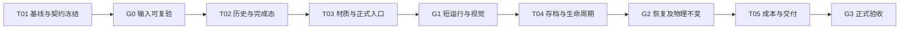

# 上岸湿沙与退水湿痕方案

类型：draft / 待实施方案。适用入口：`scenes/main.tscn`、`scenes/playable/test1_geometry.tscn`。

用户随后将正式接入范围限定为场景2，当前实现及证据见[正式接入记录](正式接入记录.md)和[沙面湿痕技术说明](../../docs/沙面湿痕.md)。以下保留原始两场景规划；三态资源与拟定字段不作为当前已生效契约。

## 目标与推荐方案

让水冲过的沙面及时变深，退水后留下连续湿痕，再按模拟时间逐渐恢复干色。采用 **256×256 独立表面湿润历史 + 完整干湿颜色混合**；接入已有统一 GPU 提交、完成态发布与恢复流程。

物理 `wetness` 继续服务压实、塌落等已有行为；新增表现状态 `surface_wetness` 只供沙面着色。无需增加沙面网格或权威水沙分辨率。

性能优先的接入候选见[低开销方案对比](低开销方案对比.md)：保持相同湿痕公式与 256² 精度，把更新合并到已有成功发布阶段，用一张历史纹理代替下文的三态基线。推荐在 T01 优先验证该候选；它尚未实施或通过 GPU 对照，原三态契约和预算暂作为参考，验证后统一修订再冻结。

## 依据与适配边界

| 依据 | 已知情况 | 对方案的约束 |
|---|---|---|
| [本项目诊断](../wet_sand_diagnosis/诊断结果.md) | 物理湿度和发布链正常；现有颜色权重为 `wetness×0.65`，退水后物理湿度快速降低 | 修复表现响应与残留历史，不把问题归因于采样精度 |
| [竞品取证](../../docs/competitor/湿沙颜色与退水残留.md) | C3：沙色随内部水量 A 混合，约 A≥0.02 已全湿；有效水深为 `max(A−0.05,0)` | 借用“薄水变湿、无可见水仍湿”的阈值关系 |
| 同上 | C3：更新有蒸发项；C0：真实干燥时长未知 | 这里的秒数属于 Godot 候选参数 |
| 同上 | 所选沙材质读取水场，没有独立湿度贴图 | 独立湿痕属于 Godot 适配，不称为原作实现；不向真实水深添加 0.05 偏置 |

竞品来源身份、原始字节、指令与复验方法沿用上述已归档专题。方案没有新增竞品算法结论。

## 预期观感与初始参数

充分接触水时，约 **0.3 秒达到完全湿色**；持续浸润约 0.75 秒后历史饱和。充分浸润后退水，约 18 秒维持全湿，随后约 12 秒逐渐变干，总计 30 秒。短暂掠过的水留下更短、更浅的湿痕。以上均为模拟秒、首轮调参起点。

| 项目 | 初始选择 | 原因 |
|---|---|---|
| 历史网格 | 256²，R32F | 与物理格点对齐；避免慢干燥的小增量在半精度下过早量化 |
| 水接触范围 | 实际水深 1–3 mm 平滑过渡 | 抑制数值残水使整片沙滩常湿；需实景薄水测试校准 |
| 湿色权重 | `smoothstep(0,0.4,M)` | 历史未完全耗尽前允许保持全湿色 |
| 干/湿颜色 | 先保留现有两个颜色端点，允许混合到 100% | 单独观察湿痕改动；现有湿色已接近所需方向 |
| 着色增强 | 首版仅颜色响应 | 当前沙材质禁用镜面；高光与法线变化另行评估 |

详细公式、边界和字段见[表面湿润契约](契约/表面湿润_v1.md)。

## 范围

| 类别 | 内容 |
|---|---|
| MVP | 两个正式场景的快速变湿、退水残留、重复打湿、自然干燥；冻结/暂停/恢复；挖堆沙后的表面重置；独立开关；参数窗口；新存档与已知旧存档迁移；成本验证 |
| placeholder | 无：不以占位纹理或空存档字段宣称接入完成 |
| vNext | 湿沙细颗粒压暗、粗糙度/镜面模型、风/日照控制干燥、分层含水与搬运湿沙 |
| out_of_scope | 改水量或蒸发物理、改塌落/压实、提高模拟/网格分辨率、重建竞品全部算法、调整水/泡沫整体美术 |

## 需求映射

| ID | 需求 | 任务 | 验证 |
|---|---|---|---|
| R1 | 水冲上岸，沙色有可辨变化 | T02、T03 | V1、V2 |
| R2 | 退水后留痕，随后变干 | T02、T03 | V1、V3 |
| R3 | 编辑、暂停、失败提交与恢复不产生错位 | T02、T04 | V4、V5 |
| R4 | 水沙模拟和账本保持原语义 | T01、T02、T04 | V6 |
| R5 | 两个正式入口、参数、存档一致 | T03、T04 | V2、V5、V7 |
| R6 | 成本可测、可关闭、证据可复验 | T05 | V8、V9 |

## 契约与接入位置

本任务是本地 RenderingDevice 扩展，无 HTTP 路由或 OpenAPI。核心字段、输入/输出、错误、存储及模式矩阵见[契约](契约/表面湿润_v1.md)。沿用[统一编辑流程契约](../sandcastle_unified_edit_pipeline/契约/主流程与扩展契约.md)与[配置存档契约](../sandcastle_unified_edit_pipeline/契约/配置与存档_v1.md)的现有约束。

| 区域 | 预期改动 |
|---|---|
| `scripts/simulation/unified_edit/visuals.gd`、`visual_finish.glsl`、`visual_publish.glsl`、`visual_edit_finish.glsl` | 新历史资源、候选提交、发布和编辑刷新；消除对泡沫/碎石开关的依赖 |
| 新 `scripts/simulation/unified_edit/surface_wetness.gd`、新 `shaders/simulation/visual_wetness_step.glsl` | profile 校验、初始化、湿润/干燥与表面更新逻辑 |
| `views.gd`、`scripts/beach/unified_playable_entry.gd`、`configuration.gd` | 只读表现输入、启动配置、来源 hash；沿用统一生命周期 |
| `assets/water_material_natural_candidate/async_rdc_bed.gdshader`、两个正式 presentation 场景及 manifest | 读取新完成态纹理，使用完整干湿混合；固化默认资源和绑定 |
| `assets/parameters/catalog.json`、参数 schema/service 与窗口生成器 | 在已有沙参数中加入必要调节项，区分实时着色参数与重启生效的历史参数 |
| checkpoint codec/router/capture、restore verifier 与已知来源注册 | 新格式读写、旧格式受控迁移、恢复前验证 |
| 当前方案/规格/参数说明及相应生成器 | 实现完成后替换已失效技术描述；不提前写成已实现 |

## 执行顺序与 Gate

默认单主执行者串行推进，所有共享 shader、profile、场景只有一名修改者；本方案不安排并行 agent。各 Gate 是证据检查点，不是重复请求用户许可。

| Gate | 放行条件 |
|---|---|
| G0 | 当前源码/配置与已有诊断差异已核对；完成态时序、旧存档来源边界、profile 字段已冻结 |
| G1 | 新 shader 编译与两个入口短运行通过；干→湿→退水序列可读；关闭其他视觉效果仍有湿痕 |
| G2 | 新格式精确恢复；已知 v6 迁移与负例通过；模拟时间一致；权威物理字段和账本对照一致 |
| G3 | 代表性完整负载下成本符合预算；连续观察无漂移/闪烁；文档、hash、正式资源一致 |

## 成本预算

提交态、候选态、只读发布态各一张 256² R32F，**新增纹理原始数据约 0.75 MiB**；这不是驱动实际显存测量值。存档只保存提交态，约增加 256 KiB 原始数据及少量元数据。

每次完成的模拟 tick 增加一轮 256² 更新；提交和发布尽量并入现有 pass。沙面增加一次双线性采样，物理湿度仍保留给已有物理与其他消费者。不进行每帧 CPU 回读或创建纹理。

初始预算：既有 GTX 1050、D3D12、1280×720 可见完整场景中，GPU 总帧时间中位增量不超过 0.3 ms；实时帧时间中位与 p95、模拟吞吐退化均不超过 3%。这是待测门槛，不能当作已测成本；噪声覆盖门槛时结果记为不确定并延长同一轮取样。超过预算先定位新增更新、发布或着色的贡献。

## 文件结构、进度与下一步

- 本文件：目标、范围、取舍与任务依赖。
- [契约/表面湿润_v1.md](契约/表面湿润_v1.md)：拟实现的技术边界，冻结前为 draft。
- [细则/实施与验证.md](细则/实施与验证.md)：每个任务的修改范围、交付物与验收。
- [执行状态.md](执行状态.md)：总体、任务和小目标进度；当前实现 **[未开始] 0%**。
- [验收/README.md](验收/README.md)：证据目录与封存要求；当前没有本方案的执行验收。

下一步从 T01 开始：封存两个正式入口的当前基线，确认 tick/编辑成功分支，再冻结契约并进入 T02。既有诊断和竞品取证是输入，不折算成本次实施完成度。
